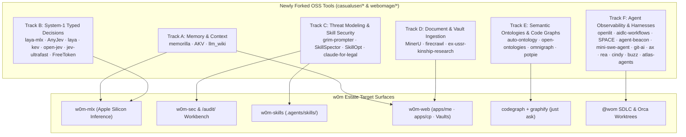

# Newly Forked `casualuser/*` & `webomage/*` Tools — Research & Estate Integration Backlog

**Date:** 2026-11-08  
**Tickets:** [[T673]], [[T672]]  
**Scope:** 33 newly forked open-source tools across `github.com/casualuser/*` (31 forks, `2026-10-16` -> `2026-11-06`) and `github.com/webomage/*` (`memorilla`, `laya-mlx`), mapped onto the 7 `w0m` estate repositories (`w0m-web`, `w0m-api`, `w0m-cf`, `w0m-ext`, `w0m-sec`, `w0m-skills`, `w0m-mlx`).

---

## 1. Architecture & Integration Topology

---

## 2. Complete Inventory of Newly Forked Repositories (`2026-10-16` – `2026-11-08`)

### Track A — Latent Semantic Memory, KV Cache Engineering & Persistent Wikis

| Fork Repository | Upstream Source | Forked At | Core Capability | Target `w0m` Surface & Integration Plan (`T673` AC3 / AC4) |
| :--- | :--- | :--- | :--- | :--- |
| **`webomage/memorilla`** | `snap-stanford/memorilla` | `2026-11-08` | Latent semantic memory compression and retrieval for LLMs | Integrate into `w0m-mlx` and `semantic-vault-mcp` so multi-session agent handoffs retain compressed latent memory alongside `STATE.md` and `LESSONS.md`. |
| **`casualuser/AKV`** | `thu-nics/AKV` | `2026-10-25` | Cache Engineering for Agents (KV cache reuse across multi-turn agent tool loops) | Apply KV-prefix ordering invariants to `.mcp.json` tool schemas and `w0m-mlx` / `omlx` prompt templates so prefix cache hit rates exceed `90%`. |
| **`casualuser/llm_wiki`** | `nashsu/llm_wiki` | `2026-10-31` | Karpathy-inspired incremental, persistent Markdown wiki builder | Pair with `wiki-fold` / `wiki-ingest` skills in `w0m-skills` to auto-maintain project knowledge vaults (`T634`) without full-corpus re-indexing. |

### Track B — System-1 Calibrated Typed-Decision Engines (`JEV` / `Laya`) & Local Serving

| Fork Repository | Upstream Source | Forked At | Core Capability | Target `w0m` Surface & Integration Plan (`T673` AC3) |
| :--- | :--- | :--- | :--- | :--- |
| **`webomage/laya-mlx`** | `mizorewww/laya-mlx` | `2026-10-28` | Apple Silicon MLX port of Laya (System-1 calibrated typed decisions in milliseconds) | Native fit for `w0m-mlx`: expose a `<25ms` `/v1/decide` endpoint on local Apple Silicon for deterministic ticket triage, hat routing, and severity classification. |
| **`casualuser/AnyJev`** | `nokia-applied-research/AnyJev` | `2026-10-28` | Calibrated typed decision engine with uncertainty quantification | Use AnyJev calibration scores to gate autonomous vs human-in-the-loop escalations in `w0m-cf` agents and SDLC review gates. |
| **`casualuser/laya`** | `NandhaKishorM/laya` | `2026-10-28` | System-1 calibrated typed decisions in milliseconds | Reference Python/Rust schema contract for `laya-mlx`. |
| **`casualuser/kev`** | `jaredpalmer/kev` | `2026-10-28` | Lightweight TypeScript/Node typed-decision & key-value evaluation primitive | Embed in `@webomage/lib` for edge-compatible (`workerd`) fast classification without full LLM round-trips. |
| **`casualuser/open-jev`** | `nico-martin/open-jev` | `2026-10-28` | Open specification and runtime for JEV (JSON/Typed Evaluation) | Standardize JSON decision payloads across `w0m-cf` and `w0m-api` edge functions. |
| **`casualuser/jev-ultrafast`** | `browser-use/jev-ultrafast` | `2026-10-28` | Browser-action & DOM-state ultrafast decision classifier | Wire into `w0m-ext` and Playwright E2E self-healing selectors for instant DOM action routing. |
| **`casualuser/freetoken`** | `FlashML-org/FreeToken` | `2026-10-31` | Run datacenter-scale models locally on desktop hardware | Benchmark alongside `omlx` (`0.6.4`) and `w0m-mlx` for heavy offline code-review and spec-verification passes. |

### Track C — Threat Modeling, Skill Security Auditing & Legal Workflows

| Fork Repository | Upstream Source | Forked At | Core Capability | Target `w0m` Surface & Integration Plan (`T673` AC2 / AC4) |
| :--- | :--- | :--- | :--- | :--- |
| **`casualuser/grim-prompter`** | `jmanico/grim-prompter` | `2026-10-31` | Evidence-traced threat modeling for AI coding agents across 36 architectures & 29 methods | **High-priority product win**: Port the 36-architecture / 29-method taxonomy into `/audit/` (`SecurityAuditReportViewer.svelte` & `ComplianceAuditCatalogExplorer.svelte`) and `w0m-sec` so client security audits emit evidence-traced threat models. |
| **`casualuser/SkillSpector`** | `NVIDIA/SkillSpector` | `2026-10-17` | Static & semantic security auditor for Agent Skills (`SKILL.md`, scripts, hooks) | Wire into `just skills-sync` and `just check-security` to verify that all governed skills in `w0m-skills` are free of prompt-injection, exfiltration, or unsafe shell patterns. |
| **`casualuser/SkillOpt`** | `microsoft/SkillOpt` | `2026-10-16` | Automated prompt & trigger optimization for agent skills | Already installed in `pyproject.toml` (`skillopt 0.2.0`); add a `just skills-optimize` recipe to benchmark trigger precision across `.w0m/skills.json`. |
| **`casualuser/claude-for-legal`** | `anthropics/claude-for-legal` | `2026-10-29` | Legal workflow plugins for NDA, MSA, DPA, and compliance clause review | Adapt into a governed `legal-review` skill and CP Contract / Compliance packet checker (`T282`, `T644`). |
| **`casualuser/ex-ussr-kinship-research`** | `DenisSergeevitch/ex-ussr-kinship-research` | `2026-11-03` | Evidence-first archival research skill with strict provenance & citation ledgers | Extract its provenance-ledger and anti-hallucination citation rules into `fact-checker` and `autoresearch` skills. |

### Track D — High-Precision Document Extraction & Web Scraping

| Fork Repository | Upstream Source | Forked At | Core Capability | Target `w0m` Surface & Integration Plan (`T673` AC4) |
| :--- | :--- | :--- | :--- | :--- |
| **`casualuser/mineru`** | `opendatalab/MinerU` | `2026-11-04` | High-precision PDF/Office/academic document converter into LLM-ready Markdown + JSON | Wire into **Resume Studio** (`me.webomage.com` PDF CV import) and **Client Vault Sources** (`T634` PDF spec/contract ingestion) so tables, multi-column layouts, and formulas extract cleanly. |
| **`casualuser/firecrawl`** | `firecrawl/firecrawl` | `2026-10-28` | Web-to-Markdown crawler and structured extractor for AI agents | Already integrated as a skill (`firecrawl`); connect self-hosted/edge extraction fallback to `webnames-crawler` in `w0m-cf`. |

### Track E — Semantic Ontologies & Code Graph Intelligence

| Fork Repository | Upstream Source | Forked At | Core Capability | Target `w0m` Surface & Integration Plan (`T673` AC5) |
| :--- | :--- | :--- | :--- | :--- |
| **`casualuser/auto-ontology`** | `NVIDIA/auto-ontology` | `2026-11-03` | Semantic graph-based reasoning layers with deterministic query generation from natural language | Layer onto `codegraph` + `graphify` (`just ask`) to translate natural-language architecture queries into deterministic graph traversals. |
| **`casualuser/open-ontologies`** | `fabio-rovai/open-ontologies` | `2026-10-22` | AI-driven RDF/OWL ontology engine with SPARQL + SHACL validation | Use SHACL-style structural constraints to validate `project/policies/*.json` and cross-repo entity relationships (`repos`, `projects`, `hats`, `tickets`). |
| **`casualuser/omnigraph`** | `ModernRelay/omnigraph` | `2026-10-21` | Unified knowledge graph builder & entity resolution | Evaluate entity-deduplication heuristics for merging `codegraph` AST symbols with `graphify` semantic concepts. |
| **`casualuser/potpie`** | `potpie-ai/potpie` | `2026-10-26` | Codebase-specific custom agent generator backed by AST/call graphs | Reference its pre-built codebase prompt templates (`debugging`, `blast-radius`, `test-gen`) for `.w0m/sdlc.json` gate prompts. |

### Track F — Agent Observability, Sandboxes & Multi-Agent Harnesses

| Fork Repository | Upstream Source | Forked At | Core Capability | Target `w0m` Surface & Integration Plan (`T673` AC6) |
| :--- | :--- | :--- | :--- | :--- |
| **`casualuser/openlit`** | `openlit/openlit` | `2026-11-05` | OpenTelemetry-native agent harness tracing, cost accounting, evaluations, and guardrails | Emit OpenLIT semantic conventions (`gen_ai.*` OTLP attributes) from `w0m-cf`, `w0m-api`, and MCP servers into our Tinybird / OTLP observability pipeline (`T658`). |
| **`casualuser/aidlc-workflows`** | `awslabs/aidlc-workflows` | `2026-11-06` | AWS AI-Driven Life Cycle (AI-DLC) adaptive workflow steering rules | Cross-reference AI-DLC's adaptive Inception -> Construction -> Operations stage gates with our `w0m-sdlc-*` lifecycle (`.w0m/sdlc.json`) to add complexity-based fast-paths. |
| **`casualuser/space`** | `perplexityai/SPACE` | `2026-11-04` | Sandboxed Platform for Agentic Code Execution | Evaluate alongside Tart VMs (`T180`–`T181`) and Cloudflare Sandboxes for isolated tool/code execution in `w0m-cf`. |
| **`casualuser/agent-beacon`** | `Asymptote-Labs/agent-beacon` | `2026-10-23` | Lightweight live status & heartbeat beacon for background coding agents | Surface live agent-tree progress (`just agent-tree`) and Orca worker heartbeats inside the CP Admin / Orca monitor bar (`T638`). |
| **`casualuser/mini-swe-agent`** | `SWE-agent/mini-swe-agent` | `2026-10-23` | 100-line minimal autonomous SWE agent using pure bash tool execution | Benchmark as an ultra-lightweight worker harness for automated lint/typecheck/test-fix loops inside `agent-tree` worktrees. |
| **`casualuser/git-ai`** | `feder-cr/git-ai` | `2026-10-22` | Git provenance and AI-assisted change tracking without polluting commit trailers | Inspect local provenance metadata patterns that respect our strict no-`Co-Authored-By` trailer rule while tracking per-ticket agent metrics. |
| **`casualuser/ax`** | `google/ax` | `2026-10-19` | Google Ax DSPy-style TypeScript LLM framework | Evaluate typed signature compilation for Hono/Cloudflare Workers AI endpoints in `w0m-cf`. |
| **`casualuser/rea`** | `morluto/rea` | `2026-10-18` | Reactive agent execution runtime | Reference reactive event-stream patterns for `w0m-cf` Durable Object agents. |
| **`casualuser/cindy`** | `makecindy/cindy` | `2026-10-24` | Automated issue-to-PR resolution workflow | Compare with our GitHub Feature Voting Board -> Agent Spec pipeline (`T584`, `T588`). |
| **`casualuser/buzz`** | `block/buzz` | `2026-10-16` | Block's workspace agent automation & notification patterns | Reference Slack/Telegram triage notification formatting for `/api/bug-report`. |
| **`casualuser/atlas-agents`** | `agulli/atlas-agents` | `2026-10-27` | Multi-agent orchestration patterns and role topologies | Reference role-handoff patterns for our 4-axis RBAC + Hat routing system (`T347`). |

---

## 3. Ranked Priority Matrix (Weighted Decision Convergence)

| Priority | Track | Lead Repositories | Effort | Impact | Target Ticket / Milestone |
| :---: | :--- | :--- | :---: | :---: | :--- |
| **1** | **Threat Modeling & Skill Security** | `jmanico/grim-prompter`, `NVIDIA/SkillSpector`, `microsoft/SkillOpt` | S–M | **Very High** | **[[T673]] AC2** — Directly enriches `/audit/` client deliverables (36 architectures, 29 threat methods) and secures `.agents/skills/`. |
| **2** | **System-1 Calibrated Typed Decisions & Latent Memory on `w0m-mlx`** | `webomage/laya-mlx`, `webomage/memorilla`, `nokia-applied-research/AnyJev`, `jaredpalmer/kev` | M | **Very High** | **[[T673]] AC3** — Gives `w0m-mlx` sub-50ms calibrated classification + compressed latent memory across sessions. |
| **3** | **Document Extraction & Incremental Vault Compaction** | `opendatalab/MinerU`, `nashsu/llm_wiki`, `anthropics/claude-for-legal` | M | **High** | **[[T673]] AC4** — Upgrades PDF CV parsing on `me.webomage.com` and client vault document ingestion (`T634`). |
| **4** | **Ontology-Grounded Code & Knowledge Graph Queries** | `NVIDIA/auto-ontology`, `fabio-rovai/open-ontologies`, `potpie-ai/potpie` | M | **High** | **[[T673]] AC5** — Makes `just ask` / `just graph-query` translate natural language into deterministic graph traversals. |
| **5** | **OTEL Agent Tracing & Adaptive SDLC Steering** | `openlit/openlit`, `awslabs/aidlc-workflows`, `Asymptote-Labs/agent-beacon` | S–M | **Medium-High** | **[[T673]] AC6** — Standardizes `gen_ai.*` OTLP spans into Tinybird and adds live agent-tree status beacons. |
| **6** | **Fork Governance & `webomage/<repo>` Canonical Mirroring** | All 31 `casualuser/*` forks | XS | **High (Hygiene)** | **[[T673]] AC1** — Ensures any fork receiving upstream PRs is mirrored under `github.com/webomage/<repo>` per estate rules. |
