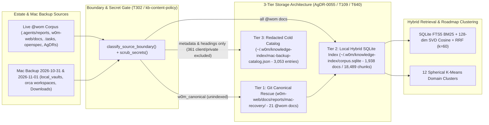
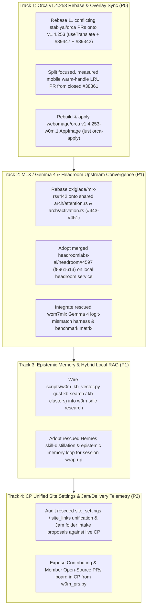

# Orca `v1.4.253` Upstream PR Audit, Mac Backup Research Rescue & Hybrid Vectorized Roadmap (`T674`)

- **Ticket:** [[T674]]
- **Date:** `2026-11-08`
- **Decisions:** [[AgDR-0055]] · [[AgDR-0058]]
- **Related Tickets:** [[T109]] · [[T302]] · [[T640]] · [[T662]] · [[T665]]

---

## 1. Executive Summary

1. **Upstream `stablyai/orca` (`v1.4.253`, `+379` commits since `be3b87f3ac6`)**:
   - Upstream shipped a repository-wide `useTranslate()` i18n sweep (`#39366`..`#39744`), non-Windows synchronous DOM refresh gating (`#39462`), WebGL atlas page bounds & cleanup (`#39715`), startup parking of gone plain-shell tabs (`#39725`), Claude Code theme sync (`#39447`), folder workspace CLI RPCs (`#39670`), native chat PR CI status (`#39020`), and mobile durable draft/offline send queues (`#39342`, `#39423`).
2. **External PR Portfolio Audit (`36` Open + `2` State Transitions on `2026-11-08`)**:
   - **Merged Today (`2026-11-08T02:40:09Z`)**: `headroomlabs-ai/headroom#4597` (`feat(proxy): unified multi-upstream routing for Anthropic Cloud and local oMLX`, commit `f8961613`).
   - **Closed Today (`2026-11-08T02:10:06Z`) by `@OrcaWin`**: `stablyai/orca#38861` (`perf/terminal-chat-redraw-and-tab-caching`) — maintainer noted non-Windows DOM redraw gating is covered by `#39462`, declined halving desktop hot-retain caps (`4->2`, `6->3`), and invited a narrower measured PR on current `main`.
   - **Maintainer Review on `oxiglade/mlx-rs#442`**: `@dcvz` requested rebasing onto `upstream/main` (`#443`–`#451`) to use shared `arch/attention.rs` & `arch/activation.rs` helpers.
   - **Mergeable vs Conflicting `stablyai/orca` PRs**: `10` open Orca PRs remain `MERGEABLE`; `11` open Orca PRs are `CONFLICTING` primarily due to the `useTranslate()` sweep (`#39366`..`#39744`), `#39447` Claude theme sync (`#38859`), and `#39342`/`#39423` mobile offline composer queue (`#37031`).
3. **3-Tier Knowledge Storage, Mac Backup Rescue & Hybrid Vectorization (`scripts/w0m_kb_vector.py`)**:
   - **Tier 1 (Git Canonical `@wom` Corpus)**: Rescued `21` unindexed `@wom`-scoped architectural proposals, audits, and `wom7mlx` Rust vs Python Gemma 4 benchmark matrices from `mac_backup_2026-10-31` into `w0m-web/docs/reports/mac-recovery/` with `0` client/personal leaks (`361` client/personal items excluded per `T302`).
   - **Tier 2 (`~/.w0m/knowledge-index/corpus.sqlite`)**: Indexed `1,938` canonical `@wom` documents (`18,489` contextual chunks) with SQLite FTS5 BM25 + `128`-dim `numpy` Randomized SVD dense unit vectors + Reciprocal Rank Fusion (`RRF`, `k=60`) and `12` spherical k-means domain clusters (`$0` cloud cost, `0 MB` added to Supabase `500 MB` cap per `AgDR-0055`).
   - **Tier 3 (`~/.w0m/knowledge-index/mac-backup-catalog.json`)**: Cataloged `3,053` Mac backup archive members with boundary classification (`w0m_canonical`, `self_product`, `client_confidential`, `personal_private`), SHA-256 digests, and headings.

---

## 2. Architecture: 3-Tier Knowledge Storage & Hybrid Vectorization Pipeline

---

## 3. Upstream `stablyai/orca` (`v1.4.253`) & `w0m-pr` Portfolio Audit

### 3.1 Major Upstream `stablyai/orca` Changes (`be3b87f3ac6..965540a7bbc`, `379` commits)

| Upstream PR / Commit | Area | Summary | Impact on `w0m` PRs & Overlay |
| :--- | :--- | :--- | :--- |
| `#39366`..`#39744` | Renderer i18n | Migrated sidebar, right sidebar, settings, terminal pane, tab bar, status bar, browser, plugins, skills, PR page, and editor to `useTranslate()` | Primary conflict driver across `11` open Orca PRs; mechanical rebase wrapping UI strings in `t(...)` |
| `#39462` | Terminal DOM Refresh | Gates synchronous `_core.refresh(start, end, true)` in `bindWritePtyOutputToXterm` to Windows clients only (`599 -> 298` paints) | Supersedes the desktop foreground redraw gate inside closed `#38861` |
| `#39715` (`6a68dac421f`) | WebGL Texture Atlas | Caps merged WebGL atlas pages at `FORCED_MAX_TEXTURE_SIZE`, fixes link layer 2048 bounds, and resets removed GL texture slots | Complements our `#38857` (`fix/webgl-atlas-version-desync-recovery`, still `MERGEABLE`) |
| `#39725` (`fb313c4745b`) | Startup Tab Parking | Parks restored plain-shell tabs whose daemon session is gone (`pty:getGoneSessionIds`) and respawns on open | Aligns with `@OrcaWin`'s preference to keep active warm tabs (`4`/`6`) while parking gone tabs |
| `#39447` (`2ec81bc2ca0`) | Claude Code Theme Sync | Syncs Orca's terminal theme into Claude Code (`2.1.119+`) in `terminal-appearance.ts` / `terminal-app-theme.ts` | Conflicts with `#38859` (`fix/mobile-terminal-theme-enforcement`); rebase onto new theme sync helper |
| `#39342` & `#39423` | Mobile Offline Chat Queue | Persists durable chat drafts, image attachments, and offline send queue across app kills | Conflicts with `#37031` (`feat/mobile-camera-capture-chat`) in `MobileNativeChatComposer.tsx` |
| `#39670` & `#39637` | Folder CLI RPCs | `orca worktree set/rm` supports `folder:<id>`, `path:`, and `name:` with `requireUniqueId` | Compatible with `#37510` (`feat/nested-subfolder-git-and-sdlc-repo`, still `MERGEABLE`) |
| `#39020` (`fd334f1e99a`) | Native Chat PR CI | `pr-watch` service displays GitHub CI check status lines inside the chat that opened/pushed to a PR | Cleanly complements `w0m-prs` workflow |

### 3.2 Actionable Upstream PR Remediation Matrix

| PR | Branch | Status | Maintainer / CI Signal | Next Action |
| :--- | :--- | :--- | :--- | :--- |
| `headroomlabs-ai/headroom#4597` | `feat/omlx-proxy-routing` | **MERGED** (`2026-11-08`) | Merged upstream as `f8961613` | Retired from `ACTIVE_OPEN_PR_HEAD_BRANCHES` in `scripts/w0m_prs.py` (`T674` AC1) |
| `stablyai/orca#38861` | `perf/terminal-chat-redraw-and-tab-caching` | **CLOSED** (`2026-11-08`) | `@OrcaWin`: covered by `#39462`; keep desktop hot-retain caps `4`/`6`; narrower measured PR welcome | Retired from `ACTIVE_OPEN_PR_HEAD_BRANCHES` (`T674` AC1); split mobile `use-warm-terminal-handles.ts` LRU with benchmark |
| `oxiglade/mlx-rs#442` | `feat/mlx-lm-gemma4-arch` | **OPEN** (`MERGEABLE`) | `@dcvz`: adapt to shared `arch/attention.rs` & `arch/activation.rs` helpers (`#443`–`#451`) | Rebase onto `upstream/main` and refactor Gemma 4 attention/activations to shared `arch/` helpers |
| `openai/tart-guest-agent#62` | `feat/media-clipboard-and-file-transfer` | **OPEN** (`MERGEABLE`) | `@sylvesterkaczmarek`: prior fixes (`f8198c4`..`3a09dd1`) verified | Ready for maintainer merge |
| `stablyai/orca` (`10` PRs) | `#16597`, `#21157`, `#37030`, `#37032`, `#37035`, `#37510`, `#37511`, `#38612`, `#38857`, `#38987` | **OPEN** (`MERGEABLE`) | Clean against `upstream/main@965540a7bbc` (`v1.4.253`) | Keep green; no rebase needed |
| `stablyai/orca` (`11` PRs) | `#21148`, `#37029`, `#37031`, `#37033`, `#37995`, `#38858`, `#38859`, `#38863`, `#38991`, `#38993`, `#38995` | **OPEN** (`CONFLICTING`) | Conflicting after `useTranslate()` sweep (`#39366`..`#39744`), `#39447`, and `#39342`/`#39423` | Rebase onto `v1.4.253` and bump `webomage/orca` overlay (`just orca-apply`) |

---

## 4. Vectorized Corpus Clustering & Potential Roadmap Synthesis

Running `just kb-index && just kb-clusters` over the `1,938` canonical documents (`18,489` chunks) surfaced `12` domain clusters and `4` high-ROI roadmap tracks combining live estate state with rescued Mac backup research:

### Prioritized Roadmap Table (Grounded in Rescued Research & Live State)

| Priority | Proposed Epic / Ticket Scope | Source Research / Evidence | Target Repos |
| :--- | :--- | :--- | :--- |
| **P0** | **Orca `v1.4.253` PR Rebase Wave (`11` PRs) + `v1.4.253-w0m.1` Overlay Bump** | `stablyai/orca` `be3b87f3ac6..965540a7bbc` (`useTranslate` sweep, `#39447`, `#39342`, `#39462`) | `w0m-pr/orca`, `tooling` |
| **P0** | **Focused Mobile Warm-Terminal-Handles LRU PR (Replacing Closed `#38861`)** | `@OrcaWin` review on `#38861` (`2026-11-08`): keep desktop caps `4`/`6`, submit measured single-concern mobile PR | `w0m-pr/orca` |
| **P1** | **Rebase `oxiglade/mlx-rs#442` onto Shared `arch/` Helpers (`#443`–`#451`)** | `@dcvz` review on `#442` + rescued `wom7mlx-gemma4-BENCHMARK_REPORT.md` & `wom7mlx-gemma4-implementation_plan.md` | `w0m-pr/mlx-rs`, `w0m-mlx` |
| **P1** | **Integrate Local Hybrid BM25+LSA Vector Search (`just kb-search`) into `w0m-sdlc-research`** | `T674` `scripts/w0m_kb_vector.py` (`1,938` docs, `18,489` chunks, `128`-dim SVD + FTS5 RRF) + `T109` / `T640` | `tooling`, `w0m-skills` |
| **P1** | **Hermes-Style Epistemic Memory & Skill Distillation in `lessons-harvest`** | Rescued `2026-09-02-proposal-hermes-learning-loop-for-w0m-zeroclaw.md` + `2026-09-02-research-honcho-memory-and-zeroclaw-honcho-plan.md` | `tooling`, `w0m-skills` |
| **P2** | **CP Contributing & Member Open-Source PRs Inventory View** | Rescued `2026-09-25-contributing-and-member-projects-prs-inventory-cp.md` + `scripts/w0m_prs.py` | `w0m-web`, `tooling` |
| **P2** | **Cross-Portal `site_settings` Read-Path & Jam Folder Intake Audit** | Rescued `2026-09-24-site-settings-and-background-animation-read-path-audit.md` + `2026-09-12-jam-dev-integration-and-w0m-control.md` | `w0m-web`, `w0m-api` |
