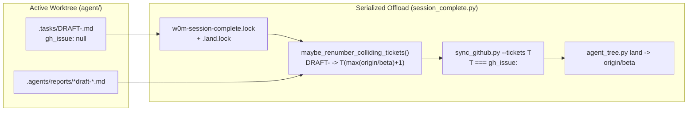

# T678 — Deferred Worktree Ticket ID Allocation (`DRAFT-<slug>` → `T<N>`), GitHub Issue `#669`–`#677` 1:1 Reconciliation, Orca-Inspired Project Repo/Tracker/Milestone Setup & Overview Completion Dashboard

- **Ticket:** [[T678]]
- **Date:** 2026-11-08
- **Area:** SDLC Tooling & Control Plane (`w0m-web/apps/cp`, `w0m-api`, `scripts/`)

## 1. Root Cause & Triangulated Architecture Analysis

1. **Why Parallel Worktrees Collided or Left Gaps (`T669`–`T677`):**
   - Previously, `scripts/ticket_new.py` allocated a numerical `T<N>` at the start of work in an isolated worktree. When multiple agents worked concurrently and finished out of order or created follow-up tickets mid-session, early finishers renumbered or left gaps (`T669`, `T670`), causing `webomage/wom7board` GitHub Issue numbers (`#669`–`#675`) to drift from `.tasks/T671.md`–`T677.md`.
   - **Fix (`AC1` & `AC2`):** Worktrees now use `DRAFT-<slug>` (`.tasks/DRAFT-<slug>.md`) during active coding and testing. Only inside the serialized offload critical section (`session_complete_lock` in `scripts/session_complete.py`) is `DRAFT-<slug>` promoted to `T<max(origin/beta)+1>` and synced `1:1` to GitHub (`T<N> === gh_issue: <N>`). Additionally, `.tasks/T669.md` and `.tasks/T670.md` were backfilled and `.tasks/T669.md`–`T677.md` were reconciled `1:1` with GitHub Issues `#669`–`#677` on `webomage/wom7board`.
2. **Why Sidebar `> OVERVIEW` Was Collapsed & Why the Completion Dashboard Was Duplicated (`AC3`):**
   - In `w0m-web/apps/cp/src/lib/context/nav.ts`, `NAV.org` did not set `defaultOpen: true` on `Overview`, so `SideNav.svelte` (`s.defaultOpen || s.items.some(...)`) collapsed `> OVERVIEW` whenever viewing `/o/webomage/projects/milestones`.
   - `<ProjectVaultTelemetry>` (the Completion & Phased Delivery Roadmap Dashboard) was mounted on both `milestones.astro` routes (`projects/milestones.astro` and `p/[project]/milestones.astro`) while missing from `/o/[org]/index.astro`. Moving `<ProjectVaultTelemetry>` onto `/o/[org]/index.astro` (alongside `<MyProjectHats>` and `<DualManagerGovernanceCard>`) and removing it from both `milestones.astro` routes ensures the Completion Dashboard appears once on Overview while Milestones focuses on milestone management.
3. **How Projects Connect Repositories, Ticket Systems & Milestones (`AC4`, Orca-Inspired):**
   - Inspired by Orca's multi-repo + issue tracker connection model (`repoIssueProvider.ts`, `githubIssues.ts`), `w0m-web/apps/cp/src/lib/project-telemetry.ts`, `ProjectVaultTelemetry.svelte`, `MilestoneManager.svelte`, and `ProjectManager.svelte` now support:
     - Multi-repository links (`public.project_repos`: primary repo, branch, monorepo subpath, GitHub/GitLab URL)
     - Task tracker connection (`projects.metadata.task_tracker`: `github` | `w0m_sdlc` | `gitlab` | `linear` | `jira`, tracker repo `owner/repo`, GitHub Projects v2 board, `milestone_source`: `hybrid` | `client_contract` | `quest_tracks`, and `ticket_id_allocation`: `deferred_on_offload` | `immediate_gh_issue`)
     - Hybrid milestone synthesis from `projects.metadata.quest_tracks` + `public.client_milestones`, resolving the `0% / 0 milestones` blank state on `w0m Platform` (`00000000-0000-0000-0000-000000000020`).

## 2. Verification Summary

- `python3 scripts/tests/test_session_complete.py` (`17/17` passed, including `test_deferred_draft_ticket_allocation_and_promotion_on_offload`)
- `npx vitest run src/lib/__tests__/project-telemetry.test.ts src/lib/context/__tests__/nav.test.ts src/lib/client/__tests__/shared-pages.test.ts` (`6` test files, `148/148` tests passed)
- `pytest w0m-web/project/scripts/tests/test_client_page_tenancy.py` (`43/43` passed)
- `python3 w0m-web/project/scripts/ds_conformance.py --enforce` (`OK`, native `<select>` count `58` vs baseline `59`, `-1`)
- `python3 w0m-web/project/scripts/ui_ticket_leak_check.py` (`OK`, `0` leaks across `386` UI files)
