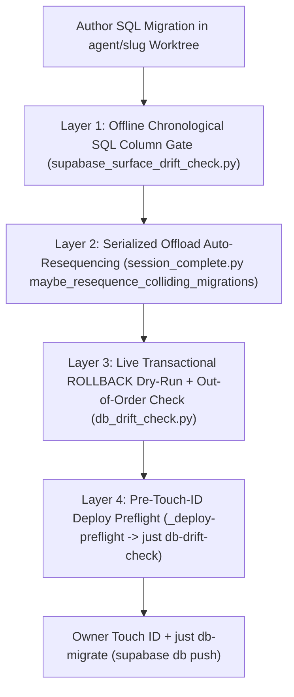

# Migration Conflict & Schema Drift Guard Audit (`T681`)

- **Ticket:** `T681` (resolving failed release `2026.11.08-1794149333` from `T675` / `T678`)
- **Date:** `2026-11-08`
- **Repos:** `w0m-api`, `w0m-web`, `@wom`

## 1. Root-Cause Diagnosis of Failed Release `2026.11.08-1794149333`

Inspection of `/home/aleksei/Projects/!self/w0m/deploy-logs/run-2026.11.08-1794149333.log` and `/home/aleksei/Projects/!self/w0m/deploy-logs/deploy-audit-latest.json` showed that `just deploy-all` passed `_deploy-preflight`, Touch ID confirmation, and `check-guardrails`, then failed at `just db-migrate`:

```text
Applying migration 20261108063000_t675_project_role_templates_and_naming.sql...
ERROR: column "min_unit_id" of relation "role_templates" does not exist (SQLSTATE 42703)
At statement: 0
```

Why did this slip past all pre-deploy gates?

1. **Missing `ALTER TABLE public.role_templates ADD COLUMN IF NOT EXISTS min_unit_id` (`T675`):**
   - `public.project_roles` (`20260904120000_t311_project_roles.sql`) had `min_unit_id uuid references public.units(id) on delete set null`, whereas `public.role_templates` (`20260915120000_t359_role_templates.sql`) did not.
   - `20261108063000_t675_project_role_templates_and_naming.sql` wrote `min_unit_id` in its `DO $$ ... INSERT INTO public.role_templates (..., min_unit_id, ...) ... UPDATE public.role_templates SET min_unit_id = ... $$` block without adding the column first.
2. **Offline `supabase_surface_drift_check.py` Only Checked TypeScript Call Sites:**
   - `supabase_surface_drift_check.py` extracted `table_columns` from `CREATE TABLE` and `ALTER TABLE ... ADD COLUMN` across all migrations, but only validated TypeScript `.from(...)` mutations against `table_columns` — never validating `INSERT INTO [public.]<table> (<cols...>)` statements inside `w0m-api/supabase/migrations/*.sql` chronologically.
3. **`db_drift_check.py` Did Not Dry-Run Pending Migrations or Check Out-of-Order Versions:**
   - `db_drift_check.py` reported `PENDING` migrations (`local - remote`) and exited `0` without checking whether any pending migration version was `<= max(applied_remote_14)` or dry-running pending SQL inside a rolled-back transaction (`BEGIN; SET LOCAL w0m.migration = 'on'; ... ROLLBACK;`).
4. **Parallel Worktree Migration Timestamp Collisions:**
   - Concurrent `agent/<slug>` worktrees creating migrations independently can pick 14-digit timestamps that collide with or fall behind a sibling migration landed on `origin/beta` while the worktree was in flight.

## 2. Four-Layer Migration Conflict & Schema Guard Architecture



| Layer | Script / Surface | What It Enforces |
|---|---|---|
| **1. Chronological SQL `INSERT` Column Gate** | `w0m-web/project/scripts/supabase_surface_drift_check.py` | Replays `CREATE TABLE`, `ALTER TABLE ... ADD COLUMN`, and `RENAME COLUMN` in chronological migration order and fails closed if any migration's `INSERT INTO [public.]<table> (<cols...>)` references a column absent from `<table>` at that point in history. |
| **2. Parallel Worktree Auto-Resequencing** | `scripts/session_complete.py` (`maybe_resequence_colliding_migrations`) | Inside `w0m-session-complete.lock`, detects branch-added migrations in `w0m-api/supabase/migrations/` whose 14-digit version collides with or is `<= max(origin/beta)` and automatically renames them to `max + 1s` while updating doc/ticket references. |
| **3. Live Transactional `ROLLBACK` Dry-Run** | `w0m-web/project/scripts/db_drift_check.py` | Rejects out-of-order pending versions (`version < max(applied_remote_14)`) and executes all pending migrations in order inside a single `BEGIN; SET LOCAL w0m.migration = 'on'; ... ROLLBACK;` transaction via `psql -X -v ON_ERROR_STOP=1` with zero persisted DB or `schema_change_log` changes. |
| **4. Pre-Touch-ID Preflight Wiring** | `justfile` (`_deploy-preflight`) & `.w0m/sdlc.json` (`session_wrapup.verification_gates`) | Runs `just db-drift-check` during both `just session-complete` and `just _deploy-preflight` (before Touch ID prompt). |

## 3. Verification Evidence

- **Fixed Migrations:**
  - `w0m-api/supabase/migrations/20261108063000_t675_project_role_templates_and_naming.sql`: Added `alter table public.role_templates add column if not exists min_unit_id uuid references public.units (id) on delete set null;` + partial index `role_templates_min_unit_id_idx` before `do $$`.
  - `w0m-api/supabase/migrations/20261108120000_w0m_platform_repos_and_task_tracker.sql`: Omitted hardcoded `id` UUID column from `INSERT INTO public.project_repos` upsert.
- **Live Transactional Dry-Run (`just db-drift-check`):**
  - Executed against live Supabase database via `infisical run --env=prod`:
    - `PENDING (2 in local w0m-api/supabase/migrations, not yet applied to remote — run 'just db-migrate'): 20261108063000, 20261108120000`
    - `✅ transactional dry-run passed (dry-run ROLLBACK verified (2 pending migration(s)))`
    - Verified `SELECT count(*) FROM public.schema_change_log` remained `2663` before and after dry-run.
- **Automated Regression Suites:**
  - `python3 w0m-web/project/scripts/tests/test_supabase_surface_drift_check.py`: `3 passed`
  - `python3 w0m-web/project/scripts/tests/test_migration_versions_unique.py`: `21 passed`
  - `python3 scripts/tests/test_session_complete.py`: `18 passed`
  - `python3 scripts/tests/test_deploy_chain_order.py`: `7 passed`
