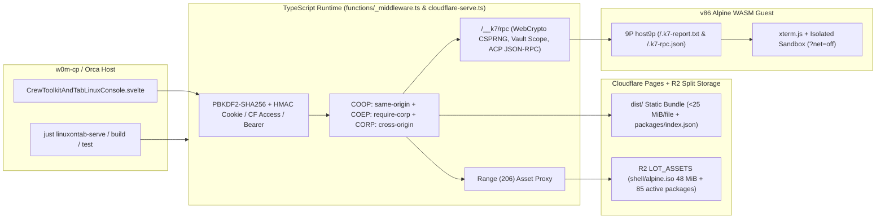

# TabLinux (`webomage/linuxontab`) TypeScript Cloudflare Pages + R2 Pipeline & Security Audit + Moksha Directional Snap Size Preservation

- **Date:** 2026-11-08
- **Tickets:** [[T618]] · [[T679]] · [[T684]]
- **Repositories:** `w0m-pr/linuxontab` (`feat/k7-orca-module-bar` @ `6603954`), `w0m-pr/moksha` (`beta` @ `dd45f9a75`), `w0m-web` (`CrewToolkitAndTabLinuxConsole.svelte`), `@wom` (`scripts/linuxontab_serve.py`, `justfile`)

---

## 1. Architecture & Request Flow

---

## 2. TabLinux (`w0m-pr/linuxontab`) Audit & TypeScript Implementation ([[T679]], [[T684]])

1. **Evaluation of Closed Upstream PR `#20` (`akkk09:cloudflare-deploy`):**
   - Upstream PR `#20` excluded `shell/alpine.iso` (`48 MiB`) and `packages/*.tar.gz` to fit Cloudflare Pages' `25 MiB` per-file limit, but omitted `COOP`/`COEP` headers (breaking `SharedArrayBuffer`), deleted `packages/index.json` (breaking `xtiny` GUI software installation), and proxied all large binaries from `raw.githubusercontent.com`.
2. **Pure TypeScript Build, Edge Middleware, Local Server & Tests (`6603954`):**
   - `cloudflare-build.ts`: Builds `dist/` (`<25 MiB` per file), preserves `packages/index.json` and `packages/index.html`, and writes `dist/packages/r2-manifest.json` auditing **85** active packages vs **75** orphaned tarballs (**296.0 MiB** saved).
   - `functions/_middleware.ts`: Implements PBKDF2-SHA256 + HMAC-SHA256 `__Host-lot_session` cookies, Cloudflare Zero Trust (`CF_ACCESS_ENABLED=1`), `LOT_BEARER_TOKEN`, `COOP`/`COEP`/`CORP` headers, R2-first (`env.LOT_ASSETS`) `206 Partial Content` streaming, and `/__k7/rpc`.
   - `cloudflare-serve.ts` & `cloudflare.test.ts`: Zero-dependency Node TypeScript local server and `node:test` suite (`6/6` tests passing via `just linuxontab-test`).
3. **Security Hardening (S1–S4):**
   - **S1:** Strict `/^[a-z0-9_-]{1,32}$/i` slug sanitization (`sanitizeSlug`) on `module`, `project`, and `env` query parameters plus 9P `emulator.create_file` host-to-guest RPC bridging.
   - **S2:** Gated `?postboot=` / `#postboot=` auto-execution behind explicit `?allow_postboot=1` + operator confirmation.
   - **S3:** Replaced hardcoded `https://linuxontab.com/local/...` URLs with `${location.origin}/local/...` and added `?net=off` default network isolation in `CrewToolkitAndTabLinuxConsole.svelte`.
   - **S4:** Blocked dotfile and path-traversal requests (`/.git`, `/.env`, `/.wrangler`, `..` -> `403`).

---

## 3. Moksha Directional Snap Size Preservation ([[T618]])

- Updated `_window_snap_unmaximize_reset`, `window_snap_do`, `_e_border_cb_mouse_move`, and `_e_border_client_inset_calc` in `w0m-pr/moksha/src/bin/e_border.c` (`dd45f9a75`) so dragging a window out of any of the 8 directional snap zones (`(bd->maximized & E_MAXIMIZE_DIRECTION) > E_MAXIMIZE_BOTH`, covering all 4 corners and all 4 halves while excluding Full Maximize) preserves its snapped width and height and cursor grab offset, while keyboard (`Super+Arrow`) and menu `Unmaximize` continue restoring pre-snap dimensions.
- Rebuilt and installed `~/.local/share/moksha-backport/moksha_0.4.2-4+w0m1_amd64.deb` (`e4d66b3e3304bb0bcd6fbd448b0c86b6`) into `/usr/bin/enlightenment`.
