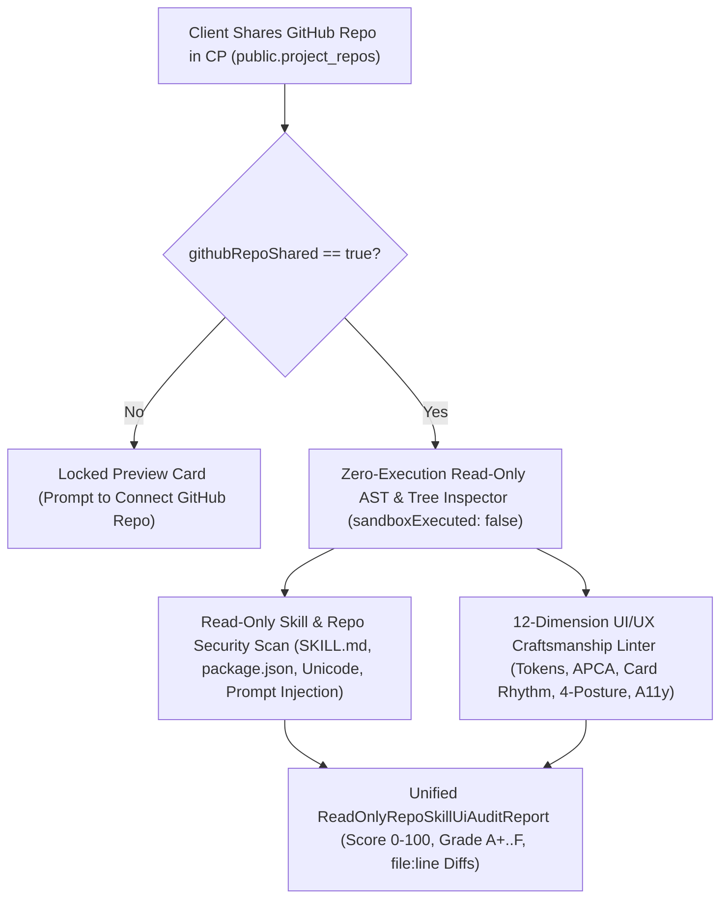

# Top-10 UI/UX & Audit Skills Evaluation, Zero-Execution Read-Only Skill/Repo Audit Service, and P2 Crypto Contract Audit Roadmap (`T673` / `T696`)

- **Date:** 2026-11-09
- **Tickets:** [[T673]] · [[T696]]
- **Canonical Forks Added:** `webomage/ui-ux-pro-max-skill`, `webomage/agent-skills`, `webomage/redesign-skill`, `webomage/ui-ux-suite`
- **Target Surfaces:** `w0m-skills/skills/webomage-design/SKILL.md`, `scripts/fork_catalog_sync.py`, `w0m-web/packages/lib/src/security/advanced-audit.ts`, `w0m-web/apps/cp/src/components/client/SecurityAuditReportViewer.svelte`

---

## 1. Architecture Flow (`zero_exec_readonly_ast`)

---

## 2. Top-10 Proven UI/UX & Design-Audit Skills Evaluation Matrix

| Rank | Repository | Stars | Forked to `webomage/*` | Selection Verdict & Role in `@wom` |
| :--- | :--- | :---: | :---: | :--- |
| **1** | `nextlevelbuilder/ui-ux-pro-max-skill` | `147,345 ★` | `webomage/ui-ux-pro-max-skill` | **Selected (Integrate)** — 67 UI styles, 96 color palettes, 57 font pairings, 99 UX rules, and conversion flow heuristics. |
| **2** | `vercel-labs/agent-skills` | `33,776 ★` | `webomage/agent-skills` | **Selected (Integrate)** — 100+ deterministic Web Interface Guidelines (`web-design-guidelines`) for focus states, forms, typography (`tabular-nums`), and CWV. |
| **3** | `elayadesign/redesign-skill` | `531 ★` | `webomage/redesign-skill` | **Selected (Integrate)** — Taste-driven redesign rubric, 6-state component completeness (`default`/`hover`/`focus`/`loading`/`empty`/`error`), equal-height card rhythm (`auto-rows-fr`), and anti-slop rules. |
| **4** | `Aboudjem/ui-ux-suite` | `120 ★` | `webomage/ui-ux-suite` | **Selected (Integrate)** — 12-dimension UI/UX design audit scorecard, WCAG 2.2 AA & APCA (`Lc >= 60`) perceptual contrast checks. |
| **5** | `dequelabs/axe-core` | `16,800 ★` | Native (`@axe-core/playwright`) | **Selected (Active in `w0m-web`)** — WCAG 2.2 AA/AAA accessibility rule taxonomy. |
| **6** | `GoogleChrome/lighthouse` | `28,600 ★` | Native PSI / Lighthouse API | **Selected (Active in Tier 1 Audit)** — Mobile + Desktop Core Web Vitals (`LCP`, `INP`, `CLS`, `TTFB`). |
| **7** | `stylelint/stylelint` | `11,100 ★` | Reference | **Reference** — CSS token-purity rules absorbed into our zero-execution AST token linter (`D1_token_purity`). |
| **8** | `reg-viz/reg-suit` | `2,300 ★` | Reference | **Superseded** — Replaced by `w0m-pixel-clone` 3-breakpoint (`375`, `768`, `1440`) `pixelmatch` loop (`<= 2%` mismatch). |
| **9** | `lost-pixel/lost-pixel` | `1,950 ★` | Reference | **Superseded** — Requires container browser execution; superseded by `zero_exec_readonly_ast` + `w0m-pixel-clone`. |
| **10** | `pa11y/pa11y` | `8,600 ★` | Reference | **Superseded** — Puppeteer CLI superseded by Playwright + zero-execution AST WCAG 2.2 checks (`D8_wcag22_a11y`). |

---

## 3. Zero-Execution Read-Only Skill & Repo Audit (`executionMode: "zero_exec_readonly_ast"`)

To guarantee that auditing a client's shared GitHub repository or third-party `SKILL.md` bundle never triggers untrusted code execution (`postinstall` scripts, malicious git hooks, or container breakouts):
- `runReadOnlyRepoAndSkillUiAudit()` (`w0m-web/packages/lib/src/security/advanced-audit.ts`) and `run_readonly_repo_and_skill_audit()` (`scripts/fork_catalog_sync.py`) enforce `executionMode: "zero_exec_readonly_ast"` and `sandboxExecuted: false`.
- **Read-Only Skill & Repo Security Checks**:
  - `RO-SKILL-001`: Prompt-injection / instruction-override directives (`ignore all previous instructions`) inside `SKILL.md` or repo docs.
  - `RO-SKILL-002`: Trojan-Source bidirectional Unicode control characters (`U+202A..U+202E`, `U+2066..U+2069`).
  - `RO-SKILL-003`: Dangerous `package.json` `preinstall` / `install` / `postinstall` lifecycle hooks invoking `curl`, `wget`, `bash`, `sh -c`, or `node -e`.
  - `RO-SKILL-004`: Remote pipe-to-shell patterns (`curl ... | bash`).
- **12-Dimension UI/UX Craftsmanship Checks**:
  - Evaluates `D1_token_purity` through `D12_anti_slop_craft` and renders the interactive scorecards and `file:line` unified diffs inside `SecurityAuditReportViewer.svelte` (`data-testid="cp-readonly-ui-skill-audit"`).

---

## 4. P2 Roadmap — Crypto Smart-Contract Audit & Coin/Token Intelligence Service

Tracked as a dedicated **P2 backlog ticket** (`T697`, `area: security`, `priority: P2`, `queue: backlog`):
- **Read-Only & Static Smart-Contract Auditing (EVM / Solidity, Solana / Anchor / Rust, Move)**:
  - Deterministic static analysis for reentrancy, unchecked external calls, oracle manipulation, flash-loan attack vectors, proxy upgradeability (`UUPS` / `TransparentUpgradeableProxy` storage collisions), mint/burn authority centralization, and ERC-20 / ERC-4626 / SPL token standard conformance.
- **Coin, Tokenomics & On-Chain Intelligence Hub**:
  - Token metadata, supply distribution & whale concentration, liquidity lock / vesting schedule verification, honeypot / fee-mutation detection, and regulatory/compliance risk scoring surfaced inside the Client Portal & Public Audit Catalog.
