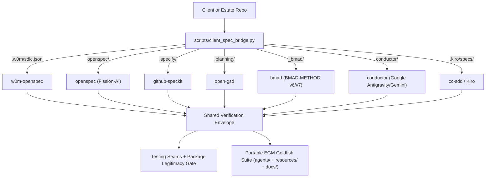

# T717 & T718 — GitHub `context-engineering` & `spec-driven-development` Landscape Audit, EGM Companion Completion, and 7-Dialect Client SDD Bridge (`BMAD-METHOD`, `Conductor`, `cc-sdd`, `go-zero`)

- **Tickets:** [[T717]] (`P0`, `completed`) · [[T718]] (`P1`, `completed`)
- **Queued Benchmark Follow-Up:** [[T719]] (`P2`, `queued`)
- **Related:** [[T705]] · [[T708]] · [[T712]] · [[T713]] · [[T714]] · [[T715]]
- **Date:** 2026-11-10

---

## 1. Executive Summary

We audited GitHub's [`topic:context-engineering`](https://github.com/topics/context-engineering) (`4,366` repositories) and [`topic:spec-driven-development`](https://github.com/topics/spec-driven-development) (`2,946` repositories) alongside three primary candidates — **`google/elephant-goldfish-model`**, **`bmad-code-org/BMAD-METHOD`**, and **`zeromicro/go-zero`** — against `w0m`'s live stack registry (`project/policies/stacks-policy.json`).

### Key Outcomes Delivered in This Session
1. **[[T717]] (`P0` Bug Fix — Complete `google/elephant-goldfish-model` Vendoring & Gate Hardening):**
   - Reality grounding caught two defects left behind by [[T705]]: (a) all `10` Goldfish reviewer persona files (`agents/*.md`), `5` document standards (`resources/document_standards/*.md` + `resources/execution_instructions.md`), and `3` harness docs (`docs/{codex,claude,harnesses}.md`) were missing from `w0m-skills/skills/egm-*/`, and (b) the `7` `egm-*` skills were unclassified in `w0m-skills/skill-portability.jsonc`, breaking `install_generic.test.ts`.
   - Vendored all `80` companion files + `Apache-2.0` `LICENSE` across `egm-*` while keeping `SKILL.md` byte-identical to upstream, classified all `7` `egm-*` skills as `portable` (`47` portable / `20` w0m-bound / `67` total), and hardened both `w0m-skills/scripts/audit_vendoring.ts` and `w0m-skills/version.ts` (`pre-commit`) to scan `agents/`, `resources/`, and `docs/` companions.
2. **[[T718]] (`P1` Feature — 7-Dialect Client SDD Bridge & Epistemic Research Firewall):**
   - Extended `scripts/client_spec_bridge.py` from `4` dialects to **`7` first-class SDD dialects**: `w0m-openspec`, `openspec`, `github-speckit` (`.specify/`), `open-gsd` (`.planning/`), **`bmad` (`_bmad/`)**, **`conductor` (`conductor/`)**, and **`cc-sdd` (`.kiro/specs/`)**.
   - Folded `BMAD-METHOD`'s **Epistemic Research Firewall** (*internal tickets/PRDs shape what questions to ask, never admissible as proof of external or live state*) into canonical `w0m-skills/skills/w0m-sdlc-research/SKILL.md`.
3. **[[T719]] (`P2` Queued Benchmark Spike):**
   - Split reproducible cold-path/token/TUI benchmarks for `VectifyAI/PageIndex`, `yvgude/lean-ctx`, `foryourhealth111-pixel/Vibe-Skills`, `jahala/tilth`, `fynnfluegge/agtx`, and native `AgDR` decision evidence-decay (`just decisions --stale`) into [[T719]].

---

## 2. Weighted Decision Matrix — Primary Candidates

| Candidate | Stars / Stack / License | Fit Score (`/100`) | Cost / Risk | Unblocks | Weighted Decision |
|---|---|---:|---|---|---|
| **`google/elephant-goldfish-model`** | `17.2k★` · Py/MD · `Apache-2.0` | **96** | Low (`0` runtime deps; static Markdown personas & standards) | Full `wise` mode Goldfish reviews + portable client installs (`T713`) | **ADOPTED & REPAIRED (`T705` + `T717`)** — Complete all `agents/`, `resources/`, `docs/` companions and `skill-portability.jsonc` entries. |
| **`bmad-code-org/BMAD-METHOD`** | `55.2k★` · Py/`uv`/MD · `MIT` + Trademark | **84** | Medium if vendored wholesale (`30` `v7` alpha skills + trademark notice); Low as external dialect + pattern extraction | Enterprise/agile client repos arriving with `_bmad/` + stronger research firewall in `w0m-sdlc-research` | **ADOPT DIALECT BRIDGE + EXTRACT FIREWALL (`T718`)** — Parse `_bmad/` natively in `client_spec_bridge.py`; fold Research Firewall into `w0m-sdlc-research`; do not vendor `30` alpha skills into `@wom`. |
| **`zeromicro/go-zero`** | `33.4k★` · Go · `MIT` (CNCF) | **58** (core) / **88** (Go clients) | High mismatch for `@wom` core (`0` Go stacks in `stacks-policy.json`); Low as client Go reference | Contract-codegen pattern (`DSL -> CLI -> TS SDK`) + Go microservice client engagements | **REFERENCE & CLIENT GO STACK ONLY** — Keep `@wom` backend on TypeScript/Hono/Cloudflare (`AgDR-0055`); recommend `go-zero` + `ai-context` + `zero-skills` when auditing/managing Go client stacks. |

---

## 3. Architecture — 7-Dialect Client SDD Bridge & EGM Companion Resolution



---

## 4. Curated Stack-Matched Shortlist (`context-engineering` & `spec-driven-development`)

All candidates below pass license screening (`MIT` or `Apache-2.0`). Strong-copyleft repos (`plastic-labs/honcho`, `cytostack/openwolf`, `Tura-AI/tura` under `AGPL-3.0`; `ai-boost/awesome-prompts` under `GPL-3.0`) and unlicensed repos (`m0n0x41d/haft`, `NOASSERTION`) are excluded from code adoption.

| Repository | Metrics | `w0m` Stack Alignment | Disposition |
|---|---|---|---|
| **`headroomlabs-ai/headroom`** | `79.3k★` · Python · `Apache-2.0` | MCP proxy (`127.0.0.1:8787`) | Already integrated in `@wom`; benchmark vs `lean-ctx` in [[T719]] |
| **`Fission-AI/OpenSpec`** | `74.6k★` · TypeScript · `MIT` | `w0m-web/openspec/` | Canonical spec base (`T712`, `T714`) |
| **`VectifyAI/PageIndex`** | `40.4k★` · Python · `MIT` | Cold-path spec/vault retrieval | Queued in [[T719]] AC1 (~97% token cut without vector index rebuilds) |
| **`cocoindex-io/cocoindex`** + **`cocoindex-code`** | `11.9k★` Rust + `3.0k★` Py · `Apache-2.0` | Incremental AST/CDC indexing | Reference benchmark vs `codegraph` + `graphify` |
| **`trailhq/Trail-Code`** | `11.2k★` · TypeScript · `MIT` | Cross-agent code map + learnings | Compare session extraction vs `just lessons-harvest` |
| **`Gentleman-Programming/gentle-ai`** | `8.8k★` · Go · `MIT` | Multi-agent harness configurator | Reference for cross-harness rule sync |
| **`yvgude/lean-ctx`** | `3.9k★` · Rust · `Apache-2.0` | Local Context Gateway + MCP | Queued in [[T719]] AC1 |
| **`foryourhealth111-pixel/Vibe-Skills`** | `3.8k★` · Python · `Apache-2.0` | Dynamic skill routing (`-29.6%` tokens) | Queued in [[T719]] AC2 for `w0m`'s `127`-skill catalog |
| **`gemini-cli-extensions/conductor`** | `3.8k★` · Python · `Apache-2.0` | Antigravity SDD plugin (`conductor/`) | Dialect bridge shipped in [[T718]] AC1 |
| **`gotalab/cc-sdd`** | `3.8k★` · TypeScript · `MIT` | Multi-host SDD skills (`.kiro/specs/`) | Dialect bridge shipped in [[T718]] AC1 |
| **`fynnfluegge/agtx`** | `1.7k★` · Rust TUI · `Apache-2.0` | `ratatui` multi-agent worktree board | Queued in [[T719]] AC3 for `k7` TUI ([[T708]]) |
| **`GanyuanRan/Aegis`** | `1.4k★` · Python · `MIT` | Baseline-first architecture drift guard | Reference alongside `reality-verify` + `egm-drift-report` |
| **`jahala/tilth`** | `361★` · Rust · `MIT` | Zero-index `tree-sitter` AST diff MCP | Queued in [[T719]] AC2 for `ultra` mode review diffs |

---

## 5. Verification Commands

```bash
pnpm --dir w0m-skills run skill-audit
pnpm --dir w0m-skills run skill-test
python3 -m pytest \
  scripts/tests/test_client_spec_bridge.py -q
just mmd-validate
just reports-ticket-check
```
