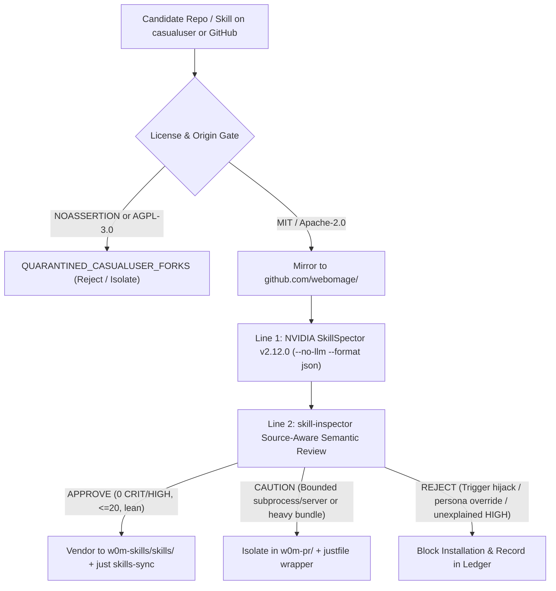

# Audit of `casualuser` Forks, Canonical `webomage/` Migration & Real `NVIDIA/SkillSpector` v2.12.0 Integration (`T721`)

**Ticket:** `T721` · **Date:** `2026-11-11` · **Area:** Security, Skill Governance & OSS Fork Architecture (`w0m-web/openspec/specs/agent-security-and-mcp-audit/spec.md`)

---

## 1. Executive Summary

We audited all recently forked repositories on `github.com/casualuser/*`, enforced the estate's canonical fork governance rule (`github.com/webomage/<repo>`, never `casualuser/<repo>`), installed and wired the real **`NVIDIA/SkillSpector` v2.12.0** security engine (`skillspector[mcp]`: 28 analyzer nodes, 71 static/AST/taint/YARA/MCP patterns across 17 threat categories), triaged external and first-party skills using NVIDIA's dual-line `skill-inspector` methodology, and expanded `FORKED_AI_TOOLS_CATALOG` from **38 to 48** canonical `webomage/<repo>` forks plus an explicit **2-repo quarantine ledger** (`QUARANTINED_CASUALUSER_FORKS`).

### Key Outcomes
1. **9 New Permissive Forks Mirrored to `github.com/webomage/<repo>`:** `SkillSpector`, `floorplan`, `rivet`, `gsd-core`, `txtai`, `learn-harness-engineering`, `local-deep-research`, `social-media-agent`, and `mistral-vibe` (joining `elephant-goldfish-model` and `linuxontab` in `scripts/fork_catalog_sync.py`).
2. **2 Forks Quarantined Before Touching First-Party Surfaces:**
   - `casualuser/job-hunter-skill` (`blackasp/job-hunter-skill`): **`REJECT`** — unlicensed (`NOASSERTION`), `SkillSpector` `E1` external `https://api.hh.ru/` calls + `AE4` Cyrillic rules, hardcoded Russian-only persona override, and broad resume trigger hijacking.
   - `casualuser/short-video-factory` (`YILS-LIN/short-video-factory`): **`ISOLATED_COPYLEFT`** — `AGPL-3.0` strong copyleft; barred from `w0m-*` first-party repositories.
3. **Real `NVIDIA/SkillSpector` v2.12.0 Live in `@wom`:**
   - Cloned `webomage/SkillSpector` to `w0m-pr/SkillSpector` and installed `skillspector[mcp]` (`v2.12.0`, `yara-python 4.5.4`, `tree-sitter 0.25.2`, `mcp 1.30.0`) under isolated Python 3.13 (`uv tool install`).
   - Upgraded `scripts/skill_spector_check.py` with both sub-second CI/pre-push static + `SkillOpt` scanning (`just skills-security-check`) and full `skillspector scan --no-llm --format json` CLI execution (`just skillspector-estate`, `just skillspector-scan <target>`) backed by file-scoped `.skillspector-baseline.yaml` governance.
   - Adapted and vendored NVIDIA's `skill-inspector` (`0/100 · LOW · SAFE`, `Apache-2.0`, zero-emoji heading normalized per `NOTICE.md`) into `w0m-skills/skills/skill-inspector/` (`68` canonical skills total: `48` portable, `20` w0m-bound).

---

## 2. Dual-Line Skill Security Pipeline (`SkillSpector` + `skill-inspector`)

---

## 3. Complete `casualuser` Fork Review & Weighted Disposition Matrix

| Upstream Repo | License | `webomage/` Canonical Fork | `SkillSpector` Static Signal | Combined Verdict | Estate Action & Target Surface |
|---|---|---|---|---|---|
| `NVIDIA/SkillSpector` | `Apache-2.0` | `webomage/SkillSpector` | `skill-inspector`: **`0/100` (`LOW` · `SAFE`, 0 issues)** | **`APPROVE`** | Installed `skillspector[mcp]` v2.12.0 CLI; upgraded `scripts/skill_spector_check.py` + `.skillspector-baseline.yaml`; vendored `skill-inspector` into `w0m-skills` |
| `haydenschmitty/floorplan` | `MIT` | `webomage/floorplan` | Zero npm runtime deps; bundles `1.6 MB` `elk.bundled.js` + `serve.mjs` loopback server & `claude -p`/`codex exec` hooks | **`CAUTION`** | Cloned to `w0m-pr/floorplan` and exposed via `just floorplan` without bloating `.agents/skills/` with 2 MB minified bundles |
| `mistralai/mistral-vibe` | `Apache-2.0` | `webomage/mistral-vibe` | `.agents/skills/`: **`17/100` (`LOW` · `SAFE`, 1 false-positive `TM1` on `git push --force` prohibition)** | **`APPROVE` (ACP Ref)** | Cataloged in Track E; `vibe-acp.spec` aligns directly with `scripts/acp_host_discovery.py` |
| `walkinglabs/learn-harness-engineering` | `MIT` | `webomage/learn-harness-engineering` | `skills/harness-creator`: **`100/100` (`CRITICAL` · `DO_NOT_INSTALL`, 13 issues: `LP3` missing `allowed-tools` + 5 `.mjs` + `init.sh`, `RP1` `npx skills`, `AS1`)** | **`CAUTION` (Ref Only)** | Cataloged in Track E as architectural reading only; executable `harness-creator` skill **not** vendored |
| `rivet-dev/rivet` | `Apache-2.0` | `webomage/rivet` | Rust/TS stateful Actor runtime (no agent `SKILL.md`) | **Reference (Track E)** | Cataloged in `FORKED_AI_TOOLS_CATALOG` alongside Cloudflare Durable Objects (`AgDR-0055`) |
| `open-gsd/gsd-core` | `MIT` | `webomage/gsd-core` | Spec-driven prompt system | **Reference (Track E)** | Cataloged in Track E as external comparison point for `w0m-sdlc-*` |
| `neuml/txtai` | `Apache-2.0` | `webomage/txtai` | Python embeddings + graph vector DB | **Reference (Track C)** | Cataloged in Track C alongside `scripts/w0m_kb_vector.py` |
| `LearningCircuit/local-deep-research` | `MIT` | `webomage/local-deep-research` | Multi-hop citation research engine | **Reference (Track C)** | Cataloged in Track C alongside `w0m-skills/skills/autoresearch` |
| `langchain-ai/social-media-agent` | `MIT` | `webomage/social-media-agent` | LangGraph human-in-the-loop social agent | **Reference (Track F)** | Cataloged in Track F |
| `google/elephant-goldfish-model` | `Apache-2.0` | `webomage/elephant-goldfish-model` | 7 `egm-*` skills (`AS1` prose harness doc paths baselined) | **`APPROVE` (`T717`)** | Registered in Track E (`FORKED_AI_TOOLS_CATALOG`) |
| `kilian-ai/linuxontab` | `MIT` | `webomage/linuxontab` | Browser Linux Wasm sandbox (`w0m-pr/linuxontab`) | **Integrate (`T678`)** | Registered in Track F (`FORKED_AI_TOOLS_CATALOG`) |
| `blackasp/job-hunter-skill` | **`NOASSERTION`** | **Not mirrored (Quarantined)** | **`19/100` (`LOW` · `CAUTION`, 4 MEDIUM: `E1` `https://api.hh.ru/`, `AE4` Cyrillic)**; semantic review caught unlicensed code, Russian-only override & resume trigger hijacking | **`REJECT`** | Blocked and recorded in `QUARANTINED_CASUALUSER_FORKS` |
| `YILS-LIN/short-video-factory` | **`AGPL-3.0`** | **Not mirrored (Quarantined)** | Electron/FFmpeg desktop app | **`ISOLATED_COPYLEFT`** | Blocked from `w0m-*` first-party repos in `QUARANTINED_CASUALUSER_FORKS` |

---

## 4. First-Party `w0m-skills` Triage & `.skillspector-baseline.yaml`

Scanning all 285 files across `w0m-skills/skills/` with `NVIDIA/SkillSpector` v2.12.0 (`--no-llm`) produced **0 `CRITICAL`** findings and **21 unique file-level `HIGH` matches**, every one of which was verified by source inspection to be a defensive guardrail or documentation reference:

- **Negative Safety Guardrails:** `w0m-sdlc-deploy/SKILL.md:32` (`"Never bypass safety checks to force a deploy"` matched `AR3`/`P1`), `wiki/references/rest-api.md:15` (`"Do not use curl -k"` matched `TM1`), and `wiki/references/git-setup.md:14` (`"user-vault ignore policy"` referring to `.gitignore` matched `AR3`).
- **Defensive Security Checklists & Unit Fixtures:** `security-audit/*` (Cloudflare `security-audit-skill` checklists and `.test.cjs` validators citing `/etc/passwd`, `keychain`, and `credentials.json`).
- **Harness Setup Documentation & UI Copy Examples:** `egm-*/docs/harnesses.md` (`~/.claude/`, `~/.gemini/` install paths), `doubt-driven-development` (`codex exec --sandbox read-only`), and `webomage-design/SKILL.md:46` (`"Personal Access Tokens"` UI label example).

All 12 verified file-scoped patterns are recorded with explicit engineering rationale in `.skillspector-baseline.yaml` (`version: 2`), so any new unreviewed `CRITICAL` or `HIGH` finding fails closed immediately.

### Empirical Scanner Bottleneck Note (`elk.bundled.js` / Single-Line Bundles)
During evaluation of `floorplan`, `SkillSpector` v2.12.0's static regex analyzers stalled on `floorplan/skills/floorplan/assets/vendor/elk.bundled.js` (`1.6 MB` single-line minified JS) and `fonts.css` (`base64` WOFF2). Keeping `floorplan` isolated in `w0m-pr/floorplan` (`just floorplan`) avoids polluting `w0m-skills` and keeps estate scans fast and deterministic.

---

## 5. Operator Usage

- Fast pre-push / CI static + `SkillOpt` gate (`<1s`): `just skills-security-check`
- Scan any external or local skill directory with real `NVIDIA/SkillSpector` v2.12.0: `just skillspector-scan <path>`
- Full estate `w0m-skills/skills` deep scan with `.skillspector-baseline.yaml`: `just skillspector-estate`
- Verify canonical `webomage/<repo>` fork governance (`48` approved + `2` quarantined): `just fork-catalog-status`
