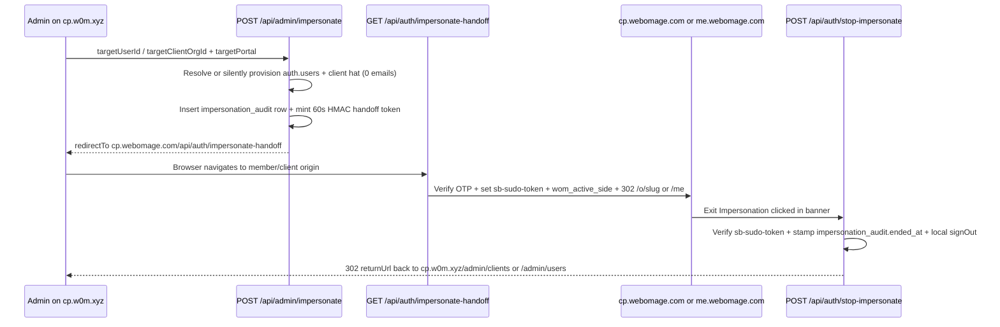

# T722 — Astro 7 + Cloudflare Adapter Audit, Deploy Retry Classification, Full-Scope Admin Impersonation, and Services/Solutions Fast Checkout History

- **Ticket:** `T722`
- **Date:** `2026-11-11`
- **Repos:** `@wom`, `w0m-web`
- **Status:** Completed & Verified (`AC1`–`AC4`)

---

## 1. Core Framework Migration Status & Root Cause of Live UI Errors (`blueprints/order` & `me/todos`)

### 1.1 Framework Versions Already Live in `w0m-web/package.json`

All core UI, build, and runtime packages in `w0m-web` are already upgraded to current major versions:

| Layer | Package | Version in `w0m-web/package.json` | Migration Ticket |
|---|---|---|---|
| **Meta-framework** | `astro` | `7.3.3` | `T104` / `T278` / `T566` |
| **Cloudflare Worker Adapter** | `@astrojs/cloudflare` | `^14.3.4` (`@cloudflare/vite-plugin@1.64.0`) | `T566` |
| **UI Compiler** | `svelte` / `@astrojs/svelte` / `svelte-check` | `^5.56.7` / `^9.0.1` / `4.7.7` | Svelte 5 Runes |
| **Bundler & Styling** | `vite` / `tailwindcss` / `@tailwindcss/vite` | `^7.3.2` / `^4.3.3` / `^4.3.3` | Vite 7 + Tailwind v4 |
| **Worker CLI & Auth** | `wrangler` / `@supabase/ssr` / `@supabase/supabase-js` | `^4.152.0` / `^0.12.0` / `^2.110.7` | `T566` |
| **TypeScript & Tests** | `typescript` / `vitest` | `6.0.3` / `^4.1.10` | TS 6 + Vitest 4 |

### 1.2 Why `webomage.com/blueprints/order` and `me.webomage.com/me/todos` Crashed

`@astrojs/cloudflare` v13+ (`Astro 6/7`) defines a **throwing property getter** on `Astro.locals.runtime`:

```text
Middleware Error: Astro.locals.runtime.env has been removed in Astro v6. Use 'import { env } from "cloudflare:workers"' instead.
```

Even optional chaining (`(context.locals as any)?.runtime?.env`) invokes the getter on `.runtime` and throws immediately.

Five Worker-bundled files written after the initial Astro 7 migration still read `locals.runtime`, and `worker_env_gate.py` previously scanned only `process.env`:

1. **`apps/web/src/pages/blueprints/order.astro`**: Read `(Astro.locals as any)?.runtime?.env?.SETTINGS`, throwing a full-page `Middleware Error` on `GET /blueprints/order`.
2. **`apps/cp/src/lib/todos-server.ts` (`getCfBinding`)**: Read `(context.locals as ...).runtime?.env`.
   - On `GET https://me.webomage.com/me/todos`, SSR `todos.astro` wrapped `handleTodosApi(Astro)` in `try/catch`, silently swallowing the SSR throw (`initialLists = undefined`).
   - On client hydration, `TodoWorkspace.svelte` called `fetch("/api/todos")` and immediately ran `await res.json()` on the plain-text `500` `"Middleware Error: ..."`, surfacing **`Unexpected token 'M', "Middleware"... is not valid JSON`** in the red UI banner!
3. **`apps/cp/src/pages/api/insights/index.ts` & `promote.ts`**: Read `(context.locals as any)?.runtime?.env ?? process.env ?? {}`.
4. **`packages/lib/src/auth/handlers.ts`**: Read `(locals as any).runtime?.env?.AUTH_RATE_LIMIT` inside `authSignInHandler` (`try/catch` masked rate-limit binding reads).

### 1.3 Additional Stale `locals` Adapter Fixes Found in Full Monorepo Audit

A full-tree scan of `apps/*/src` and `packages/*/src` confirmed `0` `Astro.glob` calls, `0` `<ViewTransitions />` imports, and `0` `{ ...locals }` object spreads, and caught **3 stale pre-unification `locals` property names**:

- **`apps/cp/src/pages/api/admin/claims.ts`**: Read `(locals as any)?.session?.access_token` instead of `locals.accessToken`.
- **`apps/cp/src/pages/api/mcp.ts`**: Read `locals.activeRole` / `locals.userRoles` instead of `locals.role` / `locals.availableRoles`, and called `getServerClient(cookies)` instead of `getServerClient({ request, cookies })`.
- **`apps/cp/src/pages/api/vault/tokens.ts`**: Read `context.locals.activeRole` / `userRoles` instead of `context.locals.role` / `availableRoles`.
- **`apps/cp/src/components/todos/TodoWorkspace.svelte`**: Added `readJsonSafe(res)` so any non-JSON upstream error returns a clean status message rather than `Unexpected token ... is not valid JSON`.
- **`project/scripts/worker_env_gate.py` (`just worker-env-check`)**: Upgraded to fail closed on any `.runtime.env`, `.runtime?.env`, `locals.runtime`, or bare `process.env` across all apps and shared packages (`0` violations; `17/17` unit tests pass), plus `/blueprints/order` added to `specs/web/live-smoke.spec`.

---

## 2. Deploy-Log Error & Retry Classification (`scripts/deploy_logged.py`)

In `release 2026.11.11-1794417310`, Supabase's Management API returned two transient `500` responses during batch deploy (`submit-service-request`, `telegram-webhook`). `w0m-api/scripts/deploy_functions.py` caught both, retried with `20s` backoff (`2 at a time`), succeeded, and verified `all 64 function(s) updated on live`.

`scripts/deploy_logged.py` (`AC2`) now separates self-healed retries (`recovered_retries`, `recovered_retries_count`) from unrecovered `other_trouble` **only when** `all N function(s) updated on live.` appears later in the same transcript (partial/failed deploys stay in `other_trouble`), and exposes `just deploy-audit`.

---

## 3. Full-Scope Admin Member & Client Impersonation (`AC3` & `AC4`)



- **Unified Directory & Silent Client Preview (`/api/admin/impersonate`):** Supports `targetUserId`, `targetProfileId`, `targetClientOrgId`, `targetEmail`, `targetPortal: "cp" | "me"`, and `provisionSilent: true` so admins can preview even pre-invite client portals (such as `PandaTransfer` -> `/o/pandatransfer`) with **zero emails sent** and `leads.converted_user_id` left untouched until a real invite is sent.
- **Cross-Domain Handoff (`/api/auth/impersonate-handoff`):** Keeps `.w0m.xyz` admin cookies untouched while minting the target session on `.webomage.com`, preventing `cp.w0m.xyz -> /404` lockouts.
- **Audit Lifecycle & Mutation Guards:** `stop-impersonate.ts` stamps `impersonation_audit.ended_at`, signs out the temporary session locally, and restores admin cookies; `assertNotImpersonating(locals)` blocks identity unlinking, MFA enrollment/unenrollment, PAT creation/deletion, and Stripe billing-portal mutation while impersonating.
- **Admin Surfaces Wired:** One-click **Impersonate** in `ClientManager.svelte` (`/admin/clients`), **Impersonate (CP)** + **Me Portal** + **`Clients`** filter in `LiveUserSessionsDashboard.svelte` (`/admin/users`), and `redirectTo` handoff in `RoleManager.svelte` (`/admin/roles`).

---

## 4. Repo History Review: `/services` & `/solutions` Fast Register & Checkout vs Details Form

### 4.1 Commit Timeline Across `w0m-web`

| Commit & Ticket | Surface | How Public Conversion Worked |
|---|---|---|
| `67d2bc8cf` (`T373`) & `cfee32ec9` (`T604`) | `/audit` (`AuditPricing.svelte`, `SecurityAuditWidget.svelte`) & `/blueprints/order` (`BlueprintOrderFlow.svelte`) | **Fast Register & Direct Checkout:** Optional 1-field domain URL + **1-click OAuth** (`Google`, `GitHub`, `LinkedIn`) or **Work Email Magic Link** (*"Skip URL & Fast Register"*), and on `/audit` direct 1-click tier selection -> `POST /functions/v1/stripe-checkout`. |
| `48f8a5b18` (`T636`, pre-`T698`) | `/services` (`ServicesPage.astro`, `ServicesDetailed.astro`) & `/solutions` (`SolutionsPage.astro`, `SolutionsGrid.astro`) | **Clean Catalog + Fast Funnel:** Zero inline multi-step infrastructure form on either page. `/services` went `Hero` -> `Top CTA` (`/audit/`, `/blueprints/`) -> `Core Services` -> `Detailed Services` (*"Order & Register Portal →"* opening fast-register drawer) -> `Compliance` -> `Final CTA`. `/solutions` went `Hero` -> `SolutionsGrid` -> `Blueprint CTA` -> `Compliance` -> `Final CTA`. |
| `46a22e4c5` (`T698`, Nov 9) | `ServiceActionOrderConfigurator.svelte` (`1,208` lines) injected via `ServiceOrderSection.astro` | **Added 3-Step Public Details Form:** Injected `#service-order-configurator` into the middle of `/services` and `/solutions` with Step 1 (Service + Package/Request toggle), **Step 2 (Source Infra chips, Target Infra chips, Involved Workloads chips, Cutover Timeline pills, Target URL, Scope Notes)**, and Step 3 (OAuth / Name + Company + Email + Turnstile + Checkout), plus dual *"Order Package / Order By Request"* buttons on every `/solutions` card. |
| `5c8a62848` (`T703`, Nov 10) | `ClientDashboard.svelte` (`/o/[org]`, `cp-onboarding-service-wizard`) | **Added Identical 3-Step Infra Wizard Post-Registration inside CP:** Embedded the same Source/Target Infra, Workloads, and Cutover Timeline selector inside the authenticated Client Portal Onboarding Wizard (`Step 1` of `/o/[org]`). |

### 4.2 Resulting Friction & Recommended Streamlined Option

Because `T703` (`5c8a62848`) already collects **Source Infra, Target Infra, Workloads, and Cutover Timeline** inside `/o/[org]`'s post-registration/post-checkout Onboarding Wizard, keeping `T698`'s heavy Step-2 infrastructure form on public `/services` and `/solutions` asks prospects to fill out architecture questionnaires **before** they have registered or checked out — and duplicates the exact wizard waiting for them in `/o/[org]`.

**Recommended clean split (ready to execute on confirmation):**
1. **Public `/services` & `/solutions` (Fast Register + Fast Checkout):** Remove the public Step-2 infra questionnaire (`Source Infra` / `Target Infra` / `Workloads` / `Timeline` / `Scope Notes`) so clicking any Service or Solution card offers immediate **1-click OAuth / Work Email Fast Register** or **1-click Fixed-Price Stripe Checkout** (matching `/audit` and `/blueprints/order`).
2. **Authenticated `/o/[org]` Onboarding Wizard (`cp`):** Keep the rich Source/Target Infra, Workloads, and Cutover Timeline configurator strictly inside the Client Portal after fast sign-in or checkout.
