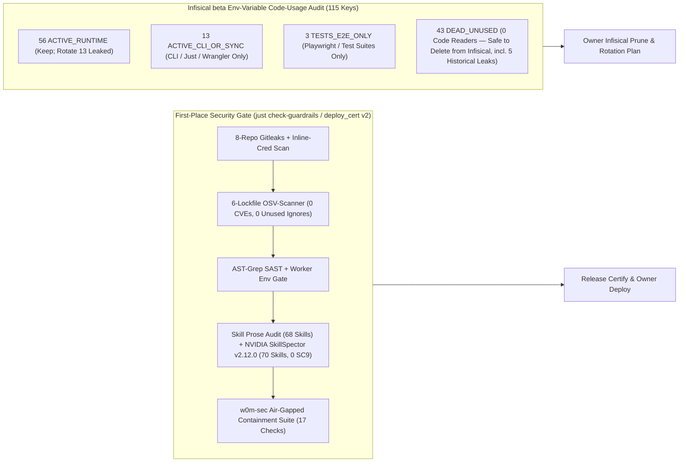

# First-Place Code & Agent Security Audits, UI/TTFB Remediation & Infisical Env-Variable Code-Usage Audit (`T725`–`T729`)

**Date:** 2026-11-11
**Tickets:** `T725`, `T726`, `T727`, `T728`, `T729`
**Scope:** `@wom` umbrella, `w0m-web`, `w0m-api`, `w0m-cf`, `w0m-ext`, `w0m-sec`, `w0m-skills`, `w0m-mlx/w0m-mlx`

## Executive Summary

This report records the implementation, verification, and static/live inventory across five coordinated tickets landed together in one atomic release batch:

- **`T725` (`/me/oss` `403 Forbidden` & `apps/me` API/Route Parity)**: Resolved `https://me.webomage.com/me/oss` returning `403 Forbidden` on repo switches by mounting `/api/board/*`, `/board/*`, `/api/vault/r2/*`, and `/api/auth/impersonate-handoff` in `apps/me`, classifying `/api/board/*` and `/api/vault/r2/*` in `apps/me/src/lib/route-policy.ts` as self-authenticating handlers (`subject: "public"`), clearing stale `board` split-state on failed repo switches in `FeatureVotingBoard.svelte`, and enforcing parity via `me-api-parity.test.ts`.
- **`T726` (First-Place Code & Agent Security Audits)**: Promoted full-estate Code + Agent security checks into `just check-guardrails` (`scripts/deploy_cert.py`, `SCHEMA_VERSION = 2`), eliminated `NVIDIA/SkillSpector v2.12.0` `SC9` (`excluded_from_analysis`) cap exhaustion (`70` unique skills, `0` `crit/high`, `0` `sc9_excluded`, `0.52s` warm SHA-256 cache), pruned all unused `osv-scanner.toml` ignores across all `6` lockfiles, and resolved `skills-audit-tools`, `skills-vendor-audit`, and `mcp-ratchet`.
- **`T727` (Edge TTFB, Anonymous-Only Edge Caching & Profile Hydration)**: Added 60s isolate + Cloudflare Edge Cache (`site_pages`, `getPosts`, `jobs-list`), strictly anonymous-only `Cache-Control` (`public, max-age=0, s-maxage=300, stale-while-revalidate=3600` ONLY when zero session/impersonation cookies or `Authorization` headers exist), parallelized the 3 sequential Supabase queries on `/me/profile` and `/cp/profile` via `Promise.all`, and moved below-the-fold islands to `client:visible`.
- **`T728` (`readJsonSafe`, Zero Missing `` Dimensions & `transition-all` Hotspots)**: Published `readJsonSafe` in `@webomage/lib`, wired client fetch callers across `web`/`me`/`cp`, added explicit `width`, `height`, and `decoding="async"` to 100% of real `` elements across `apps/web`, `apps/me`, and `apps/cp` (`0` missing), and replaced `transition-all` across top animation hotspots (`ResumeStudio.svelte`, `Footer.astro`, `Codemap.astro`, `ApplicationForm.svelte`, `BlueprintGallery.astro`, `me/profile.astro`, `OnboardingChecklist.svelte`, `TechIconGrid.astro`).
- **`T729` (Infisical & Worker Env-Variable Code-Usage Audit & Dead Residue Cleanup)**: Built `scripts/env_usage_audit.py` (`just env-usage-audit`), audited all `115` injected Infisical `beta` keys (and all `20` git-history digest keys) without reading or logging any secret value, pruned ~80 dead keys from `w0m-cf/worker-configuration.d.ts`, `w0m-cf/wrangler.jsonc`, and `w0m-web/turbo.json`, and updated `w0m-api/scripts/rotate_leaked_secrets.py` to distinguish **delete-from-Infisical** dead keys from **rotate-in-place** live keys.

---

## 1. First-Place Code & Agent Security Audit Matrix (`T726`)

| Security Gate | Surface Covered | Result |
|---|---|---|
| **`gitleaks` + `guard-test-admin`** | All 8 git repos (`.`, `w0m-web`, `w0m-api`, `w0m-cf`, `w0m-ext`, `w0m-sec`, `w0m-skills`, `w0m-mlx/w0m-mlx`) | **PASS** (`0` hardcoded secrets) |
| **`INLINE_CRED_RE` Connection-String Scan** | Tracked non-Markdown files across all 8 estate git repos | **PASS** (`0` inline DB/Redis/AMQP credentials) |
| **`osv-scanner` SCA** | All 6 `pnpm-lock.yaml` files (`w0m-web`, `w0m-api`, `w0m-cf`, `w0m-ext`, `w0m-ext/extension`, `w0m-skills`) | **PASS** (`0` open CVEs, `0` unused ignores) |
| **`ast-grep` SAST & `worker_env_gate.py`** | TS/Python structural AST rules + Cloudflare Worker `process.env` isolation | **PASS** (`0` findings, `0` unexempted `process.env` reads) |
| **`skill-audit` (`skill_audit.ts`)** | `235` Markdown files across `68` skills (5 prose exfil/override rules) | **PASS** (`0` risk signals) |
| **`NVIDIA/SkillSpector v2.12.0 --deep`** | All `70` unique skills across `w0m-skills/skills` + `.agents/skills` (clean-staged without `node_modules`) | **PASS (`APPROVE`)** (`crit/high=0`, `sc9_excluded=0`, `0.52s` warm SHA-256 cache) |
| **`w0m-sec` Ephemeral Sandbox Containment** | Air-gapped network block, hostile `.git/hooks` neutralization, prompt-injection quarantine, secret redaction | **PASS** (`17/17` pytest checks in `0.31s`) |
| **`skills-audit-tools` / `skills-vendor-audit` / `mcp-ratchet`** | Standard governance recipes, `128` vendored companion links, host MCP/LAN listener ratchet | **PASS** (`0` undecided skills, exposure shrank) |

---

## 2. Complete Infisical `beta` Environment-Variable Code-Usage Audit (`T729`)

Executed via `just env-usage-audit --infisical` (`scripts/env_usage_audit.py`), inspecting key names only (`0` secret values read, hashed, or logged). Across `115` evaluated keys (`114` Infisical `beta` secrets + static historical set):

- **`ACTIVE_RUNTIME`: `56` keys** — actively read by shipping Astro SSR (`web`/`me`/`cp`), `@webomage/lib`, Supabase Edge Functions (`w0m-api/supabase/functions/*`), or Cloudflare Workers (`w0m-cf/src/*`).
- **`ACTIVE_CLI_OR_SYNC`: `13` keys** — read only by local operator `just` recipes, sync scripts, or CLI healthchecks (`ADMIN_EMAIL`, `ADMIN_PASSWORD`, `CDP_PORT`, `E2E_BASE_URL`, `INFISICAL_SERVICE_TOKEN`, `LITELLM_BASE_URL`, `LITELLM_MASTER_KEY`, `MCP_PORT`, `R2_ACCESS_KEY_ID`, `R2_SECRET_ACCESS_KEY`, `SUPABASE_ACCESS_TOKEN`, `SUPABASE_KEY`, `UPWORK_CALLBACK_URL`).
- **`TESTS_E2E_ONLY`: `3` keys** — read only inside Playwright/test helpers (`PUBLIC_HONEYCOMB_API_KEY`, `TEST_USER_EMAIL`, `TEST_USER_PASSWORD`).
- **`DEAD_UNUSED`: `43` keys** — **`0` executable code readers** across all 8 git repositories (safe to delete from Infisical `beta`).

### 2.1 Disposition of All 20 Historical Git-Digest Keys (`just secret-history-check`)

| Key Name | Code-Usage Status | Primary Code Readers | Action Required |
|---|---|---|---|
| `AWS_ACCESS_KEY` | **`DEAD_UNUSED`** | `0` code readers | **DELETE from Infisical** (do not rotate) |
| `AWS_ACCESS_SECRET` | **`DEAD_UNUSED`** | `0` code readers | **DELETE from Infisical** (do not rotate) |
| `CRON_SECRET` | **`DEAD_UNUSED`** | `0` code readers (removed from `turbo.json`) | **DELETE from Infisical** (do not rotate) |
| `GITHUB_APP_PRIVATE_KEY` | **`DEAD_UNUSED`** | `0` code readers | **DELETE from Infisical** (do not rotate) |
| `MEMBER_PASSWORD` | **`DEAD_UNUSED`** | `0` code readers | **DELETE from Infisical** (do not rotate) |
| `ADMIN_PASSWORD` | `ACTIVE_CLI_OR_SYNC` | `justfile`, `w0m-web/tests/helpers/auth.ts` (`0` Worker/Edge readers) | Rotate local/E2E test password in GoTrue + Infisical |
| `GEMINI_API_KEY` | `ACTIVE_RUNTIME` (legacy fallback) | `w0m-api/supabase/functions/_shared/ai-router.ts` (disabled `403`; Workers AI primary) | Delete from Infisical + Supabase secrets once legacy fallback is retired, or replace with fresh restricted key |
| `CRYPTO_KEY` | `ACTIVE_RUNTIME` | `apps/cp/src/pages/api/admin/impersonate.ts`, `packages/lib/src/auth/middleware.ts` | **ROTATE** in Infisical + Cloudflare Workers (`web`, `me`, `cp`) |
| `E2E_ACCESS_SECRET` | `ACTIVE_RUNTIME` | `packages/lib/src/auth/middleware.ts`, `w0m-api/supabase/functions/_shared/bot-defense.ts` | **ROTATE** in Infisical + Workers + Supabase Edge secrets |
| `GITHUB_TOKEN` | `ACTIVE_RUNTIME` | `apps/cp/src/pages/api/board/[owner]/[repo].ts`, `oss-board.ts` | **ROTATE** PAT in GitHub + Infisical + Workers |
| `GITHUB_APP_CLIENT_SECRET` | `ACTIVE_RUNTIME` | `apps/cp/src/pages/api/auth/github-board/callback.ts` | **ROTATE** in GitHub App + Infisical + Workers |
| `GITHUB_APP_WEBHOOK_SECRET` | `ACTIVE_RUNTIME` | `w0m-api/supabase/functions/github-sync-webhook/index.ts` | **ROTATE** in GitHub App + Infisical + Supabase Edge secrets |
| `LINKEDIN_APP_SECRET` | `ACTIVE_RUNTIME` | `w0m-api/supabase/functions/linkedin-oauth-callback/index.ts` | **ROTATE** in LinkedIn Dev Portal + Infisical + Supabase Edge secrets |
| `MISTRAL_API_KEY` | `ACTIVE_RUNTIME` | `packages/lib/src/security/mistral-remediation-helper.ts`, `ai-router.ts` | **ROTATE** in Mistral Console + Infisical + Workers/Supabase |
| `MISTRAL_API_KEY_W0M` | `ACTIVE_RUNTIME` | `scripts/mistral_project_scope.py` | **ROTATE** in Mistral Console + Infisical |
| `POSTHOG_API_KEY` | `ACTIVE_RUNTIME` | `w0m-api/supabase/functions/get-admin-metrics/index.ts` | **ROTATE** personal API key in PostHog + Infisical + Supabase |
| `RESEND_API_KEY` | `ACTIVE_RUNTIME` | `contact-submit`, `apply-submit`, `inbound-email`, `send-quest-notification` | **ROTATE** in Resend + Infisical + Supabase Edge secrets |
| `SMTP_PASS` | `ACTIVE_RUNTIME` | `w0m-api/supabase/functions/send-email/index.ts` | **ROTATE** SMTP credential + Infisical + Supabase Edge secrets |
| `UPWORK_API_KEY` | `ACTIVE_RUNTIME` | `upwork-client.ts`, `upwork-oauth-init`, `upwork-graphql` | **ROTATE** in Upwork Dev Console + Infisical + `w0m-cf`/Supabase |
| `UPWORK_API_SECRET` | `ACTIVE_RUNTIME` | `upwork-client.ts`, `upwork-oauth-callback` | **ROTATE** in Upwork Dev Console + Infisical + `w0m-cf`/Supabase |

### 2.2 Complete List of 43 `DEAD_UNUSED` Infisical Keys (`0` Executable Code Readers)

Grouped by retired subsystem so the owner can prune them cleanly from Infisical `beta`:

1. **Historical-Digest Dead Keys (5):** `AWS_ACCESS_KEY`, `AWS_ACCESS_SECRET`, `CRON_SECRET`, `GITHUB_APP_PRIVATE_KEY`, `MEMBER_PASSWORD`
2. **Retired Third-Party AI / Queue Keys (6):** `COHERE_API_KEY`, `GROQ_API_KEY`, `HATCHET_CLIENT_TOKEN`, `HUGGINGFACE_API_TOKEN`, `MISTRAL_TEST_MODEL`, `CF_RUNTIME_API_TOKEN`
3. **Retired SigNoz / PostHog / Honeycomb Duplicate Keys (9):** `PUBLIC_SIGNOZ_API_KEY`, `SIGNOZ_API_KEY`, `SIGNOZ_ENDPOINT`, `SIGNOZ_INGESTION_ENDPOINT`, `SIGNOZ_OTLP_ENDPOINT`, `SIGNOZ_TENANT_ID`, `POSTHOG_PROJECT_ID`, `PUBLIC_POSTHOG_API_KEY`, `HONEYCOMB_MANAGEMENT_KEY`
4. **Retired OCI VM Provisioning Keys (8):** `OCI_AVAILABILITY_DOMAIN`, `OCI_COMPARTMENT_OCID`, `OCI_VM_APPLY_RETRIES`, `OCI_VM_APPLY_RETRY_DELAY_SEC`, `OCI_VM_BOOT_VPUS_PER_GB`, `OCI_VM_IMAGE_OCID`, `OCI_VM_MEMORY_IN_GBS`, `OCI_VM_OCPUS`
5. **Retired QA / Demo / Named Login Passwords & Unused Metadata (15):** `ADMIN_LOGIN_PASSWORD`, `ALEKSEI_LOGIN_PASSWORD`, `DEMO_CANDIDATE_PASSWORD`, `DEMO_CLIENT_PASSWORD`, `ELENA_LOGIN_PASSWORD`, `GITHUB_APP_ID`, `GITHUB_APP_NAME`, `INFISICAL_VAULT_FILE_PASSPHRASE`, `MEMBER_EMAIL`, `MLX_PORT`, `MLX_RS_PORT`, `STRIPE_PUBLISHABLE_KEY`, `TEST_RBAC_BYPASS`, `WOM_QA_EMAIL`, `WOM_QA_PASSWORD`

---

## 3. UI, API Parity & Edge TTFB Remediation Summary (`T725`, `T727`, `T728`)

1. **`me.webomage.com/me/oss` `403 Forbidden` Fixed (`T725`)**:
   - `apps/me/src/lib/route-policy.ts` previously fell through to `default-deny` (`403 Forbidden`) for `/api/board/*` and `/api/vault/r2/*` on `me.webomage.com`, while `apps/me/src/pages/` lacked the route files.
   - Mounted `/api/board/[owner]/[repo].ts`, `/api/board/[owner]/[repo]/badge.svg.ts`, `/board/index.astro`, `/board/[owner]/[repo].astro`, `/api/vault/r2/[engagement]/index.ts`, `/api/vault/r2/[engagement]/[...path].ts`, and `/api/auth/impersonate-handoff.ts` in `apps/me`, updated `route-policy.ts`, cleared stale `board` split-state in `FeatureVotingBoard.svelte`, and added `me-api-parity.test.ts`.
2. **Edge TTFB, Anonymous-Only Edge Caching & Profile Parallelization (`T727`)**:
   - Added `@webomage/lib/security/edge-cache-policy` (`hasAuthOrSessionSignal`, `applyAnonymousHtmlEdgeCache`, `BoundedTtlCache`, `fetchPublicJsonCached`), strictly gating `s-maxage=300, stale-while-revalidate=3600` to anonymous `GET`/`HEAD` `200 text/html` responses without `Cookie`, `Authorization`, or `Set-Cookie` headers (`5/5` unit tests).
   - Cached public `site_pages`, `getPosts()`, and `jobs-list` for 60s, parallelized `profiles` + `team_members` + `profile_public_settings` via `Promise.all` on `/me/profile` and `/cp/profile`, and hydrated below-the-fold islands with `client:visible`.
3. **Resilient JSON Parsing, Zero CLS `` Dimensions & Compositor Transitions (`T728`)**:
   - Published `readJsonSafe` in `@webomage/lib/http/json-safe` (`5/5` unit tests) and wired 10 high-traffic client fetch surfaces across `web`/`me`/`cp`.
   - Added explicit `width`, `height`, and `decoding="async"` to all remaining real `` tags across `apps/web`, `apps/me`, and `apps/cp` (`0` missing).
   - Replaced `transition-all` with explicit compositor/color property transitions across `72` hotspot occurrences.
