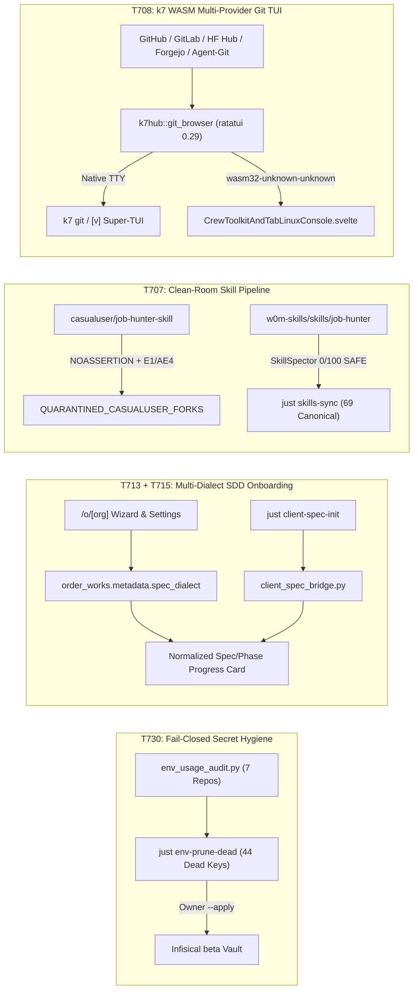

# Consolidated Delivery & Security Audit Report — Dead Secret Pruning (`T730`), Multi-Dialect SDD Onboarding (`T713`, `T715`), Clean-Room `job-hunter` Skill (`T707`), and `k7` WASM Multi-Provider Git TUI (`T708`)

**Tickets:** `T730`, `T713`, `T715`, `T707`, `T708` · **Date:** `2026-11-12` · **Specs:** `w0m-web/openspec/specs/sdlc_toolchain/spec.md`, `w0m-web/openspec/specs/agent-security-and-mcp-audit/spec.md`

---

## 1. Executive Summary

All five queued tickets were implemented, verified test-first, and audited in one isolated worktree session (`agent/t730-t713-t715-t707-t708`):

1. **`T730` (`P0` — Fail-Closed Dead Env Var Pruner & `GEMINI_API_KEY` Retirement):** Shipped `scripts/env_prune_dead.py` (`just env-prune-dead`, dry-run by default, owner `--apply` gated) cross-checking `scripts/env_usage_audit.py` across all 7 estate repos, retired disabled `GEMINI_API_KEY` / `GOOGLE_API_KEY` runtime env reads without mutating `w0m-api/deno.lock` (`0` parity errors), and updated `w0m-api/scripts/rotate_leaked_secrets.py` (`--prune-dead`, skipping `delete_from_infisical` keys during rotation). Live Infisical `beta` dry-run confirms **`44` `DEAD_UNUSED` keys** (including `GEMINI_API_KEY`) ready for one-command pruning.
2. **`T713` (`P1` — Client Project Multi-Dialect Spec Bootstrap & Registry):** Added `spec_dialect` (`w0m-openspec`, `openspec`, `github-speckit`, `open-gsd`, `bmad`, `conductor`, `cc-sdd`) to `project/policies/clients-policy.schema.json` and `project/policies/clients-policy.json`, extended `scripts/client_inventory.py` with live dialect detection, reconciled `development_modes` and `elephant_goldfish_model` tier contract surfaces (`0` inventory errors), and delivered `scripts/client_spec_init.py` (`just client-spec-init`) + `w0m-skills/GENERIC-SDLC-SET.md` lifecycle mapping.
3. **`T715` (`P1` — Client Portal Onboarding Wizard & Project Settings SDD Dialect Selector):** Added selectable Spec-Driven Development (`SDD`) dialects (`openspec`, `github-speckit`, `open-gsd`, `w0m-openspec`) across `order-form-state.ts`, `/o/[org]` post-signup onboarding wizard, `apps/cp/src/pages/api/client/security-audit.ts`, `ProjectManager.svelte`, and `ClientDashboard.svelte` (including normalized Spec/Phase progress visualization and 100% `@webomage/ui` primitives).
4. **`T707` (`P1` — Security Audit of `casualuser/job-hunter-skill` & Clean-Room `job-hunter` Skill):** Executed zero-exec static (`skill_audit.ts`, `runReadOnlyRepoAndSkillUiAudit`), `NVIDIA/SkillSpector` v2.12.0 (`19/100 LOW · CAUTION`, 4 active `E1`/`AE4` findings), and semantic/license review on `casualuser/job-hunter-skill` (`blackasp/job-hunter-skill`). Confirmed `REJECT` for direct vendoring (`NOASSERTION` missing license, `https://api.hh.ru/` coupling, Russian-only persona override, broad resume trigger hijacking) and authored a **100% clean-room `w0m-native` `job-hunter` skill** (`0/100 LOW · SAFE` on `SkillSpector`, `0` findings on `skill-audit` & `runReadOnlyRepoAndSkillUiAudit`), synced across `.w0m/skills.json`, `w0m-web/.w0m/skills.json`, `w0m-web/project/skills-survey.json`, and `w0m-web/docs/SKILLS-CATALOG.md` (`69` canonical skills: `49` portable, `20` w0m-bound).
5. **`T708` (`P1` — `k7` WASM Multi-Provider & LLM Git Navigation Browser):** Implemented `k7hub::git_browser` (`src/git_browser.rs` + `src/lib.rs` + `k7 git` CLI/`[v]` TUI in `k7hub` commit `8acca23`) supporting **GitHub**, **GitLab** (API v4 subgroups/MRs), **Hugging Face Hub** (`models`, `datasets`, `spaces`), **Forgejo/Gitea/Codeberg**, and **LLM Agent Git** (`agent/*`, `gitbutler/*`, `orca/*` checkpoint lanes) with `.safetensors`, `.gguf`, `SKILL.md`, and Model Card header inspection, compiling cleanly to both native Linux and `wasm32-unknown-unknown` (`TestBackend` frame snapshots), mirrored in `w0m-web/packages/lib/src/security/k7-git-browser.ts` and `CrewToolkitAndTabLinuxConsole.svelte`.

---

## 2. End-to-End Architecture Diagram



---

## 3. `T707` Security & Provenance Audit (`casualuser/job-hunter-skill` vs Clean-Room `job-hunter`)

| Audit Layer | `casualuser/job-hunter-skill` (`blackasp/job-hunter-skill`) | Canonical `w0m-skills/skills/job-hunter` (`w0m-native`) |
|---|---|---|
| **SPDX License** | **`NOASSERTION` (Unlicensed — all rights reserved by default)** | **`MIT` (`w0m-native`, `2026.11.12-1794513627`)** |
| **`skill_audit.ts` (5 Prose Rules)** | `0` prose rule matches across `3` `.md` files | **`0` findings (`236` `.md` files across `69` canonical skills)** |
| **`NVIDIA/SkillSpector` v2.12.0** | **`19/100` (`LOW · CAUTION`, `4` active findings: `E1` `https://api.hh.ru/`, `AE4` Cyrillic)** | **`0/100` (`LOW · SAFE`, `0` CRIT/HIGH, `0` active findings)** |
| **`runReadOnlyRepoAndSkillUiAudit`** | Zero shell hooks, but hardcodes external regional API assumptions | **`status: "pass"`, `0` findings (`zero_exec_readonly_ast`)** |
| **Semantic & Trigger Fit** | **FAIL (`REJECT`):** Forces Russian-only persona and hijacks broad resume/CV triggers | **PASS (`APPROVE`):** Grounded `0-100` role-fit rubric, anti-fabrication rules, PII minimization, locale-neutral |
| **Client Portability** | N/A (Quarantined in `QUARANTINED_CASUALUSER_FORKS`) | **`portable`** (`49` portable / `69` total in `skill-portability.jsonc`) |

---

## 4. Verification Matrix Across All 5 Tickets

| Ticket | Verification Gate / Suite | Measured Result |
|---|---|---|
| **`T730`** | `pytest -q scripts/tests/test_env_prune_dead.py scripts/tests/test_env_usage_audit.py scripts/tests/test_deno_lock_parity.py w0m-api/scripts/tests/test_rotate_leaked_secrets.py` | **`14 passed`** (`deno_lock_parity_check.py`: `0 error(s)`) |
| **`T730`** | `just env-prune-dead --infisical --json` | **`44` `DEAD_UNUSED` keys** verified (including `GEMINI_API_KEY`), `0` secret values read |
| **`T713`** | `just client-spec-init-test` & `python3 scripts/client_inventory.py --quiet` | **`7 passed`**; `client_inventory` **`0` errors** across all 10 workspaces |
| **`T715`** | `vitest run apps/web/src/tests/sdd-dialect-onboarding.test.ts apps/web/src/tests/service-action-order-configurator.test.ts` | **`12 passed (12)`**; `ui-ticket-leak-check`: **`0` leaks**; `ds-conformance`: **improved (`-64` hex)** |
| **`T707`** | `pnpm --dir w0m-skills run skill-test` + `just skills-security-check` + `just skillspector-scan w0m-skills/skills/job-hunter` | **`174 passed (0 failed)`**; `SkillSpector` **`0/100 (LOW · SAFE)`**; `just skills-sync --check` **`0`** |
| **`T708`** | `cargo test` + `cargo build --lib --target wasm32-unknown-unknown` (`k7hub`) + `vitest run apps/web/src/tests/k7-git-browser.test.ts` | **`7 passed` (Rust)** + **`k7hub.wasm` built cleanly** + **`3 passed` (Vitest)** |

---

## 5. Operator Commands (Owner-Gated Actions)

Preview the `44` verified dead Infisical `beta` keys (read-only dry-run):

```bash
cd ~/Projects/'!self'/w0m
just env-prune-dead --infisical
```

Delete the `44` unused Infisical `beta` keys when ready:

```bash
cd ~/Projects/'!self'/w0m
just env-prune-dead --infisical --apply
```

Bootstrap a client repository with any SDD dialect (`openspec`, `github-speckit`, or `open-gsd`):

```bash
cd ~/Projects/'!self'/w0m
just client-spec-init --target /tmp/demo-client \
  --dialect open-gsd --skills
```

Preview the `k7` multi-provider WASM/TUI Git browser snapshot:

```bash
cd ~/Projects/'!self'/k7/k7hub
cargo run --quiet -- git \
  'hf:mistralai/Mistral-Small-3.1-24B-Instruct-2503@main' \
  --snapshot
```
