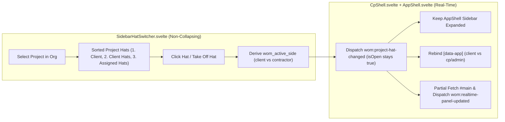

# CP Sidebar Hat Switcher & Mobile-First Multi-Orientation UI/UX Audit (`T603`)

- **Date**: 2026-11-01
- **Ticket**: `[[T603]]`
- **Decision Record**: [`AgDR-0054`](../../docs/decisions/AgDR-0054-mobile-first-multi-orientation-responsive-ui.md)
- **Design Skills Applied**: `webomage-design`, `figma-designer`, `landing-page-design`, `w0m/w0m-ui-expert`

## 1. Executive Summary

Following the introduction of org-scoped Project Hat switching (`T571`, `T600`), the Control Panel (`apps/cp`) sidebar exhibited three UX regressions identified in live testing:
1. **Redundant `VIEW SIDE` Switcher**: A manual `VIEW SIDE` (`w0m PM` vs `Client View`) toggle box sat above `Project Hats`, forcing users to flip two controls to change perspective even though selecting a `Client` hat vs a delivery hat (`PM`, `Tech Lead`) already determines the view side.
2. **Client Hat Ordering**: In projects where the user holds a Client hat (or client-side hats alongside delivery hats), `Client` was not prioritized first in the hat selector.
3. **Jarring Sidebar Collapse & Reload on Hat Selection**: Selecting or resetting a hat in `SidebarHatSwitcher.svelte` set `isOpen = false` and invoked `window.location.reload()`, collapsing the popover/sidebar and flashing the entire viewport instead of smoothly re-rendering `#main` and sidebar state in real time.

In addition, `AgDR-0054` establishes **Mobile-First Multi-Orientation Responsive UI** across the `@wom` estate (`Mobile Portrait/Landscape 0–767px`, `Tablet Vertical 768×1024`, `Tablet Horizontal 1024×768`, and `Desktop Well-Wrapped 1200px–1440px+`).

## 2. Architecture & Interaction Flow

## 3. Verified Changes (`T603` AC1–AC4)

| Surface | Before | After (`T603`) |
|---|---|---|
| **Responsive Contract (`AgDR-0054`)** | Desktop-first `grid-template-columns: 264px 1fr` with a single `max-width` collapse | Explicit 4-posture Mobile-First contract: Mobile Portrait/Landscape (`max-height: 600px` compact bars), Tablet Vertical (`768×1024`), Tablet Horizontal (`1024×768` persistent `232px` rail), and Desktop Well-Wrapped (`max-width: 1440px; min-width: 0; margin-inline: auto`) |
| **`VIEW SIDE` Switcher** | Manual `w0m PM` / `Client View` toggle box above Project Hats | Retired; `wom_active_side` (`client` vs `contractor`) is automatically derived from the selected hat (`isClientRoleSlug`) |
| **Hat Ordering** | Unsorted API/catalog order | `sortProjectHats()` places `Client` (`role_slug === "client"`) first (`rank 0`), followed by other client-side hats (`rank 1`), user's assigned project hats (`rank 2`), and catalog hats (`rank 3`) |
| **Real-Time Panel Re-Render** | `isOpen = false; window.location.reload()` collapsed popover and flashed page | `isOpen` stays `true`, `AppShell` preserves expanded sidebar, and `CpShell` updates `[data-app]` and `#main` smoothly in real time |
