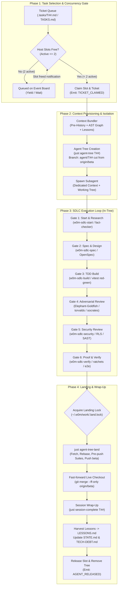
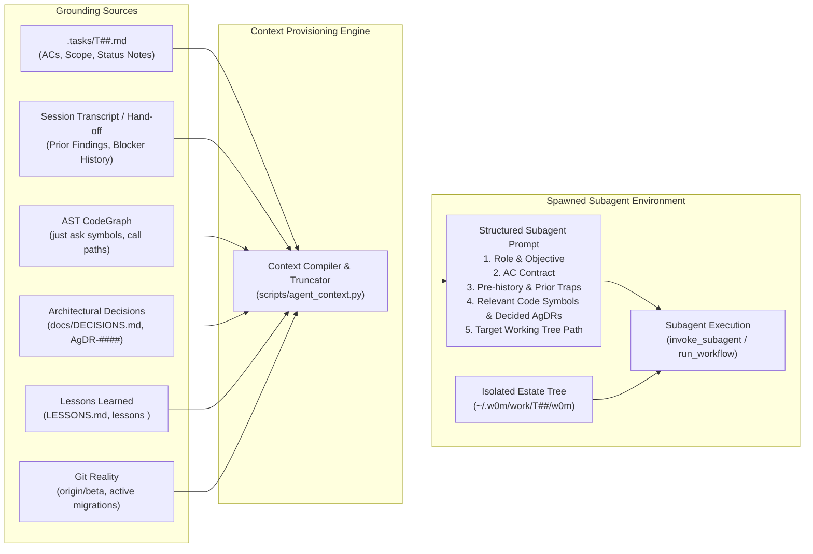
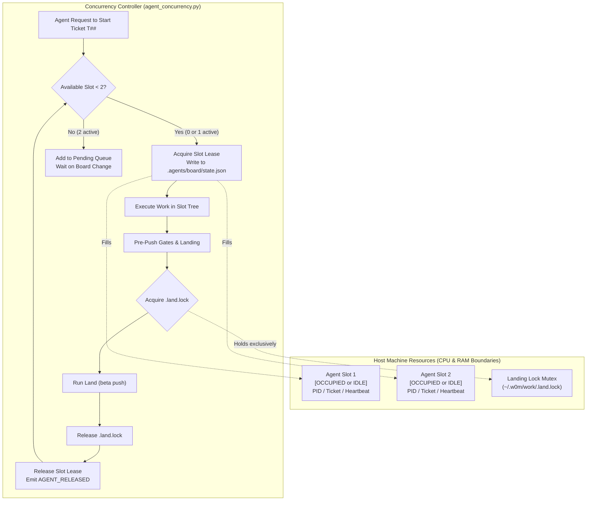

# AI-DLC & SDLC Multi-Agent Architecture: Lifecycle, Subagent Spawning, and Host Concurrency

**Date:** 2026-11-21  
**Ticket:** [[T683]]  
**Status:** Architecture Proposal & System Design  
**Author:** Antigravity (Coordinator)  
**Estates Covered:** `@wom` root, `w0m-web`, `w0m-api`, `w0m-cf`, `w0m-ext`, `w0m-sec`, `w0m-skills`, `w0m-mlx`  
**Related Decisions:** `AgDR-0032` (Agent Trees), `AgDR-0039` (Agent Transport Stack), `AgDR-0006` (AGENTS.md Control Plane), `AgDR-0007` (Cross-Agent Memory)  

---

## 1. Executive Summary & Problem Space

As autonomous AI development accelerates across the w0m estate, the boundary between traditional **Software Development Life Cycle (SDLC)** and **AI Development Life Cycle (AI-DLC)** must be formalized:

1. **SDLC (The "What" & "Rules"):** Deterministic contract and quality gates (`start` → `spec` → `build` → `review` → `security` → `verify` → `deploy` → `archive`). SDLC enforces the non-negotiables: no ungrounded tickets, TDD test-first implementations, strict RLS and secrets isolation, zero regression on ratchets, and verified clean landings.
2. **AI-DLC (The "How" & "Orchestration"):** The autonomous multi-agent operating loop that drives the SDLC: ticket ingestion, tailored context & pre-history compilation, isolated agent tree instantiation (`~/.w0m/work/<ticket-id>/w0m`), adversarial pair-programming (Elephant Builder + Goldfish Reviewer), and automated lessons harvesting.
3. **Host Concurrency Limit (Max 2 Agents):** Running heavy full-estate validation (Astro check across 5 apps, Vite bundling, Oxlint, Semgrep SAST, Vitest suites, TypeScript ratchets) consumes 1.5–2.5 GB RAM and 100%+ CPU per agent. Capping concurrent active agents on this host to **exactly 2** prevents memory exhaustion, OOM kills, and landing lock contention.
4. **Event-Driven Internal Agent Board (`.agents/board/`):** A shared, file-backed event stream (`events.jsonl`) and projected state (`state.json`) that provides real-time visibility into which agent owns what ticket, their current SDLC gate, heartbeats, and blockers.

---

## 2. End-to-End AI-DLC & SDLC Lifecycle



---

## 3. Subagent Spawning with Pre-History & Grounded Context

AI subagents fail when launched with either a blank slate (hallucinations, re-solving solved problems) or a bloated prompt (context overflow, dilution). The Context Provisioning Engine compiles an exact, structured bundle before spawning:



### Context Bundle Anatomy
Every spawned subagent receives 5 discrete sections:
1. **Mission & Acceptance Criteria:** The authoritative contract from `.tasks/T##.md` (DoD, non-negotiables).
2. **Pre-History & Session Trajectory:** Prior attempts, verified facts, user preferences, and reasons why previous approaches were abandoned.
3. **Grounded AST & Call Symbols:** Extracted via `codegraph` (`just ask "<symbols>"`) so the subagent doesn't blindly grep.
4. **Architectural Constraints (AgDRs) & Anti-Patterns:** Specific AgDR constraints (e.g. `AgDR-0055` Free-Tier-First, `AgDR-0032` Agent Trees, `AgDR-0054` multi-orientation UI contract).
5. **Target Workspace:** Absolute path to its isolated agent tree (`~/.w0m/work/<name>/w0m`), guaranteeing it never writes to the live tree.

---

## 4. Host Concurrency Gate (Max 2 Agents)



### Why Max 2 Agents on this Host?
1. **Pre-Push Heavy Gates:** `astro check` across 5 apps (`cp`, `me`, `web`, `job`, `join`) requires ~1.5 GB Node RSS and saturates multiple CPU cores. Running 3+ simultaneous pre-push runs causes severe CPU throttling and risks hitting the OOM killer.
2. **Landing Lock Contention:** Landings run sequentially against `origin/beta` using `~/.w0m/work/.land.lock`. With 2 agents, pipeline interleaving is optimal: Agent 1 builds/codes while Agent 2 tests/lands. With 3+ agents, agents spend excessive time waiting for the landing lock or rebasing after competitor pushes.

---

## 5. Event-Driven Internal Board (`.agents/board/`)

The internal board operates on a lightweight, append-only JSON Lines event stream with an atomic projected state JSON file.

### 1. Board Directory Structure
```
.agents/
└── board/
    ├── events.jsonl        # Append-only ledger of state transitions
    ├── state.json          # Materialized view of active agents, slots, and queues
    └── locks/
        ├── slot-1.lock     # Flocked file descriptor for Slot 1
        └── slot-2.lock     # Flocked file descriptor for Slot 2
```

### 2. Event Types & Schema
Every event written to `events.jsonl` contains:
```json
{
  "timestamp": "2026-11-21T23:25:00-05:00",
  "event_id": "evt_01JDJ5K...",
  "event_type": "GATE_ENTERED",
  "agent_id": "role-selector",
  "slot": 1,
  "ticket": "T790",
  "payload": {
    "gate": "verify",
    "details": "Running vitest ProjectManager.test.ts and svelte-typecheck-ratchet",
    "progress": "85%"
  }
}
```

Standard Event Types:
- `SLOT_ACQUIRED`: Agent claimed a slot (`slot-1` or `slot-2`).
- `TICKET_ASSIGNED`: Agent bound to a ticket (`T##`).
- `GATE_ENTERED`: State transition (`start`, `spec`, `build`, `review`, `security`, `verify`, `landing`).
- `HEARTBEAT`: Periodic liveness ping (stale threshold: 300s).
- `BLOCKED`: Agent waiting for dependency, user input, or review.
- `LANDING_LOCK_WAITING` / `LANDING_LOCK_ACQUIRED`: Agent entering release queue.
- `TICKET_COMPLETED`: Ticket marked done, ready for archive.
- `SLOT_RELEASED`: Agent cleaned up worktree and freed host slot.

### 3. Materialized Board State (`state.json`)
```json
{
  "updated_at": "2026-11-21T23:25:00-05:00",
  "max_concurrency": 2,
  "active_slots": {
    "1": {
      "status": "active",
      "agent_id": "role-selector",
      "ticket": "T790",
      "gate": "landing",
      "pid": 542554,
      "started_at": "2026-11-21T22:45:00-05:00",
      "last_heartbeat": "2026-11-21T23:24:50-05:00"
    },
    "2": {
      "status": "idle",
      "agent_id": null,
      "ticket": null,
      "gate": null,
      "pid": null,
      "started_at": null,
      "last_heartbeat": null
    }
  },
  "queued_tickets": []
}
```

---

## 6. Implementation Plan & Recipes

To integrate this model into the w0m toolchain:

| Recipe / Command | Purpose |
|---|---|
| `just agent-board` | Displays the live ANSI table of active slots, agents, tickets, and gates |
| `just agent-claim <ticket-id>` | Checks host concurrency (< 2), reserves slot, provisions agent tree & context bundle |
| `just agent-heartbeat <gate>` | Emits progress event and refreshes slot liveness lease |
| `just agent-release <agent-id>` | Releases slot lease, logs completion event, and cleans worktree |
| `just agent-prune-stale` | Watchdog command: frees dead-PID or timed-out slot locks (> 10m inactive) |

This architecture enforces ironclad concurrency bounds, transparent peer observability, and clean isolation across all estate repos.
