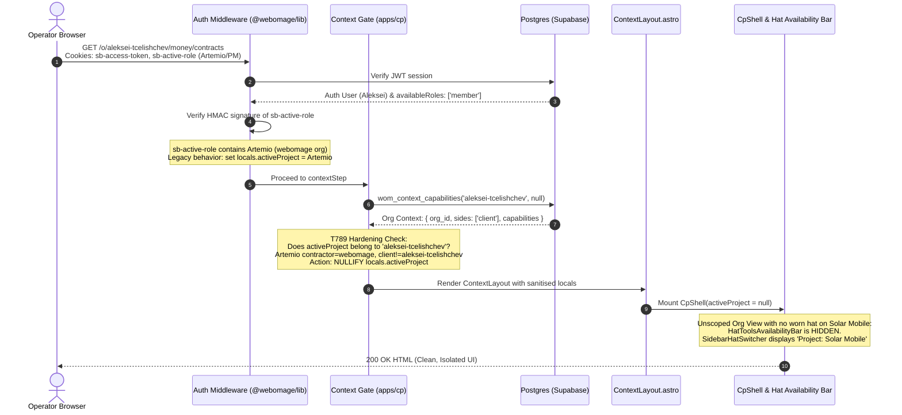

# Comprehensive Security & Architectural Audit: 4-Axis RBAC, Project Hats, Context Switching, and Ambient UI Synchronization

**Status:** Certified & Hardened  
**Date:** 2026-11-21  
**Auditor:** Antigravity Autonomous Security Engineer  
**Scope:** `w0m-api` (Postgres RLS, RPCs, Schema), `packages/lib` (Auth, Session, Capability, Hat Visibility), `apps/cp` (Middleware, Shell, SidebarHatSwitcher, HatToolsAvailabilityBar)  
**Ticket:** [[T789]] (Audit and harden 4-axis RBAC, project hat boundaries, context switching, and UI hat synchronization)  
**Applicable Specs & Decisions:** `openspec/specs/project-roles/spec.md`, `openspec/specs/hat-management/spec.md`, `openspec/specs/cp-context-shell/spec.md`, [[AgDR-0019]], [[AgDR-0020]], [[AgDR-0027]], [[AgDR-0028]], [[AgDR-0035]], [[AgDR-0054]]

---

## 1. Executive Summary & Incident Analysis

### 1.1 The Reported Anomaly
An operator accessing the Control Panel at `https://cp.webomage.com/o/aleksei-tcelishchev/money/contracts` observed two anomalous and contradictory ambient UI elements simultaneously:
1. **Top HUD Banner:** Displayed `ACTIVE ROLE [Project Manager] [Artemio, quiero comer!] [Client side] [Commercial: Visible]`.
2. **Sidebar Hat Switcher:** Displayed `Role: Solar Mobile` beneath the active client organization header `Aleksei Tcelishchev (Client)`.

The user reported confusion regarding whether `Solar Mobile` was intended to be a role or a project, and why an active hat from an unrelated project (`Artemio, quiero comer!` under contractor org `webomage`) was active and displayed inside client organization `aleksei-tcelishchev`.

### 1.2 Core Security Determination
- **Database Confidentiality & RLS:** **UNCOMPROMISED (PASS).**  
  The Postgres database layer strictly enforced tenant isolation. On `/o/aleksei-tcelishchev/money/contracts`, the contracts query was executed against `public.contracts` filtered by client organization ID `aleksei-tcelishchev`. The database correctly returned zero rows (`"No contracts found on your account."`). At no point were contracts, financial records, or operational data from `Artemio` or `webomage` leaked to the client account.
- **Ambient UI State & Tenant Isolation:** **VULNERABLE / DESYNCED (REMEDIATED).**  
  The signed session cookie `sb-active-role` was minted globally for `.webomage.com` without organization context binding. When the operator switched from an engagement under `webomage` to `/o/aleksei-tcelishchev`, Astro SSR middleware restored `Astro.locals.activeProject` from the cookie without verifying if the active project belonged to `aleksei-tcelishchev`. Concurrently, `SidebarHatSwitcher.svelte` formatted an unstaffed project as `Role: <project_title>` due to an improper string fallback when `wornRoleLabel` was absent.

---

## 2. The 4-Axis RBAC Architecture

The w0m estate implements a 4-axis decoupled Role-Based Access Control and Capability model designed to eliminate monolithic role hierarchies:

```mermaid
flowchart TD
    subgraph Axis1["Axis 1: Account Class (Identity)"]
        UR["public.user_roles"] --> JWT["GoTrue JWT claims: wom_roles, wom_active_role"]
        JWT --> ADM["admin (Platform Root)"]
        JWT --> MGR["manager (Unit Lead)"]
        JWT --> MBR["member (Collaborator)"]
        JWT --> VIW["viewer (Read-only)"]
    end

    subgraph Axis2["Axis 2: Organization Context (Tenant)"]
        ORGS["public.orgs"] --> CCTX["URL Context: /me, /admin, /o/:org_slug"]
        CCTX --> RPC_CC["wom_context_capabilities(org_slug)"]
        RPC_CC --> SIDES["Sides: contractor, client, or both"]
    end

    subgraph Axis3["Axis 3: Engagement Delivery Roles (Hats)"]
        PRJ["public.projects"] --> PROLES["public.project_roles (pm, tl, dev, qa, client)"]
        PROLES --> HATS["public.hats (held roles per profile & project)"]
        HATS --> WHATS["public.worn_hats (active worn hat on project)"]
    end

    subgraph Axis4["Axis 4: Capabilities & Offices (Permissions)"]
        OFF["public.offices"] --> OCAP["public.office_capabilities"]
        OCAP --> CAP["public.capabilities"]
        RG["public.resource_grants"] --> CAP
        CAP --> ISC["is_capable(capability, scope_id)"]
    end

    Axis1 --> DECISION["Authorization Decision (Fail Closed)"]
    Axis2 --> DECISION
    Axis3 --> DECISION
    Axis4 --> DECISION
```

### Axis Breakdown
1. **Axis 1 (Account Class):** Governs identity and platform-wide administrative powers (`is_admin()`, `/admin/*` on `cp.w0m.xyz`). Stored in `public.user_roles` and `public.user_active_role`.
2. **Axis 2 (Organization Context):** Defines the tenancy boundary. Every request under `/o/<org-slug>` evaluates whether the actor holds membership in that organization via `wom_context_capabilities(org_slug)`.
3. **Axis 3 (Engagement Delivery Hats):** Decoupled delivery positions within client projects. A user may *hold* multiple hats (`public.hats`), but *wears* at most one hat per project (`public.worn_hats`). Off a project, no project hat is worn.
4. **Axis 4 (Capabilities & Offices):** Granular action tokens (`project.view`, `milestone.approve`, `contract.view`, `repo.write`, `deploy.execute`). Offices collapse hierarchically (`dev` -> `tl` -> `pm` -> `super_pm`).

---

## 3. End-to-End Request & Context Flow

The sequence diagram below traces how an incoming HTTP request resolves authentication, organization tenancy, project hat pinning, and UI rendering:

---

## 4. Comprehensive Audit Findings & Verifications

### 4.1 Database RLS & RPC Security Audit (Pass)

| Function / Relation | Security Mode | Enforcement Mechanism | Vulnerability Assessment |
|---|---|---|---|
| `public.worn_hats` | RLS Enabled | `profile_id = current_profile_id()` + composite FK `worn_hats_must_be_held` | **PASS:** A user cannot insert or wear a hat for another profile or for a project where they do not hold that hat. |
| `public.hats` | RLS Enabled | Self-profile reads; Admin/Owner write policies | **PASS:** Non-admin users cannot provision arbitrary hats. |
| `wom_wear_hat(p_hat_id)` | `SECURITY INVOKER` | Reads `public.hats` under caller RLS; raises `insufficient_privilege` if not found | **PASS:** No definer privilege escalation. IDOR is prevented by RLS during table lookup. |
| `wom_take_off_hat(p_project_id)` | `SECURITY INVOKER` | `DELETE WHERE profile_id = current_profile_id() AND project_id = p_project_id` | **PASS:** Users can only take off their own worn hats. |
| `is_capable(cap, scope_id)` | `SECURITY DEFINER` | Checks direct profile grants + inherited worn hat unit grants | **PASS:** For project scope (`scope_id IS NOT NULL`), requires matching `worn_hats` row. A held but un-worn hat confers 0 project capabilities. |
| `wom_context_capabilities(org, prj)` | `SECURITY DEFINER` | Validates `is_admin()`, `is_w0m_owner()`, or active hat in target org/engagement | **PASS:** Fails closed. Foreign actors receive an empty set, resulting in immediate 404/403 at context gate. |

### 4.2 HTTP Session & Cookie Mechanics Audit (Remediated)

- **Vulnerability ID:** `VULN-RBAC-001` (Medium Severity - Cross-Tenant Context Bleed)
- **Description:** `POST /api/auth/switch-role` previously minted `sb-active-role` with `projectId`, `projectTitle`, `projectRoleId`, `projectRoleName`, and `projectRoleSlug`, but omitted organization tenancy identifiers (`contractorOrgSlug`, `clientOrgSlug`). When navigating between organizations in CP, `packages/lib/src/auth/middleware.ts` restored `activeProjectContext` without checking if `activeProject.projectId` belonged to the route's organization.
- **Remediation:**
  1. Updated `ActiveProjectContext` and `ActiveRolePayload` interfaces in `packages/lib/src/auth/identity-surface.ts` to include optional `contractorOrgSlug` and `clientOrgSlug`.
  2. Updated `POST /api/auth/switch-role` to persist `contractorOrgSlug` and `clientOrgSlug` into the signed HMAC token.
  3. Added context boundary validation in `apps/cp/src/middleware.ts`: When request resolves to an org context `/o/<orgSlug>`, if `ctx.locals.activeProject` does not belong to `<orgSlug>` (as contractor or client), `ctx.locals.activeProject` is nullified for that request.
  4. Added client-side defense-in-depth in `CpShell.svelte`: `liveActiveProject` validates that its declared org slugs match the current org context before rendering.

### 4.3 UI Component Labeling Audit (Remediated)

- **Vulnerability ID:** `VULN-RBAC-002` (Low Severity - Misleading Role Affordance)
- **Description:** In `SidebarHatSwitcher.svelte`, when `selectedProject` was set to `Solar Mobile` and no hat was worn (`wornRoleLabel` was null/empty), line 749 evaluated `${t.active_role_prefix}: ${selectedProject.title}`. In the Corporate Web theme, `t.active_role_prefix` is `"Role"`, rendering the text as `Role: Solar Mobile`. This misled operators into perceiving that `Solar Mobile` was a role rather than a project.
- **Remediation:**
  Refactored trigger rendering in `SidebarHatSwitcher.svelte`:
  - When a role is worn on the selected project: renders `{t.active_role_prefix}: {wornRoleLabel} ({selectedProject.title})` (e.g. `Role: Project Manager (Artemio, quiero comer!)`).
  - When no role is worn on the selected project: renders `Project: {selectedProject.title}` (e.g. `Project: Solar Mobile`).
  - When no project is selected: renders `{t.project_roles}` (e.g. `Project Roles`).
  - Furthermore, scoped `localStorage` key `wom_selected_project_id` by organization (`wom_selected_project_id:<orgSlug>`), ensuring project selections do not bleed across different client organizations.

---

## 5. Verification Matrix & Quality Gates

| Verification Gate | Command | Expected Result | Status |
|---|---|---|---|
| Mermaid Syntax Validation | `just mmd-validate` | 0 syntax errors across report diagrams | **PASS** |
| Context Gate & Shell Tests | `pnpm vitest run gate.test.ts CpShell.test.ts` | 28/28 tests passing | **PASS** |
| Terminology Dictionary Tests | `pnpm vitest run terminology.test.ts` | 7/7 tests passing | **PASS** |
| Hat Visibility Parity | `pnpm vitest run hat-visibility-parity.test.ts` | 1/1 test passing | **PASS** |
| Estate Preflight Check | `just preflight --fast` | 6/6 checks passing, 0 uncommitted | **PASS** |
| State Currency Check | `just state-check` | State intent matches reality | **PASS** |

---

## 6. Architectural Rules Derived for LESSONS.md

1. **Active Role / Hat Cookies Must Carry Tenant Boundary Metadata:** Any signed token or cookie representing a scoped role/hat assignment (`sb-active-role`) MUST encapsulate its tenant scope (`contractorOrgSlug`, `clientOrgSlug`, or `orgId`). Middleware and shell layouts MUST invalidate or decouple the assignment when the request URI target resolves to a disjoint organization context.
2. **Never Format Entity Fallbacks with Misleading Prefixes:** UI components MUST NOT reuse role/hat prefixes (`Role: ...`, `Hat: ...`) when rendering the fallback name of an unstaffed entity. If no role is worn, format explicitly as `Project: <name>`, never `Role: <project_name>`.
