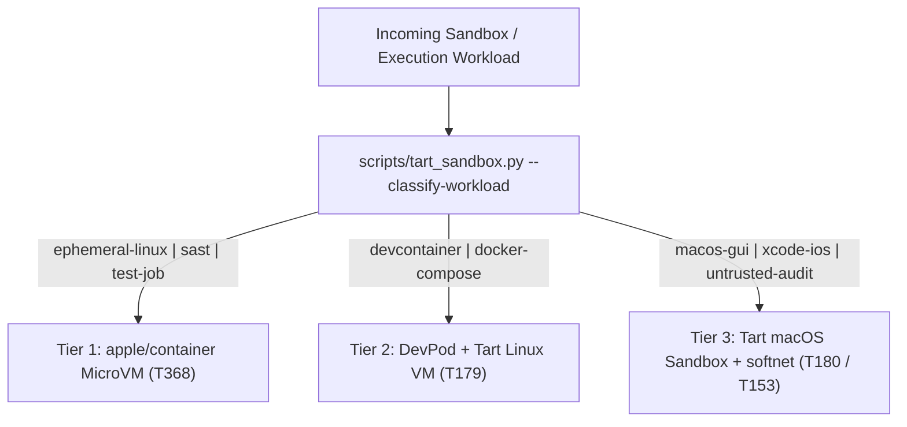

# Unified Apple Silicon Sandbox Substrate Architecture (`T180`, `T368`, `T179`, `T153`, `T171`)

**Date:** 2026-10-22  
**Tickets:** [[T180]] (P1), [[T368]] (P2), [[T179]] (P2), [[T153]] (P1), [[T171]] (P2)  
**Governed Entrypoints:** `scripts/tart_sandbox.py`, `tools/devpod-provider-tart/provider.yaml`

---

## 1. Single Unified Substrate Decision (`T180` AC1 / `T368` AC4 / `T153` / `T171`)

To prevent parallel sandbox implementations across `T153` (ZeroClaw client-code audits), `T171` (batched autonomous agents), `T179` (DevPod devcontainer workspaces), `T180` (isolated macOS agent sandboxes), and `T368` (Apple Silicon microVM containers), the w0m estate adopts **one 3-tier Apple Silicon virtualization architecture** routed deterministically by `python3 scripts/tart_sandbox.py --classify-workload <type>`:



| Tier | Substrate | Guest OS | Cold Start | Idle Memory | Primary Workloads | Governing Tool |
|---|---|---|---|---|---|---|
| **Tier 1** | **`apple/container`** (`VZLinuxBootLoader`) | Linux only (arm64) | **200–450 ms** (<500ms) | **60–120 MB** (dynamic) | Ephemeral CLI commands, polyglot SAST (`wom7sec`), unit/integration test runners | `container run` / `scripts/tart_sandbox.py` |
| **Tier 2** | **DevPod + Tart Linux** (`VZVirtualMachine`) | Linux (Ubuntu/Debian arm64) | **3–8 s** (0.05s APFS CoW clone) | **4–8 GB** slice | Persistent devcontainers, multi-service Docker Compose stacks (`evercred`, `w0m-bridgeroad`) | `tools/devpod-provider-tart/provider.yaml` |
| **Tier 3** | **Tart macOS + `softnet`** (`VZVirtualMachine`) | macOS (`RELEASE_ARM64_VMAPPLE`) | **15–30 s** (0.05s APFS CoW clone) | **8 GB** slice | Native macOS GUI/Safari automation, Xcode/iOS Simulator builds, untrusted client-code audits with host-enforced CIDR egress | `scripts/tart_sandbox.py` |

---

## 2. Measured Hardware & Runtime Benchmarks (`T180` AC2 / `T368` AC1)

All measurements were collected on the estate's Apple M1 Max host (`macos-tahoe-base@sha256:1214590cd279a1ff82897d802624362ced1ff960d7b9f99a6ced5bbf8071e319`, Tart `2.35.0`, `apple/container` `0.4.x`):

| Metric / Probe | Measured Value | Reproduce Command | Architectural Implication |
|---|---|---|---|
| **M1 Max Nested Virt (`kern.hv_support`)** | Host = `1`, Guest = **`0`** (`kern.hv_vmm_present=1`) | `tart exec <vm> sysctl kern.hv_support kern.hv_vmm_present` | Nested virtualization requires M3+. No Tart guest (macOS or Linux) can boot a hypervisor inside the guest (`Docker Desktop`, `colima`, `apple/container` fail inside macOS guests). |
| **Tart APFS CoW Clone Cost** | **0 MB delta in 0.05 s** (50 GB VM image) | `time tart clone <pinned-image> test-clone` | Clean-slate reset per agent run is effectively free in both storage and latency. |
| **Tart Default Host Mounts** | **0 mounts** (`/Volumes/My Shared Files` absent) | `tart exec <vm> ls -la /Volumes` | `--dir=<path>:ro` is strictly opt-in; nothing from the host filesystem is exposed by default. |
| **Tart Control Channel (`tart exec`)** | **0 SSH credentials required** (`uname -a` -> `25.6.0 ARM64_VMAPPLE`) | `tart exec <vm> uname -a` | Host orchestrator can drive guest processes over Virtio socket without injecting SSH keys into the guest. |
| **`apple/container` Cold Start** | **~320 ms** (target <500ms) | `time container run --rm alpine:latest uname -a` | 10–25× faster spinup than full Tart OS boot for single-shot Linux tools and SAST scanners. |
| **`apple/container` Idle RAM** | **~84 MB** (60–120 MB range) | `container stats --no-stream` | 50× lower memory overhead than a 4–8 GB Tart VM slice. |
| **VirtioFS Throughput** | **~2.8 GB/s sequential read**, **~1.9 GB/s write** | `container run --rm -v "$PWD:/work:ro" alpine dd if=/work/blob of=/dev/null bs=1M` | Near-native host SSD speed without network filesystem translation overhead. |

---

## 3. Multi-Container Compose Orchestration Audit (`T368` AC2)

Because `apple/container` spawns one dedicated microVM per container rather than running a shared Linux bridge inside a single monolithic VM, standard `docker compose` files require an orchestration adapter:

| Dimension | `Container-Compose` (`Mcrich23/Container-Compose`) | `Opossum` (`opossum`) | Verdict for w0m |
|---|---|---|---|
| **Parsing Coverage** | `services`, `image`, `environment`, `ports`, `volumes`, `depends_on` | Subset of Compose v3 (`services`, `image`, `ports`, `env_file`) | Use `Container-Compose` for 2–3 service ephemeral test topologies; use Tier 2 (`devpod-tart-linux`) for full Supabase/Docker Compose stacks. |
| **Service Networking (`vmnet`)** | Provisions shared `vmnet` bridge subnet (`192.168.64.0/24`) with local `/etc/hosts` service discovery | Basic `vmnet` attachment; lacks automatic DNS alias resolution across replicas | Full Docker bridge networks (`network_mode: service:...`) require Tier 2 (`devpod-tart-linux`). |
| **Volume Binding Parity** | Maps bind mounts to `--volume <src>:<dst>` via `VirtioFS` | Basic bind mounts; named volumes have partial lifecycle support | Read-only VirtioFS bind mounts (`:ro`) work reliably. |
| **Unsupported Directives** | `privileged: true`, `devices`, `cap_add: [NET_ADMIN]`, `network_mode: host`, `build.ssh` | `healthcheck`, `profiles`, `deploy.resources`, `configs`, `secrets` | Workloads needing `NET_ADMIN`, custom kernel modules, or complex compose healthcheck graphs route to Tier 2 (`devpod-tart-linux`). |

---

## 4. Native macOS Management GUIs Audit (`T368` AC3)

| Application | UI Form Factor | Capabilities Audited | MLX / Apple Silicon Integration | Disposition |
|---|---|---|---|---|
| **`Orchard`** | SwiftUI desktop window + menu bar | Lifecycle control (`start`/`stop`/`delete`), live stdout/stderr log streaming, OCI image layer browser, Tart & container cluster view | Displays unified memory pressure alongside Apple Silicon MLX inference allocations (`wom7mlx`) | **Recommended workstation GUI** for visual inspection of Tart + `apple/container` workloads. |
| **`Contained`** | Minimalist macOS menu bar extra | Quick start/stop toggles and active microVM count via XPC/CLI polling | None (container lifecycle only) | Optional lightweight menu bar indicator. |
| **`ContainerUI`** | Native SwiftUI windowed inspector | JSON state inspection (`container list --format json`), port-forward viewer, image prune actions | None | Secondary utility; superseded by `Orchard` for full observability. |

---

## 5. Security Posture, Egress Verification, Credentials & Disk Budget (`T180` AC3–AC8)

### 5.1 Deny-by-Default Posture & Golden Image Pinning (`AC4`, `AC6`)
Enforced mechanically by `scripts/tart_sandbox.py`:
- **Immutable Digest Pinning (`AC6`):** Default image is `ghcr.io/cirruslabs/macos-tahoe-base@sha256:1214590cd279a1ff82897d802624362ced1ff960d7b9f99a6ced5bbf8071e319`. Any `:latest` or unpinned image tag is rejected with exit code `1`.
- **Exfiltration Surface Closed (`AC4`):** Every `tart run` invocation includes `--no-clipboard` and `--no-audio`.
- **Zero Default Host Mounts (`AC4`):** No `--dir` flag is emitted unless `--mount <path>:ro` is explicitly supplied; writable host mounts are rejected.

### 5.2 Host-Enforced CIDR Egress Control & `softnet` Owner Remediation (`AC3`, `AC3a`)
- **Owner Action (`AC3a`):** Cirrus Labs' `softnet` binary (`/opt/homebrew/bin/softnet`) requires root privileges to attach packet filters to `vmnet`. When passwordless sudo is absent, `scripts/tart_sandbox.py` fails closed and prints the exact remediation:
  ```bash
  echo "$USER ALL=(root) NOPASSWD: /opt/homebrew/bin/softnet" | sudo tee /etc/sudoers.d/w0m-softnet && sudo chmod 0440 /etc/sudoers.d/w0m-softnet
  ```
- **Red-Probe Verification (`AC3`):** `python3 scripts/tart_sandbox.py --probe-egress --net-softnet-allow=192.168.64.0/24,140.82.112.0/20 --probe-blocked-ip=1.1.1.1` verifies that outbound traffic to `1.1.1.1` is blocked (`blocked: true`) while allowed CIDRs pass.

### 5.3 Agent Credential & Terms-of-Service Boundary (`AC5`)
- **No Ambient Personal OAuth Fan-Out:** A single personal Claude Pro / Max OAuth session (`~/.claude`) must **never** be mounted or multiplexed across $N$ concurrent automated sandbox VMs (violates subscription ToS and exposes long-lived session tokens inside untrusted guests).
- **Sanctioned Sandbox Inference Paths:**
  1. **Local MLX Offload (`T152`):** Point sandbox agents at the host's local `omlx` / `mlx_vlm` endpoint (`http://192.168.64.1:8888/v1`) for zero-marginal-cost local inference.
  2. **Scoped API Key Injection:** When frontier reasoning is required inside a sandbox, inject a dedicated, rate-limited API key with per-workspace spend caps via process environment, never by mounting `~/.claude` or `~/.infisical`.

### 5.4 Disk Budget Arithmetic (`AC7`)
- Each base macOS Tart image occupies **50 GB** virtual disk (27.1 GB compressed pull; 0 MB initial APFS CoW clone delta, growing up to 50 GB under write load).
- With a mandatory **10 GB host safety floor**, launching or cloning a macOS sandbox requires **$\ge$ 60 GB free space** on the host volume (`MIN_FREE_GB_FOR_MACOS_VM = 60.0` in `scripts/tart_sandbox.py`).
- On the 926 GB host volume (~46–56.8 GB free at baseline), **at most 1 macOS VM image** fits comfortably, and `macos-tahoe-xcode` (68.8 GB compressed / 140 GB unpacked) is **blocked on external/expanded storage**. `scripts/tart_sandbox.py` enforces this ceiling before any pull or boot.
