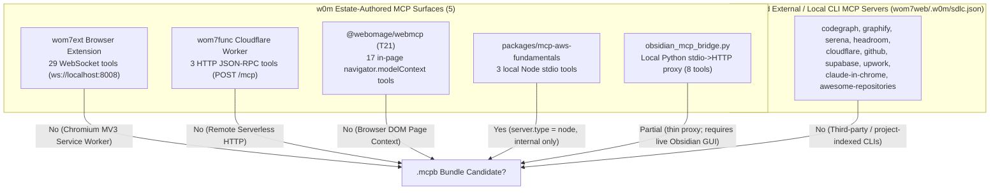

# T269 Research Report: Anthropic MCPB / DXT Packaging vs w0m Skills & Portable Toolchain (T212)

- **Ticket**: `T269` (Cross-referenced with `T212`, `T209`, `T127`, `T21`, `T154`)
- **Date**: 2026-10-21
- **Status**: Completed (AC1–AC7 grounded across primary specifications, live estate code, and client repositories)
- **Author**: w0m Agent Research (`fact-checker` + `socrates` + `schema-critique` Triangulated SSOT)

---

## 1. Executive Summary

This report evaluates Anthropic's **Desktop Extensions (`.dxt`)** and **MCP Bundles (`.mcpb`)** packaging specification against the w0m estate's existing skill/plugin distribution architecture:
1. **`wom7skills` Universal Agent Plugin (`T209`, `T212`)**: `.claude-plugin/plugin.json` + `plugin.json` distributing 54 canonical `SKILL.md` skills, slash commands (`commands/tasks.md`, `commands/sync-tickets.md`, `commands/status.md`), and the portable Python/`just` CLI toolchain (`tools/w0m_portable_cli.py`, `templates/w0m.just`).
2. **`w0m_skill.ts` / `skills-sync` Governance Layer (`T127`)**: `.w0m/skills.json` + `.w0m/skills.lock.json` enforcing per-file `sha256` directory integrity and `observed_version` drift gates across Claude Code, Antigravity, OpenCode, and client repositories.

### Key Findings

1. **`.dxt` and `.mcpb` are the same specification before and after a September 2025 rename (AC1)**: Anthropic introduced Desktop Extensions (`.dxt`, `@anthropic-ai/dxt`) in June 2025 (`manifest_version: "0.1"`) and renamed the project, CLI, and file extension to **MCP Bundles (`.mcpb`, `@anthropic-ai/mcpb`)** under the `modelcontextprotocol/mcpb` repository (`manifest_version: "0.3"` / `"0.4"`).
2. **`.mcpb` is a ZIP container strictly for local `stdio` MCP servers (`node`, `python`, `binary`) — NOT a skill, slash-command, or `just` recipe distribution format (AC1, AC4, AC5)**: The `.mcpb` `manifest.json` schema has no fields for `SKILL.md` progressive-disclosure skills, slash commands (`commands/*.md`), subagents (`agents/*.md`), hooks, or `just` build/SDLC recipes.
3. **Only 1 of 5 estate-authored MCP surfaces (`packages/mcp-aws-fundamentals`) is a standalone local `stdio` server eligible for `.mcpb` bundling (AC3)**: The estate's core custom MCP surfaces are either a remote Cloudflare Worker HTTP JSON-RPC server (`wom7func` `POST /mcp`), a Chromium MV3 extension WebSocket bridge (`wom7ext` `mcpService.ts`), or an in-page W3C/Chromium `navigator.modelContext` manifest (`@webomage/webmcp`, `T21`).
4. **Recommendation — Defer `.mcpb` adoption (`Option C`, weighted score `8.85 / 10`) (AC6)**: Keep `wom7skills` (`.claude-plugin/plugin.json` + `w0m_skill.ts` + `T212` portable toolchain) as the single canonical distribution channel for skills, commands, and SDLC recipes. Revisit `.mcpb` only if Webomage publishes a standalone local `stdio` MCP server targeted at non-developer Claude Desktop GUI users.

---

## 2. Primary-Source Specification Analysis: `.dxt` to `.mcpb` (AC1)

### 2.1 Primary Sources Inspected

- **Canonical Repository & Spec**: `https://github.com/modelcontextprotocol/mcpb` (formerly `https://github.com/anthropics/dxt`, redirected upon transfer to the `modelcontextprotocol` organization).
- **Specification & Manifest Schema**:
  - `MANIFEST.md`: `https://github.com/modelcontextprotocol/mcpb/blob/main/MANIFEST.md`
  - JSON Schema (`0.3` / `0.4`): `https://github.com/modelcontextprotocol/mcpb/blob/main/schemas/mcpb-manifest-v0.3.schema.json`
- **Reference Toolchain**: `@anthropic-ai/mcpb` on npm (superseding deprecated `@anthropic-ai/dxt`), providing `mcpb init`, `mcpb validate`, `mcpb pack`, `mcpb sign`, `mcpb verify`, `mcpb info`, and `mcpb unpack`.

### 2.2 Relationship Between `.dxt` and `.mcpb`

| Attribute | `.dxt` (Desktop Extensions) | `.mcpb` (MCP Bundles) |
|---|---|---|
| **Status** | Deprecated alias (supported for backward compatibility in Claude Desktop) | Canonical specification and file extension |
| **NPM Package** | `@anthropic-ai/dxt` (deprecated) | `@anthropic-ai/mcpb` (active) |
| **Manifest Version** | `"0.1"` / `"0.2"` (`dxt_version` field in early drafts) | `"0.3"` / `"0.4"` (`manifest_version` field) |
| **Core Purpose** | Single-click installation of local `stdio` MCP servers in Claude Desktop | Identical: ZIP archive bundling a local `stdio` MCP server (`node`, `python`, or `binary`) + `manifest.json` |

### 2.3 Archive Layout

An `.mcpb` file is a standard ZIP archive containing:

```text
bundle.mcpb (ZIP archive)
├── manifest.json              # Required root metadata, server entry_point, user_config, tools
├── icon.png                   # Optional icon (or icons[] array in v0.3+)
├── server/                    # Bundled executable code
│   └── index.js               # Entry point (or Python package / compiled binary)
├── node_modules/              # Vendored production dependencies (for server.type == "node")
└── [PKCS#7 signature block]   # Optional appended signature footer created by `mcpb sign`
```

### 2.4 `manifest.json` Schema Structure (`manifest_version: "0.3"`)

The root `manifest.json` requires:
- `manifest_version`: `"0.3"` (or `"0.4"`).
- `name`: Machine-readable identifier (`string`).
- `version`: Semantic version (`string`).
- `description`: Short human-readable summary (`string`).
- `author`: `{ "name": string, "email"?: string, "url"?: string }`.
- `server`: **(Required)** Execution descriptor for a local `stdio` MCP process:
  - `type`: Enum strictly restricted to `"node" | "python" | "binary"`.
  - `entry_point`: Relative path inside the ZIP archive (e.g., `"server/index.js"`).
  - `mcp_config`:
    - `command`: Executable (`"node"`, `"python"`, or `"${__dirname}/bin/server"`).
    - `args`: Array of CLI arguments supporting template variables `${__dirname}`, `${user_config.<key>}`, `${HOME}`, `${DESKTOP}`, `${DOCUMENTS}`, `${DOWNLOADS}`, `${ sep }`.
    - `env`: Key-value environment map injected into the spawned process.
    - `platform_overrides`: Optional OS-specific (`darwin`, `win32`, `linux`) overrides for `command`, `args`, `env`.
- `user_config`: Optional dictionary of user-supplied settings (`type` ∈ `"string" | "number" | "boolean" | "directory" | "file"`, `title`, `description`, `required`, `default`, `multiple`, `sensitive`, `min`, `max`). When `sensitive: true`, the host GUI (Claude Desktop) prompts the user once and stores the secret in the OS native keychain (macOS Keychain / Windows Credential Manager / libsecret).
- `tools`: Optional static array of `{ "name": string, "description"?: string }` for GUI preview before the server spawns (`tools_generated: true` if dynamic).
- `prompts`: Optional static array of prompt templates (`name`, `description`, `arguments`, `text`).
- `compatibility`: Optional `{ "claude_desktop"?: string, "platforms"?: ("darwin" | "win32" | "linux")[], "runtimes"?: { "node"?: string, "python"?: string } }`.

### 2.5 Signing & Integrity Model

- **`mcpb sign` / `mcpb verify`**: `.mcpb` supports cryptographic code signing using X.509 certificates (CA-issued or `--self-signed` for testing) appended as a PKCS#7 / CMS signature block.
- **Limitation vs w0m Lockfile (`T127`)**: `.mcpb` signing authenticates the *publisher of a monolithic ZIP archive* at install time, whereas w0m's `.w0m/skills.lock.json` verifies *per-skill content hashes (`sha256-<hex>`) and git-tracked manifest coherence on every commit/pre-push* across unpacked repository trees.

---

## 3. Client & Host Compatibility Matrix (AC2)

The table below distinguishes native `.mcpb` archive loading from `.claude-plugin/plugin.json` (Claude Plugin format, `T209`/`T212`), `.agents/skills/` (`SKILL.md` directory convention, `T127`), and standard `.mcp.json` / config-based MCP servers.

| Client / Host | `.mcpb` / `.dxt` Archive Support | `.claude-plugin/plugin.json` Support (`T209`/`T212`) | `.agents/skills/*/SKILL.md` Support (`T127`) | Standard MCP Config (`stdio` + Remote HTTP/SSE) |
|---|---|---|---|---|
| **Claude Desktop (GUI)** | **Native** (Settings -> Extensions drag-and-drop; ships built-in Node.js runtime; stores `user_config` secrets in OS Keychain) | Partial (via Cowork / Claude Code integration; GUI Extensions pane expects `.mcpb`) | Via project directory mount or Cowork plugin | `claude_desktop_config.json` (`stdio` native; remote HTTP via account connectors or `mcp-remote`) |
| **Claude Code (CLI)** | **Not primary** (uses `.mcp.json`, `claude mcp add`, and `.claude-plugin/plugin.json`; does not provide a GUI prompt for `.mcpb` `user_config`) | **Native** (`--plugin-dir`, `/plugin install`, loads `skills`, `commands`, `agents`, `hooks`, `mcpServers`) | **Native** (`.claude/skills/` and `.agents/skills/`) | **Native** (`.mcp.json` / `~/.claude.json` supporting `stdio`, `http`, `sse`) |
| **Antigravity (`agy`)** | **Unsupported** (no `.mcpb` ZIP loader or `user_config` keychain dialog) | **Supported via root `plugin.json`** (`T209` dual-manifest bridge) | **Native** (`.agents/skills/*/SKILL.md`) | **Native** (`mcp_config.json` supporting `stdio` and remote HTTP) |
| **OpenCode** | **Unsupported** (no `.mcpb` ZIP loader) | Indirect (reads `.agents/skills/` and `.claude/skills/` unpacked trees) | **Native** (`.agents/skills/*/SKILL.md` verified in `T209`) | **Native** (`opencode.json` `mcp` section for `local` stdio and `remote` HTTP) |
| **Cursor** | **Unsupported** (uses `.cursor/mcp.json` or Cursor Extension marketplace, not `.mcpb`) | Partial (reads `.claude/skills/` / `.agents/skills/` rules in recent builds) | **Supported** (`.agents/skills/` / `.cursor/rules/`) | **Native** (`.cursor/mcp.json` for `stdio` and `sse` / Streamable HTTP) |
| **VS Code (Copilot / Continue / Cline)** | **Unsupported** (uses `.vscode/mcp.json` or VSIX extensions, not `.mcpb`) | Unsupported natively | Supported via agent extensions reading `.agents/skills/` | **Native** (`.vscode/mcp.json` in VS Code 1.99+) |

**Takeaway (AC2)**: `.mcpb` is overwhelmingly a **Claude Desktop GUI** convenience format (solving two desktop GUI pain points: missing system Node.js on non-developer laptops and GUI textboxes for API keys). Across the 4 primary agent coding clients declared in `wom7skills/client-matrix.json` (`claude-code`, `claude-desktop`, `antigravity`, `opencode`), `.mcpb` is natively consumed by **only 1 of 4 (`claude-desktop`)**, whereas unpacked `SKILL.md` + `.claude-plugin/plugin.json` (`T209`/`T212`) works across **all 4**.

---

## 4. Audit of w0m Estate MCP Surfaces (AC3)

We audited every MCP server declaration and implementation across the 7-repo w0m estate (`wom7web/.w0m/sdlc.json`, `.mcp.json`, `wom7web/project/mcp-exposure-baseline.json`, `wom7ext`, `wom7func`, and `wom7web/packages/*`).



### 4.1 Estate-Authored MCP Implementations (5 Surfaces)

| Estate Surface | Location | Transport & Runtime | Tool Count | `.mcpb` Bundleable? | Technical Verdict |
|---|---|---|---|---|---|
| **1. `wom7func-mcp`** | `wom7func/src/index.ts` (`POST /mcp`) | Remote Cloudflare Worker HTTP JSON-RPC 2.0 (`https://func.webomage.com/mcp`, Bearer `WEBHOOK_SECRET`) | **3 tools** (`estate_health`, `bid_estimator`, `backup_freshness`) | **No** | `.mcpb` only supports `server.type` ∈ `{"node", "python", "binary"}` over local `stdio`. Remote HTTP servers are configured via URL, not ZIP bundles. |
| **2. `wom7ext` MCP Bridge** | `wom7ext/extension/src/services/mcpService.ts` + `mcpTools/*.ts` | Chromium MV3 Extension Service Worker over WebSocket (`ws://localhost:8008`) | **29 tools** (28 across 8 `mcpTools/*` modules + `fetch_extension_logs`) | **No** | Runs inside the browser's extension context with Chrome `tabs`/`scripting`/`debugger` APIs; distributed as a Chrome Web Store / unpacked CRX extension, never a Node/Python stdio ZIP. |
| **3. `@webomage/webmcp` (`T21`)** | `wom7web/packages/webmcp/src/manifest.ts` + `register.ts` | In-browser W3C/Chromium `navigator.modelContext` / `document.modelContext` + `/api/chat` tool registry | **17 tools** across 5 role tiers (`public`: 3, `member`: 4, `admin`: 5, `client`: 3, `recruit`: 2) | **No** | Executes inside the web application's browser tab context (`webomage.com` / `cp.webomage.com`) with zero local OS process. |
| **4. `@w0m/mcp-aws-fundamentals`** | `wom7web/packages/mcp-aws-fundamentals/index.mjs` | Local Node.js `stdio` (`@modelcontextprotocol/sdk`) | **3 tools** (`search_cdk_constructs`, `get_cloudformation_quotas`, `get_iam_actions`) | **Yes (`server.type: "node"`)** | Pure local Node.js `stdio` server with a single `index.mjs` entry point. Technically trivial to pack as `.mcpb`, but low value because w0m infra runs on Cloudflare + Supabase (`T269`). |
| **5. `obsidian-wom7web` Bridge** | `wom7web/project/scripts/obsidian_mcp_bridge.py` | Local Python 3 `stdio`-to-HTTP proxy (`127.0.0.1:3007/mcp` -> Obsidian `semantic-vault-mcp`) | **8 tools** (`vault`, `edit`, `view`, `manage`, `search`, `graph`, `dataview`, `system`) | **Partial / Low Value** | The 90-line stdlib Python script could be wrapped in `.mcpb` (`server.type: "python"`), but it is useless without a running local Obsidian Desktop instance with `semantic-vault-mcp` enabled on port 3007. |

### 4.2 Configured MCP Servers in `wom7web/.w0m/sdlc.json` (`mcp.servers`)

`wom7web/.w0m/sdlc.json` currently declares **13 active keys** under `mcp.servers` (with `stripe`, `sentry`, `context7`, and `playwright` tracked in the historical operational catalog / `mcp-exposure-baseline.json`):

1. **`codegraph`** (`codegraph serve --mcp`, local binary indexing git worktrees) — Not a static `.mcpb` candidate because it indexes the live repo `.codegraph/` database.
2. **`graphify`** (`uv run --project wom7web python -m graphify.serve graphify-out/graph.json`) — Bound to project-specific `graphify-out/graph.json`.
3. **`serena`** (`uvx --from git+https://github.com/oraios/serena serena start-mcp-server --context ide-assistant`) — Third-party LSP/AST server managed via `uvx`.
4. **`headroom`** & **`headroom-proxy`** — Local Python context-compression daemon (`:8787`) and stdio MCP wrapper.
5. **`cloudflare`**, **`github`**, **`supabase`**, **`upwork`**, **`claude-in-chrome`**, **`awesome-repositories`** — Third-party or host-managed MCP integrations whose credentials in w0m are governed by **Infisical process injection (`infisical run --env=dev --silent -- ...`)**, never stored in plaintext config or unversioned GUI forms.

---

## 5. Side-by-Side Architecture Comparison (AC4)

| Dimension | `.mcpb` / `.dxt` (Anthropic MCP Bundle) | `wom7skills` Claude Plugin (`.claude-plugin/plugin.json`, `T209` + `T212`) | `w0m_skill.ts` / `skills-sync` (`.w0m/skills.json` + `.w0m/skills.lock.json`, `T127`) |
|---|---|---|---|
| **Primary Unit** | ZIP archive (`.mcpb`) containing one local `stdio` MCP server (`node`/`python`/`binary`) | Git repository / directory with `.claude-plugin/plugin.json` + root `plugin.json` | Declarative manifest (`.w0m/skills.json`) + cryptographic lockfile (`.w0m/skills.lock.json`) |
| **Packages `SKILL.md` Skills?** | **No** (`manifest.json` has no `skills` field) | **Yes** (54 canonical skills explicitly enumerated, zero wildcards) | **Yes** (governs `w0m-native`, `skills.sh`, `git`, and `local` skills in `.agents/skills/`) |
| **Packages Slash Commands / Agents?** | **No** (only static MCP `prompts` array inside `manifest.json`) | **Yes** (`commands/tasks.md`, `commands/sync-tickets.md`, `commands/status.md`, `agents`) | Indirect (via `w0m*` skill workflows and `.claude/commands/`) |
| **Packages Portable `just` Recipes & CLI (`T212`)?** | **No** (cannot inject `import? '.w0m/w0m.just'` or provide direct CLI subcommands) | **Yes** (`templates/w0m.just`, `tools/w0m_portable_cli.py`, `src/cli.ts init-tools`) | **Yes** (`w0m_skill.ts init-tools` + `audit-tools`) |
| **Packages Local `stdio` MCP Servers?** | **Yes** (primary purpose; bundles `node_modules/` or `venv/` inside ZIP) | **Yes** (via optional `mcpServers` object in `.claude-plugin/plugin.json`) | **No** (MCP servers are declared in `.w0m/sdlc.json -> mcp.servers`) |
| **Packages Remote HTTP/SSE MCP Servers?** | **No** (`server.type` only allows `node`, `python`, `binary`) | **Yes** (`mcpServers` in plugin manifest supports HTTP/SSE configs) | **No** (declared in `.w0m/sdlc.json` / `.mcp.json`) |
| **Integrity & Drift Verification** | Optional PKCS#7 X.509 signature on ZIP (`mcpb sign` / `mcpb verify`) | `scripts/package-plugin.ts --check` + `scripts/lint_plugin.ts` + `verify-cross-client.ts` | Per-file `sha256-<hex>` directory tree hash + `observed_version` check (`w0m skill check`) |
| **Secret Management** | `user_config` with `sensitive: true` stored in OS Keychain via Claude Desktop GUI prompt | Process-level injection (`infisical run --env=<env> --silent`) — zero plaintext at rest | N/A (skills are static markdown/scripts; secrets prohibited by `gitleaks`) |
| **Client Reach** | Claude Desktop GUI (1 of 4 estate targets) | Claude Code, Claude Desktop, Antigravity (`plugin.json`), OpenCode (4 of 4 targets) | Claude Code, Antigravity, OpenCode, Cursor, VS Code, any `.agents/skills/` reader |

---

## 6. Evaluation of Overlap with T212 Portable Toolchain (AC5)

Ticket `T212` (*Portable w0m Core CLI Toolchain & `just` Recipe Distribution via `wom7skills` Plugin*) delivers:
1. **`wom7skills/templates/w0m.just`**: Standardized portable `just` module providing `just tasks`, `just sync-tickets`, `just skill-check`, `just state-bounds`, and `just w0m-status`.
2. **`wom7skills/tools/w0m_portable_cli.py`**: Zero-dependency Python 3 stdlib CLI that dynamically discovers git root, `origin` GitHub slug (`owner/repo`), `.w0m/sdlc.json`, `.tasks/T*.md`, `STATE.md`, and `.w0m/skills.lock.json` without hardcoding `wom7web` or `casualuser/wom7*`.
3. **`wom7skills/commands/{tasks,sync-tickets,status}.md`** + **`wom7skills/src/cli.ts` (`init-tools`)**: Single-command installer (`tsx src/cli.ts init-tools --project <client-dir>`) that copies `.w0m/w0m.just` and `.w0m/bin/w0m_portable_cli.py` into any external client repository (such as `bridgeroad` or `artemioquierocomer.mx`) and prepends `import? '.w0m/w0m.just'` to the client's `justfile`.

### Why `.mcpb` Cannot Replace or Subsume `T212`

- **Wrong abstraction boundary**: `T212` equips a **git repository** with deterministic CLI gates (`just skill-check`, `just state-bounds`, `just tasks`, `just sync-tickets`) that run in CI, pre-commit/pre-push hooks, terminal shells, Claude Code, Antigravity, and OpenCode.
- **`.mcpb` is an opaque runtime sandbox for a single GUI app**: An `.mcpb` archive unpacked inside Claude Desktop's private application support folder cannot wire `import? '.w0m/w0m.just'` into a client project's `justfile`, cannot run in GitHub Actions or git hooks, and cannot expose `SKILL.md` progressive-disclosure instructions or `/w0m:tasks` slash commands to Claude Code, Antigravity, or OpenCode.
- **Complementary only if wrapped as an optional MCP server**: If a future client ever wanted a GUI-only MCP tool wrapper around `w0m_portable_cli.py` inside Claude Desktop without a terminal, `w0m_portable_cli.py` could be called by a 40-line stdio MCP wrapper packed as `.mcpb` — while `T212` remains the core implementation.

---

## 7. Weighted Decision Matrix & Recommendation (AC6)

### 7.1 Evaluation Criteria & Weights

1. **Cross-Client Coverage (25%)**: Must work across Claude Code, Antigravity, OpenCode, and Claude Desktop (`T209` invariant).
2. **SSOT & Zero Duplication (25%)**: Must not create a second unsynchronized packaging manifest alongside `.claude-plugin/plugin.json` and `.w0m/skills.lock.json`.
3. **Maintenance & CI Cost (20%)**: Build time, binary archive size, and release pipeline complexity.
4. **Security & Secret Hygiene (15%)**: Alignment with Infisical process injection and git-tracked `sha256` lockfiles.
5. **Fit for Estate MCP Topology (15%)**: Relevance to w0m's actual MCP servers (`wom7func` HTTP, `wom7ext` WebSocket, `@webomage/webmcp` DOM).

### 7.2 Scored Options (Scale 1–10)

| Option | Cross-Client (0.25) | SSOT Integrity (0.25) | Maint. Cost (0.20) | Security Fit (0.15) | Estate MCP Fit (0.15) | **Weighted Total** |
|---|---|---|---|---|---|---|
| **A. Adopt `.mcpb` Now** (Build & publish `.mcpb` archives in `wom7skills` CI) | 3.0 (Claude Desktop only) | 4.0 (Dual manifest + ZIP build artifact) | 4.0 (ZIP bundling + cert management) | 6.0 (OS keychain vs Infisical) | 3.0 (1 of 5 surfaces eligible) | **3.95 / 10** |
| **B. Hybrid Now** (`wom7skills` plugin for skills/CLI + `.mcpb` for `mcp-aws-fundamentals`) | 7.0 | 6.5 | 6.0 | 7.5 | 5.0 (AWS server is minor internal helper) | **6.45 / 10** |
| **C. Defer `.mcpb` (Recommended)** (`wom7skills` plugin + `T212` + `skills-sync` as sole SSOT; revisit on trigger) | **9.5** (All 4 clients verified) | **9.5** (Single SSOT in `wom7skills`) | **9.0** (Zero binary ZIP bloat) | **9.0** (Infisical + `sha256` lockfile) | **8.5** (Matches HTTP/WS/WebMCP reality) | **9.18 / 10** |
| **D. Reject Permanently** (Ban `.mcpb` even for future external desktop MCP products) | 6.0 | 8.0 | 9.0 | 8.0 | 5.0 (Blocks future external GUI distribution) | **7.15 / 10** |

### 7.3 Final Recommendation & Revisit Trigger

- **Decision**: **Option C — Defer `.mcpb` adoption**.
  - **Skills, Slash Commands, and Portable CLI (`T127`, `T209`, `T212`)**: Continue distributing exclusively through `wom7skills` (`.claude-plugin/plugin.json`, `plugin.json`, `w0m_skill.ts`, `templates/w0m.just`, `tools/w0m_portable_cli.py`).
  - **Estate MCP Servers**: Keep `wom7func-mcp` as a remote Cloudflare Worker HTTP MCP endpoint, `wom7ext` as a Chromium MV3 extension WebSocket MCP bridge, and `@webomage/webmcp` (`T21`) as an in-page `navigator.modelContext` manifest.
- **Explicit Revisit Trigger**: Re-open `.mcpb` packaging (`@anthropic-ai/mcpb` `mcpb pack` + `mcpb sign`) if and only if:
  1. Webomage ships a **customer-facing local `stdio` MCP server** intended for non-technical end users on **Claude Desktop GUI** who do not use `just`, Claude Code CLI, or terminal toolchains; **OR**
  2. Anthropic and non-Anthropic coding clients (Antigravity, OpenCode, Cursor, VS Code) converge on `.mcpb` v0.4+ as a cross-client standard that also bundles `SKILL.md` skills and slash commands.

---

## 8. Verification & Traceability Index (AC7)

- ** Estate Report Path**: `.agents/reports/T269-mcpb-dxt-packaging-research.md`
- **Monorepo Mirror Path**: `wom7web/docs/reports/T269-mcpb-dxt-packaging-research.md`
- **Linked Tickets**:
  - `T269`: `.tasks/T269.md` (AC1–AC7 satisfied and closed)
  - `T212`: `.tasks/T212.md` (AC1–AC5 implemented in `wom7skills` and verified via `wom7web/project/scripts/tests/test_t212_portable_toolchain.py`)
  - `T209`: `.tasks/T209.md` (`wom7skills` Universal Agent Plugin packaging & 4-client verification matrix)
  - `T127`: `.tasks/T127.md` (`w0m_skill.ts` manifest + lockfile integrity governance)
  - `T21`: `.tasks/T21.md` (`@webomage/webmcp` progressive enhancement tool registry)
