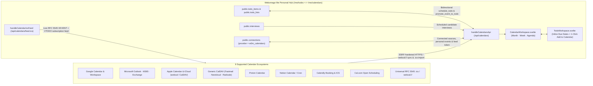

# Universal Calendar & Schedule Integration Next to To-do in Webomage Me (`T700`)

- **Ticket**: `[[T700]]`
- **Date**: 2026-11-09
- **Scope**: `w0m-web` (`packages/lib/src/calendars/`, `apps/cp/src/lib/calendars-server.ts`, `apps/cp/src/components/calendars/CalendarWorkspace.svelte`, `apps/cp/src/components/todos/TodoWorkspace.svelte`, `apps/me/src/pages/me/calendars.astro`, `apps/me/src/lib/context/nav.ts`, `apps/cp/src/lib/cp-routes.ts`, `apps/me/src/lib/route-policy.ts`)

## 1. Architecture & Multi-Provider Topology

## 2. Delivered Capabilities

1. **Universal Calendar Domain Package (`@webomage/lib/calendars`)**:
   - `CALENDAR_PROVIDER_CATALOG` covering all 9 calendar ecosystems (`google_calendar`, `microsoft_outlook`, `apple_icloud`, `caldav`, `proton_calendar`, `notion_calendar`, `calendly`, `cal_com`, `ics_subscription`) with step-by-step setup guides and protocol badges.
   - `normalizeCalendarFeedUrl` converting `webcal://` and `webcals://` to `https://` while blocking private/loopback/link-local/metadata SSRF targets.
   - `parseIcsCalendar` and `generateIcsCalendar` supporting RFC 5545 line unfolding/folding, `VEVENT` and `VTODO` blocks, `VALUE=DATE` all-day events, and meeting URL extraction.
   - `buildAddToCalendarLinks` generating 1-click deep links for Google Calendar, Outlook.com, Microsoft 365, Yahoo Calendar, and downloadable `.ics` files.
   - `mergeUnifiedCalendarEvents`, `buildMonthGrid` (42-cell Monday-first grid), and `buildWeekColumns` (7-day week columns).

2. **Server API & Live Outbound `.ics` Subscription Feed (`apps/cp/src/lib/calendars-server.ts`)**:
   - `GET/POST /api/calendars` (`connect_source`, `sync_source`, `sync_all_sources`, `toggle_source`, `delete_source`, `import_ics`, `schedule_todo`, `promote_event_to_todo`, `update_preferences`, `rotate_feed_token`, `delete_event`, `create_event`).
   - `GET /api/calendars/feed.ics?user=<profileId>&token=<secret>` streaming the user's unified schedule (`VEVENT` + `VTODO`) for live subscription in external calendar apps.

3. **Me Personal Hub UI (`/me/calendars` & `/me/todos`)**:
   - Added `Calendars & schedule` (`path: "calendars"`, capability `"self"`, hat feature `"me.calendars"`) right next to `To-dos & wishlists` in the Personal Hub sidebar.
   - Added a Personal Hub switcher pill linking `/me/todos` ↔ `/me/calendars` in both `TodoWorkspace.svelte` and `CalendarWorkspace.svelte`, plus inline due-date scheduling and 1-click `+Google Cal`, `+Outlook`, and `+.ics` actions on To-do items.
