# T701 — Multi-Page Printable Audit Report PDF Dossier & PKCE Auth Ceremony Hardening

- **Ticket:** `[[T701]]`
- **Date:** 2026-11-09
- **Repos:** `w0m-web`, `@wom`
- **Status:** Completed

## 1. Executive Summary

This report documents the root-cause analysis and remediation for two production-critical issues:

1. **Admin / OAuth / Magic-Link Login Failure (`PKCE code verifier not found in storage`)**:
   - **Root Cause**: `createAuthMiddleware` (`w0m-web/packages/lib/src/auth/middleware.ts`) executed before `/api/auth/callback` and called `await supabase.auth.getUser()` on the shared per-request `getServerClient(context)` instance (`reqObj.__womSupabaseServerClient`). Inside `@supabase/auth-js@2.110.7` (`GoTrueClient.js:2671` and `4326`), whenever `getUser()` encounters an expired or signed-out `sb-<ref>-auth-token` cookie in the browser, `_getUser()` / `_removeSession()` calls `await removeItemAsync(this.storage, "${this.storageKey}-code-verifier")`, deleting `sb-<ref>-auth-token-code-verifier` from the shared SSR cookie storage milliseconds before `handleCallback` called `exchangeCodeForSession(code)`.
   - **Fix**:
     - `packages/lib/src/auth/middleware.ts`: Skip the middleware `supabase.auth.getUser()` pre-read on `/api/auth/*` ceremony routes (`isAuthCeremonyApi`).
     - `packages/lib/src/auth/server-client.ts`: Pass explicit `cookieOptions` (`domain`, `path: "/"`, `sameSite: "lax"`, `secure`, `httpOnly: true`) into `createServerClient` and prevent empty duplicate cookies from shadowing valid cookies in `getAll()`.
     - `packages/lib/src/auth/handlers.ts`: In `handleCallback`, recover cleanly if a duplicate/prefetched callback request hits after the session is already established, purge stale `sb-<ref>-auth-token-code-verifier` cookies across host-only and domain scopes on failure, and replace raw `@supabase/ssr` developer text with actionable guidance; also purge `${base}-code-verifier` in `handleSignOut`.
     - `apps/{cp,web}/src/pages/api/auth/reset-request.ts`: Use `getSupabaseServerClient` instead of ephemeral `createClient` so password-reset PKCE code verifiers persist in cookies.
     - `packages/ui/src/lib/components/ui/AuthForm.astro`: Normalize any raw `PKCE code verifier not found` query parameter and strip one-time `error`/`message` parameters from `window.location.search` via `history.replaceState`.

2. **1-Page Clipped Manual Print (`output.pdf`) on `/o/[org]/projects/security-audit`**:
   - **Root Cause**: `CpShell.svelte` and `apps/cp/src/styles/global.css` constrained `.page-content` and `.content-scroll-area` with `height: 100vh; overflow-y: auto; display: flex`, causing browser print engines (`Ctrl+P` / `window.print()`) to clip the entire document to 1 viewport page while rendering CP shell chrome (`ACTIVE HAT`, Obsidian sync bar, `PageHeader`, tab buttons, and `🐛 Report Bug`) and low-contrast dark-mode text on white paper.
   - **Fix**:
     - `apps/cp/src/styles/global.css`, `CpShell.svelte`, `security-audit.astro`: Added `@media print` overrides (`height: auto !important; overflow: visible !important; display: block !important; background: rgb(255 255 255) !important; color: rgb(15 23 42) !important;`) and `data-no-print="true"` guards on CP shell chrome.
     - `SecurityAuditReportViewer.svelte`: Built a dedicated, multi-page **Executive & Technical Security, CWV, Repo/Skill & Compliance Audit Report Dossier** (`data-testid="cp-printable-audit-report-dossier"`) with a `"Preview Printable Report"` toggle (`data-testid="audit-toggle-print-preview"`) and top-bar `"Export PDF / Print"` button (`data-testid="audit-export-pdf-top"`).

## 2. Architecture & Flow Diagram

```mermaid
flowchart TD
  subgraph Auth["PKCE Auth Callback Ceremony (/api/auth/callback)"]
    A1["Browser GET /api/auth/callback?code=..."] --> A2["createAuthMiddleware (isAuthCeremonyApi == true)"]
    A2 -->|"Skips getUser() so _removeSession() never wipes code-verifier"| A3["handleCallback -> exchangeCodeForSession(code)"]
    A3 -->|"Success or already authenticated"| A4["Redirect 302 -> /o/[org]/projects/security-audit"]
  end
  subgraph Print["Multi-Page Printable Audit Report PDF Dossier"]
    P1["User clicks Export PDF / Print or presses Ctrl+P"] --> P2["@media print unclips .page-content & hides [data-no-print='true']"]
    P2 --> P3["Renders cp-printable-audit-report-dossier (Cover + 5 Sections)"]
  end
```

## 3. Verification Matrix

| Check                      | Command                                                                                                | Result |
| -------------------------- | ------------------------------------------------------------------------------------------------------ | ------ |
| Auth PKCE Unit Tests       | `pnpm exec vitest run packages/lib/src/auth/handlers.spec.ts packages/lib/src/auth/middleware.spec.ts` | `PASS` |
| Printable Dossier UI Tests | `pnpm exec vitest run apps/web/src/tests/audit-blueprint-order-ui.test.ts`                             | `PASS` |
| Design System Conformance  | `just ds-conformance --enforce`                                                                        | `PASS` |
| UI Ticket Leak Gate        | `just ui-ticket-leak-check`                                                                            | `PASS` |
