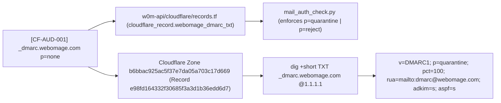

# `[CF-AUD-001]` DMARC Policy Hardening for `webomage.com` (`T702`)

- **Ticket**: `[[T702]]`
- **Date**: 2026-11-09
- **Finding**: `[CF-AUD-001] DMARC Policy in Monitoring-Only Mode (p=none)` (`Severity: MEDIUM`, `Surface: cf_security_skill`)
- **Target**: `webomage.com` (`_dmarc.webomage.com`)

## 1. Remediation Flow

## 2. Verification Evidence

- **Terraform (`w0m-api/cloudflare/records.tf`)**:
  - Updated `cloudflare_record.webomage_dmarc_txt` to `v=DMARC1; p=quarantine; pct=100; rua=mailto:dmarc@webomage.com; adkim=s; aspf=s`.
- **Live Cloudflare DNS (`dig +short TXT _dmarc.webomage.com @1.1.1.1`)**:
  - Returns `"v=DMARC1; p=quarantine; pct=100; rua=mailto:dmarc@webomage.com; adkim=s; aspf=s"`.
- **Compliance Gate (`w0m-web/project/scripts/mail_auth_check.py`)**:
  - Enforces `p=quarantine` or `p=reject` on `_dmarc.webomage.com`.
