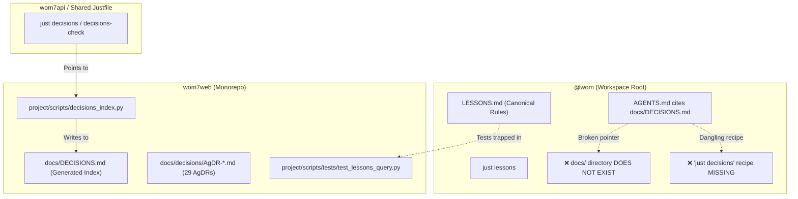
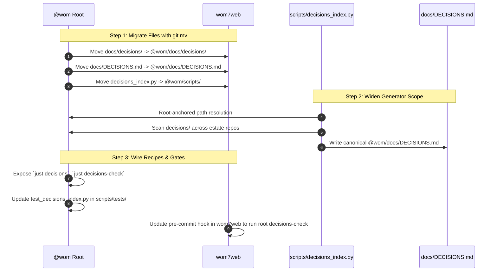

# Estate Architecture Report: Elevating Decisions & Lessons to Workspace Root

**Date:** 2026-09-30  
**Status:** Audit & Proposal  
**Governing Principles:** AgDR-0025 (Clean Cutover, Zero Silent Fallbacks, Zero Shadow Symlinks)  
**Related Tickets:** [[T414]] (Phase 2 Elevation), [[T392]] (Estate-wide AgDR standard), [[T509]] (Root-first layout staged migration)

---

## 1. Executive Summary & Grounded Reality

A systematic audit across the 5 surfaces (Code, Specs, Tests, Registers, Live Tooling) reveals that **Lessons and Decisions are currently in two very different states of elevation**:

| Register / Capability | Current Live Location | Root Recipe / Tool | Status |
|---|---|---|---|
| **`LESSONS.md`** | [`@wom/LESSONS.md`](../../LESSONS.md) | `just lessons` (`scripts/lessons_query.py`) | 🟢 **Elevated to Root** (T414); only test file is still trapped in `wom7web` |
| **`docs/decisions/AgDR-*.md`** | `wom7web/docs/decisions/` | None at root | 🔴 **Trapped in `wom7web`**; other 6 repos cannot author natively |
| **`docs/DECISIONS.md`** | `wom7web/docs/DECISIONS.md` | `just decisions` (fails at root) | 🔴 **Trapped in `wom7web`**; root `AGENTS.md` pointer is dangling |
| **`decisions_index.py`** | `wom7web/project/scripts/decisions_index.py` | Runs via `wom7api/justfile` | 🔴 Monorepo-scoped generator; walks only `wom7web/` sources |

---

## 2. Root Cause & Historical Drift

1. **The Incomplete T414 Elevation (2026-09-21):**
   - **T414** was originally titled: *"Elevate Central Registers (LESSONS, STATE, TECH-DEBT, ROADMAP, docs) and Estate Tooling to Workspace Root"*.
   - Section 1 of T414 explicitly cited `docs/` as trapped in `wom7web/`.
   - However, during ticket refinement, AC1–AC3 scoped only `LESSONS.md`, `STATE.md`, `TECH-DEBT.md`, and `ROADMAP.md`. **`docs/` was dropped from the acceptance criteria**, leaving `docs/DECISIONS.md`, `docs/decisions/`, `docs/ARCHITECTURE.md`, `docs/ECOSYSTEM.md`, and `docs/ANTI-PATTERNS.md` behind.
2. **The Dangling Root Contract:**
   - Both root `AGENTS.md` and `CLAUDE.md` document:
     `docs/DECISIONS.md (just decisions) | Indexed record of all decided architectural choices (T232)`
   - But `@wom/docs` does not exist! Running `just decisions` from workspace root fails with `error: justfile does not contain recipe decisions`.
3. **Existing Ticket Queue State:**
   - **T392** (*"Make AgDR an estate-wide decision-record standard, not wom7web-only"*, queued 2026-09-18) was filed to address this for AgDR authoring across the 7 repos, but remains unstarted in `backlog-platform`.
   - **T509** (*"Root-first layout: finish the T414 move in staged units"*, queued 2026-09-30) outlines 10 units (U0–U9) to finish elevating scripts, justfiles, tests, and data, but **did not explicitly assign a unit to elevate `docs/decisions/` and `docs/DECISIONS.md`**.

---

## 3. Elevation Plan: Clean Cutover under AgDR-0025

Per **AgDR-0025**, we reject backward-compatibility shims, fallback search paths, and shadow symlinks. The elevation must be executed as an atomic cutover across callers.

### Proposed Work Units

#### Unit A: Lessons Completion (Low Effort, Instant Win)
- **Scope:**
  - Move `wom7web/project/scripts/tests/test_lessons_query.py` to `scripts/tests/test_lessons_query.py`.
  - Update root `just lessons-test` recipe from `python3 wom7web/project/scripts/tests/...` to `python3 scripts/tests/test_lessons_query.py`.
  - Verify `just lessons-test` passes (5/5 assertions green).
- **Execution Target:** Can land immediately or roll into T509 Unit U2.

#### Unit B: Decisions & AgDR Elevation (High Impact, Core SSOT)
- **Scope:**
  1. **Move Decision Records:** `git mv wom7web/docs/decisions @wom/docs/decisions`.
  2. **Move Generator & Tests:**
     - `git mv wom7web/project/scripts/decisions_index.py @wom/scripts/decisions_index.py`
     - `git mv wom7web/project/scripts/tests/test_decisions_index.py @wom/scripts/tests/test_decisions_index.py`
  3. **Widen Generator Scope (Completes [[T392]] AC2/AC3):**
     - Update `decisions_index.py` to anchor `ROOT = Path(__file__).resolve().parents[1]` (root `@wom`).
     - Scan `@wom/docs/decisions/AgDR-*.md` as primary source.
     - Scan all declared repos from `.w0m/sdlc.json` for in-repo decision markers.
     - Generate index directly at `@wom/docs/DECISIONS.md`.
  4. **Expose Recipes at Workspace Root:**
     - Add `decisions *args:`, `decisions-check:`, and `decisions-test:` to root `justfile`.
     - Remove duplicate recipe from `wom7api/justfile`.
  5. **Update Pre-commit Hooks & Callers:**
     - Update `.pre-commit-config.yaml` hook in `wom7web` and root to invoke `decisions-check` cleanly.
     - Update 22 reference sites in `wom7web` that currently cite `wom7web/docs/DECISIONS.md`.
     - Zero shadow symlinks left behind (per AgDR-0025).

---

## 4. Weighted Decision Matrix & Recommendation

| Option | Pros | Cons / Risks | Recommendation |
|---|---|---|---|
| **Option 1: Merge into T509 Unit U2** | Natural fit with existing planned move of estate tests and `project/` data; avoids fragmented tickets. | Makes Unit U2 slightly larger. | **(Recommended)** Combine with Unit U2 so all root registers (`docs/DECISIONS.md`, tests, data) land cohesively. |
| **Option 2: Pull T392 to `next` as a Dedicated Ticket** | Dedicated focus on the AgDR standard across 7 repos; tracks estate-wide authoring independently. | Adds another ticket to in-flight queue before root layout refactor starts. | **Viable alternative** if owner wants AgDR standard formalized before general layout migration. |
| **Option 3: Quick forwarder / shim in root justfile** | Fixes `just decisions` in 2 minutes. | **STRICTLY PROHIBITED** by AgDR-0025. Accumulates dead shims, maintains dual paths, leaves `docs/` trapped. | ❌ Reject. |

---

## 5. Proposed Next Actions

1. **Owner Confirmation:** Approve incorporating Decisions & Lessons elevation into **T509 Unit U2** (or promoting **T392** to `next`).
2. **Current Session Closeout:**
   - Database forward migration `20260930210000` is committed and pushed to `wom7api:beta`.
   - Profile & Resume Studio suggestion enhancements are committed and pushed to `wom7web:beta`.
   - Hand off live `just db-migrate` instruction to device owner.
