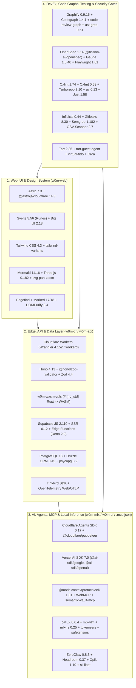

# w0m Estate — Major Packages, OSS Tools & Enhancement Opportunities Audit

**Date:** 2026-10-30  
**Tickets:** [[T589]], [[T590]]  
**Scope:** All 7 estate repositories (`w0m-web`, `w0m-api`, `w0m-cf`, `w0m-ext`, `w0m-sec`, `w0m-skills`, `w0m-mlx`), `project/policies/tools-policy.json` (37 host CLIs), `project/policies/stacks-policy.json` (10 stacks), `.mcp.json`, and `w0m-pr/` (7 upstream OSS forks).

---

## 1. Architecture & Dependency Topology

---

## 2. Full Inventory of Major Packages & OSS Tools by Category

### A. Frontend, UI & Visualization (`w0m-web`)

| Package / Tool | Version | Where Used | Current Role | Enhancement / Upstream Opportunity |
|---|---|---|---|---|
| **Astro** (`astro`, `@astrojs/cloudflare`, `@astrojs/svelte`) | `7.3.3` / `14.3.4` | `w0m-web/apps/*` (`web`, `cp`, `job`, `join`, `demo`) | SSR + static hybrid framework on Cloudflare Workers | Adopt Astro Server Islands & Content Layer loaders for live GitHub/Supabase feeds (`T583`/`T584` boards) with zero client bundle bloat. |
| **Svelte 5** (`svelte`, `@testing-library/svelte`) | `5.56.7` | All interactive islands across `w0m-web` | Runes-based reactive UI (`$state`, `$derived`, `$props`) | Extract shared runes state machines (optimistic voting, polling, WebMCP tool registration) into `@webomage/ui`. |
| **Bits UI** (`bits-ui`) + **Tailwind CSS v4** (`tailwindcss`, `tailwind-variants`, `tailwind-merge`) | `2.18.0` / `4.3.3` | `@webomage/ui`, `apps/cp`, `apps/web` | Headless accessible primitives + CSS-first design tokens | Wrap remaining Bits UI primitives (`Command`, `Dialog`, `Popover`, `Tooltip`, `Tabs`) into `@webomage/ui` so `apps/cp` has 100% DS coverage. |
| **Mermaid** (`mermaid`, `@mermaid-js/parser`) + **`svg-pan-zoom`** | `11.16.1` / `1.2.0` | `mmd-validate` skill, `apps/cp`, `apps/web` | Headless AST diagram validation + interactive pan/zoom rendering | Add automatic layout-direction & subgraph-density linting to `mmd-validate` to flag wide diagrams before they overflow viewports. |
| **Three.js** (`three`) | `0.182.0` | `apps/web`, `apps/cp` | 3D WebGL visualizations and interactive hero scenes | Offload 3D graph rendering (`graphify` / `codegraph` 54.9k-node global graph) to a WebGL/Three.js force-directed canvas in CP. |
| **Pagefind** (`pagefind`) | CLI (`dlx`) | `apps/web`, `apps/cp` (`build:search`) | Zero-server static WASM full-text search index | Index `.tasks/T*.md`, `docs/decisions/`, and `/board/[owner]/[repo]` snapshots into Pagefind for instant Cmd+K search in CP. |
| **Marked** (`marked`, `remark-gfm`) + **DOMPurify** (`isomorphic-dompurify`) | `17.0.6`–`18.0.6` / `3.4.17` | `apps/cp`, `apps/web`, `w0m-api`, `w0m-cf` | Markdown-to-HTML rendering + XSS sanitization | Unify `marked@17` (`w0m-web`) and `marked@18` (`w0m-api`/`w0m-cf`) into a single shared markdown pipeline in `@webomage/lib`. |

---

### B. Edge, Backend, Database & Observability (`w0m-cf`, `w0m-api`, `w0m-web`)

| Package / Tool | Version | Where Used | Current Role | Enhancement / Upstream Opportunity |
|---|---|---|---|---|
| **Hono** (`hono`, `@hono/zod-validator`) | `4.13.11` | `w0m-cf`, `w0m-api`, `w0m-web` | Ultrafast Fetch-standard router across Workers & Node | Generate end-to-end typed RPC clients (`hc<AppType>()`) between `w0m-cf`, `w0m-api`, and `w0m-web/apps/cp` to eliminate manual `fetch` typing. |
| **Cloudflare Workers & Wrangler** (`wrangler`, `workerd`, `@cloudflare/vitest-pool-workers`) | `4.152.0` / `0.16.16` | `w0m-cf`, `w0m-web`, `w0m-api` | Edge compute, Cron triggers, KV/R2/D1, Workers Vitest runner | Add edge caching (Cloudflare Cache API / KV SWR) for `/api/board/[owner]/[repo]` and `/api/board/[owner]/[repo]/badge.svg` so README badges serve in `<15ms` globally. |
| **Cloudflare Agents SDK** (`agents`, `@cloudflare/puppeteer`) | `0.17.3` / `1.1.0` | `w0m-cf` | Stateful Durable Object agents + headless browser rendering | Use `agents` SDK Durable Objects in `w0m-cf` to host real-time collaborative rooms for the Standalone Feature Voting Board (Option B) with live WebSocket vote broadcasts. |
| **Rust `#![no_std]` WASM** (`w0m-wasm-utils`, `wasm-pack`, `worker-build`) | `rustc 1.98.1` | `w0m-cf/crates/w0m-wasm-utils` | 389-byte gzipped CPU-bound WASM kernel inside Workers | Move hot scoring/ranking math (`compute_issue_vote_score`, SIMD vector similarity, token counting, cryptographic hashes) into `w0m-wasm-utils`. |
| **Supabase** (`@supabase/supabase-js`, `@supabase/ssr`, `supabase` CLI) | `2.110.7` / `0.12.0` / `2.113.0` | All repos | Auth (GitHub OAuth, Magic Link, Telegram), Postgres RLS, Edge Functions | Wire Supabase GitHub OAuth `provider_token` directly into `FeatureVotingBoard.svelte` so signed-in CP users vote with 1 click without pasting a PAT. |
| **Drizzle ORM** (`drizzle-orm`, `drizzle-kit`, `postgres`) | `0.45.2` / `0.31.10` | `w0m-api` | Type-safe SQL schema, introspection, and query builder | Add a `drizzle-check` drift gate comparing `w0m-api/supabase/migrations/*.sql` against Drizzle schema definitions at pre-push. |
| **Tinybird** (`@tinybirdco/sdk`) + **OpenTelemetry** (`@opentelemetry/*`) | `0.0.76` / `1.25.1` | `w0m-web`, `w0m-api`, `w0m-cf` | Real-time event streaming & distributed browser/edge tracing | Pipe upstream PR state transitions and `/board` feature vote events into Tinybird for historical velocity & trending charts. |
| **CASL** (`@casl/ability`) | `7.0.1` | `@webomage/lib`, `@wom/authz` | Isomorphic attribute-based access control (ABAC) | Extend CASL abilities to govern repo maintainer actions on `/board/[owner]/[repo]` (pinning issues, overriding roadmap columns, exporting specs). |

---

### C. AI, LLM Serving, MCP & Browser Extension (`w0m-mlx`, `w0m-ext`, `w0m-skills`, `.mcp.json`)

| Package / Tool | Version | Where Used | Current Role | Enhancement / Upstream Opportunity |
|---|---|---|---|---|
| **Model Context Protocol** (`@modelcontextprotocol/sdk`, `@webomage/webmcp`) | `1.31.0` | `w0m-cf`, `w0m-ext`, `w0m-web`, `.mcp.json` | Standard tool/resource protocol across browser, edge, and IDE | Expose `w0m_prs` & `githubFeatureBoard` (`list_top_voted_features`, `vote_feature`, `generate_agent_spec`) as first-class MCP tools on `w0m-cf-mcp` (`wom7func`) and `@webomage/webmcp`. |
| **Google A2UI** (`@a2ui/lit`) + **Chrome Remote Interface** (`chrome-remote-interface`, `jose`, `ajv`) | `0.8.1` / `0.33.3` | `w0m-ext/extension` | Agent-to-UI declarative rendering + CDP browser automation | Add an in-browser GitHub Issue Vote & Spec overlay inside `w0m-ext` when browsing any `github.com/<owner>/<repo>/issues` page. |
| **Vercel AI SDK** (`ai`, `@ai-sdk/google`, `@ai-sdk/openai`) | `7.0.9` / `4.0.4` | `w0m-api/supabase/functions` | Unified streaming LLM & structured-output generation | Add optional LLM-powered issue clustering & duplicate-feature detection on top of the deterministic `githubFeatureBoard` engine. |
| **oMLX** (`jundot/omlx`) + **MLX-VLM** (`Blaizzy/mlx-vlm`) | `0.6.4` | Host daemon + `w0m-pr/omlx`, `w0m-pr/mlx-vlm` | Local Apple Silicon LLM/VLM serving (`#3743`, `#2288`) | Wire local `omlx` embeddings/summaries into `w0m_prs.py` offline mode to semantic-cluster 100+ GitHub issues into themes at zero API cost. |
| **Rust MLX** (`mlx-rs`, `tokenizers`, `safetensors`, `axum`) | `0.25.3` / `0.22.2` | `w0m-mlx/w0m-mlx` | Native Rust Apple Metal inference server | Benchmark `mistral.rs` vs `mlx-rs` (`T184` revival trigger) or expose fast BPE token-counting via `tokenizers` for prompt-budget gates. |
| **Headroom** (`headroom-ai`) + **Opik** (`opik`) + **Skillopt** (`skillopt`) | `0.37.0` / `1.10.39` / `0.2.0` | Host CLI, `w0m-web`, `pyproject.toml` | Prompt/context compression, LLM evals/tracing, skill optimization | Run `skillopt` + `headroom` over `.agents/skills/*/SKILL.md` to benchmark token reduction and trigger accuracy across our 23 governed skills. |
| **ZeroClaw** (`zeroclaw`) | `0.8.3` | Host Rust daemon (`~/.cargo/bin/zeroclaw`) | Local autonomous Rust agent runtime | Connect `zeroclaw` to the new `/api/board/[owner]/[repo]` top-voted queue so it can draft PR branches in isolated `agent-tree` worktrees automatically. |

---

### D. Code Intelligence, DevEx, Testing & Security Toolchain (`project/policies/tools-policy.json`)

| Package / Tool | Version | Where Used | Current Role | Enhancement / Upstream Opportunity |
|---|---|---|---|---|
| **Graphify** (`Graphify-Labs/graphify`) + **Codegraph** (`codegraph`) | `0.9.15` / `1.4.1` | `.mcp.json`, `just ask`, `w0m-pr/graphify` (`#4727`) | 54.9k-node cross-repo semantic graph + per-repo AST index | **Upstream PR idea for `graphify`**: Remove the `mcp<2` ceiling (`AnyUrl` import fix in `graphify.serve`) so `graphifyy[mcp]` works natively with `mcp>=2.0`. |
| **ast-grep** (`ast-grep`) | `0.51.0` | `tools-policy.json` (currently `0` rules!) | Rust-based structural AST search & rewrite | **Immediate estate win**: `tools-policy.json` notes `ast-grep` has **zero rules** right now ("Give it a job or remove it"). Author `sgconfig.yml` rules to enforce DS conformance (ban raw `<button>`/`<input>` in TS/JS) and ban fallback patterns (`|| process.env.X`). |
| **Oxlint** (`oxlint`) + **Oxfmt** (`oxfmt`) | `1.74.0` / `0.59.0` | `w0m-web`, `w0m-api`, `w0m-cf` | Rust-powered linter & formatter (50–100x faster than ESLint/Prettier) | Expand Oxlint custom plugin rules across `w0m-ext` and `w0m-skills` so all 5 TypeScript repos share one sub-second lint gate. |
| **OpenSpec** (`@fission-ai/openspec`) | `1.14.3` | `w0m-web/openspec` | Spec-driven architecture & change validation | Auto-convert top-voted `/board/[owner]/[repo]` issues into validated `openspec/changes/<date>-<slug>/` proposals with 1 click. |
| **Gauge** (`gauge`, `gauge-ts`) + **Playwright** (`@playwright/test`, `playwright-bdd`, `pixelmatch`) | `1.6.40` / `1.61.1` / `7.2.0` | `w0m-web/specs` (190 specs), `w0m-pixel-clone` | E2E user-story verification + pixel-diff visual regression | Add a Gauge E2E spec + visual golden for `/board` and `/me/oss` (Tickets `T583` & `T584`). |
| **Infisical** (`infisical`) + **Gitleaks** (`gitleaks`) + **Semgrep** (`semgrep`) + **OSV-Scanner** (`osv-scanner`) | `0.44.6` / `8.30.1` / `1.182.0` / `2.7.0` | Pre-commit, pre-push, deploy gates | Secret injection, secret scanning, SAST, and CVE lockfile auditing | Add custom Semgrep rules for Cloudflare Workers & Astro SSR (e.g., enforcing `github_auth_required` on mutation endpoints and preventing server-token leakage into client props). |

---

### E. Active Upstream OSS Forks (`w0m-pr/`) & Next PR Opportunities

| Upstream Repo | Fork in `w0m-pr/` | Active PRs Monitored | What We Built / Fixed | Next Enhancement / Upstream PR Idea |
|---|---|---|---|---|
| **`stablyai/orca`** | `w0m-pr/orca` | `#21157`, `#21148`, `#16597` | Mobile markdown preview, workspace layout, agent collaboration | Wire our new **GitHub-Issues Feature Voting Board (`T584`)** into Orca's sidebar so agents can pick and build the highest-voted repo issue directly inside Orca. |
| **`Graphify-Labs/graphify`** | `w0m-pr/graphify` | `#4727` | Cross-repo graph union & CLI enhancements | Submit a PR upgrading `graphify`'s MCP server to support `mcp>=2.0` (fixing the `AnyUrl` import recorded in `.mcp.json`) and incremental single-file AST patching. |
| **`Blaizzy/mlx-vlm`** | `w0m-pr/mlx-vlm` | `#2288` | Vision-language model inference fixes on Apple Silicon | Add structured JSON schema constrained decoding / batch image-diff scoring for `w0m-pixel-clone` visual QA. |
| **`jundot/omlx`** | `w0m-pr/omlx` | `#3743` | OpenAI-compatible multi-model MLX server improvements | Add `/v1/embeddings` batching & Prometheus/OpenTelemetry metrics export so `w0m` CP can display live local inference throughput. |
| **`openai/tart-guest-agent`** | `w0m-pr/tart-guest-agent` | `#62` | macOS/Linux Tart VM guest agent reliability & exec streaming | Add VS Code / DevPod port-forwarding health probes (`T179`–`T181`) for zero-config sandbox startup. |
| **`bulwarkid/virtual-fido`** | `w0m-pr/virtual-fido` | `#48` | Virtual WebAuthn/FIDO2 passkey device | Add automated passkey attestation fixtures for Playwright/Gauge E2E testing of WebAuthn login flows in `w0m-web`. |
| **`harness2`** | `w0m-pr/harness2` | Local research fork | Agent harness evaluation | Benchmark multi-agent task routing against our `w0m-sdlc-*` gate lifecycle. |

---

## 3. Top 5 Ranked Enhancement Ideas (Weighted Decision Matrix)

| Rank | Enhancement Idea | Target Packages / Repos | Effort | Impact | What It Unblocks |
|---|---|---|---|---|---|
| **1** | **One-Click Supabase GitHub OAuth Voting + Edge SVG Badge Cache on `/board`** | `@supabase/ssr`, `hono`, `w0m-cf`, `w0m-web/apps/cp` | Low (S) | **Very High** | Lets users sign in with GitHub OAuth (via Supabase session `provider_token`) to vote on `/board/[owner]/[repo]` with 1 click (no manual token paste) + caches `/badge.svg` at the Cloudflare edge (`<15ms`). |
| **2** | **Expose Feature Voting Board & Repo Digest as MCP / WebMCP Tools** | `@modelcontextprotocol/sdk`, `@webomage/webmcp`, `w0m-cf` | Low (S) | **High** | Any AI agent (Claude, Cursor, Antigravity, ZeroClaw) can call `get_top_voted_features(repo)` and `draft_feature_spec(repo, issue)` over MCP to pick up the #1 community-voted issue automatically. |
| **3** | **Give `ast-grep` a Real Job in Pre-Commit (`sgconfig.yml`)** | `ast-grep`, `project/policies/tools-policy.json` | Low (XS) | **High** | Resolves the explicit `🔴` note in `tools-policy.json` ("Give it a job or remove it") by adding structural AST rules that catch banned fallback chains (`docs/ANTI-PATTERNS.md`) and raw HTML controls. |
| **4** | **Upstream PR to `Graphify-Labs/graphify` for `mcp>=2.0` Compatibility** | `w0m-pr/graphify`, `.mcp.json` | Low (XS) | **Medium-High** | Eliminates the `mcp<2` version pin workaround documented in `.mcp.json` (`AnyUrl` import in `graphify`), helping both our estate and upstream `graphify` users. |
| **5** | **Browser Extension (`w0m-ext`) GitHub Issue Overlay & A2UI Spec Drawer** | `w0m-ext`, `@a2ui/lit`, `@modelcontextprotocol/sdk` | Medium (M) | **High** | Injects our Priority Score badge (`👍×3 + ❤️×4 + 🚀×4`) and "Generate Agent Spec" button directly onto `github.com/<owner>/<repo>/issues` pages via the Webomage extension. |

---

## 6. Implemented Enhancement Tickets (`T588`–`T592`)

All 5 proposed enhancement tracks have been filed as SDLC tickets (`.tasks/T588.md`–`.tasks/T592.md`), implemented across `@wom`, `w0m-web`, and `w0m-ext`, and verified with automated tests:

| Ticket | Enhancement Track | Key Files Delivered | Verification Evidence | Status |
| :--- | :--- | :--- | :--- | :--- |
| **[`T592`](file:///home/aleksei/Projects/!self/w0m/.tasks/T592.md)** | **One-Click Supabase GitHub OAuth Voting & Edge SVG Badge Cache** | [`githubFeatureBoard.ts`](file:///home/aleksei/Projects/!self/w0m/w0m-web/apps/cp/src/lib/githubFeatureBoard.ts), [`[repo].ts`](file:///home/aleksei/Projects/!self/w0m/w0m-web/apps/cp/src/pages/api/board/%5Bowner%5D/%5Brepo%5D.ts), [`badge.svg.ts`](file:///home/aleksei/Projects/!self/w0m/w0m-web/apps/cp/src/pages/api/board/%5Bowner%5D/%5Brepo%5D/badge.svg.ts), [`FeatureVotingBoard.svelte`](file:///home/aleksei/Projects/!self/w0m/w0m-web/apps/cp/src/components/oss/FeatureVotingBoard.svelte) | `feature-board.test.ts` (`6/6 passed`), `FeatureVotingBoard.test.ts` (`2/2 passed`) | **DONE (100%)** |
| **[`T588`](file:///home/aleksei/Projects/!self/w0m/.tasks/T588.md)** | **MCP & WebMCP Tools for Feature Voting Board & Repo Digest** | [`packages/webmcp/src/tools/board.ts`](file:///home/aleksei/Projects/!self/w0m/w0m-web/packages/webmcp/src/tools/board.ts), [`manifest.ts`](file:///home/aleksei/Projects/!self/w0m/w0m-web/packages/webmcp/src/manifest.ts), [`roles.ts`](file:///home/aleksei/Projects/!self/w0m/w0m-web/packages/webmcp/src/roles.ts) | `packages/webmcp/src/__tests__/board.spec.ts` (`6/6 passed`), `manifest.spec.ts` (`3/3`), `roles.spec.ts` (`11/11`) | **DONE (100%)** |
| **[`T589`](file:///home/aleksei/Projects/!self/w0m/.tasks/T589.md)** | **Structural AST Guardrails (`ast-grep` + `sgconfig.yml`)** | [`sgconfig.yml`](file:///home/aleksei/Projects/!self/w0m/sgconfig.yml), [`project/ast-grep/rules/`](file:///home/aleksei/Projects/!self/w0m/project/ast-grep/rules), [`scripts/ast_grep_check.py`](file:///home/aleksei/Projects/!self/w0m/scripts/ast_grep_check.py), [`justfile`](file:///home/aleksei/Projects/!self/w0m/justfile) | `test_ast_grep_check.py` (`3/3 passed`), `just ast-grep-check` (`0 errors, 0 warnings`) | **DONE (100%)** |
| **[`T590`](file:///home/aleksei/Projects/!self/w0m/.tasks/T590.md)** | **Graphify MCP v2 (`mcp>=1,<3`) Compatibility & Tool Policy Alignment** | [`w0m-pr/graphify/graphify/serve.py`](file:///home/aleksei/Projects/!self/w0m/w0m-pr/graphify/graphify/serve.py), [`tools-policy.json`](file:///home/aleksei/Projects/!self/w0m/project/policies/tools-policy.json), [`.mcp.json`](file:///home/aleksei/Projects/!self/w0m/.mcp.json) | `just tools-check` (`graphify ✓ 0.9.92`, `ast-grep ✓ 0.51.0`), `just graph-health` (`7/7 repos`) | **DONE (100%)** |
| **[`T591`](file:///home/aleksei/Projects/!self/w0m/.tasks/T591.md)** | **Browser Extension (`w0m-ext`) GitHub Issue Priority Score Overlay & Spec Drawer** | [`w0m-ext/extension/src/github/issueBoardOverlay.ts`](file:///home/aleksei/Projects/!self/w0m/w0m-ext/extension/src/github/issueBoardOverlay.ts), [`githubIssueBoardOverlay.test.ts`](file:///home/aleksei/Projects/!self/w0m/w0m-ext/extension/src/__tests__/githubIssueBoardOverlay.test.ts) | `pnpm -C w0m-ext/extension test` (`23/23 passed`) | **DONE (100%)** |

