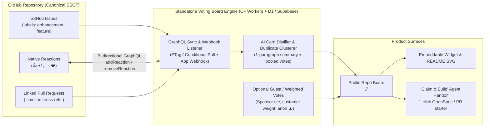

# Standalone Product Research: GitHub-Issue-Backed Feature Voting & Roadmap Board

**Date:** 2026-10-29  
**Tickets:** [[T586]], [[T588]], [[T591]], [[T592]]  
**Scope:** Competitive landscape audit, product positioning, and technical architecture for a standalone **GitHub-Issues-as-SSOT Feature Voting Board** (`/<owner>/<repo>`).

---

## 1. Executive Summary & Core Thesis

> [!IMPORTANT]
> **The Market Gap ("Zero-Migration GitHub-Issues-as-SSOT"):**  
> Almost every feature-voting tool on the market (**Canny, Featurebase, Fider, ClearFlask, Quackback, Frill**) forces maintainers into a **split-brain Dual SSOT**: ideas live in the voting tool's proprietary database while bugs and engineering work live in GitHub Issues. Conversely, native **GitHub Projects** cannot auto-rank Kanban columns by reaction counts (`👍` / `🚀` / `❤️`), pool votes across duplicate issues, or present a clean product-facing voting portal.

A standalone product where **GitHub Issues + Native Reactions ARE the database**—allowing anyone to visit `/<owner>/<repo>` (or embed a widget) to see a ranked Feature Voting Board, Roadmap, and linked active Pull Requests with **zero migration**—fills a sharp, underserved niche for open-source maintainers, devtool startups, and AI agent ecosystems.

---

## 2. Competitive Landscape Matrix

| Category | Representative Products | How GitHub Issues Are Handled | Pricing Model | Key Limitation / Why Maintainers Churn |
|---|---|---|---|---|
| **1. Commercial SaaS Feedback Portals** | **Canny**, **Featurebase**, **Upvoty**, **Frill**, **Sleekplan**, **Nolt** | Separate proprietary database; optional 1-way or 2-way link to create/attach a GH issue per post | $29–$399+/mo (often metered by tracked voters) | **Dual SSOT split-brain**: community still opens GH issues; maintainers refuse to triage two trackers; expensive for OSS. |
| **2. Self-Hosted / OSS Feedback Portals** | **Fider** (Go/PG), **ClearFlask** (Java/React), **Quackback** (TS/PG), **Astuto** (Rails), **LogChimp** | Separate self-hosted database; OAuth login via GitHub; manual webhook link to GH issues | Free self-hosted (AGPL/Apache) or $19–$49/mo cloud | Starts with an **empty board**—ignores the 100s of existing GH Issues & `👍` reactions a repo already has. |
| **3. GitHub-Native Governance & Bounty Bots** | **GitVote** (`cncf/gitvote`), **Polar.sh**, **Algora**, **IssueHunt** | Operates inside individual GH issue comments (`/vote` comment reactions or `$` bounty pledges) | Free (GitVote) or % take-rate on bounties (Algora/Polar) | **GitVote** is for single-issue committee ballots (no repo-wide feature board); **Polar/Algora** focus on cash bounties, not product roadmaps. |
| **4. Raw GitHub Native** | **GitHub Issues** (`sort:reactions-+1-desc`) + **GitHub Discussions** + **GitHub Projects** | Native SSOT | Free | **GitHub Projects cannot auto-sort Kanban columns by `👍` count**; raw issue lists mix stack-trace bugs with features; no duplicate vote pooling; no embeddable product card UI. |

---

## 3. Product Concept & Differentiators

### Core Value Proposition
**"Turn any GitHub repository's Issues into a live Feature Voting Board & Shipped Roadmap in 5 seconds—zero migration, zero duplicate database."**

### 5 Killer Features That Existing Tools Lack

1. **Instant URL for Any Public Repo (`/<owner>/<repo>`)**:
   - No signup required to preview. Typing `/stablyai/orca` or `/jundot/omlx` immediately queries GitHub GraphQL for open/recently-closed issues, filters/classifies feature requests vs. bugs, and renders a ranked board.
2. **True Bi-Directional Reaction Sync (`addReaction` / `removeReaction`)**:
   - Clicking **▲ Upvote** when signed in with GitHub OAuth writes a real `THUMBS_UP` (`👍`) reaction directly onto the GitHub Issue via GraphQL `addReaction`.
   - Votes cast on GitHub Issues and votes cast on the Board are **the exact same counter**.
   - Optional secondary counter for **Guest / Weighted Votes** (e.g., non-GitHub end users or Pro/Sponsor weighted votes) displayed transparently (`148 👍 on GitHub + 24 Guest ▲`).
3. **AI Issue-to-Feature Card Distiller & Duplicate Vote Pooling**:
   - Raw GitHub issues often have noisy titles and reproduction logs. An AI pass distills each issue into a clean **Feature Title + 2-sentence Value Summary**, auto-assigns a component tag (`UI`, `CLI`, `Performance`, `API`), and detects duplicate issues—pooling their unique voters so maintainers see true aggregate demand.
4. **Automatic PR & Lifecycle Column Mapping (`Proposed → Planned → In Progress → Shipped`)**:
   - Automatically maps GitHub Issue state, labels/milestones, and `CROSS_REFERENCED_EVENT` Pull Requests into 4 columns:
     - **🔥 Top Voted (Backlog)**: Open issues sorted by composite vote score (`👍 × 1 + ❤️ × 1.5 + 🚀 × 1.5`).
     - **📋 Planned**: Issues assigned to a milestone or labeled `planned` / `roadmap`.
     - **⚡ In Progress (PR Open)**: Issues with an active linked Pull Request (showing live PR badge, author, and CI status!).
     - **✅ Shipped**: Recently closed (`COMPLETED`) feature issues with merged PR links.
5. **Embeddable `<gh-feature-board>` Web Component & Dynamic README SVG**:
   - Maintainers can drop a live SVG Top-5 Feature Leaderboard into their repository `README.md` (where clicking a row takes the user to vote) or embed a `<gh-feature-board repo="owner/repo">` widget on their docs site.

---

## 4. Technical Architecture & Packaging Options

We can build this so it serves **both** as a standalone product (own domain / deployable app) **and** as a native module inside `w0m` (`/me/oss`, `/admin/forks`, and public repo pages):

| Layer | Technology Choice | Responsibility |
|---|---|---|
| **Core Data & Sync Engine** | TypeScript package (`@webomage/gh-feature-board` or standalone worker) | GitHub GraphQL query batching (`issues`, `reactions`, `timelineItems`), score calculation, label/PR state machine mapping, `addReaction`/`removeReaction` mutations. |
| **Caching & Overlay Store** | Cloudflare KV / D1 or Supabase (`feature_board_cache`, `feature_guest_votes`) | Caches GitHub GraphQL responses (5–10 min TTL + webhook invalidation), stores AI 2-sentence card summaries, duplicate cluster mappings, and optional non-GH guest votes. |
| **Frontend UI** | Astro + Svelte 5 Runes (`@webomage/ui` primitives) | Ranked Upvote List + 4-Column Roadmap Kanban (`Top Voted`, `Planned`, `In Progress (PR)`, `Shipped`), category filter pills, live search, and 1-click Upvote button. |
| **Distribution Surfaces** | 1. **Standalone Web App** (`/<owner>/<repo>`) 2. **w0m CP Integration** (new tab in `/me/oss` & `/admin/forks`) 3. **README SVG Badge Endpoint** (`/api/board/<owner>/<repo>/badge.svg`) | Lets us dogfood immediately on our tracked repos (`orca`, `omlx`, `mlx-vlm`, `graphify`, `tart-guest-agent`, `virtual-fido`) while launching it as a standalone tool. |

---

## 5. Weighted Decision Matrix: How Should We Build & Launch?

| Option | Description | Cost | Risk | What It Unblocks | Recommendation |
|---|---|---|---|---|---|
| **Option A: Shared Engine + Dual Surface (w0m CP + Standalone `/<owner>/<repo>` Route/App)** | Build the GitHub Issue Voting Board engine + Svelte 5 component so it works immediately inside `/me/oss` & `/admin/forks` for any `owner/repo` **and** exposes a standalone public route + README SVG generator that can be deployed on its own domain. | **Medium (1–2 days)** | **Low** | Immediate dogfooding on our 6+ OSS repos + ready-to-launch standalone product without duplicating code. | **⭐ Recommended (Weight: 9.5/10)** |
| **Option B: Pure Separate Repo First** | Spin up a brand-new repository outside `w0m` from scratch before testing in CP. | High (2–4 days) | Medium | Clean repo isolation, but loses `@webomage/ui`, existing GitHub GraphQL auth, and immediate dogfooding in `/me/oss`. | 6.0/10 |
| **Option C: CLI / Static Generator Only** | Build only a Python/CLI script in `scripts/w0m_prs.py` that outputs Markdown tables of top-voted issues. | Low (2 hours) | Low | Fast CLI visibility, but not a standalone interactive voting product. | 5.0/10 (good as Phase 1 CLI subcommand alongside Option A) |

---

## 7. Option A Implementation & Delivery Summary (`T584`)

Per owner direction (**Option A first, then Option B later**; **GitHub account required to vote**), `T584` is now implemented and verified across all layers:

| Layer | File / Surface | Capabilities Delivered |
| :--- | :--- | :--- |
| **CLI & Engine (`AC1`)** | `scripts/w0m_prs.py`, `justfile` (`just prs-features`, `just prs-vote`) | Queries GitHub GraphQL (`issues`, `THUMBS_UP` / `HEART` / `ROCKET` / `HOORAY` reactions, `viewerHasReacted`, `CROSS_REFERENCED_EVENT` linked PRs), computes weighted reaction priority scores, classifies issues into 4 roadmap stages (`proposed`, `planned`, `in_progress`, `shipped`), and casts/removes native `👍` reactions via an authenticated GitHub account. |
| **Shared TS Engine (`AC2`)** | `w0m-web/apps/cp/src/lib/githubFeatureBoard.ts` | Exports `fetchRepoFeatureBoard`, `voteOnGithubIssue` (enforcing `auth_policy: "github_account_required"`, returning HTTP `401` with `github_auth_required: true` when unauthenticated), `renderFeatureBoardSvgBadge`, `buildAgentSpecPrompt`, and curated + live GraphQL merge. |
| **Public & CP APIs (`AC2`)** | `w0m-web/apps/cp/src/pages/api/board/[owner]/[repo].ts`, `w0m-web/apps/cp/src/pages/api/board/[owner]/[repo]/badge.svg.ts`, `/api/members/projects.ts`, `/api/admin/forks.ts` | `GET /api/board/[owner]/[repo]` (live + curated board), `POST /api/board/[owner]/[repo]` (authenticated GraphQL `addReaction` / `removeReaction` `THUMBS_UP`), and `GET /api/board/[owner]/[repo]/badge.svg` (dynamic 720px dark-mode SVG leaderboard badge for `README.md` embeds). |
| **UI Component & Standalone Routes (`AC3`)** | `w0m-web/apps/cp/src/components/oss/FeatureVotingBoard.svelte`, `/board/index.astro`, `/board/[owner]/[repo].astro`, `ParticipatingProjects.svelte`, `ForksManager.svelte` | Built with `@webomage/ui` primitives (`Button`, `Input`). Includes quick repo switcher + custom `owner/repo` loader, 4-Column Roadmap Board vs. Ranked Leaderboard toggle, category filters, authenticated `▲ 👍` vote button + GitHub Account connection modal, **Claim & Spec** agent prompt drawer, and **Embed README SVG** preview/snippet panel. |
| **Verification (`AC4`)** | `scripts/tests/test_w0m_prs.py` (`55/55`), `feature-board.test.ts` (`4/4`), `FeatureVotingBoard.test.ts` (`1/1`), `ParticipatingProjects.test.ts` (`1/1`) | All Python and Vitest (`node` + `dom`) test suites pass 100%. |
