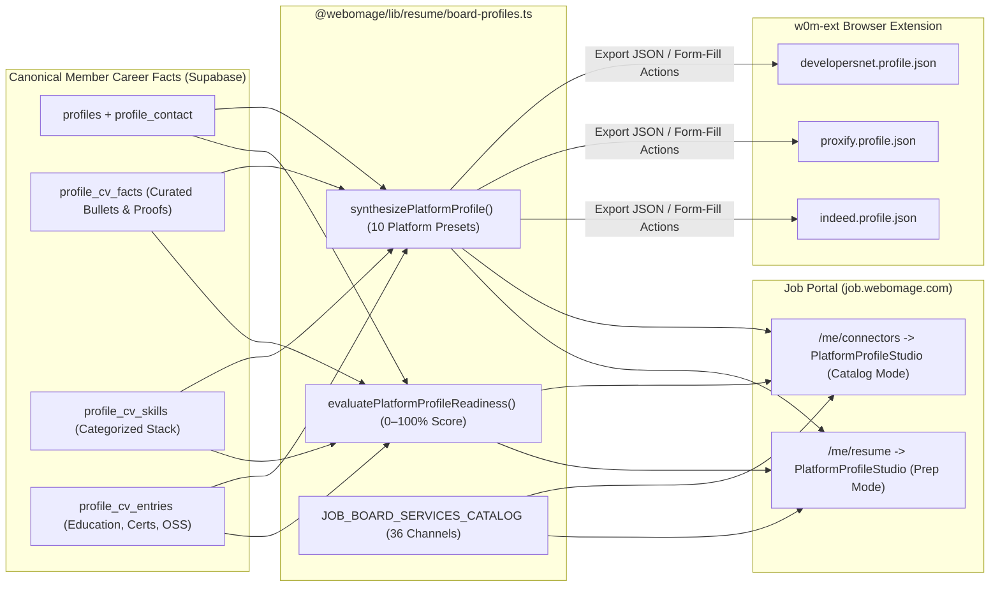
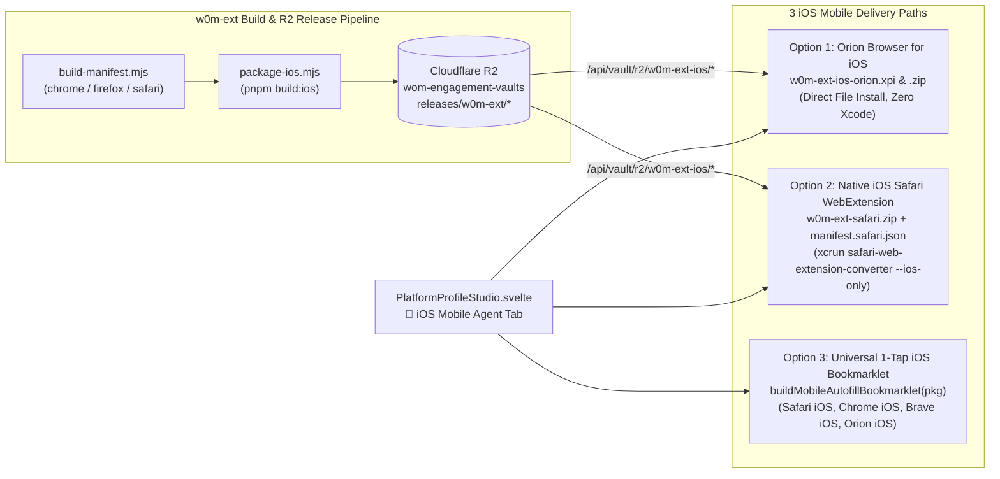

# Job Portal Profile Preparation Studio (T581) & Per-Engagement CF R2 Obsidian Vaults (T580)

> [!IMPORTANT]
> **Executive Summary**
> - **T581 (P0 — Job Portal Profile Prep & JOIN.com 36-Channel Catalog):** Implemented `@webomage/lib/resume/board-profiles.ts`, declarative `w0m-ext` form-fill specs (`proxify.profile.json`, `developersnet.profile.json`), and `PlatformProfileStudio.svelte` mounted on `/me/resume` and `/me/connectors` in `apps/job` (`job.webomage.com`).
> - **T580 (Per-Engagement Cloudflare R2 Obsidian Vaults & Mobile WebDAV Gateway):** Provisioned and verified `r2://wom-engagement-vaults/engagements/{eg-1945,eg-artemio-quiero-comer,eg-servicios777,eg-personaje0}/` (25 objects verified in live R2), implemented `/api/vault/r2/[engagement]` WebDAV + JSON gateway with Bearer & HTTP Basic Auth for native **Obsidian Mobile (`Remotely Save`)**, and added multi-engagement switching on `/o/[org]/projects/vault`.

---

## Part 1 — Job Portal Multi-Platform Profile Preparation & JOIN.com Catalog (`T581`)

### 1.1 Architecture & Data Flow

### 1.2 Target Profile Preparation Presets (10 Platforms)

| Preset ID | Platform | Portal URL | Synthesized Sections & `w0m-ext` Actions |
|---|---|---|---|
| `indeed` | **Indeed Resume & Quick Apply** | `https://my.indeed.com/resume` | 1. Professional Summary (`indeed.profile.fill_summary`) 2. Quantified Experience Bullets (`indeed.profile.fill_experience_bullet`) 3. ATS Comma-Separated Skills (`indeed.profile.fill_skills`) 4. Education & Accreditations (`indeed.profile.fill_education`) |
| `proxify` | **Proxify Vetted Network** | `https://career.proxify.io` | 1. Seniority Headline, Bio & C1/C2 + CET/EST Overlap (`proxify.profile.fill_summary`) 2. Core Technical Stack & Years Matrix (`proxify.profile.fill_stack_matrix`) 3. Quantified Architecture & Production Impact Stories (`proxify.profile.fill_impact_story`) 4. 180-min Codility & Live Senior Engineering Interview Prep Checklist |
| `developers-net` | **Developers.net / BairesDev** | `https://applicants.bairesdev.com` | 1. US Nearshore Timezone-Aligned Senior Bio (`developersnet.profile.fill_summary`) 2. Categorized Technology & Years Matrix (`developersnet.profile.fill_stack_matrix`) 3. AI-Augmented Engineering Workflow (Claude Code, Cursor, Agentic SDLC) & US Overlap (`developersnet.profile.fill_availability`) 4. Enterprise Delivery & Migration Highlights (`developersnet.profile.fill_impact_story`) |
| `join-com` | **JOIN.com Universal Quick Apply** | `https://join.com` | Universal candidate packet formatted for JOIN.com Quick Apply across StepStone, XING, LinkedIn, Indeed, Glassdoor, Monster, and Google for Jobs |
| `toptal` | **Toptal Talent Network** | `https://www.toptal.com/talent/apply` | 4-stage screening bio, stack-years matrix, quantified impact stories, and verified OSS proofs |
| `turing` | **Turing AI-Vetted Developer** | `https://developers.turing.com` | Deep stack proficiency matrix, distributed systems highlights, and US business-hours overlap |
| `gun-io` | **Gun.io Senior Principal** | `https://app.gun.io` | Fractional/Principal pitch, production scaling war stories, and GitHub/OSS code proofs |
| `lemon-io` | **Lemon.io Startup Engineer** | `https://lemon.io/for-developers/` | High-velocity startup engineering pitch, zero-downtime delivery metrics, and full-stack ownership |
| `xteam` | **X-Team Remote Tribe** | `https://x-team.com/join/` | Autonomous forward-deployed engineering profile + live `xteam` aggregator feed & clipper |
| `wellfound` | **Wellfound (AngelList Talent)** | `https://wellfound.com/jobs` | Founding/Staff engineer pitch + direct founder intro snippet + `wellfound.jobs.json` clipper |

### 1.3 Complete 36-Channel JOIN.com & Global Talent Ecosystem Catalog

| Tier | Channels (`JOB_BOARD_SERVICES_CATALOG`) | Integration Modes |
|---|---|---|
| **1. Vetted Developer Networks (10)** | **Proxify**, **Developers.net (BairesDev)**, **Toptal**, **X-Team**, **Turing**, **Gun.io**, **Lemon.io**, **Andela Talent Cloud**, **Braintrust**, **Arc.dev** | `w0m-ext-formfill`, `w0m-ext-clipper`, `aggregator-feed`, `assessment-prep` |
| **2. Freelance Marketplaces (4)** | **Upwork** (GraphQL/MCP + Clipper), **Contra**, **Fiverr Pro**, **Freelancer.com (Preferred)** | `oauth-mcp`, `w0m-ext-clipper`, `w0m-ext-formfill` |
| **3. JOIN.com Multipost & Tech Job Boards (17)** | **Indeed** (Platinum Partner), **LinkedIn Jobs** (Silver Partner), **Google for Jobs**, **StepStone**, **XING Jobs**, **Glassdoor**, **Monster**, **Talent.com**, **Jooble**, **Adzuna**, **Wellfound**, **We Work Remotely (WWR)**, **Remotive**, **RemoteOK**, **Arbeitnow**, **SwissDevJobs / GermanTechJobs / DevITjobs**, **Dice & BuiltIn** | `join-multipost`, `aggregator-feed`, `w0m-ext-formfill`, `w0m-ext-clipper`, `oauth-mcp` |
| **4. JOIN.com ATS & Technical Assessments (5)** | **JOIN.com ATS & Multiposting Hub**, **Codility** (180m assessment prep), **HackerRank & TestGorilla**, **Lever / Greenhouse / Ashby / Workable**, **Personio & Teamtailor HR Sync** | `join-multipost`, `w0m-ext-formfill`, `assessment-prep` |

---

## Part 2 — Per-Engagement Cloudflare R2 Obsidian Vaults & Mobile WebDAV Gateway (`T580`)

### 2.1 Live Cloudflare R2 Bucket & Per-Engagement Prefixes

All 4 client engagements now have isolated prefixes inside `r2://wom-engagement-vaults` (bound to `webomage-cp` as `VAULT_R2`) and round-trip verified via `just vault-push-r2 --verify`:

| Engagement Public ID | Vault Slug | Organization | Live R2 Prefix | Mobile WebDAV URL |
|---|---|---|---|---|
| `eg-1945` | `1945` | `1945-social-club` | `r2://wom-engagement-vaults/engagements/eg-1945/` | `https://cp.webomage.com/api/vault/r2/eg-1945` |
| `eg-artemio-quiero-comer` | `artemio` | `artemio-quiero-comer` | `r2://wom-engagement-vaults/engagements/eg-artemio-quiero-comer/` | `https://cp.webomage.com/api/vault/r2/eg-artemio-quiero-comer` |
| `eg-servicios777` | `servicios777` | `maksim-kulikov` | `r2://wom-engagement-vaults/engagements/eg-servicios777/` | `https://cp.webomage.com/api/vault/r2/eg-servicios777` |
| `eg-personaje0` | `personaje0` | `maksim-kulikov` | `r2://wom-engagement-vaults/engagements/eg-personaje0/` | `https://cp.webomage.com/api/vault/r2/eg-personaje0` |

### 2.2 Connecting Native Obsidian Mobile (iOS / Android)

1. Open `/o/<org>/projects/vault` in CP and click **📱 Connect Mobile App (CF R2)**.
2. In the **Obsidian Mobile** app, install and enable the **Remotely Save** community plugin.
3. Choose **WebDAV** as the remote service and paste:
   - **Server Address:** `https://cp.webomage.com/api/vault/r2/<engagement_public_id>`
   - **Username:** Your signed-in CP email address
   - **Password:** Your active JWT Access Token (1-click copyable from the **Connect Mobile App (CF R2)** card)

---

## 3. T582 — `w0m-ext` on iOS Mobile Browsers (All 3 Delivery Options)

Because Apple iOS restricts third-party Chromium/Firefox browsers from loading extensions directly unless built into a WebKit extension host or delivered via Safari WebExtensions / Bookmarklets, **T582** ships all **three** iOS options side-by-side:

| Option | Target iOS Browsers | Package / Mechanism | How to Use on iPhone / iPad |
|---|---|---|---|
| **Option 1 (Recommended — Full MV3 Extension, Zero Xcode)** | **Orion Browser for iOS** (by Kagi, free on iOS App Store) | `w0m-ext-ios-orion.xpi` (351 KB) & `w0m-ext-ios-chrome.zip` (351 KB) hosted in `r2://wom-engagement-vaults/releases/w0m-ext/` | 1. Install **Orion Browser** from the App Store. 2. Download `w0m-ext-ios-orion.xpi` from `/api/vault/r2/w0m-ext-ios/w0m-ext-ios-orion.xpi` (or from the **📱 iOS Mobile Agent** tab). 3. In Orion iOS, tap `⋯` → **Extensions** → **+** → **Install from File** and select `w0m-ext-ios-orion.xpi`. |
| **Option 2 (Native iOS Safari Extension)** | **Safari on iOS 16.4+ / iPadOS** | `w0m-ext-safari.zip` (`manifest.safari.json` with `strict_min_version: "16.4"`, `background.non_persistent: true`, and desktop-only `webRequest`/`contextMenus` stripped) | Convert on macOS via: `xcrun safari-web-extension-converter w0m-ext/extension/dist/ios/safari-unpacked --project-location w0m-ext/dist/safari-ios --app-name 'Webomage Agent' --bundle-identifier com.webomage.agent --swift --ios-only` Sign in Xcode / TestFlight and enable in **iOS Settings → Apps → Safari → Extensions**. |
| **Option 3 (Universal 1-Tap Bookmarklet)** | **Safari iOS, Chrome iOS, Brave iOS, Orion iOS, In-App WebViews** | `buildMobileAutofillBookmarklet(pkg)` (`javascript:(function(){...})()`) | 1. Tap **📱 Copy iOS Bookmarklet** in `PlatformProfileStudio`. 2. Save any bookmark in Safari/Chrome iOS as `⚡ w0m Agent` and paste the `javascript:...` URL. 3. Tap the bookmark on any application form to auto-fill inputs and open the interactive **⚡ w0m iOS Agent** bottom-sheet drawer. |

