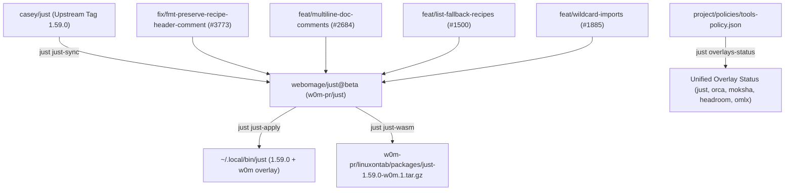

# `webomage/just` (`w0m-pr/just`) Overlay Fork, Host Binary Sync, and TabLinux WASM Package

- **Date:** 2026-11-08
- **Ticket:** `T685` (`T684` / `T685`)
- **Upstream Anchor:** `casey/just` `1.59.0`
- **Overlay Fork:** `github.com/webomage/just@beta` (`w0m-pr/just`)
- **TabLinux WASM Package:** `w0m-pr/linuxontab/packages/just-1.59.0-w0m.1.tar.gz`

---

## 1. Architecture & Release Sync Flow

---

## 2. Implemented Overlay Branches (`w0m-pr/just@beta`)

| Branch | Upstream Issue | Enhancement Summary | Verification |
|---|---|---|---|
| `fix/fmt-preserve-recipe-header-comment` | `casey/just#3773` | Preserves trailing `# comments` on recipe header lines (`b: a # comment`) when the recipe has a body in `just --fmt` and `just --dump`. | `cargo test --test integration format::` (`127/127` pass) |
| `feat/multiline-doc-comments` | `casey/just#2684` | Collects consecutive standalone `#` doc comment lines above recipes and renders them in `just --list`, `just --show <recipe>`, and `just --usage <recipe>`. | `cargo test --test integration -- usage:: show:: list::` (`245/245` pass) |
| `feat/list-fallback-recipes` | `casey/just#1500` | Appends public fallback recipes from parent `justfile`s under a `[fallback]` group in `just --list` when `set fallback` is enabled. | `cargo test --test integration -- fallback:: list::` (`40/40` pass) |
| `feat/wildcard-imports` | `casey/just#1885` | Expands glob wildcard patterns (`*`, `?`) in `import` / `import?` statements (`import 'just/*.just'`) in deterministic lexicographical order. | `cargo test --test integration -- imports::` (`25/25` pass) |

---

## 3. TabLinux WASM Package (`just-1.59.0-w0m.1.tar.gz`)

- **Archive:** `w0m-pr/linuxontab/packages/just-1.59.0-w0m.1.tar.gz`
- **Build Recipe:** `w0m-pr/linuxontab/packages/recipes/just.sh`
- **Registry Index:** `w0m-pr/linuxontab/packages/index.json` (`packages.just`, `version: "1.59.0-w0m.1"`)
- **Capabilities in TabLinux WASM:** Supports `just --version`, `just --w0m-features`, `just --summary`, `just --list` (with multi-line `#` doc comments and `[fallback]` parent discovery), `just --usage <recipe>`, `just --show <recipe>`, wildcard `import '*.just'`, and recipe execution inside the browser Linux environment.
