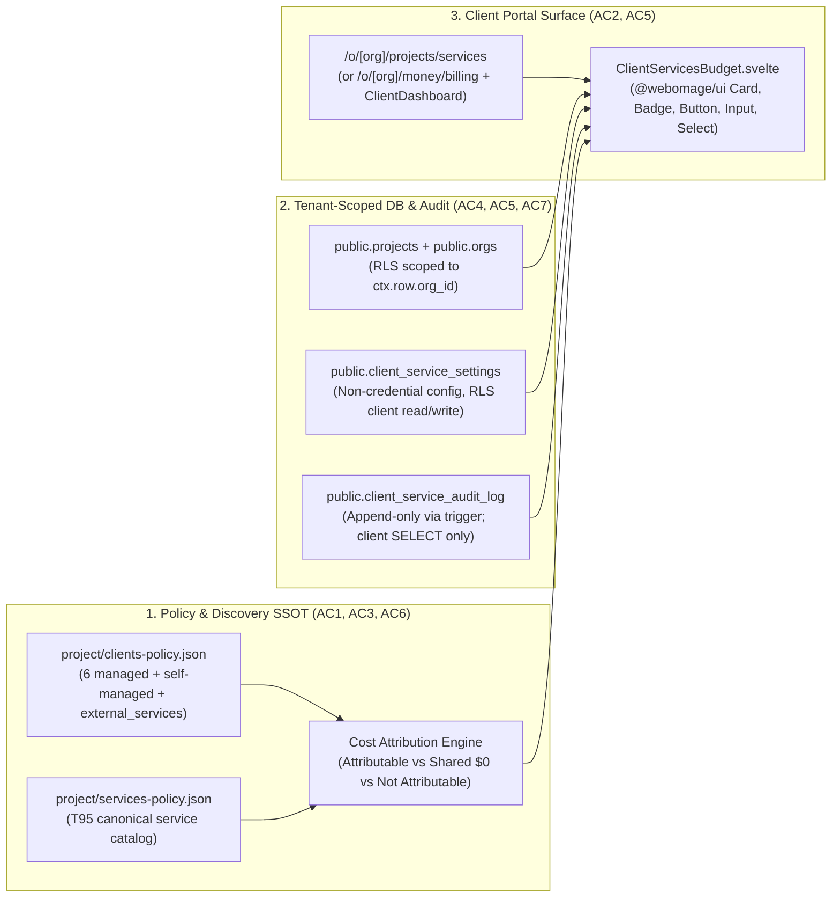

# T272 — Grounding Report & Start Brief (`w0m-sdlc-start` + `w0m-sdlc-research`)

> [!IMPORTANT]
> **Verdict: `ready` (with 4 stale ticket premises reconciled against Oct 2026 live reality and 3 architectural choices ready for confirmation).**
> `T272` (`P1`, `client-beta`, `0/8` ACs) is the prerequisite gate before `T271` (the Cloudflare Workers Paid `$5/mo` vs Supabase Pro `$25/mo` spend decision).

---

## 1. Five-Surface Reality Check (What Changed Since 2026-08-24)

| Surface / Claim in `T272` (2026-08-24) | Measured Reality (2026-10-20) | Impact on `T272` |
|---|---|---|
| **Client Portal Routes**: Cites `apps/cp/src/pages/client/{portal,invoices,milestones}.astro` and `ClientLayout`. | **Retired in `T439` C4a.** Enforced by `apps/cp/src/lib/client/__tests__/shared-pages.test.ts`. Client portal now renders inside `/o/[org]/*` (`ContextLayout.astro`), gated by `nav.ts` (`sides: BOTH` or `sides: CLIENT, only: "client"`) and `isPureClientOrg(ctx.held)`, with queries in `org-scope.ts` scoped to `ctx.row.org_id` under the caller's own session (`getSupabaseServerClient(Astro)`). | Build under `/o/[org]/*` (never `pages/client/*`), guarded by `shared-pages.test.ts` and `cp-nav-check`. |
| **Artemio DB State (`T266`)**: Cites `0` rows in `clients`, `client_users`, `projects`, `contracts`, `invoices`. | **`T266` is `done` (10/10 ACs, 2026-09-03).** Live DB holds `public.orgs` (`76618087-7279-49a5-af21-9248690582b8`, `slug = 'artemio-quiero-comer'`), `public.projects` (`a7e31002-2660-4000-8000-000000000001`, `slug = 'artemio-quiero-comer'`), `public.engagements` (`eg-artemio-quiero-comer`), linked client user `eva@webomage.com` (`66b018cd-b7a3-48f2-aa5c-51c92856a4bb`, holding `contract.view`, `invoice.view`, `milestone.approve`, `project.view`, `proposal.view`), 1 contract, 1 paid invoice (`$3,000`), and 2 milestones (`just artemio-tenancy-probe` 9/9 green). | We have a live, end-to-end client tenant (`artemio-quiero-comer`) to verify `T272` against immediately. |
| **Artemio Secrets Divergence (`T203`)**: States Artemio uses `dotenv` instead of Infisical. | **Closed in `T203` (2026-09-04).** `artemioquierocomer.mx/.w0m/sdlc.json` now uses Infisical (`"manager": "infisical"`), pointing to Artemio's **dedicated Infisical workspace** (`19a35ec3-5a10-4631-a65a-5b7cab961e9b`, distinct from `wom7web`'s `87a1718d-…`) and pushes secrets (`ADMIN_USERNAME`, `ADMIN_PASSWORD`, `TELEGRAM_BOT_TOKEN`, `TELEGRAM_CHAT_ID`) to its dedicated Cloudflare Worker (`artemioquierocomer-mx`). | `AC1`'s 4th state (`declared-but-not-reachable-by-us` → rendered as **`"managed outside w0m"`**) remains essential: Artemio's dedicated Infisical workspace (`19a35ec3-…`), Cloudflare bindings (`ORDERS_KV`, `IMAGES`, `AI`, `MYBROWSER`), Telegram bot, and Microsoft Clarity live outside `cp.webomage.com`'s runtime env / `public.connections`, and `1945` / `bridgeroad` / `evercred` declare `enabled: false` services in `clients-policy.json`. |
| **Service Discovery Registry (`T95` / `AC6`)**: Says *"Specify `T95` rather than duplicating it."* | **`T95` is `done` (5/5 ACs, 2026-09-17).** Shipped `project/services-policy.json`, `packages/lib/src/system-registry/sources.ts`, and `just connector-check`. | Extend `project/clients-policy.json` + `system-registry` to consume `services-policy.json` vocabulary rather than inventing a second registry (`AC6` satisfied by extension). |
| **Encryption at Rest (`T99` / `T442` / `AC4`)**: Says `T99` encryption at rest must land before any client credential is accepted. | **`T442` (`AgDR-0034`) is deployed in code & DB**, revoking column-level `SELECT` on token columns and adding AES-256-GCM encryption + `owner_kind = 'org'` on `public.connections`. **However, `CONNECTOR_TOKEN_KEY_V1` is currently `False` (absent) in Infisical `dev`/`beta`**, and `T99` is `paused` (4/9 ACs; 1 legacy plaintext row in `social_integrations`, 4 expired rows in `connections`). | Per `AC4`, client-editable settings in `T272` must either be scoped strictly to **non-credential** project/service settings (with credential intake hard-gated/refused until `CONNECTOR_TOKEN_KEY_V1` is active), or we can provision `CONNECTOR_TOKEN_KEY_V1` now. |

---

## 2. Architecture & Data Flow for `T272`

