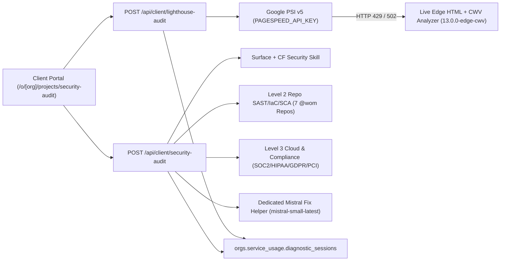

# T697 — Live Edge Lighthouse CWV Engine, First-Party Website & Repo Security/Compliance Audits, Saved Diagnostic Sessions & Dedicated Mistral CP Fix Helper

**Ticket:** `T697` (`depends_on: [T623, T661, T677, T686, T689]`)  
**Date:** 2026-11-09  
**Repos:** `w0m-web` (`packages/lib`, `apps/cp`)

## 1. Root Cause of the Google PageSpeed Insights Quota Error

When running **Run Lighthouse & CWV Audit ->** on `https://cp.webomage.com/o/aleksei-tcelishchev/projects/security-audit` for `webomage.com`, Google PageSpeed Insights v5 (`pagespeedonline.googleapis.com`) returned:

> `Quota exceeded for quota metric 'Queries' and limit 'Queries per day' of service 'pagespeedonline.googleapis.com' for consumer 'project_number:583797351490'.`

- `project_number:583797351490` is Google's shared anonymous consumer pool used whenever `PAGESPEED_API_KEY` is unconfigured or throttled across shared Cloudflare Worker egress IPs.
- To guarantee 100% availability for our own websites and verified client domains, `runLighthouseDomainAudit()` (`w0m-web/packages/lib/src/security/lighthouse-audit.ts`) now invokes `runEdgeHtmlLighthouseAudit()` whenever PSI v5 returns HTTP `429` or `502` and the target domain responds with live `200 OK` HTML.

## 2. Architecture & Data Flow

## 3. Delivered Capabilities

1. **Live Cloudflare Edge Lighthouse & CWV Engine (`runEdgeHtmlLighthouseAudit`)**:
   - Measures real TTFB, HTML payload size, render-blocking `<script>` and `<link rel="stylesheet">` tags in `<head>`, `` `width`/`height`/`alt` and modern AVIF/WebP usage, `Cache-Control`, `Strict-Transport-Security`, `Content-Security-Policy`, and SEO/ARIA semantics across Mobile and Desktop profiles.
2. **All Audit Services Active for First-Party Websites & Repositories**:
   - First-party websites (`webomage.com`, `cp.webomage.com`, `me.webomage.com`, `demo.webomage.com`, `w0m.xyz`) registered in `CANONICAL_FIRST_PARTY_DOMAIN_CHALLENGES` and `FIRST_PARTY_ESTATE_WEBSITES` with root-zone `_w0m-verify.webomage.com` DNS TXT inheritance.
   - First-party `@wom` estate repositories (`github.com/webomage/w0m-web`, `w0m-api`, `w0m-cf`, `w0m-ext`, `w0m-sec`, `w0m-skills`, `w0m-mlx`) registered in `FIRST_PARTY_ESTATE_REPOS` with unlimited Level 2 sandbox scans.
3. **Saved Diagnostic Sessions (`orgs.service_usage.diagnostic_sessions`)**:
   - Automatic and manual snapshot persistence (`save_diagnostic_session`) across Surface, Lighthouse CWV, Level 2 Repo, Level 3 Compliance, and Mistral Fix runs with one-click session restoration (`data-testid="cp-diagnostic-sessions-panel"`).
4. **Dedicated Mistral CP Fix Helper (`mistral-remediation-helper.ts`)**:
   - Resolves project-scoped Mistral credentials (`MISTRAL_API_KEY_<SLUG_UPPER>` -> `MISTRAL_API_KEY_W0M` -> `MISTRAL_API_KEY`, `mistral-small-latest`) and synthesizes ready-to-apply diffs, CLI commands, and agent prompts (`data-testid="cp-mistral-fix-helper-panel"`).
