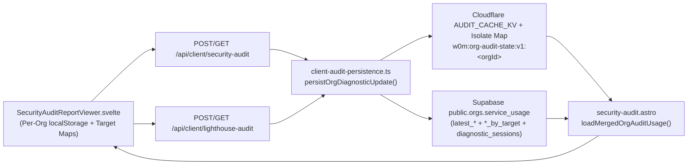

# Security & Compliance Audit Inventory and Result Preservation Architecture (`T697`, `T702`, `T704`)

## 1. End-to-End Audit Result Preservation Mechanic (3-Layer Architecture)

### Root Causes Fixed in the Preservation Mechanic

1. **Client-Hat / Non-Admin RLS `UPDATE` Drop on `public.orgs`**:
   - `public.orgs` has a single `UPDATE` policy (`"Admins update orgs"` requiring `public.wom_acting_is('admin')`).
   - When an operator wears a Client Hat (`Hat: Solar Mobile`) or a client member runs an audit, PostgREST `UPDATE public.orgs` via the user-scoped SSR client returns `0` rows without throwing an error.
   - `persistOrgDiagnosticUpdate()` (`apps/cp/src/lib/client-audit-persistence.ts`) now writes to **Cloudflare `AUDIT_CACHE_KV` + per-isolate memory (`w0m:org-audit-state:v1:<orgId>`)** alongside `public.orgs.service_usage`, and `security-audit.astro` merges both sources on SSR load via `loadMergedOrgAuditUsage()`.
2. **Lighthouse KV Cache Early-Return Bypass**:
   - Previously, `POST /api/client/lighthouse-audit` returned early on `AUDIT_CACHE_KV` URL hits (`w0m:lhr:v1:<url>`) before calling `persistOrgDiagnosticUpdate`, so cached Lighthouse runs were never saved to the org's `latest_lighthouse_report` or `diagnostic_sessions`. Both fresh and cached runs now persist to the org's audit state.
3. **Multi-Target Overwrite Across Websites & Repositories**:
   - `service_usage` now maintains per-target maps (`security_reports_by_target[hostname]`, `lighthouse_reports_by_target[hostname]`, `level2_reports_by_repo[repoUrl]`) in addition to `latest_*` pointers and `diagnostic_sessions` (up to `50` sessions, each enriched with a full combined snapshot). Switching between `webomage.com`, `cp.webomage.com`, `me.webomage.com`, `demo.webomage.com`, or the 7 `@wom` repositories restores that target's saved report immediately.

---

## 2. Inventory: Live & Working Now vs Reference-Modeled / Planned

| Layer / Package | Capability | Current Execution Status | Underlying Engine & Files |
|---|---|---|---|
| **Tier 1 — Domain Ownership & Auto-Provisioning** | DNS `TXT` (`_w0m-verify.<host>`) & HTTP `/.well-known/w0m-verify.txt` + Cloudflare / Route53 / DigitalOcean / GoDaddy API & CLI + AI Agent prompts | **LIVE (Production)** | `packages/lib/src/security/domain-ownership.ts`, `public.domain_ownership_verifications`, `public.domain_ownership_audit_log` |
| **Tier 1 — Passive Surface, TLS, Headers, DNS & Mail Auth** | Live HTTPS/TLS inspection, HSTS/CSP/XFO/CORP headers, DoH `SPF`/`DMARC`/`DNSSEC`/`CAA`, `security.txt`, and `cloudflare/security-audit-skill` (`CF-AUD-###`) | **LIVE (Production)** | `packages/lib/src/security/passive-audit.ts`, `w0m-web/project/scripts/mail_auth_check.py` |
| **Tier 1 — Lighthouse v13 & Core Web Vitals (Mobile + Desktop)** | Live Google PageSpeed Insights v5 API + automatic Cloudflare Edge HTML/CWV analyzer (`13.0.0-edge-cwv`) when PSI daily quota is exhausted | **LIVE (Production)** | `packages/lib/src/security/lighthouse-audit.ts`, `apps/cp/src/pages/api/client/lighthouse-audit.ts` |
| **CP Dedicated Mistral Security Fix Helper** | Calls Mistral API (`mistral-small-latest`, dedicated account `aleksei-tcelishchev@webomage.com`) with deterministic fallback patches & agent prompts | **LIVE (Production)** | `packages/lib/src/security/mistral-remediation-helper.ts` |
| **Repo & Skill Read-Only SAST + 12-Dimension UI/UX Audit** | Zero-exec static scan (`6` security rules + `12` UI/UX dimensions) across local repo files and `w0m-pr/` forks | **LIVE (CLI + CP Viewer)** | `runReadOnlyRepoAndSkillUiAudit` (`advanced-audit.ts`), `scripts/fork_catalog_sync.py` |
| **Estate CI/Pre-Push Security Gates** | `gitleaks`, `osv-scanner`, `semgrep`, `rbac-auditor`, `supabase_surface_drift_check.py`, `authz_admin_client_triage.py`, `mail_auth_check.py` | **LIVE (CI / Pre-Push)** | `just check-guardrails`, `w0m-sec/scripts/check_security_txt.py` |
| **Level 2 — Sandboxed Remote GitHub Repo Clone & Scan** | Offline polyglot analyzers (`semgrep`, `trivy`, `gitleaks`, `checkov`, `slither`, `license-sbom`) work on passed `VirtualRepoFile[]` or local dirs (`sandbox_audit_runner.py`), but CP `provisionLevel2TrialAudit` currently scans in-memory fixture files unless `files` are supplied | **Engine Live on Local Files; Remote GitHub Tarball Fetch in CP is Reference-Modeled** | `packages/lib/src/security/advanced-audit.ts`, `w0m-sec/scripts/sandbox_audit_runner.py` |
| **Level 3 — Multi-Cloud Posture & Compliance Binders (`SOC2`, `HIPAA`, `GDPR`, `PCI-DSS`)** | Generates structured gap matrices, readiness scores, and compliance packet blueprints (`audit-catalog.ts`) | **Deterministic Reference Model (Live Cloud IAM Connectors Planned)** | `runLevel3CloudAudit` (`advanced-audit.ts`), `packages/lib/src/compliance/audit-catalog.ts` |
| **`@k7*` Cross-Cloud Migration & FinOps (`@k7c`, `@k7tg`, `@k7s`)** | Generates HCL reverse-engineering preview, Mermaid topology graph, and FinOps cost delta (`AWS/GCP/Azure -> Cloudflare`) | **Deterministic Reference Calculator (Live `terraformer`/`inframap` Runner Planned)** | `runK7SmartInfraAndMigrationAudit` (`advanced-audit.ts`) |
