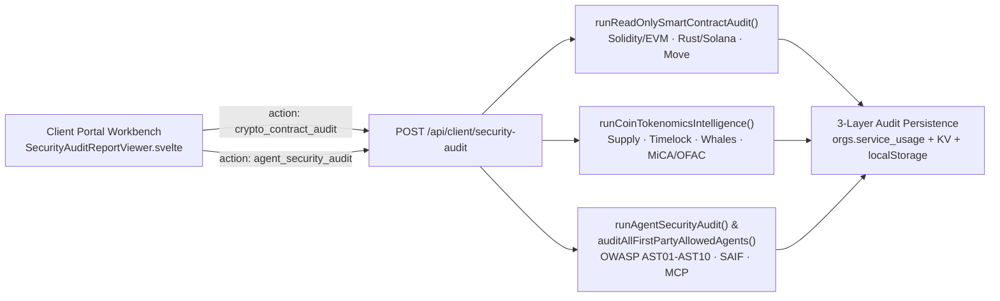

# T699 & T711 — Crypto Smart-Contract & Coin Intelligence Audit + AI Agent, MCP & Skill Security Certification

**Tickets**: `T699`, `T711`
**Date**: 2026-11-10
**Scope**: `@webomage/lib/security/crypto-contract-audit`, `@webomage/lib/security/coin-intelligence`, `@webomage/lib/security/agent-security-audit`, `/api/client/security-audit`, `SecurityAuditReportViewer.svelte`, `AuditPricing.svelte`, `scripts/session_complete.py`

---

## 1. Executive Summary

1. **Crypto Smart-Contract Security Audit (`T699`, `crypto-contract-audit.ts`)**:
   - Implemented deterministic, zero-execution (`sandboxExecuted: false`, `executionMode: "zero_exec_readonly_ast"`) static AST & invariant auditing across **8 blockchain ecosystems**:
     - **Solidity / EVM** (`ethereum`, `arbitrum`, `base`, `optimism`, `polygon`): Detects `SWC-107` CEI reentrancy, `DeFi-Oracle-01` AMM spot-price manipulation, `SWC-112/115` unprotected `delegatecall` / `tx.origin`, and `ERC-4626` first-depositor vault inflation.
     - **Rust / Solana Anchor** (`solana`): Detects `SOL-ANC-SIGNER-001` missing `Signer<'info>` & account owner verification, `SOL-ANC-CPI-002` arbitrary Cross-Program Invocation, `SOL-ANC-PDA-003` non-canonical bump seeds, and `SOL-ANC-MATH-004` unchecked lamport arithmetic.
     - **Move** (`sui`, `aptos`): Detects `MOVE-RES-HOTPOTATO-001` flash-loan receipts with `drop` ability, `MOVE-CAP-LEAK-002` exposed `AdminCap`/`TreasuryCap`, and `MOVE-MATH-PRECISION-003` division-before-multiplication precision loss.
2. **Coin & Tokenomics Intelligence (`T699`, `coin-intelligence.ts`)**:
   - Evaluates mint/freeze/burn authorities, proxy upgradeability & multisig timelock delay, top-10 whale holder concentration, DEX LP lock %, 90-day cliff unlock shock, buy/sell transfer tax honeypot risks, oracle dependency topology, and EU MiCA / OFAC / FATF VASP compliance posture.
3. **AI Agent, MCP & `SKILL.md` Security Audit + First-Party Fleet Certification (`T711`, `agent-security-audit.ts`)**:
   - Benchmarks agents against **6 Big Tech & Industry Agent Security Frameworks**:
     - **OWASP Agentic Skills Top 10 (`AST01`–`AST10`)** (`v1.0-2026`)
     - **Anthropic MCP & Linux Foundation AAIF `SKILL.md` Standard** (`2026.1`)
     - **Google SAIF & Elephant-Goldfish Context Isolation** (`SAIF-2.0 / EGM-1.0`)
     - **Trail of Bits `mcp-context-protector`** (`v0.4`)
     - **Microsoft PyRIT & AI Red Team** (`v0.9`)
     - **MITRE ATLAS (`AML.T0051` / `AML.T0048`)** (`v4.6`)
   - Certifies **all 6 Webomage Public & Client-Allowed Agents** (`6/6 PASS`, `100/100 · Grade A · certified_pass`):
     - `w0m-public-concierge` (Public Website & Audit Concierge)
     - `w0m-cp-mistral-security-helper` (Client Portal Dedicated Mistral Security Helper)
     - `w0m-cp-onboarding-advisor` (Client Portal Onboarding & Scope Advisor)
     - `w0m-me-personal-copilot` (Me Workspace Personal Productivity Copilot)
     - `w0m-sec-readonly-auditor` (Zero-Execution Read-Only Repo, Contract & Skill Auditor)
     - `w0m-egm-goldfish-reviewer` (Stateless Fresh-Context Goldfish Adversarial Reviewer)

---

## 2. Architecture Flow

