# T703 — Post-Registration & Post-Checkout Client Portal Onboarding Wizard for Advanced Services, Packages & Infrastructure Selectors

- **Ticket:** [[T703]]
- **Date:** 2026-11-10
- **Status:** Completed (`status: done`, `AC1–AC5` verified)

## 1. Executive Summary

We embedded the **Advanced Services, Packages & Infrastructure Selector Configurator** (`PUBLIC_SERVICE_ACTION_CATALOG`, `SERVICE_SOURCE_INFRA_OPTIONS`, `SERVICE_TARGET_INFRA_OPTIONS`, `SERVICE_WORKLOAD_SCOPE_OPTIONS`, `SERVICE_CUTOVER_TIMELINE_OPTIONS`) directly into the Client Portal **Post-Registration & Post-Checkout Onboarding Wizard** (`w0m-web/apps/cp/src/components/client/ClientDashboard.svelte`, `data-testid="cp-onboarding-service-wizard"`), and wired **Stripe Checkout** (`stripe-checkout`) and **1-Click OAuth / Magic Link Registration** as direct triggers that open the wizard pre-populated with the client's package and infrastructure selections.

```mermaid
flowchart LR
  PublicCard["Public Service / Audit / Blueprint Card"] --> CheckoutTrigger["Checkout Package ($X) or 1-Click OAuth"]
  CheckoutTrigger --> CpRoot["cp.webomage.com/?onboarding=wizard&checkout=triggered&service=..."]
  CpRoot --> PreserveQuery["index.astro forwards Astro.url.search to /o/<org>"]
  PreserveQuery --> WizardStep1["Step 1: Package & Mode Selector + In-Portal Checkout Trigger"]
  WizardStep1 --> WizardStep2["Step 2: Source/Target Infra, Workloads & Cutover Timeline"]
  WizardStep2 --> WizardStep3["Step 3: Save to orgs.service_usage.deliveries & Verify Domain"]
```

## 2. Key Architectural Changes

1. **Canonical Onboarding & Checkout Trigger URL Helpers (`w0m-web/packages/lib/src/security/order-form-state.ts`)**:
   - Added `buildOnboardingWizardPortalUrl(context, cpOrigin, basePath)` and `parseOnboardingWizardQuery(search)`.
   - Extended `FastOAuthOrderContext` with `checkoutTriggered?: boolean` and `onboardingWizard?: boolean`, and updated `buildFastOAuthRegisterUrl` so OAuth `next` URLs include `onboarding=wizard` (and `checkout=triggered` when triggered via package checkout).
   - Added `ORDER_FORM_STORAGE_KEYS.cpOnboardingWizard` (`wom:order-state:cp-onboarding-wizard:v1`).
2. **Query String Forwarding on CP Root Router (`w0m-web/apps/cp/src/pages/index.astro`)**:
   - Preserved `Astro.url.search` when `/` redirects to `result.to` (`/o/<org>`) so OAuth callbacks, magic links, and Stripe Checkout return URLs forward all onboarding/checkout parameters to `ClientDashboard.svelte`.
3. **Checkout as Direct Trigger for the Onboarding Wizard (`ServiceActionOrderConfigurator.svelte`, `AuditPricing.svelte`, `BlueprintOrderFlow.svelte`)**:
   - Added direct `"Checkout & Launch Wizard ($X) →"` buttons (`data-testid="fast-checkout-trigger-${slug}"`) on each service package card.
   - Updated `stripe-checkout` `success_url` to include `?order=success&onboarding=wizard&checkout=triggered&service=${slug}&mode=package...`.
   - Added the `"Checkout Confirmed — Launch Your Onboarding Wizard"` handoff banner (`data-testid="checkout-triggered-onboarding-banner"`) with deep-link CTA (`data-testid="open-cp-onboarding-wizard-link"`).
4. **3-Step Advanced Services & Infrastructure Onboarding Wizard in Client Portal (`ClientDashboard.svelte` & `apps/cp/src/pages/api/client/security-audit.ts`)**:
   - Embedded `data-testid="cp-onboarding-service-wizard"` on `/o/[org]` that automatically opens on checkout trigger (`?checkout=triggered`, `?order=success`, `?success=true`), OAuth/registration trigger (`?onboarding=wizard`, `?service=...`), or initial `onboarding` state (`hasNoData`).
   - Persisted non-website `order_works` deliverables (`infra`, `cross_cloud_migration`, `blueprint`, `repo`), `latest_k7_report`, and `service_scope` (`latest_service_onboarding`) into `orgs.service_usage.deliveries`.

## 3. Verification Evidence

- **Vitest Unit & Integration Suite**: `pnpm exec vitest run apps/web/src/tests/service-action-order-configurator.test.ts` — **6/6 passed**.
- **Design System & UI Leak Gates**: `just ds-conformance --enforce` and `just ui-ticket-leak-check` — **0 findings**.
