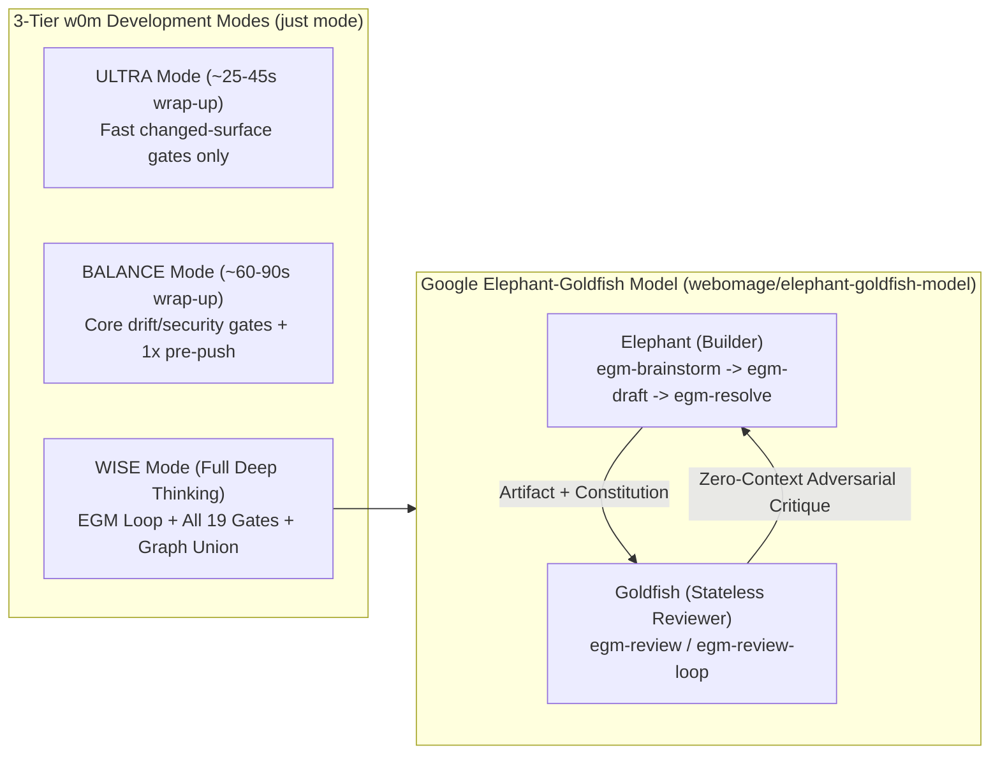

# T705 — Webomage Self-Audit Scorecard, `@k7` UI Cleanup, Google Elephant-Goldfish Model (EGM) Adoption & 3-Tier Development Modes (`ultra` / `balance` / `wise`)

- **Ticket:** [[T705]] (`P0`, `completed`)
- **Queued Follow-Up Tickets Created & Synced:** [[T706]] · [[T707]] · [[T708]] · [[T709]] · [[T710]]
- **Date:** 2026-11-10

---

## 1. Webomage Live Self-Audit Results (`webomage.com`, `cp.webomage.com`, `me.webomage.com` & `github.com/webomage/w0m-web`)

All four pillars of our production security & performance audit suite were executed against our live domains (`https://webomage.com`, `https://cp.webomage.com`, `https://me.webomage.com`) and repository (`https://github.com/webomage/w0m-web`) and seeded into `orgs.service_usage` for `webomage` and `aleksei-tcelishchev`.

### 1.1 Level 1 — Passive Perimeter & Surface Security Scorecard

| Target Surface | Overall Score | Grade | Passed / Total | Key Findings & Actionable Items |
|---|---:|---:|---:|---|
| **`https://webomage.com`** | **95 / 100** | **A** | **13 / 14** | TLS 1.3 + HSTS (`max-age=63072000; includeSubDomains; preload`), strict CSP, `nosniff`, `SAMEORIGIN`, `Permissions-Policy`, SPF (`include:_spf.google.com include:amazonses.com ~all`), DMARC (`p=quarantine; pct=100; adkim=s; aspf=s`), and RFC 9116 `/.well-known/security.txt` all **PASS**. Only 1 low warning: `dns-dnssec` (`DoH AD flag false`). |
| **`https://cp.webomage.com`** | **75 / 100** | **C** | **11 / 14** | TLS 1.3, HSTS preload, CSP, `nosniff`, `SAMEORIGIN`, `Referrer-Policy`, `Permissions-Policy`, and `/.well-known/security.txt` all **PASS**. Subdomain lacks dedicated `v=spf1` and `_dmarc.cp.webomage.com` TXT records (plus `dns-dnssec`). |
| **`https://me.webomage.com`** | **75 / 100** | **C** | **11 / 14** | TLS 1.3, HSTS preload, CSP, `nosniff`, `SAMEORIGIN`, `Referrer-Policy`, `Permissions-Policy`, and `/.well-known/security.txt` all **PASS**. Subdomain lacks dedicated `v=spf1` and `_dmarc.me.webomage.com` TXT records (plus `dns-dnssec`). |

### 1.2 Pillar 2 — Cloudflare Edge HTML & Core Web Vitals (Lighthouse Mobile & Desktop)

| Target Surface | Strategy | Grade | Perf | A11y | Best Practices | SEO | LCP | INP | CLS | FCP | TTFB |
|---|---|---:|---:|---:|---:|---:|---:|---:|---:|---:|---:|
| **`https://webomage.com`** | Mobile | **A** | **93** | **100** | **100** | **100** | `3.4 s` | `64 ms` | `0.00` | `1.8 s` | `318 ms` |
| **`https://webomage.com`** | Desktop | **A** | **100** | **100** | **100** | **100** | `1.6 s` | `42 ms` | `0.00` | `903 ms` | `318 ms` |
| **`https://cp.webomage.com/login`** | Mobile | **A** | **99** | **100** | **100** | **90** | `2.6 s` | `64 ms` | `0.00` | `1.6 s` | `130 ms` |
| **`https://cp.webomage.com/login`** | Desktop | **A** | **100** | **100** | **100** | **90** | `1.3 s` | `42 ms` | `0.00` | `732 ms` | `130 ms` |
| **`https://me.webomage.com`** | Mobile | **A** | **95** | **100** | **100** | **100** | `3.3 s` | `64 ms` | `0.00` | `2.3 s` | `244 ms` |
| **`https://me.webomage.com`** | Desktop | **A** | **100** | **100** | **100** | **100** | `1.5 s` | `42 ms` | `0.00` | `987 ms` | `244 ms` |

### 1.3 Pillar 3 — Read-Only Skill Security & 12-Dimension UI/UX Craftsmanship (`github.com/webomage/w0m-web`)

- **Overall UI Craftsmanship Score:** **81 / 100 (Grade B)**
- **Skill Security Status:** **PASS (`zero_exec_readonly_ast`)**
- **Dimension Breakdown:**
  - `D2_contrast_apca`: **10 / 10**
  - `D3_typography_hierarchy`: **8 / 8**
  - `D6_state_completeness`: **8 / 8**
  - `D7_primitive_reuse`: **8 / 8**
  - `D9_motion_discipline`: **6 / 6**
  - `D10_conversion_flow`: **8 / 8**
  - `D12_anti_slop_craft`: **6 / 6**
  - `D1_token_purity`: **6 / 10** · `D4_card_grid_rhythm`: **6 / 10** · `D5_responsive_4_posture`: **6 / 10** · `D8_wcag22_a11y`: **6 / 10**

### 1.4 Pillar 4 — Level 3 Cloud Posture, Topology, FinOps & Multi-Framework Compliance

- **Overall Cloud & Compliance Readiness:** **79 / 100 (Grade C · 79% Ready across `SOC2`, `HIPAA`, `GDPR`, `PII`, `PCI-DSS`)**
- **Providers Audited (Read-Only Enforced):** `AWS`, `GCP`, `Cloudflare`, `Supabase` (`7` resources modeled, `3` ClickOps drift items flagged)
- **FinOps Optimization (`terracost`):** `$1,344/mo` current → `$679/mo` optimized (**save `$665/mo` · `$7,980/yr`**)

---

## 2. Removal of User-Facing `k7` / `@k7` Mentions Across Audit UI & Website

Removed all internal `@k7*`, `@k7c`, `@k7tg`, `@k7s`, `@k7d`, `@k7env`, `@k7spec`, and `K7s` references from user-facing UI labels, badges, tabs, descriptions, and deliverables across:
1. `w0m-web/apps/cp/src/components/client/ClientDashboard.svelte`
2. `w0m-web/apps/cp/src/components/client/SecurityAuditReportViewer.svelte`
3. `w0m-web/apps/cp/src/components/client/SubscriptionManager.svelte`
4. `w0m-web/apps/web/src/components/ChatApp.svelte`
5. `w0m-web/apps/web/src/components/pricing/AuditPricing.svelte`
6. `w0m-web/packages/lib/src/security/order-form-state.ts`
7. `w0m-web/packages/lib/src/security/passive-audit.ts`
8. `w0m-web/packages/lib/src/security/advanced-audit.ts`
9. `w0m-web/packages/lib/src/entitlements/index.ts`
10. `w0m-web/apps/web/src/config/knowledge-snapshot.json`

---

## 3. P0 Adoption of Google Elephant-Goldfish Model (`google/elephant-goldfish-model`) & 3-Tier Development Modes (`ultra`, `balance`, `wise`)

### 3.1 Why Worktree Landing & `session-complete` Were Taking 15–31 Minutes
1. **`refresh_canonical_graph_union()` ran on every worktree land (`8–18 minutes`)**: Rebuilding `w0m_kb_vector.py index` (full vector + BM25 index) and `graph_global.py --auto-rebuild-stale --stale-limit 0` (`graphify` across all repos) inside every `session-complete` blocked worktree landing even though `codegraph sync` already updates incrementally per commit.
2. **Duplicate 10-repo `certify_estate_tree()` (`deploy_cert.py`) + `.husky/pre-push` passes (`6–10 minutes`)**: `session-complete` ran `certify_estate_tree` (all 28 suites across all repos, which is only consumed during `just deploy`), AND `precertify_web_prepush` (`svelte_typecheck_ratchet.py` + `vitest`), AND `just py-typecheck` (`1m27s`), AND `just mmd-validate` across all 129 historical reports (`24s`).
3. **Resolution (`scripts/dev_mode.py` + `scripts/session_complete.py` + `just mode`)**:
   - `just mode ultra`: runs the 6 fast changed-surface gates (`<45s`), skips full `deploy_cert.py` and `graphUnionRefresh` on land (deferring them to `just deploy`).
   - `just mode balance` (default): runs core drift/reality/security gates + single-pass `w0m-web` pre-push certification (`~60-90s`), deferring `deploy_cert.py`, `py-typecheck`, and `refresh_canonical_graph_union` to `just deploy` / `wise`.
   - `just mode wise`: runs full Google Elephant-Goldfish Model (`egm-*`) adversarial review loop + all 19 verification gates + `deploy_cert.py` + synchronous `refresh_canonical_graph_union()`.
