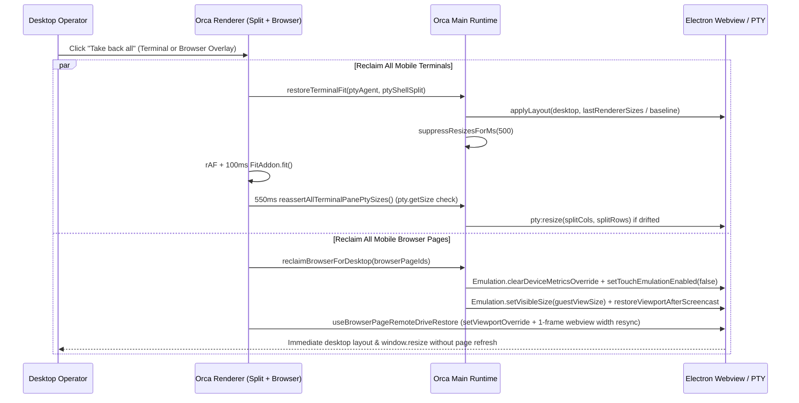

# T706 — Orca Mobile -> Desktop "Take back all" & Browser Auto-Resize Fix

- **Ticket**: `[[T706]]`
- **Upstream Issue**: [`stablyai/orca#40859`](https://github.com/stablyai/orca/issues/40859)
- **Upstream PR**: [`stablyai/orca#40954`](https://github.com/stablyai/orca/pull/40954)
- **Fork Branch**: `webomage/orca:fix/mobile-take-back-all-and-browser-resize` (`19156c0594b`, GPG-signed)

## 1. Root Cause Analysis

### 1.1 Split Terminal & Browser Surface Reclaim Gap (`AC2`)

1. **Terminal-Only `Take back all`**:
   - `restoreAllTerminalFits` (`src/renderer/src/components/terminal-pane/viewport/use-mobile-terminal-fit-actions.ts`) only invoked `restoreTerminalFitsToDesktop`, ignoring `browser-mobile-driver-state.ts` (`reclaimBrowserForDesktop`).
   - `BrowserMobileDriverOverlay.tsx` rendered only single-tab `Take back` without a `Take back all` recovery button.
2. **Post-Suppression Split PTY Drift**:
   - Main-process `applyLayout(..., { kind: 'desktop' })` (`terminal-layout-application.ts`) calls `suppressResizesForMs(500)`, dropping incoming `pty:resize` IPCs for `500ms`.
   - Renderer `scheduleRestoredTerminalRefit` and `useMobileOverlayTicks` ran `FitAddon.fit()` at `rAF` (`~16ms`) and `100ms`—inside the suppression window—mutating local `pane.terminal.cols/rows` to the split pane width while main dropped the `pty:resize` IPC.
   - Any later `safeFit` call early-returned (`dims.cols === pane.terminal.cols && dims.rows === pane.terminal.rows`) without re-emitting `onResize`, leaving split shell PTYs stuck at narrow mobile or pre-split widths.
   - In `terminal-desktop-reclaim.ts` and `terminal-display-mode.ts`, releasing a mobile driver lock without an active `terminalFitOverride` did not restore `lastRendererSizes` when the PTY grid had drifted.

### 1.2 Browser Tab Stuck at Mobile Viewport Until Manual Refresh (`AC3`)

1. **CDP `Emulation.setVisibleSize` & Touch Emulation Leak**:
   - `browser-screencast-device-metrics.ts` called `Emulation.setVisibleSize({ width: 390, height: 844 })` alongside `Emulation.setDeviceMetricsOverride`, directly resizing Chromium's guest `RenderWidgetHostView`.
   - `clearDeviceMetricsOverride` only called `Emulation.clearDeviceMetricsOverride` without restoring `Emulation.setVisibleSize` to the embedder's `guestViewSize` or disabling mobile touch emulation (`Emulation.setTouchEmulationEnabled({ enabled: false })`).
   - In `browser-screencasts.ts`, when a mobile viewport owner left a shared screencast whose remaining viewer was sizeless, `session.updateViewport({})` was skipped.
2. **Constant Host `<webview>` Bounds Suppressing `SynchronizeVisualProperties`**:
   - On desktop, the `<webview>` container's CSS dimensions remained unchanged while mobile drove the guest, so Electron's internal `<webview>` `ResizeObserver` did not emit `SynchronizeVisualProperties` when `isMobileDriven` transitioned `true -> false`.

## 2. End-to-End Reclaim Flow

## 3. Verification Summary

- **Unit & Integration Suites (`Vitest`)**:
  - `src/renderer/src/components/terminal-pane/viewport/terminal-fit-restore.test.ts` — `reclaimAllMobileSurfacesToDesktop` & `550ms` post-suppression `reassertAllTerminalPanePtySizes`.
  - `src/renderer/src/components/browser-pane/assemble-chrome/BrowserMobileDriverOverlay.test.tsx` — `Take back all` + `Take back` actions.
  - `src/renderer/src/components/browser-pane/host-guest/use-browser-page-remote-drive-restore.test.tsx` — live desktop viewport & `<webview>` embedder bounds resync without reload.
  - `src/main/runtime/terminal/layout/mobile-presence-lock.test.ts` — split renderer geometry restore on driver-lock reclaim + zero regressions on `mobile-subscribe-integration.spec.ts`.
  - `src/main/browser/cdp/screencast/browser-screencast-stream.test.ts` & `browser-screencast-driver-attribution.test.ts` — `Emulation.setVisibleSize` restore & touch emulation teardown.
- **Static Gates**:
  - `check-max-lines-ratchet.mjs`: **OK** (`browser-page-pane.tsx` kept at `399/400` lines).
  - `oxlint --deny-warnings`: **0 warnings, 0 errors** across all 22 touched files.
