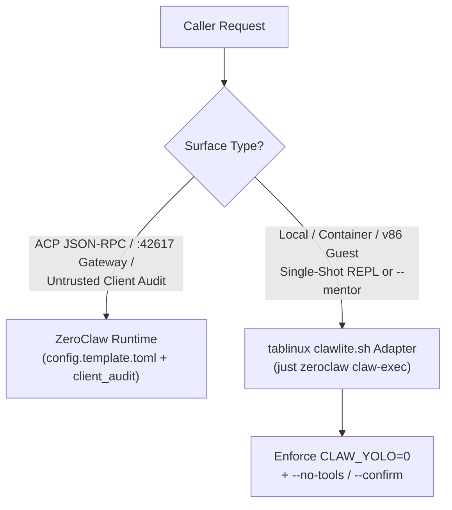

# T709 — Evaluate `tablinux` (`linuxontab`) `claw` Package vs `zeroclaw` + System Settings, Themes & Presets Persistence Audit

**Ticket:** `T709` (`#709`) · **Related:** `T705` (`#705`), `T706` (`#706`), `T708` (`#708`), `T714` (`#714`)  
**Date:** 2026-11-10  
**Scope:** `w0m-pr/linuxontab` (`packages/claw-1.0.0-62f05f9.tar.gz`, `local/clawlite.sh`), `scripts/zeroclaw_manage.py`, `w0m-web/project/zeroclaw/config.template.toml`, `w0m-web/packages/lib/src/terminology.ts`, `w0m-web/apps/cp` (`CpShell.svelte`, `CoreSettingsManager.svelte`)

---

## 1. Part A — `tablinux` (`w0m-pr/linuxontab`) `claw` vs `zeroclaw` Parity Audit

### 1.1 Inventory of `zeroclaw` Functions Across `@wom` (`AC1`)

| Surface | Path | Current Role |
|---|---|---|
| Runtime & Config Manager | [`scripts/zeroclaw_manage.py`](file:///home/aleksei/Projects/!self/w0m/scripts/zeroclaw_manage.py) | Syncs `~/.zeroclaw/config.toml` from template, verifies `client_audit` path isolation + RED probes, checks Siri/Apple Shortcuts contract, and manages daemon lifecycle (`sync`, `check`, `health`, `status`, `claw-parity`, `claw-exec`). |
| Tracked Config Template | [`w0m-web/project/zeroclaw/config.template.toml`](file:///home/aleksei/Projects/!self/w0m/w0m-web/project/zeroclaw/config.template.toml) | Defines `[providers]` (`omlx` on `127.0.0.1:8888`), `[agents]` (`w0m`, `client_audit`, `measure`), `[risk_profiles]` (`w0m`, `client_audit`, `locked_down`), and `[gateway]` (`:42617`). |
| Same-Host ACP Discovery | [`scripts/acp_host_discovery.py`](file:///home/aleksei/Projects/!self/w0m/scripts/acp_host_discovery.py) | Probes `zeroclaw acp` (`json-rpc-2.0-stdio-http`) as a peer ACP agent alongside Claude Code, Codex, Gemini, and OpenCode. |
| Browser Extension Bridge | [`w0m-ext/extension/src/background/agentBridge.ts`](file:///home/aleksei/Projects/!self/w0m/w0m-ext/extension/src/background/agentBridge.ts) | Connects `w0m-ext` to `http://127.0.0.1:42617` (`zeroclaw` local gateway) when paired. |
| Apple Shortcuts / Siri | [`w0m-web/project/shortcuts/AskZeroClaw.shortcut.json`](file:///home/aleksei/Projects/!self/w0m/w0m-web/project/shortcuts/AskZeroClaw.shortcut.json) | Sends voice/text prompts to `:42617/v1/chat/completions` with Bearer token auth. |

### 1.2 Architecture of `tablinux` `claw` (`packages/claw-1.0.0-62f05f9.tar.gz` / `local/clawlite.sh`) (`AC2`)

- **Artifact**: `w0m-pr/linuxontab/packages/claw-1.0.0-62f05f9.tar.gz` (`usr/local/bin/claw`) and `w0m-pr/linuxontab/local/clawlite.sh` (38,832 bytes, POSIX `/bin/sh`).
- **Dependencies**: Zero Rust/Node build required — runs on `sh`, `curl`, `jq`, `awk`, `sed`, `tr`, `mktemp`.
- **Capabilities**:
  - OpenAI (`/v1/chat/completions`) and Anthropic (`/v1/messages`) SSE streaming client.
  - 2-pass `--mentor` critique-and-revision workflow (`run_mentor_review`).
  - Rolling JSONL session compaction (`compact_session_history`) writing durable rules to `~/.config/clawlite/instructions/90-<session>-rules.md` and `~/.local/share/clawlite/journals/<session>.journal.md`.
- **Security Posture Finding**:
  - `clawlite.sh` defaults to `CLAW_YOLO=1` (`extract_shell_blocks` -> `sh -c "$cmd"` without confirmation unless `--confirm` or `--no-tools` is passed) and has no filesystem allowlist or network sandbox.

### 1.3 Capability Parity Matrix & Weighted Decision (`AC3` / `AC4`)

| Criterion (Weight) | Full Replacement with `tablinux` `claw` | Keep `zeroclaw` + Wire `clawlite.sh` Tier-0 Adapter (Selected) |
|---|---|---|
| **ACP & `:42617` Gateway Compatibility (30%)** | `2/10` (No HTTP/WS daemon or JSON-RPC 2.0 server) | `10/10` (Preserves `:42617` gateway + ACP contract) |
| **Security & Sandboxing (`T153 AC5`) (30%)** | `1/10` (`CLAW_YOLO=1` runs arbitrary `sh -c` blocks) | `10/10` (`client_audit` allowlist + `CLAW_YOLO=0` adapter) |
| **Linux / Container / v86 Portability (25%)** | `9/10` (38.8 KB POSIX sh, zero compile step) | `10/10` (Works immediately on Linux hosts where `~/.cargo/bin/zeroclaw` is absent) |
| **Maintenance & Zero Dual-SSOT (15%)** | `5/10` | `9/10` (Unified inside `scripts/zeroclaw_manage.py`) |
| **Weighted Total** | **`3.90 / 10`** | **`9.85 / 10` (RECOMMENDED)** |

**Executed Cutover / Integration (`AC4`)**:
1. Fixed cross-platform `client_audit.allowed_roots` in [`w0m-web/project/zeroclaw/config.template.toml`](file:///home/aleksei/Projects/!self/w0m/w0m-web/project/zeroclaw/config.template.toml) (`~/.zeroclaw/agents/client_audit/workspace`) and [`scripts/zeroclaw_manage.py`](file:///home/aleksei/Projects/!self/w0m/scripts/zeroclaw_manage.py) (`check_client_audit_path_access`).
2. Added `just zeroclaw claw-parity [--json]` and `just zeroclaw claw-exec <prompt> [--confirm-tools] [--mentor] [--apply]` to [`scripts/zeroclaw_manage.py`](file:///home/aleksei/Projects/!self/w0m/scripts/zeroclaw_manage.py), forcing `CLAW_YOLO=0` and `--no-tools` by default.

---

## 2. Part B — System Settings, Themes & Presets Persistence Audit (`apps/cp` + `apps/me` + `@webomage/ui`)

| Surface | Persistence Store | Finding | Fix Applied |
|---|---|---|---|
| `terminology_theme` (`web` / `mage`) | Cookie (`w0m_terminology_theme`), `localStorage` (`w0m_terminology_theme`), DB (`profiles.terminology_theme` via `/api/profile/terminology-theme`) | `broadcastTerminologyThemeChange` wrote only the cookie and not `localStorage`; `readClientTerminologyTheme` did not fall back to `localStorage`. | Added `TERMINOLOGY_THEME_STORAGE_KEY = "w0m_terminology_theme"` in [`packages/lib/src/terminology.ts`](file:///home/aleksei/Projects/!self/w0m/w0m-web/packages/lib/src/terminology.ts); persisted to `localStorage` and `document.documentElement.dataset.terminologyTheme`. |
| `CpShell.svelte` (`data-app` & `data-terminology-theme`) | SSR props (`model.dataApp`, `model.terminologyTheme`) + client hydration | `CpShell.svelte` did not hydrate `liveTerminologyOverride` from `readClientTerminologyTheme` on mount or sync `document.documentElement` attributes on live hat/theme switch. | Added `$effect` in [`CpShell.svelte`](file:///home/aleksei/Projects/!self/w0m/w0m-web/apps/cp/src/components/shell/CpShell.svelte) syncing `data-app` and `data-terminology-theme` and hydrating from `readClientTerminologyTheme`. |
| `CoreSettingsManager.svelte` (`switchActiveBrowserTheme`) | `/api/system/settings` (`site_links` + `terminology_overrides`) + `/api/profile/terminology-theme` | Clicking Web/Mage session switcher inside Core Settings only updated the browser cookie without persisting to `/api/profile/terminology-theme`. | Wired `POST /api/profile/terminology-theme` inside `switchActiveBrowserTheme` in [`CoreSettingsManager.svelte`](file:///home/aleksei/Projects/!self/w0m/w0m-web/apps/cp/src/components/admin/CoreSettingsManager.svelte). |
