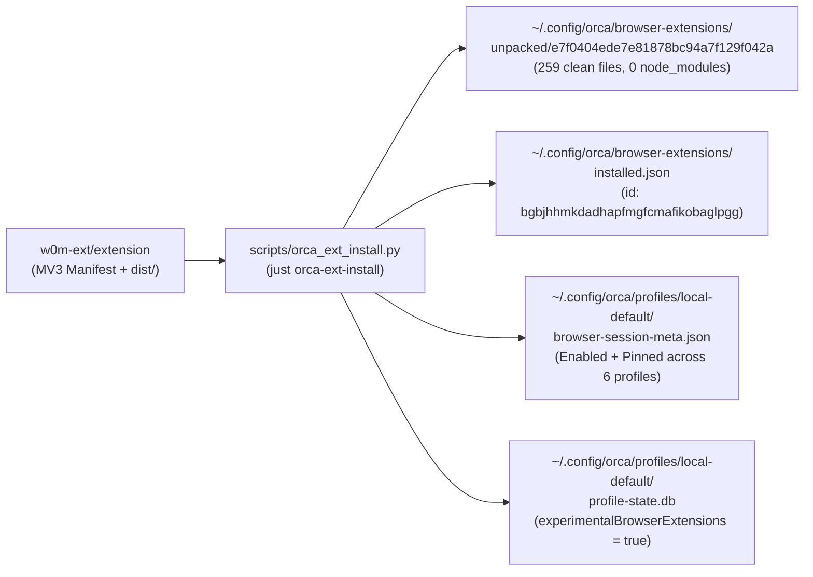

# T710 — Install & Load `w0m-ext` MV3 Extension Inside Orca Embedded Browser

**Ticket:** `T710` (`#710`) · **Related:** `T608` (`#608`), `T705` (`#705`), `T706` (`#706`)  
**Date:** 2026-11-10  
**Scope:** `w0m-pr/orca` (`src/main/browser/extensions/`), `w0m-ext` (`extension/`), `scripts/orca_ext_install.py`

---

## 1. Architecture & Root-Cause Findings (`AC1`)

1. **Orca Electron MV3 Extension Subsystem (`w0m-pr/orca/src/main/browser/extensions/`)**:
   - Orca Desktop loads extensions into each browser profile partition (`session.fromPartition(profile.partition)`) via `attachBrowserExtensionsToProfileSession` ([`browser-extension-session-loader.ts`](file:///home/aleksei/Projects/!self/w0m/w0m-pr/orca/src/main/browser/extensions/browser-extension-session-loader.ts)).
   - Installed extensions are persisted in `~/.config/orca/browser-extensions/installed.json` ([`browser-extension-install-store.ts`](file:///home/aleksei/Projects/!self/w0m/w0m-pr/orca/src/main/browser/extensions/browser-extension-install-store.ts)).
   - For `source: 'unpacked'` extensions, [`prepareBrowserExtensionDirectory`](file:///home/aleksei/Projects/!self/w0m/w0m-pr/orca/src/main/browser/extensions/browser-extension-load-directory.ts) computes:
     - `unpackedManifestKey(sourceDirectory)` = `sha256("orca-unpacked:" + resolve(sourceDirectory)).digest('base64')`
     - `extensionId` = `chromeExtensionIdFromKey(key)` -> **`bgbjhhmkdadhapfmgfcmafikobaglpgg`** for `/home/aleksei/Projects/!self/w0m/w0m-ext/extension`
     - `unpackedCopyDirectory` = `~/.config/orca/browser-extensions/unpacked/e7f0404ede7e81878bc94a7f129f042a`
2. **Bottleneck Fixed in `w0m-pr/orca`**:
   - In [`browser-extension-load-directory.ts:194`](file:///home/aleksei/Projects/!self/w0m/w0m-pr/orca/src/main/browser/extensions/browser-extension-load-directory.ts#L194-L201), `cp(extension.path, directory, ...)` only filtered out `.git`, causing unpacked source folders containing `node_modules/` (such as `w0m-ext/extension/node_modules`) to recursively dereference and copy thousands of pnpm packages into `~/.config/orca/browser-extensions/unpacked/` and list them in `web_accessible_resources`.
   - Updated the filter in [`browser-extension-load-directory.ts`](file:///home/aleksei/Projects/!self/w0m/w0m-pr/orca/src/main/browser/extensions/browser-extension-load-directory.ts) to exclude both `.git` and `node_modules`, and exposed `experimentalBrowserExtensions` in [`client-settings-params.ts`](file:///home/aleksei/Projects/!self/w0m/w0m-pr/orca/src/shared/rpc-contract/client-settings-params.ts), [`runtime-client-settings-shape.ts`](file:///home/aleksei/Projects/!self/w0m/w0m-pr/orca/src/main/runtime/runtime-client-settings-shape.ts), and [`runtime-client-settings.ts`](file:///home/aleksei/Projects/!self/w0m/w0m-pr/orca/src/main/runtime/runtime-client-settings.ts).

---

## 2. Provisioning Flow (`just orca-ext-install`) (`AC2` & `AC3`)

| Target Surface | Value Configured |
|---|---|
| Extension ID | `bgbjhhmkdadhapfmgfcmafikobaglpgg` (`Webomage Agent` v`2026.12.25.498121`) |
| Unpacked Staging Dir | `~/.config/orca/browser-extensions/unpacked/e7f0404ede7e81878bc94a7f129f042a` (`259` files) |
| Install Store | `~/.config/orca/browser-extensions/installed.json` (`source: "unpacked"`, `optionsPage: "ui/options.html"`, `iconPath: "icons/icon128.png"`) |
| Enabled & Pinned Profiles | All 6 Orca browser profiles (`default`, `Elena`, `Aleksei`, `Aleksei@w0m`, `Workspace: w0m`, `Workspace: master`) |
| Settings DB Flag | `experimentalBrowserExtensions: true` in `~/.config/orca/profiles/local-default/profile-state.db` |

---

## 3. Verification Evidence (`AC4`)

- `npx vitest run src/main/browser/extensions/browser-extension-load-directory.test.ts` (in `w0m-pr/orca`) -> **`9 passed (9)`**
- `just orca-ext-test` (`pytest -q scripts/tests/test_orca_ext_install.py`) -> **`2 passed`**
- `just orca-ext-status` -> `[STATUS] Orca Embedded Browser w0m-ext (bgbjhhmkdadhapfmgfcmafikobaglpgg): registered=True · experimentalBrowserExtensions=True · profiles=6`
