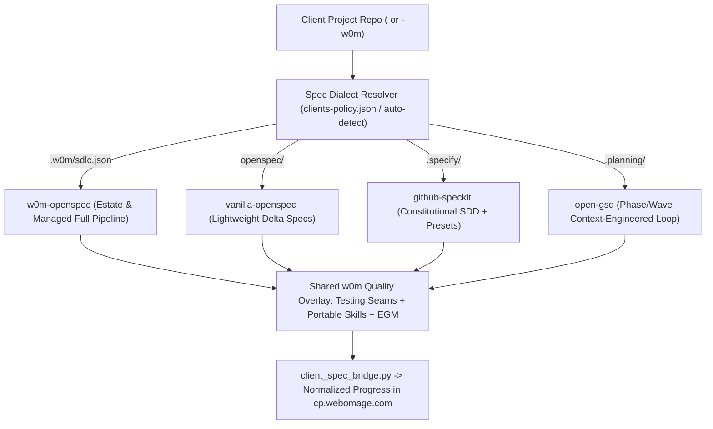

# T712 — 4-Way SDD Architecture Comparison (`open-gsd/gsd-core` vs `github/spec-kit` vs `OpenSpec` vs `w0m` Actual Specs) & Multi-Dialect Client Project Strategy

- **Ticket:** [[T712]] (`P1`, `completed`)
- **Queued Implementation Tickets:** [[T713]] · [[T714]] · [[T715]]
- **Date:** 2026-11-10

---

## 1. Executive Summary

This report compares four Spec-Driven Development (SDD) architectures:
1. **OpenGSD (`open-gsd/gsd-core`)** — Context-engineering & fresh-subagent wave execution framework (`.planning/`).
2. **GitHub Spec Kit (`github/spec-kit`)** — Constitutional requirements contract & preset/extension catalog toolkit (`.specify/`).
3. **Vanilla OpenSpec (`Fission-AI/OpenSpec`)** — Lightweight brownfield delta specification workflow (`openspec/`).
4. **Webomage (`w0m`) Actual Specs (`w0m-web/openspec/SPEC-AUTHORING-STANDARD.md`)** — Executable verification contracts with mandatory `Testing seams` (observable, attachment point, failure-shape question), Triangulated SSOT, Gauge/Gherkin E2E suites, 10-gate SDLC, 3-tier development modes (`ultra`/`balance`/`wise`), and Google's Elephant-Goldfish Model (`egm-*`).

For client engagements (`role: "managed"` and `role: "self-managed"` in `project/policies/clients-policy.json`), we define a **Multi-Dialect Client Spec Architecture** (`[[T713]]`, `[[T714]]`, `[[T715]]`) that supports **`github-speckit`**, **`open-gsd`**, **`openspec`**, and **`w0m-openspec`** as first-class client project dialects while preserving Webomage's `Testing seams` and security/quality gates.

---

## 2. Four-Way Comparison Matrix

| Dimension | **OpenGSD (`open-gsd/gsd-core`)** | **GitHub Spec Kit (`github/spec-kit`)** | **Vanilla OpenSpec (`Fission-AI/OpenSpec`)** | **`w0m` Actual Specs (`SPEC-AUTHORING-STANDARD.md`)** |
|---|---|---|---|---|
| **Primary Thesis** | **Context-engineered phase execution**: prevent context rot by running research, planning, and wave execution in fresh `200k` subagent windows backed by `.planning/` disk state | **Constitutional requirements contract**: formal, stakeholder-readable artifact pipeline (`constitution -> specify -> clarify -> plan -> tasks -> analyze -> implement -> converge`) | **Lightweight brownfield delta specs**: propose small `ADDED/MODIFIED/REMOVED` requirement deltas and fold them into canonical domain specs on archive | **Executable, reality-grounded verification contracts**: mandatory `Testing seams` (`observable`, `where it is read`, `its failure shape`) + Triangulated SSOT + 10-gate SDLC + `ultra`/`balance`/`wise` + EGM |
| **On-Disk State & Directory Layout** | `.planning/` (`PROJECT.md`, `REQUIREMENTS.md`, `ROADMAP.md`, `STATE.md`, `config.json`, `phases/XX-name/{CONTEXT,RESEARCH,PLAN,SUMMARY,VERIFICATION,VALIDATION,UI-SPEC,UAT}.md`) | `.specify/` (`memory/constitution.md`, `templates/`, `specs/<NNN-feature>/{spec.md, plan.md, tasks.md, research.md, data-model.md, checklists/requirements.md}`) | `openspec/` (`project.md`, `specs/<domain>/spec.md`, `changes/<change-id>/{proposal.md, design.md, tasks.md, specs/<domain>/spec.md}`, `changes/archive/`) | `.w0m/sdlc.json` + `w0m-web/openspec/specs/` + `w0m-web/specifications/*.spec` (Gauge) + `.tasks/T##.md` + `TASKS.md` + `STATE.md` + `TECH-DEBT.md` + `LESSONS.md` + `docs/DECISIONS.md` (AgDR) |
| **Core Lifecycle Loop** | **5-Step Phase Loop**: `Discuss` -> `Plan` (4x parallel researchers + plan-checker) -> `Execute` (wave subagents) -> `Verify` (`UAT.md` + codebase drift gate) -> `Ship` | **9-Command Pipeline**: `/speckit.constitution` -> `specify` -> `clarify` -> `plan` -> `checklist` -> `tasks` -> `analyze` -> `implement` -> `converge` (plus `bug.*` & `assess.*` bundles) | **4-Step Change Loop**: `openspec-new-change` (`propose`) -> `openspec-explore` -> `openspec-apply-change` -> `openspec-verify-change` -> `openspec-archive-change` | **10-Gate Enforced Pipeline**: `new` -> `research` -> `start` -> `spec` -> `build` (TDD) -> `review` (`torvalds` / EGM Goldfish) -> `security` -> `verify` -> `deploy` -> `archive` (`just session-complete`) |
| **Verification & Anti-Hallucination Rigor** | **Strong**: `Plan Checker` loop (max 3x), `Package Legitimacy Gate` (blocks hallucinated `[SLOP]` packages), `Decision Coverage Gate` (`CONTEXT.md -> PLAN.md`), post-execute `codebase_drift_gate`, Nyquist `VALIDATION.md` | **Medium (LLM self-check)**: `/speckit.clarify` (up to 5 ambiguity questions), `/speckit.checklist` (requirements quality checklist), `/speckit.analyze` (read-only cross-artifact consistency check), `/speckit.converge` | **Light**: `SHALL` + `#### Scenario: WHEN/THEN` blocks and `openspec validate` structural schema check; does not enforce where assertions attach or whether a test can vacuously pass | **Strictest (Mechanical + Adversarial)**: Mandatory `- **Testing seams:**` (`observable`, `where it is read`, and *"does a catastrophic failure look like a pass?"*), `just reality-verify`, `supabase_surface_drift_check.py`, `spec_drift_check.py`, `ds-conformance`, plus EGM (`egm-review-loop`) |
| **Context & Token Management** | **First-class**: 6 namespace meta-routers (`/gsd-workflow`, `/gsd-project`, `/gsd-quality`, `/gsd-context`, `/gsd-manage`, `/gsd-ideate`), workflow byte budgets (`38KB–90KB` ratchet), `CONTEXT.md` predicate fact-store (`ADR-1671`), `gsd-context-monitor.js` hook, and built-in `graphify` hooks | **Template-layered**: `specify artifact` stack (`built-in -> preset -> extension -> override`), `agent-context` extension updates `CLAUDE.md`/`AGENTS.md`; single-session chat execution by default | **Minimal**: small markdown files (~250 lines per change) read directly in current agent session | **Multi-layered**: `codegraph` + `graphify` (`just ask` before grep), `corpus.sqlite` hybrid BM25/vector index, `STATE.md` pickup block (`just state-brief`), 3-tier dev modes (`ultra` / `balance` / `wise`), and Google EGM (`README.md` Peanuts/Hay contracts) |
| **CLI & Runtime Footprint** | Node.js CJS (`npx @opengsd/gsd-core`, `gsd-tools.cjs` command routing hub), 33 specialized agents, 14 hooks (`gsd-secret-read-guard.js`, `gsd-prompt-guard.js`) | Python 3.11+ (`uv tool install specify-cli`, `specify init --integration <agent>`), composable `Presets`, `Extensions`, `Workflows`, `Bundles`, and private/air-gapped `Catalogs` | Node.js CLI (`@fission-ai/openspec`), generates slash commands/skills per IDE | Python + TypeScript + `just` (`scripts/*.py`, `w0m-skills/skills.ts`), isolated agent worktrees (`just agent-tree`), GitHub Projects v2 two-way sync |
| **Best Fit** | Autonomous greenfield/brownfield feature phases where clients want self-contained `.planning/` artifacts + wave execution without `w0m` infra coupling | Enterprise / regulated / agency clients who want GitHub-standard `.specify/` constitutional contracts, presets, and stakeholder sign-off before coding | Small brownfield repos needing low-ceremony delta proposals without heavy phase or constitutional scaffolding | `@wom` first-party estate and full-service managed engagements where DB/RLS/UI/deploy drift gates and multi-repo certification are mandatory |

---

## 3. Architectural Synthesis & Multi-Dialect Client Adapter

### Follow-Up Implementation Roadmap (`T713`–`T715`)

1. **[[T713]] — Client Project Multi-Dialect Spec Bootstrap & Registry (`clients-policy.json`, `GENERIC-SDLC-SET.md`, `just client-spec-init`)**:
   - Add `spec_dialect` (`w0m-openspec` | `openspec` | `github-speckit` | `open-gsd`) to `clients-policy.schema.json` and `clients-policy.json`.
   - Implement `just client-spec-init <target> --dialect <speckit|gsd|openspec>` with Webomage `Testing seams` preset/override templates for `.specify/templates/overrides/` and `.planning/` plus portable `w0m-skills` installation.
   - Update `w0m-skills/GENERIC-SDLC-SET.md` lifecycle mapping table for `OpenSpec`, `GitHub Spec Kit`, and `OpenGSD`.
2. **[[T714]] — Cross-Dialect Client Spec Bridge & Package Legitimacy Gate (`scripts/client_spec_bridge.py` + `just client-check`)**:
   - Build `scripts/client_spec_bridge.py` to parse and normalize requirements, plans, tasks, and verification status across `.specify/`, `.planning/`, `openspec/`, and `.tasks/`.
   - Adopt OpenGSD's Package Legitimacy Gate (`[SLOP]` / `[SUS]` registry verification for proposed npm/PyPI/crates dependencies) into `w0m-sdlc-research` and `client_spec_bridge.py`.
3. **[[T715]] — Client Portal (`apps/cp`) Onboarding Wizard & Project Settings SDD Dialect Selector**:
   - Add SDD Dialect selection (`GitHub Spec Kit`, `OpenGSD`, `OpenSpec`, `Webomage Full SDLC`) to the Client Portal Onboarding Service Wizard (`T703`) and Project Settings (`apps/cp`), and display normalized spec/phase completion metrics in the Client Portal dashboard.
