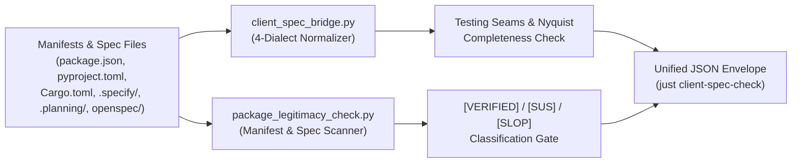

# T714 — Package & Dependency Legitimacy Audit Across All 7 Estate Repos + Cross-Dialect Client Spec Bridge

**Ticket:** `T714` (`#714`) · **Related:** `T712` (`#712`), `T713` (`#713`), `T715` (`#715`)  
**Date:** 2026-11-10  
**Scope:** `@wom` workspace root + all 7 estate repositories (`w0m-web`, `w0m-api`, `w0m-cf`, `w0m-ext`, `w0m-sec`, `w0m-skills`, `w0m-mlx`)

---

## 1. Executive Summary

1. **Custom Package & Dependency Legitimacy Gate (`scripts/package_legitimacy_check.py`)**:
   - Scans all **27 manifests** (`package.json`, `pyproject.toml`, `Cargo.toml`) across the `@wom` workspace root and all **7 estate repositories**, plus proposed install commands inside specification/plan markdown files (`npm i`, `pnpm add`, `pip install`, `uv add`, `cargo add`).
   - Enforces a zero-tolerance gate against:
     - **`[SLOP]` (Blocking, exit `1`)**: Hallucinated/non-existent packages, unapproved `http://` / `https://` / `git+` / `github:` remote tarball specifiers, path-traversal specifiers (`..`), typosquatted internal scopes (`@w0m-*`, `@webomage-*`), and known malicious/deprecated typosquat names.
     - **`[SUS]` (Warning, exit `2` under `--strict`)**: Newly published (< 30 days) or low-download packages when `--online` registry metadata verification is enabled across npm (`registry.npmjs.org`), PyPI (`pypi.org/pypi/<pkg>/json`), and crates.io (`crates.io/api/v1/crates/<pkg>`).
   - Wired into `@wom/.pre-commit-config.yaml` (`id: package-legitimacy-check`), `just package-legitimacy-check`, and `w0m-skills/skills/w0m-sdlc-research/SKILL.md` Step 3b.
2. **Cross-Dialect Client Spec Bridge (`scripts/client_spec_bridge.py` + `just client-spec-check`)**:
   - Normalizes specifications, implementation plans, tasks, and verification status across all 4 Spec-Driven Development (SDD) dialects:
     - **`github-speckit`** (`.specify/specs/<NNN-feature>/{spec,plan,tasks}.md` + `.specify/memory/constitution.md`)
     - **`open-gsd`** (`.planning/{PROJECT,REQUIREMENTS,ROADMAP,STATE}.md` + `.planning/phases/XX-*/`)
     - **`openspec`** (`openspec/specs/` + `openspec/changes/`)
     - **`w0m-openspec`** (`.w0m/sdlc.json` + `.tasks/T##.md` + `w0m-web/openspec/specs/`)
   - Audits `Testing seams` / Nyquist `VALIDATION.md` / `checklists/requirements.md` and runs the Package Legitimacy Gate on spec/plan markdown files.

---

## 2. Package & Dependency Legitimacy Audit Across All 7 Estate Repos

Measured via `python3 scripts/package_legitimacy_check.py`:

| Repository | Manifests Audited | Dependencies Audited | `VERIFIED` | `SUS` | `SLOP` | First-Party Workspace Scopes |
|---|---:|---:|---:|---:|---:|---|
| `@wom` (`.`) | 1 (`package.json`) | 2 | 2 | 0 | 0 | `@wom` |
| `w0m-web` | 15 (`package.json` across root, 5 apps, 9 packages) | 288 | 288 | 0 | 0 | `@webomage/*`, `@w0m/*` |
| `w0m-api` | 2 (`package.json`, `worker/package.json`) | 17 | 17 | 0 | 0 | `@w0m/*` |
| `w0m-cf` | 4 (`package.json`, `Cargo.toml`, 2 wasm crates) | 21 | 21 | 0 | 0 | `w0m-cf-wasm-*` |
| `w0m-ext` | 2 (`package.json`, `extension/package.json`) | 19 | 19 | 0 | 0 | `@w0m/browser-assistant` |
| `w0m-sec` | 1 (`package.json`) | 2 | 2 | 0 | 0 | `@w0m/sec` |
| `w0m-skills` | 1 (`package.json`) | 1 | 1 | 0 | 0 | `@w0m/skills` |
| `w0m-mlx` | 1 (`w0m-mlx/pyproject.toml`) | 7 | 7 | 0 | 0 | `w0m-mlx` |
| **Total** | **27 manifests** | **357 dependencies** | **357** | **0** | **0** | **100% conformant** |

---

## 3. Architecture & Verification Flow

---

## 4. Verification Evidence

- `just package-legitimacy-check` -> `[PASS] Package Legitimacy Gate: 27 manifest(s) across 8 repo(s) · 357 dep(s) (VERIFIED=357, SUS=0, SLOP=0)`
- `just client-spec-check` -> `[VERIFIED] Client Spec Bridge (w0m-openspec): 167 feature/phase spec(s) · tasks 4412/5659 · testing_seams=True · pkg_slop=0`
- `just client-spec-bridge-test` (`pytest -q scripts/tests/test_client_spec_bridge.py`) -> `6 passed`
