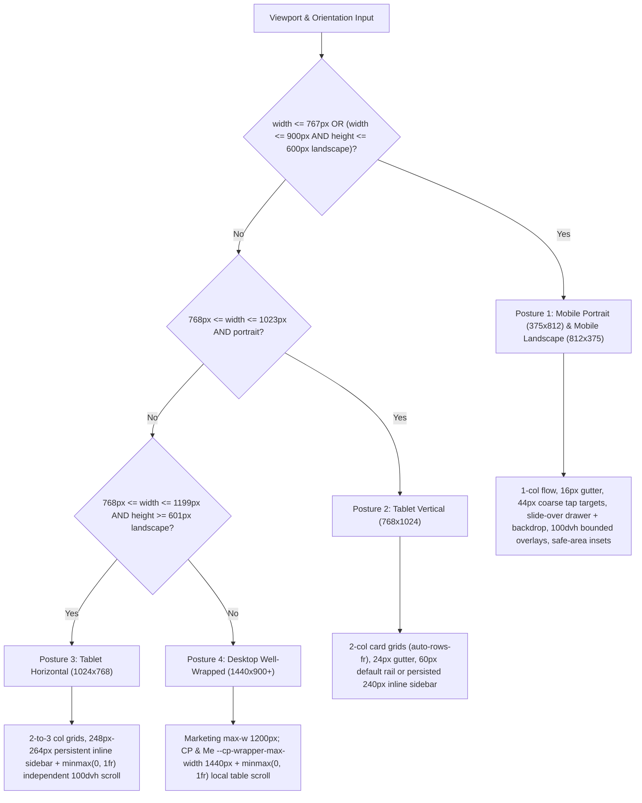

# T716 — Multi-Orientation UX Audit & Remediation (`AgDR-0054`)

- **Ticket:** [[T716]]
- **Decision Reference:** [`AgDR-0054`](../../docs/decisions/AgDR-0054-mobile-first-multi-orientation-responsive-ui.md) · [`AgDR-0056`](../../docs/decisions/AgDR-0056-consolidate-join-and-job-into-me-webomage-com.md)
- **Scope:** `@webomage/ui` (`w0m-web/packages/ui`), `@webomage/lib` (`w0m-web/packages/lib`), `apps/web`, `apps/cp`, `apps/me`, `apps/demo`, and `w0m-web/tests/steps/ui.steps.ts`

## 1. Executive Summary

`[[T716]]` audited and remediated multi-orientation layout, viewport containment, horizontal blowout, sidebar state persistence, token purity (`D1`), card-grid equal-height rhythm (`D4`), responsive posture static verification (`D5`), coarse-pointer touch targets (`D8`, `>= 44×44px`), and dead-anchor (`D11`) regressions across all four active `w0m-web` applications (`apps/web`, `apps/cp`, `apps/me`, `apps/demo`) and shared packages (`@webomage/ui`, `@webomage/lib`).

Key structural root causes resolved:
1. **Short-Height Mobile Landscape (`812×375`) vs Tablet Horizontal (`1024×768`) Collisions:** `AppShell.svelte` previously matched `812×375` phones against `@media (min-width: 768px) and (max-width: 1199px) and (orientation: landscape)`, rendering an inline `248px` sidebar without a slide-over backdrop and leaving overlays (`ChatApp`, `SidebarHatSwitcher`, `ContextSwitcher`, `DialogContent`, `QuickViewModal`, `BugReportWidget`, `Header.astro` mobile drawer) unbounded or clipped off-screen on `375px`-tall viewports. Adding `and (min-height: 601px)` to Tablet Horizontal and routing `(max-width: 900px) and (max-height: 600px) and (orientation: landscape)` to mobile drawer + `100dvh` scroll bounds + `env(safe-area-inset-*)` resolved all landscape clipping.
2. **Tablet Portrait (`768×1024`) Sidebar Persistence & Orientation Rotation Wipe:** `AppShell.svelte` now reads `localStorage.getItem("w0m-sidebar-collapsed")` across all viewports `>= 768px`, defaults to the `60px` icon rail on Tablet Portrait (`768px–1023px`) only when no explicit preference is stored, and preserves `manualCollapsed` across `768×1024` ↔ `1024×768` tablet rotations.
3. **Grid Blowout & Desktop Well-Wrapped Width (`1440px`):** Replaced `1fr` shell column tracks with `minmax(0, 1fr)` so wide `<Table>` and `<pre>` children scroll locally rather than stretching document width, and switched `.w0m-main > *` from `--wrapper-max-width` (`1200px` marketing token) to `--cp-wrapper-max-width` (`1440px` workspace token).
4. **Static Audit Precision (`D4_card_grid_rhythm` & `D5_responsive_4_posture`):** Updated `packages/lib/src/security/advanced-audit.ts` so `max-w-[1200px]` / `max-w-[1440px]` and `min-w-*` utilities never false-positive (`(?<!max-)(?<!min-)\bw-\[(?:[4-9]\d\d|\d{4,})px\]`), fixed `w-[500px]`+ overflow widths are caught, and 2-column form input grids are distinguished from multi-card grids.

## 2. Multi-Orientation Posture Routing Architecture



## 3. Five-Viewport Audit Matrix (`AgDR-0054`)

| Viewport Posture | Dimensions | Pre-Remediation Defects | Post-Remediation State |
|---|---|---|---|
| **Mobile Portrait** | `375×812` | `SharedHeader.astro` (`me`/`demo`) overflowed `+144px–185px`; `apps/demo` `minmax(300px, 1fr)` overflowed `287px` inner container; `Footer.astro` `.social-media-list` `flex-nowrap` clipped; `ServiceActionOrderConfigurator` & `ClientDashboard` `whitespace-nowrap` CTA buttons overflowed cards; `InterviewSession` `p-16` crushed content to `247px`. | Collapsible `< 768px` drawer in `SharedHeader.astro`; `minmax(min(100%, 300px), 1fr)` in `apps/demo`; `flex-wrap` social row & headers; wrapped multi-line CTAs; `p-5 sm:p-10 lg:p-16` in `InterviewSession`; zero horizontal page overflow (`scrollWidth <= innerWidth + 1`). |
| **Mobile Landscape** | `812×375` | `812px` width triggered Tablet Landscape inline `248px` sidebar in `AppShell`; `Header.astro` mobile drawer clipped `#nav-free-audit-cta`; `ChatApp.svelte` pushed `.chat-header`/`.close-btn` off-screen; `SidebarHatSwitcher`, `ContextSwitcher`, `DialogContent`, `QuickViewModal`, `BugReportWidget`, and `JobBoard` overlays exceeded `375px` height; `admin/tasks.astro` `calc(100vh - 18rem)` crushed board to `87px`. | `min-height: 601px` guard isolates Tablet Landscape; `(max-width: 900px) and (max-height: 600px) and (orientation: landscape)` activates mobile slide-over drawer, `48px–52px` compact headers, `env(safe-area-inset-*)` notch padding, full-screen `100dvh` `ChatApp`, `100dvh`-scrollable modals/popovers, and `min-h-[360px]` task board. |
| **Tablet Portrait** | `768×1024` | `AppShell` ignored `localStorage` below `1024px` and wiped `manualCollapsed` on rotation; `AuditPricing` jumped `1 -> 3` cols (`lg:grid-cols-3`); `SolutionsGrid` & `BlueprintGallery` `350px` min-width forced 1 col at `720px` container width; `ClientDashboard` & `SecurityAuditReportViewer` `md:grid-cols-4` crushed cards to `147px`; `assessments/[id].astro` split `1/3 + 2/3` side-by-side at `md:`. | `localStorage` honored for all `>= 768px` viewports and preserved across portrait↔landscape rotation; `md:grid-cols-2` / `minmax(min(100%, 310px), 1fr)` delivers clean 2-up card grids (`2 × 310 + 30 = 650 <= 720px`); `sm:grid-cols-2 xl:grid-cols-4` stat grids; `assessments/[id].astro` stacks `flex-col lg:flex-row`. |
| **Tablet Landscape** | `1024×768` | `.chat-popup.maximized` (`700px` height + `6rem` bottom offset) clipped header at `768px` height; `AppShell` `1fr` track allowed wide tables to push horizontal scrollbars onto `documentElement`. | `.chat-popup.maximized` clamped to `max-height: calc(100dvh - 6rem); max-width: calc(100vw - 2rem)`; `AppShell` uses `minmax(0, 1fr)` tracks with independent `100dvh` scroll panes. |
| **Desktop Well-Wrapped** | `1440×900` | `.w0m-main > *` read `--wrapper-max-width` (`1200px` `:root` marketing token), prematurely capping `apps/cp` and `apps/me` workspaces at `1200px`; `D5_responsive_4_posture` regex falsely penalized `max-w-[1200px]` / `max-w-[1440px]`. | `.w0m-main > *` consumes `var(--cp-wrapper-max-width, 1440px)`; `D5_responsive_4_posture` scores `max-w-[1200px]` / `max-w-[1440px]` at `10 / 10`. |

## 4. Surface-by-Surface Remediation Ledger

### 4.1 `@webomage/ui` (`w0m-web/packages/ui`) — AC1
- **`AppShell.svelte` & Tests (`AppShell.test.ts`, `review-fixes.test.ts`):**
  - Honored `localStorage.getItem("w0m-sidebar-collapsed")` for all `>= 768px` viewports while keeping `768px–1023px` collapsed by default when unset, and preserved `manualCollapsed` across tablet orientation changes.
  - Discriminated Tablet Horizontal (`min-height: 601px`) from Mobile Landscape (`max-width: 900px` and `max-height: 600px`), routing `812×375` to the mobile slide-over drawer + backdrop with `48px` `.hdr` height, `12px 16px` main padding, and `env(safe-area-inset-left/right/bottom)` support.
  - Replaced `1fr` grid column definitions with `minmax(0, 1fr)`, bound `.w0m-main > *` to `var(--cp-wrapper-max-width, 1440px)`, and expanded `.rail-btn` coarse-pointer tap targets to `44×44px`.
- **`SharedHeader.astro`:** Added `< 768px` mobile toggle (`>= 44×44px`, `aria-expanded`, `aria-controls`, `aria-label`) + `100dvh`-scrollable navigation drawer, `16px` mobile horizontal padding, `52px` short-landscape header compaction, and `var(--...)` token purity.
- **Bounded Overlays (`dialog-content.svelte`, `QuickViewModal.svelte`, `BugReportWidget.svelte`, `ContextSwitcher.svelte`):** Clamped all modals/menus within `100dvh` with `overflow-y: auto`, replaced `QuickViewModal` default `href = "#"` with conditional link/button rendering (`D11`) + `sm:grid-cols-2 auto-rows-fr`, removed raw `#hex` literals in `BugReportWidget` (`D1`) + stacked `< 640px` form fields + `env(safe-area-inset-*)`, and enforced `>= 44px` coarse-pointer close/trigger targets.
- **Foundations (`BaseLayout.astro`, `button.svelte`, `SideNav.svelte`, `PageHeader.svelte`, `Tabs.svelte`, `ComplianceAuditCatalogExplorer.svelte`):** Added `viewport-fit=cover` (with `omitBaseMeta` deduplication in `BaseHead.astro`), `flex-wrap` impersonation banner and `PageHeader` `.acts`, `@media (pointer: coarse)` `44px` hit areas without altering desktop mouse density, `Tabs` `scrollbar-width: none`, and `md:grid-cols-2 auto-rows-fr` in `ComplianceAuditCatalogExplorer`.

### 4.2 `apps/web` — AC2
- **`Header.astro` & `Footer.astro`:** Bounded mobile `.nav-links` to `h-[calc(100dvh-var(--header-height))] overflow-y-auto overscroll-contain` with `52px` landscape `--header-height` and compact spacing so `#nav-free-audit-cta` is reachable on `812×375`; ensured `44×44px` `#nav-toggle`; changed `Footer.astro` `.social-media-list` to `flex-wrap` with `px-4 sm:px-8` and `>= 44px` coarse-pointer targets.
- **`ChatApp.svelte` (`apps/web` & `apps/cp`):** Clamped `.chat-popup` and `.chat-popup.maximized` to `max-height: calc(100dvh - 6rem); max-width: calc(100vw - 2rem)`, switched `(max-width: 480px), ((max-height: 600px) and (orientation: landscape))` to `inset: 0; height: 100dvh` with `env(safe-area-inset-*)`, and set `1rem` (`16px`) touch input font size + `44×44px` coarse-pointer controls.
- **`ServiceActionOrderConfigurator.svelte`, `AuditPricing.svelte`, `SolutionsGrid.astro`, `BlueprintGallery.astro`, `BlueprintFilter.astro`, `blueprints/compare.astro`:** Wrapped multi-word CTA labels (`whitespace-normal h-auto py-2 leading-tight`) inside `grid-cols-1 sm:grid-cols-2` action rows, added `auto-rows-fr` + `md:grid-cols-2` / `minmax(min(100%, 310px), 1fr)` for 2-column Tablet Portrait (`768×1024`), replaced `#compare-bar` `href="#"` with `/blueprints/compare` (`D11`), and anchored `#compare-bar` to `max(1rem, env(safe-area-inset-bottom))` on mobile/short-landscape.

### 4.3 `apps/cp`, `apps/me` & `apps/demo` — AC3
- **`apps/cp`:**
  - `CpShell.svelte`: `44×44px` coarse-pointer `.cp-mode-icon-btn` hit areas.
  - `ClientDashboard.svelte`: `flex-wrap gap-3` header & `client-order-works-panel` footer, `auto-rows-fr` + `grid-cols-1 sm:grid-cols-2` wrapped package CTAs in `cp-onboarding-service-wizard`, and `grid-cols-1 sm:grid-cols-2 xl:grid-cols-4 auto-rows-fr` `cp-portal-stats`.
  - `SecurityAuditReportViewer.svelte` & `SubscriptionManager.svelte`: Responsive `.cp-printable-audit-dossier.is-screen-preview` (`1` col `< 640px`, `2` cols `640px–1023px`, `4` cols `>= 1024px`, preserving `@media print` 4-col dossier) and `sm:grid-cols-2 xl:grid-cols-4` / `md:grid-cols-2 xl:grid-cols-3 auto-rows-fr` grids.
  - `SidebarHatSwitcher.svelte`, `AIAgentWorkspace.svelte`, `admin/tasks.astro`, `interviews/Dashboard.svelte`, `ResumeStudio.svelte`: Clamped collapsed-rail hat popover to `calc(100dvh - 5rem)`, stacked `.workspace-grid` below `1024px` and on `max-height: 600px` landscape, changed `tasks.astro` to `min-h-[360px] lg:h-[calc(100dvh-14rem)]`, constrained the `500px` decorative blur orb (`w-[min(500px,100%)] overflow-hidden`), and replaced sanitizer `'href="#"'` fallback with `'href="#sanitized"'`.
- **`apps/me`:**
  - `assessments/[id].astro`: Stacked split panes (`flex-col lg:flex-row`, `w-full lg:w-1/3`, `w-full lg:w-2/3 min-h-[320px]`), `flex-wrap gap-3` header, and `100dvh` sizing + `var(--surface-solid)`.
  - `JobBoard.svelte`, `InterviewSession.svelte`, `me/interviews/[id].astro`: Bounded `.blur-overlay` via `inset: 0; height: 100dvh` + scrollable `.overlay-content` (`max-height: calc(100dvh - 2rem)`), and updated interview room padding to `p-5 sm:p-10 lg:p-16` with `min-h-dvh`.
- **`apps/demo`:**
  - `Layout.astro` & `pages/index.astro`: Passed `app="demo"` to `<BaseLayout>`, changed card grid to `minmax(min(100%, 300px), 1fr)` + `grid-auto-rows: 1fr`, replaced raw `#hex` literals with `var(--brand-accent)` / `var(--text-on-brand)`, and enforced `min-height: 44px` on `.tour-link` & `.cta`.

### 4.4 `@webomage/lib`, E2E Viewport Steps & `AgDR-0054` — AC4
- **`packages/lib/src/security/advanced-audit.ts` & `advanced-audit.test.ts`:** Updated `D5_responsive_4_posture` to `/(?<!max-)(?<!min-)\bw-\[(?:[4-9]\d\d|\d{4,})px\]/` and scoped `D4_card_grid_rhythm` to card / 3+-column / `auto-fit` grids without `auto-rows-fr`; added unit tests proving `max-w-[1200px]` / `max-w-[1440px]` and 2-col form grids score `10 / 10` while `w-[500px]` and `w-[920px]` are caught.
- **`tests/steps/ui.steps.ts`:** Aligned `mobile-portrait` (`375×812`) and `mobile-landscape` (`812×375`) with `AgDR-0054` (preserving `mobile` `390×844` for existing goldens) and added `document.documentElement.scrollWidth <= window.innerWidth + 1` horizontal overflow enforcement inside `implementationNoLayoutRegression`.
- **`docs/decisions/AgDR-0054-mobile-first-multi-orientation-responsive-ui.md`:** Updated application roster to `apps/{web,cp,me,demo}` (`AgDR-0056`) and documented `--cp-wrapper-max-width: 1440px` + `min-height: 601px` / `max-height: 600px` landscape height discrimination.

## 5. Verification Commands & Gate Results

Reproducible verification commands:

```bash
pnpm --dir w0m-web --filter @webomage/ui test
pnpm --dir w0m-web --filter @webomage/lib test
just ds-conformance --enforce
just ui-ticket-leak-check
just mmd-validate
python3 scripts/reports_ticket_check.py
```

All unit suites (`@webomage/ui`, `@webomage/lib`, `apps/cp`, `apps/web`), design-system conformance (`ds-conformance --enforce`), UI copy hygiene (`ui-ticket-leak-check`), Mermaid diagram validation (`mmd-validate`), report ticket linkage (`reports_ticket_check.py`), and Svelte/Astro typecheck gates pass (`exit 0`).
