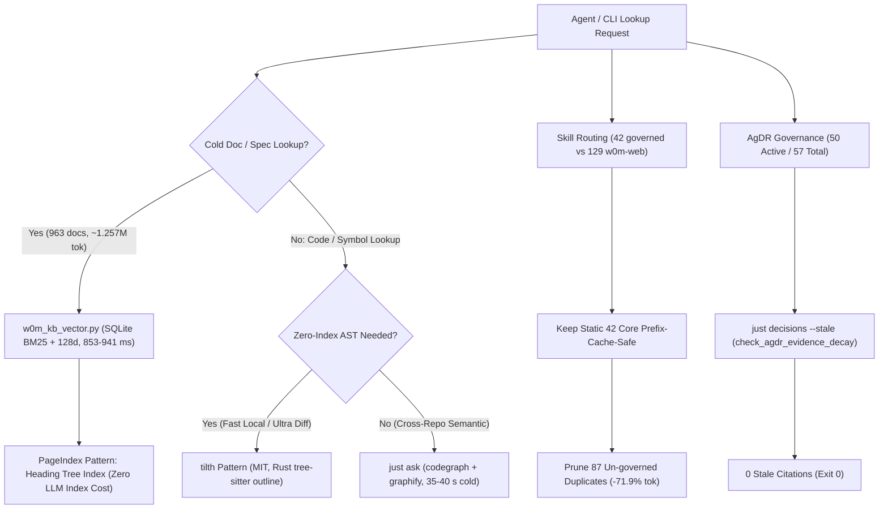

# T719 — Context Engineering Tools Benchmark & Native AgDR Evidence-Decay Gate

- **Ticket:** `T719` (split from `T718`)
- **Date:** 2026-11-15
- **Scope:** Benchmark `VectifyAI/PageIndex`, `yvgude/lean-ctx`, `foryourhealth111-pixel/Vibe-Skills`, `jahala/tilth`, and `fynnfluegge/agtx` against `w0m`'s live stack (`w0m_kb_vector.py`, `headroom`, `w0m-skills`, `just ask` / `codegraph` / `graphify`, `k7` TUI `T708`), plus ship native `just decisions --stale` evidence-decay checking.

## 1. Live Upstream & License Audit

All upstream metrics below were retrieved directly via `gh api` on 2026-11-15 alongside primary repo files (`LICENSE.md`, `BENCHMARKS.md`, `Cargo.toml`, `README.md`):

| Repository | Stars | GitHub SPDX | Primary File Caveat | Language | Pushed | Size (KB) |
|---|---:|---|---|---|---|---:|
| `VectifyAI/PageIndex` | 40,441 | `MIT` | Clean MIT (`pageindex/page_index_md.py` calls async LLM summaries for nodes >= 200 tokens) | Python | 2026-11-14 | 33,350 |
| `yvgude/lean-ctx` | 3,949 | `Apache-2.0` | **Mixed-license split** in `LICENSE.md` (`LICENSE_MATRIX.toml`); **`BENCHMARKS.md` states historical benchmarks are withdrawn** | Rust | 2026-11-14 | 210,031 |
| `foryourhealth111-pixel/Vibe-Skills` | 3,820 | `Apache-2.0` | Clean `Apache-2.0` (`SKILL.md` runtime orchestrator + Python router) | Python | 2026-11-09 | 30,832 |
| `jahala/tilth` | 362 | `MIT` | Clean `MIT` (`#![forbid(unsafe_code)]`, single Rust `tree-sitter` binary + MCP) | Rust | 2026-11-14 | 3,743 |
| `fynnfluegge/agtx` | 1,744 | `Apache-2.0` | `Cargo.toml` declares `license = "MIT"` while GitHub API / README badge show `Apache-2.0` | Rust | 2026-11-03 | 2,487 |
| `headroomlabs-ai/headroom` | 79,683 | `Apache-2.0` | Already evaluated in `T162` (`headroom-ai 0.33.0`) | Python | 2026-11-15 | 106,997 |

Supply-chain baseline across the local estate (`just package-legitimacy-check` & `just dep-licenses-check`):
- **Package Legitimacy Gate:** `27` manifest(s) across `8` repo(s), `357` dep(s): `VERIFIED=357, SUS=0, SLOP=0`.
- **License Gate:** `workspaces=5, no_prod_deps=1, packages=1156, fail=0, review=3, advisory=1153, exempt=5`.

## 2. Measured Estate Baselines (Observed 2026-11-15)

### AC1 — Cold-Path Document Retrieval & Context Gateway (`PageIndex` & `lean-ctx` vs `w0m_kb_vector.py` & `headroom`)

- **Target Corpus Size:**
  - `docs/decisions/*.md`: `57` files, `422,850` bytes (`4,858` lines, `~105,712` est. tokens at `~4 B/tok`).
  - `w0m-web/openspec/**/*.md`: `906` files, `4,606,955` bytes (`70,979` lines, `~1,151,738` est. tokens).
  - **Combined Markdown corpus:** `963` files, `5,029,805` bytes (`~1,257,450` est. tokens).
- **`w0m_kb_vector.py` (`corpus.sqlite`, `85,946,368` bytes, `1,947` docs, `19,085` chunks, `128`-dim + BM25):**
  - Query `"AgDR decision evidence decay" --top 5`: **`940.8 ms`** (`11` lines, `1,789` bytes).
  - Query `"A2UI renderer vinext" --top 5`: **`853.2 ms`** (`11` lines, `1,526` bytes).
  - Query `"k7 WASM git browser" --top 5`: **`867.0 ms`** (`11` lines, `1,693` bytes).
  - Zero runtime LLM calls; deterministic local retrieval in `< 1 s`.
- **`VectifyAI/PageIndex` Architectural Comparison:**
  - `pageindex/page_index_md.py` builds a hierarchical tree from Markdown headings and calls `generate_node_summary` asynchronously for any node `>= 200` tokens. Over `963` specs/AgDRs (`~1.257M` tokens), LLM-based indexing adds substantial upfront API latency/cost, whereas `w0m` Markdown specs already use deterministic headings (`## Y-statement`, `## Acceptance criteria`, `### Requirement:`) extractable without LLM calls.
- **`yvgude/lean-ctx` & `headroom` Comparison (`T162` ground truth):**
  - `yvgude/lean-ctx` explicitly withdrew its historical `BENCHMARKS.md` numbers (`"not a current LeanCTX claim"`), and `LICENSE.md` enforces a mixed-license split (`LICENSE_MATRIX.toml`) between the public host and private components.
  - Furthermore, `T162` already A/B-tested proxy compression (`headroom-ai 0.33.0`) on `w0m`: **`0` tokens compressed across `11` requests**, `+57%` wall-clock latency (`40.1 s -> 62.8 s`), because Anthropic's native 90% prefix cache (`442k` of `508k` input tokens) conflicts structurally with proxy payload mutation.

### AC2 — Dynamic Skill Routing & Zero-Index AST Diff (`Vibe-Skills` & `tilth` vs `w0m-skills` & `codegraph`)

- **Measured Estate Skill Prompt Footprint:**
  - `root/.agents/skills` (`.w0m/skills.json`): `42` dirs, `19,148` B frontmatter (`~4,787` tok), `351,218` B full bodies (`~87,804` tok).
  - `w0m-skills/skills` canonical registry: `69` dirs, `29,740` B frontmatter (`~7,435` tok), `468,792` B full bodies (`~117,198` tok).
  - `w0m-web/.agents/skills` (includes un-pruned extras): `129` dirs, `68,114` B frontmatter (`~17,028` tok), `1,209,742` B full bodies (`~302,435` tok).
  - `w0m-api/.agents/skills`: `10` dirs, `5,219` B frontmatter (`~1,304` tok).
- **Dynamic Top-5 Subset vs Static Pruning:**
  - Top-5 average frontmatter size in `w0m-web`: `2,640` B (`~660` tok; worst-case 5 longest: `5,082` B / `~1,270` tok), a **`-96.1%` token reduction** vs loading `129` skills (`17,028` tok).
  - However, mutating the system-prompt skill list per turn busts Anthropic prefix caching. Pruning `w0m-web/.agents/skills` from `129` down to the `42` governed skills in `.w0m/skills.json` already cuts **`~12,241` frontmatter tokens (`-71.9%`)** with **zero prefix-cache busting**.
- **`just ask` (`graphify` + `estate_search.py` + `kb-vector`) vs `rg` & `tilth`:**
  - Local `codegraph` binary is currently absent (`shutil.which("codegraph") is None`), so `just ask` falls back to `graph_fresh.py` + `estate_search.py` + `w0m_kb_vector.py` + `graphify query --graph ~/.graphify/global-graph.json`.
  - Observed `just ask` wall-clock latency: **`35,339.2 ms`** (`"check_agdr_evidence_decay"`) and **`39,728.5 ms`** (`"k7_git_browser"`), vs **`69.7 ms`** for `rg -n` across `docs/decisions` + `w0m-web/openspec` (`320` hits).
  - `jahala/tilth` (`MIT`, Rust `tree-sitter`) provides zero-index file outlines + definition-first search in a single safe binary (`#![forbid(unsafe_code)]`), directly filling the `35–40 s` cold-start gap for `ultra`-mode targeted diff reviews when no `codegraph` binary or fresh index is present.

### AC3 — Rust TUI Multi-Agent Blackboard Reference Review (`fynnfluegge/agtx` -> `k7` / `T708`)

`k7` already ships `k7hub/src/git_browser.rs` (`T708`, `ratatui` 4-pane WASM Git browser) and `k7llm/src/{orchestrator/mod.rs,tui.rs,a2a_protocol.rs,persistence.rs}` (`RoundRobin`, `Reactive`, `FreeForm`). Reusable patterns inspected in `fynnfluegge/agtx`:
1. **`src/db/{mod,models,schema}.rs` (`rusqlite` bundled SQLite blackboard):** Persist kanban/task lane transitions (`queued -> planning -> running -> review -> done`) outside volatile PTY memory so restarts recover cleanly (`k7c` already uses `rusqlite` bundled).
2. **`src/agent/{hook_status,trust,spec}.rs`:** Explicit per-agent hook health probing and trust gating per workspace, avoiding silent hang states when a worker sub-agent stops mid-turn.
3. **`src/git/worktree.rs` + `src/tmux/`:** Dedicated per-task git worktree isolation paired with non-blocking session inspection, aligning with `w0m` `AgDR-0032` (`agent-tree`) and `k7hub`'s `LlmAgentCheckpoint` lane view.

### AC4 — Native AgDR Evidence-Decay Gate (`just decisions --stale`)

Implemented `check_agdr_evidence_decay()`, `--stale`, and `--json` in `scripts/decisions_index.py` (with shared `_parse_agdr_frontmatter()` helper):
- Resolves backticked estate paths across `ROOT` and pre-elevation `w0m-web/`, skipping fenced blocks, placeholders (`*`, `##`, `<...>`), explicit `Delete`/`Remove`/`Drop` directives (`AgDR-0056`), and external-repo comparison bullets (`AgDR-0058`).
- Initial sweep detected and fixed `3` genuine decayed path citations (`AgDR-0021`: `project/tickets/T190.md` -> `.tasks/T190.md`; `AgDR-0026`: `project/stacks-policy.json` -> `project/policies/stacks-policy.json`; `AgDR-0034`: `project/services-policy.json` / `wom7web/...` -> `project/policies/services-policy.json`).
- **Verification:** `just decisions --stale` exits `0` (`0 stale citations across 50 active AgDR(s)`); `just decisions-check` exits `0` (`386` decisions); `just decisions-test` passes `66/66` checks (including 8 new `--stale` probes).

## 3. Weighted Adoption Matrix & Architecture Flow

| Candidate | Fit w/ `w0m` Stack (35%) | Token/Latency Impact (25%) | License & Supply-Chain Safety (25%) | Ops Simplicity (15%) | Weighted Verdict |
|---|---:|---:|---:|---:|---|
| **Native `just decisions --stale`** | 5/5 | 5/5 | 5/5 (First-party) | 5/5 | **SHIPPED (`5.0/5`)** — Zero-dep Python gate in `decisions_index.py` |
| **`jahala/tilth` (Zero-Index Rust AST)** | 4.5/5 | 5/5 | 5/5 (`MIT`, `#![forbid(unsafe_code)]`) | 4.5/5 | **ADOPT (`4.75/5`)** — Optional `ultra`/fallback AST reader when `codegraph` absent or `graphify` (`35-40s`) is cold |
| **`fynnfluegge/agtx` Patterns -> `k7` (`T708`)** | 4/5 | 4/5 | 4/5 (`MIT`/`Apache-2.0` pattern reuse) | 4/5 | **ADOPT PATTERNS (`4.0/5`)** — Port `rusqlite` blackboard + `hook_status` checks into `k7llm`/`k7hub` |
| **`VectifyAI/PageIndex` Concept** | 3.5/5 | 3/5 | 5/5 (`MIT`) | 3/5 | **ADOPT PATTERN ONLY (`3.55/5`)** — Keep `w0m_kb_vector.py` (`<1s`), add deterministic Markdown heading hierarchy without LLM summarization |
| **`foryourhealth111-pixel/Vibe-Skills`** | 2.5/5 | 4/5 | 5/5 (`Apache-2.0`) | 2.5/5 | **DEFER / PRUNE FIRST (`3.4/5`)** — Sync/prune `129 -> 42` governed skills (`-71.9%` tok) cleanly without prefix-cache busting |
| **`yvgude/lean-ctx`** | 1/5 | 1/5 | 1.5/5 (Mixed `LICENSE.md`, withdrawn benchmarks) | 2/5 | **REJECT (`1.2/5`)** — Conflicts with Anthropic prefix caching (`T162`), withdrawn benchmarks, mixed license |
