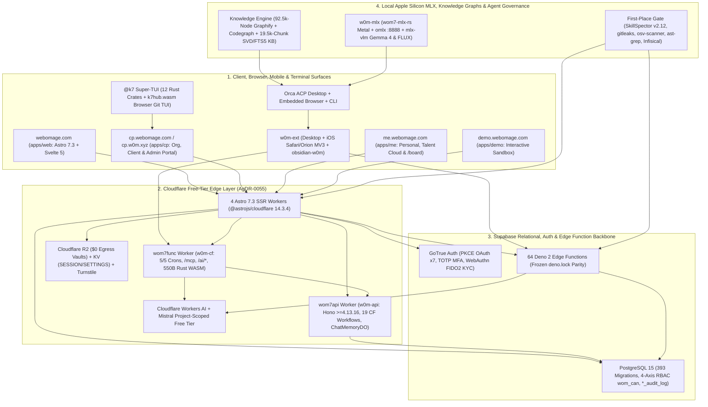
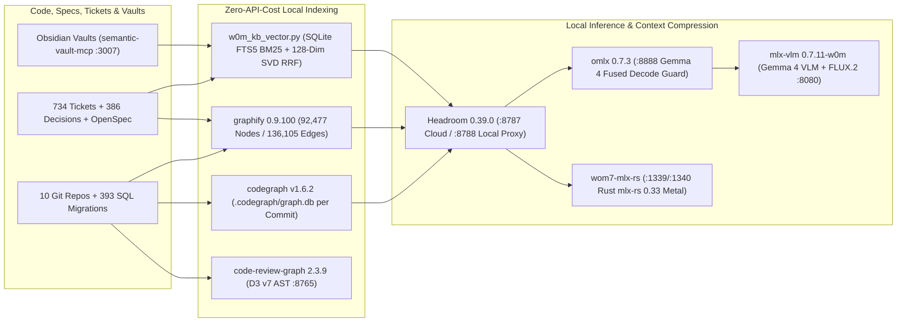

# Webomage (`w0m`) Technology Landscape: Big Picture & Full Layer-by-Layer Reference

**Date:** 2026-11-12
**Tickets:** [[T734]] · [[T733]] · [[T732]] · [[T731]] · [[T730]] · [[T725]] · [[T722]] · [[T721]] · [[T715]] · [[T713]] · [[T708]]
**Release Baseline:** `2026.11.12-1794538248` (`@wom` single-branch `beta`)
**Verification Method:** 100% reality-measured against git-tracked manifests, lockfiles, `project/policies/*.json`, SQL migrations, Edge Functions, Rust/WASM crates, and live production endpoints (`fact-checker` 5-surface verification).

---

## Part I — The Big Picture

### 1.1 Architectural North Star

Webomage (`w0m`) is an **Edge-First, Agent-Native Software Delivery, Talent Cloud, and Security Platform** engineered around five foundational principles:

1. **4-Tier Free-Tier-First Economics (`AgDR-0055`, `AgDR-0003`, `AgDR-0043`):**
   - **Tier 0 — Client & Browser Compute First:** Isomorphic hashing (FIPS 180-4 SHA-256), `k7hub.wasm` TUI rendering, `WebMCP` (`navigator.modelContext`), and client-side compression run in the user's browser at `$0` marginal server cost.
   - **Tier 1 — Cloudflare Free-Tier Edge Compute & `$0`-Egress Storage:** 4 Astro 7.3 SSR Workers (`web`, `cp`, `me`, `demo`), 2 Hono 4.13+ backend Workers (`wom7api` with 19 Durable Workflows + `ChatMemoryDO`, `wom7func` with `5/5` account crons + Streamable HTTP MCP + `#![no_std]` Rust WASM), R2 (`wom-engagement-vaults`, `wom-public-assets`), KV (`SESSION`, `SETTINGS`), Turnstile + `@webomage/fingerprint`, and Workers AI.
   - **Tier 1b — Per-Project Isolated Mistral Free Tier (`T677`):** Dedicated project-scoped LLM/embedding capacity paired with isolated Obsidian vaults (`projects/<slug>/vault`).
   - **Tier 2 — Supabase Free-Tier Relational & Auth Backbone:** Reserved strictly for GoTrue Auth (PKCE OAuth, TOTP MFA, hardware WebAuthn/FIDO2 passkeys), PostgreSQL 15 4-axis RBAC (`public.wom_can`), RLS relational metadata, 64 Deno 2 Edge Functions, and compact append-only `*_audit_log` rows — never binary blobs or unverified public scan writes.
2. **Single-Branch `beta` Trunk with Isolated Agent Trees & Content-Addressed Deploy Certs (`AgDR-0032`, `AgDR-0057`):**
   - Zero long-lived remote feature branches. Every AI or human session works in an isolated 10-repo worktree (`~/.w0m/work/<name>/w0m`), passes 18 wrap-up gates via `just session-complete`, stamps a 10-repo SHA-256 tree-set certificate (`deploy_cert.py`, `<0.2s` warm verify), and lands atomically onto `origin/beta` (members first, `@wom` root last).
3. **First-Place Code, Agent & Secret Security (`just check-guardrails`):**
   - Every commit, pre-push, and production deploy gates simultaneously on **code** (`gitleaks`, `osv-scanner` across 6 lockfiles, `semgrep`, `ast-grep`, `worker_env_gate.py`, 4-axis RBAC red probes), **AI skills & MCP** (`NVIDIA/SkillSpector v2.12.0` YARA + `tree-sitter` AST + `skill_audit.ts` + `mcp_ratchet.py` across 71 skills and 14 MCP servers), and **zero-`.env` secrets** (Infisical `beta` process injection of 71 active keys with `AES-256-GCM` pre-prune backups).
4. **Graph-Before-Grep & Triangulated Single Source of Truth:**
   - Agents query a `92,477`-node unified semantic/AST graph (`graphify` + `codegraph`) and a `19,469`-chunk offline SQLite FTS5 + 128-dim SVD/LSA hybrid vector index (`corpus.sqlite`) before touching code, paired with the **Elephant-Goldfish** (`egm-*`) stateful-builder / fresh-context-adversarial-reviewer loop.
5. **Polyglot Precision (`TypeScript + Svelte 5 + Rust/WASM + Python + SQL + Apple MLX`):**
   - TypeScript 6 / Astro 7.3 / Svelte 5 runes on the web edge; Rust 1.95 (`#![no_std]` Worker WASM, `@k7` `ratatui`/`ratzilla` browser-and-terminal TUIs, `mlx-rs` Metal inference) where zero-overhead binary size or native Metal speed matters; Deno 2 frozen lockfiles on Supabase Edge Functions; Python 3.12+ (`mypy` + `pytest` gated) strictly for local governance, security scanners, and MLX orchestration.

### 1.2 End-to-End Estate Topology Diagram

### 1.3 Estate Numbers at a Glance (Measured Live)

| Metric | Live Measured Count / Version | Canonical Source |
|---|---|---|
| **First-Party Estate Git Repos** | **`10`** (`root`, `w0m-web`, `w0m-api`, `w0m-cf`, `w0m-ext`, `w0m-sec`, `w0m-skills`, `w0m-mlx`, `w0m-ava`, `w0m-clips`) | `.w0m/sdlc.json`, `catalog-info.yaml` |
| **Upstream Managed OSS Forks** | **`23`** local `w0m-pr/*` checkouts / **`48`** `github.com/webomage/*` forks | `scripts/w0m_prs.py` (`AgDR-0058`) |
| **Governed Runtime Stacks & Host CLIs** | **`11`** stacks · **`45`** version-pinned host tools | `project/policies/{stacks,tools}-policy.json` |
| **Indexed Architectural Decisions** | **`386`** (`57` structured `AgDR` docs + `329` inline decisions) | `docs/DECISIONS.md` (`just decisions`) |
| **Active Cloudflare Workers** | **`7`** (`webomage`, `webomage-cp`, `webomage-me`, `webomage-demo`, `wom7api`, `wom7func`, `webnames-crawler`) | `wrangler.jsonc` across `w0m-web`, `w0m-api`, `w0m-cf` |
| **Cloudflare Durable Workflows & Crons** | **`19`** Workflows + **`1`** SQLite DO (`wom7api`) · **`5/5`** Cron triggers (`wom7func`) | `w0m-api/src/workflows/`, `w0m-cf/wrangler.jsonc` |
| **Supabase SQL Migrations & Edge Functions** | **`393`** top-level SQL migrations · **`64`** Deno 2 Edge Functions | `w0m-api/supabase/{migrations,functions}/` |
| **Shared `w0m-web` Workspace Libraries** | **`9`** packages · **`25`** canonical `@webomage/ui` primitives | `w0m-web/packages/*`, `design-system/_ds_manifest.json` |
| **Rust Crates (`w0m-cf`, `w0m-mlx`, `@k7`)** | **`14`** crates (`w0m-wasm-utils` `550 B`, `wom7-mlx-rs`, `k7hub` + `11` `@k7` crates) | `Cargo.toml` manifests |
| **Canonical Agent Skills & MCP Servers** | **`69`** canonical skills (`71` `SkillSpector`-approved units) · **`14`** MCP servers | `w0m-skills/`, `.w0m/sdlc.json` |
| **Supported SDD Spec Dialects** | **`7`** (`w0m-openspec`, `github-speckit`, `open-gsd`, `openspec`, `bmad`, `conductor`, `cc-sdd`) | `scripts/client_spec_bridge.py` (`T713`–`T718`) |
| **Unified Knowledge Graph & Hybrid Vector KB** | **`92,477`** graph nodes (`136,105` edges) · **`2,061`** docs (`19,469` SVD+FTS5 chunks) | `~/.graphify/`, `~/.w0m/knowledge-index/` |
| **Infisical `beta` Active Cloud Secrets** | **`71`** active keys (`43` dead cloud keys backed up via `AES-256-GCM` & pruned) | `scripts/env_usage_audit.py` (`T729`–`T732`) |
| **Registered Automated Test Suites** | **`377`** suites (`319` offline, `45` live, `12` guardrails, `1` fast; `0` OSV CVEs) | `w0m-web/project/test-suites.json` |
| **Tracked SDLC Tickets** | **`734`** (`T1`–`T734`; `0` unresolved `TECH-DEBT.md` items) | `.tasks/T*.md`, `TASKS.md` |

---

## Part II — Full Layer-by-Layer Technical Deep Dive

### 2. Estate Control Plane, Governance & Policy Engine (`@wom` Root)

- **Root-First Layout L2 (`AgDR-0050`):** `@wom/justfile` + `just/estate.just` expose 2–3 word operational recipes across all 10 repos (`just preflight --fast`, `just ask`, `just agent-tree`, `just session-complete`, `just check-guardrails`, `just deploy-all`), backed by `122+` type-checked Python scripts in `@wom/scripts/`.
- **24 Declarative Policy Contracts (`project/policies/*.json` + `w0m-web/project/*.json`):**
  - **Platform & ABI Portability (`stacks-policy.json`, `AgDR-0052`):** Supports both Apple Silicon (`darwin-arm64`) and Linux (`linux-x86_64` with `x86-64-v2` non-AVX2 binary compatibility, e.g. `pagefind 1.5.2`).
  - **Cross-Repo Lockstep & Security Floors (`deps-policy.json`):** Enforces byte-identical `pnpm@10.32.0`, `hono >=4.13.16` (`T733`), `wrangler ^4.151.0`, `astro >=7.3.3 <7.4.0`, and `@astrojs/cloudflare >=14.3.4 <14.4.0` across all TypeScript repos via `just deps-check`.
  - **Zero Internal Leakage & Zero Shadow Symlinks (`AgDR-0025`, `T667`):** `just ui-ticket-leak-check` blocks internal `T##` / `AgDR-####` / `AC#` identifiers from user-facing UI strings; `emoji_policy_check.py` forbids decorative heading emojis; `client_inventory.py` enforces strict estate-vs-client workspace isolation (`T302`).

---

### 3. Frontend, Edge SSR Applications & Design System (`w0m-web`)

#### 3.1 Core Web Toolchain
- **Framework & Compiler Stack:** **Astro `7.3.3`** + **`@astrojs/cloudflare` `14.3.4`** (`@cloudflare/vite-plugin` `1.64.0`) + **Svelte `5.56.4`** (`@astrojs/svelte` `9.1.5`, 100% runes `$props`/`$state`/`$derived`/`$effect`, `0` `svelte-check` errors across `155` `.svelte` files) + **Vite `7.3.7` / Rolldown `1.2.14`** + **Tailwind CSS `4.3.3`** / **LightningCSS `1.32+`** + **TypeScript `6.0.3`** on **Node `v26.13.0`**.
- **Edge Runtime Hygiene (`T722`, `T727`, `T728`, `T734`):**
  - All Worker-bundled routes use `import { env } from "cloudflare:workers"` (`locals.runtime.env` is mechanically banned by `worker_env_gate.py`).
  - `applyAnonymousHtmlEdgeCache` + `BoundedTtlCache` (`edge-cache-policy.ts`) accelerate anonymous public SSR TTFB while refusing cache storage whenever `Cookie`, `Authorization`, or `Set-Cookie` is present.
  - `readJsonSafe` protects client islands against non-JSON edge middleware errors, and `browser-barrel-node-free.test.ts` (`T734`) guarantees `@webomage/lib`'s entire transitive barrel graph stays `100%` free of `node:*` built-ins.

#### 3.2 The 4 Active Cloudflare SSR Workers (`project/policies/release-apps.json`)

| Worker (`wrangler.jsonc`) | Domain(s) & Dev Port | Key Features & Recent Innovations |
|---|---|---|
| **`webomage`** (`apps/web`) | `webomage.com` (`:4321`) | Corporate platform, **1-Click Fast OAuth Register + Direct Fixed-Price Stripe Checkout** on `/services` & `/solutions` (`T723`), `/audit` live security & AI/MCP audit intake (`T711`), `/blueprints` catalog, Pagefind static search (`1.5.2`), RFC 9116 `/.well-known/security.txt`. |
| **`webomage-cp`** (`apps/cp`) | `cp.webomage.com`, `cp.w0m.xyz` (`:4325`) | Unified Organization (`/o/[org]`), Client & Crew Control Plane: post-signup Onboarding Wizard with embedded Services Configurator (`T703`) + **selectable 7-dialect SDD Spec Engine** (`T715`), **Full-Scope Admin Member & Client Impersonation** via HMAC `/api/auth/impersonate-handoff` (`T722`), multi-page printable Audit PDF Dossier (`T701`/`T704`), and `TabLinuxConsole.svelte` running **`k7hub.wasm` TUI Git Browser** (`T708`). |
| **`webomage-me`** (`apps/me`) | `me.webomage.com` (`:4323`) | Unified Personal Identity, Public Portfolio (`/u/[slug]`) & Talent Cloud (`AgDR-0056`, absorbing retired `job` & `join`): Resume Studio, Skill Assessments, **Universal `.ics`/CalDAV Calendars & Schedule** (`T700`), **GitHub-Issues-as-SSOT Feature Voting & Roadmap Board** (`/me/oss`, `/board/*`, `/api/board/*`, `T725`), and R2 Vault Gateway (`/api/vault/r2/*`, enforced by `me-api-parity.test.ts`). |
| **`webomage-demo`** (`apps/demo`) | `demo.webomage.com` (`:4324`) | Zero-signup interactive product tours (`Walkthrough`), role simulations, and live component showcase (`T79`). |

#### 3.3 All 9 Shared Workspace Packages (`w0m-web/packages/*`)
1. **`@webomage/ui` (`packages/ui` <- `design-system/`)**: Dark-first glassmorphic design system with `[data-app]` brand theming, RGB-triplet `rgba(var(--...), <alpha>)` tokens, **`AgDR-0054` Multi-Orientation Responsive Contract** (`T716`), **25 canonical primitives** (`Badge`, `Button`, `Card`, `Checkbox`, `Input`, `Label`, `Separator`, `AppShell`, `Breadcrumb`, `ContextSwitcher`, `EmptyState`, `PageHeader`, `SideNav`, `Tabs`, `BlueprintCard`, `ComplexityBadge`, `GlassCard`, `SegmentBadge`, `StatusDot`, `TechIcon`, `Dialog`, `Select`, `BugReportWidget`, `QuickViewModal`, `Table`), plus domain widgets (`AuthWidget`, `MfaChallenge`, `ComplianceAuditCatalogExplorer`, `WebMCP.astro`).
2. **`@webomage/lib` (`packages/lib`)**: Isomorphic auth/PKCE/MFA/impersonation, 4-axis CASL abilities, AI prompt/provider router (with isomorphic FIPS 180-4 SHA-256 prompt checksums, `T734`), `.ics`/CalDAV engine (`T700`), `k7-git-browser.ts` (`T708`), `edge-cache-policy.ts` (`T727`), `readJsonSafe` (`T728`), and connector schemas.
3. **`@wom/authz` (`packages/authz`)**: Zero-dependency static & runtime authorization guards (`bucket-guard`, `definer-guard`, `grant-guard`, `edge-fn-guard`).
4. **`@webomage/webmcp` (`packages/webmcp`)**: Browser-native `navigator.modelContext` tool registration, role-gated manifests, client-side Mermaid validation, and Feature Board tools (`T588`).
5. **`@webomage/fingerprint` (`packages/fingerprint`)**: Zero-dependency device/bot signal collector paired with Cloudflare Turnstile.
6. **`@webomage/crawler` (`packages/crawler`)**: Multi-engine web extractor (`fetch`, `lightpanda`, `playwright`, `puppeteer`, `taiko`) + `cheerio`/`turndown` Markdown sanitizer.
7. **`@wom/kyc` (`packages/kyc`)**: W3C WebAuthn/FIDO2 hardware enclave biometric binding (`biometric.ts`, `T475`) + LATAM fiscal/identity validators across Mexico (`CURP`, `SAT`, `RESICO/INM`), Central America (`CR`, `DO`, `SV`, `GT`, `PA`), and South America (`AR`, `BR`, `CL`, `CO`, `PE`, `UY`, `T644`).
8. **`@wom/logger` (`packages/logger`)**: Structured JSON trace/context logger.
9. **`mcp-aws-fundamentals` (`packages/mcp-aws-fundamentals`)**: Standalone MCP reference server for cloud architecture patterns.

---

### 4. Backend, Durable Workflows, Edge Compute & Data Layer (`w0m-api` & `w0m-cf`)

#### 4.1 Cloudflare Workers, 19 Durable Workflows, Crons & `#![no_std]` Rust WASM
- **`wom7api` (`w0m-api/src/index.ts`, Hono `>=4.13.16`):**
  - Orchestrates **`19` Cloudflare Durable Workflows**: `GamificationEvent`, `DomainScanner`, `JobScanner`, `LinkedinSync`, `LinkedinBroadcast`, `LinkedinDataErasure`, `CertEvaluator`, `CertIngestion`, `JobAggregator`, `JobScorer`, `VectorizeJob`, `VectorizeProfile`, `VectorizeVault`, `Newsletter`, `CvGenerator`, `DeckGenerator`, `WebnamesBatch`, `Crawler`, and `PdfGenerator`.
  - Hosts SQLite-backed Durable Object **`ChatMemoryDO`** (`CHAT_MEMORY`) for low-latency conversational state.
- **`wom7func` (`w0m-cf/src/index.ts`, Hono `>=4.13.16`):**
  - Consolidates all **`5/5` Cloudflare Free-Tier cron triggers** (`*/15`, `*/30`, `0 8 * * *`, `0 */6 * * *`, `0 14 * * SUN`).
  - Serves **`POST /mcp`** (Streamable HTTP JSON-RPC 2.0 MCP server via `@modelcontextprotocol/sdk` + Cloudflare `agents` SDK), `/ai/chat` & `/ai/embed` (Workers AI + Mistral Free Tier), Browser Rendering (`@cloudflare/puppeteer`), Inbound Email Routing, and unified ATS adapters (`huntflow`, `merge`).
  - Embeds **`w0m-cf/crates/w0m-wasm-utils`** (`#![no_std]` Rust 2024 -> `wasm32-unknown-unknown`, **`550 B` raw / `389 B` gzipped** per `AgDR-0044`) for hot-loop FNV-1a 64-bit hashing, Levenshtein distance, and token-overlap scoring.

#### 4.2 Supabase PostgreSQL 15, 4-Axis RBAC, Deno 2 Edge Functions & Integrations
- **Relational Schema & Security (`393` SQL Migrations):**
  - Unified `<org>.<unit>` (`public.orgs`), 2-party engagements (`<contractor>.<engagement>.<client>`), `public.hats` (`granted_at` deterministic ordering, `T724`), and `public.wom_can(...)` 4-axis capability enforcement.
  - Append-only `*_audit_log` tables populated via `SECURITY DEFINER` triggers on every security/privacy/visibility/commercial mutation (`T614`), cross-checked against TypeScript callers by `supabase_surface_drift_check.py`, `anon_execute_ratchet.py`, and live `authz_probe_suite.py` (`0` RED of `18`).
- **64 Deno 2 Edge Functions (`w0m-api/supabase/functions/`):**
  - Enforced under `--frozen=true` with byte-identical `w0m-api/deno.lock` == `supabase/functions/deno.lock` (`deno_lock_parity_check.py`, `T720`).
  - Key domains: AI persona agents (`w0m-admin`, `w0m-architect`, `w0m-consultant`, `w0m-personnel`), billing (`stripe-checkout`, `stripe-portal`, `stripe-webhook`, `mercadopago-checkout`, `mercadopago-webhook`), portals & registration (`client-api`, `client-register`, `submit-service-request`), documents & media (`manage-document`, `parse-resume`, `cv-pdf`, `resume-pdf`, `validate-mermaid`, `hume-token`), and connectors (`github-repos`, `upwork-poller`, `social-signal-sync`, `telegram-webhook`).
- **Analytics, Payments, Mail & 7 Connector Families:**
  - **Analytics & Tracing:** Tinybird (`northamerica-northeast2` Free Tier), Opik (`opik-tracer.ts`), OpenTelemetry (`otel.ts`).
  - **Outbound Mail (`AgDR-0040`, `T702`):** GoTrue Auth + Google Workspace SMTP + Resend Free Tier under strict DMARC `p=quarantine; pct=100; adkim=s; aspf=s`.
  - **Encrypted Connectors (`public.connections` AES-256-GCM):** Google, GitHub (App + GraphQL Issues SSOT), LinkedIn REST v2, Upwork MCP (`https://mcp.upwork.com/mcp`), Telegram, X API v2, Reddit, Meta Threads, plus 10 automated job-board feeds.

---

### 5. Cross-Browser, Mobile & Vault Extensions (`w0m-ext`)

- **Single-Source MV3 Extension (`w0m-ext/extension/`):**
  - Built with TypeScript, `esbuild`, `@modelcontextprotocol/sdk`, `@a2ui/lit`, `jose`, and `pkce-challenge`.
  - **Targets:** Chromium MV3 (Chrome, Edge, Brave, Arc), Firefox MV3, macOS Safari, **iOS 16.4+ Safari & Orion iOS** (`w0m-ext-ios-orion.xpi`, `w0m-ext-ios-chrome.zip`, `w0m-ext-safari.zip` distributed via R2 vault gateway, `T582`), and **Orca's embedded Electron browser** (`scripts/orca_ext_install.py`, `T710`).
  - **Capabilities:** Declarative JSON `specEngine.js` across **17 talent/job marketplaces** (Upwork, LinkedIn, Toptal, Contra, Wellfound, Arc.dev, etc.), universal page clipper, anti-bot/CAPTCHA fail-closed detector (`captchaDetector.js`), and local WebSocket MCP bridge (`127.0.0.1:8008`).
- **`obsidian-w0m` (`w0m-obsidian-sync v1.0.0`):** Cross-platform Desktop + iOS/Android Obsidian plugin performing direct R2 (`wom-engagement-vaults`) delta sync, milestone tracking, and shared todos.

---

### 6. Rust `@k7` Super-TUI & `k7hub.wasm` Browser TUI (`@k7`)

- **12-Crate Rust 1.95 Workspace (`/home/aleksei/Projects/!self/k7`):**
  - `k7hub` unifies 11 specialized `ratatui` modules (`k7env`, `k7pwd`, `k7d`, `k7s`, `k7c`, `k7llm`, `k7spec`, `k7sol`, `k7tg`, `k7kb`, `k7log`) into a single native binary (`k7`).
- **`k7hub.wasm` WebAssembly Git Navigation Browser (`T708`):**
  - Compiles `k7hub::git_browser` cleanly to `wasm32-unknown-unknown` (`u64` shard byte lengths for `>4 GiB` `.safetensors`/`.gguf` weights, `ratatui::backend::TestBackend` + `ratzilla` DOM rendering) and mounts inside `apps/cp` (`TabLinuxConsole.svelte` + `packages/lib/src/git/k7-git-browser.ts`).
  - Natively browses **6 Git & LLM remote flavours**: GitHub, GitLab, Gitea/Forgejo, **HuggingFace Hub** (model cards + weight shards), **Ollama Registry**, and **`w0m` R2 Engagement Vaults**.

---

### 7. Local Apple Silicon MLX AI & Unified Knowledge Graph Engine

- **Local Inference (`w0m-mlx/w0m-mlx`):** Pairs Rust `wom7-mlx-rs` (`mlx-rs 0.33.0`, `axum 0.7`, `safetensors`, `tokenizers`) with Python `omlx 0.7.3` (`:8888`) and `mlx-vlm 0.7.11-w0m` running 4-bit Gemma 4 coding/vision models and 2-bit FLUX.2 image generation (`:8080`), fronted by `headroom 0.39.0` context compression (`:8787`/`:8788`).
- **Graph & Hybrid Vector Retrieval:**
  - `just ask "<query>"` fuses **1)** `codegraph` AST symbol definitions/callers, **2)** `w0m_kb_vector.py` Reciprocal Rank Fusion (`BM25 + 128-dim numpy Randomized SVD` across `2,061` docs / `19,469` chunks in `corpus.sqlite`), and **3)** `graphify` BFS traversal over `92,477` nodes, complemented by our custom `serena` fork (`v1.7.0-w0m.1`) with native `.astro` LSP support.

---

### 8. Agent Ecosystem, 7-Dialect SDD & First-Place Security Gate (`w0m-skills`, `w0m-sec`)

- **69 Canonical Skills & Elephant-Goldfish Architecture (`w0m-skills/`):**
  - Includes the 10-gate `w0m-sdlc-*` lifecycle (`new -> research -> start -> spec -> build -> review -> security -> verify -> deploy -> archive`), 7 **Google Elephant-Goldfish (`egm-*`)** skills (`T705`/`T717`) separating stateful implementation from fresh-context adversarial verification, persona reviewers (`fact-checker`, `socrates`, `torvalds`, `schema-critique`, `rbac-auditor`), `job-hunter` (`T707`), `w0m-pixel-clone`, `webomage-design`, and headless `mmd-validate`.
  - **3-Tier Execution Modes (`scripts/dev_mode.py`):** `ultra` (`25–45s`), `balance` (default `60–90s`), and `wise` (`8–15m` deep verification).
- **7-Dialect Spec-Driven Development Bridge (`T712`–`T715`, `T718`):**
  - First-class detection, bootstrap (`just client-spec-init`), anti-slopsquatting package verification (`package_legitimacy_check.py`), and `apps/cp` UI selection across **`w0m-openspec`**, **`github-speckit`** (`.specify/`), **`open-gsd`** (`.planning/`), **`openspec`**, **`bmad`** (`_bmad/`), **`conductor`** (`conductor/`), and **`cc-sdd`** (`.kiro/specs/`).
- **First-Place Code, Agent & Secret Security (`just check-guardrails`):**
  - **Code & Supply Chain:** `gitleaks 8.30.1`, `osv-scanner 2.7.0` (`0` vulnerabilities across 6 lockfiles), `semgrep 1.183.0`, `ast-grep 0.51.0`, `worker_env_gate.py`, and `w0m-sec` air-gapped Docker `--network none` containment + RFC 9116 `security.txt` + `AgDR-0047` Touch-ID-gated bug-bounty shortlist (`17/17` pytest).
  - **Agent & Skill Security:** `w0m-skills/skill_audit.ts` + **`NVIDIA/SkillSpector v2.12.0`** (`scripts/skill_spector_check.py --deep`, YARA + `tree-sitter` AST + prompt-injection analysis across all `71` unique skills with `crit/high = 0` and `SC9 = 0`) + `mcp_ratchet.py` across `14` declared MCP servers.
  - **Infisical Zero-`.env` Secret Lifecycle (`T729`–`T732`):** `71` active cloud secrets injected strictly via `infisical run --env=beta --silent`; dead-key pruning (`just env-prune-dead`) is gated on in-memory-verified **`AES-256-GCM` backups** (`~/.w0m/backups/infisical/`, `0600`) and explicit `--type=shared` Infisical CLI operations.
  - **377 Registered Test Suites (`test-suites.json`):** Gauge `1.6.42` + Playwright `1.61.1` E2E & visual goldens, Vitest `4.1.12`, Deno 2 tests, Rust `cargo test`, `pytest`, `mypy 1.20.1`, `oxlint 1.74.0`, and `oxfmt 0.59.0`.

---

### 9. Upstream Open-Source Fork Estate (`w0m-pr/*` & `AgDR-0058`)

All public forks live under `github.com/webomage/<repo>` (`23` active local `w0m-pr/` checkouts; `48` tracked org forks) and ship upstream PRs exclusively through `scripts/w0m_prs.py` (`just pr-auto` / `just pr-open`), which enforces 6 hard gates (`CONTRIBUTING.md`, PR template, duplicate check, `Fixes #`, GPG `-S` signature, `git merge-tree`) and hard-bans anti-automation repos (`ml-explore/mlx-lm`):
- **Key Active Forks:** `SkillSpector` (`NVIDIA/SkillSpector`), `orca` (`stablyai/orca`), `linuxontab`, `graphify`, `headroom`, `omlx`, `mlx-rs`, `mlx-vlm`, `laya-mlx`, `serena` (`.astro` LSP), `virtual-fido` (Go FIDO2/U2F hardware token emulator), `tart-guest-agent`, `moksha` / `bodhi*`, `just`, `floorplan`.

---

### 10. Recent Capability Wave Summary (`T700`–`T734`)

| Wave | Tickets | Shipped Capabilities |
|---|---|---|
| **Personal Schedule, PDF Dossiers & DMARC** | `T700`–`T704` | `.ics`/CalDAV Calendars in `apps/me`, printable multi-page Audit PDF Dossiers, strict DMARC `p=quarantine`, Onboarding Wizard Services Configurator, RLS multi-target audit persistence. |
| **Elephant-Goldfish, `@k7` WASM & Orca** | `T705`–`T711` | Google `egm-*` skills + `ultra`/`balance`/`wise` dev modes, clean-room `job-hunter` skill, **`k7hub.wasm` Rust+Ratatui TUI Git Browser**, Orca responsive/extension loader, commercial AI Agent/MCP Security Audit offering. |
| **7-Dialect SDD & Multi-Orientation UI** | `T712`–`T718` | 7-dialect SDD bridge + anti-slopsquatting checker + `apps/cp` dialect selector + `AgDR-0054` Portrait/Landscape responsive polish across all 4 apps. |
| **Deno Parity, SkillSpector & Astro 7 Hardening** | `T720`–`T728` | Frozen `deno.lock` parity, **`NVIDIA/SkillSpector v2.12.0`** estate gate (`71` skills), Astro 7 `cloudflare:workers` `env` cutover + full-scope Admin Impersonation, 1-click `/services` & `/solutions` checkout, `apps/me` `/api/board` + `/api/vault/r2` parity, anonymous Edge HTML caching. |
| **Infisical Vault Prune, Hono 4.13.16 & Log Hygiene** | `T729`–`T734` | Pruned `43` dead Infisical `beta` secrets (`114 -> 71`) behind `AES-256-GCM` round-trip backups + `--type=shared`, bumped `hono >=4.13.16` (`0` OSV CVEs), eliminated `@webomage/lib` `node:crypto` barrel warnings + `deploy_logged.py` false-positive `other_trouble` counts, and logged earned rules in `LESSONS.md`. |
