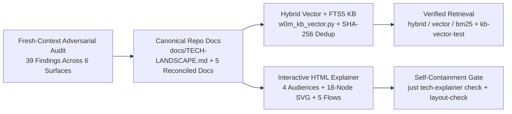

# T735 — Deep Adversarial 5-Surface Tech Landscape Review, Hybrid Vector KB Expansion & Interactive Visual Architecture Explainer

- **Ticket:** [[T735]] (Split from [[T734]], related [[T669]] · [[T708]] · [[T713]] · [[T715]] · [[T725]] · [[T733]])
- **Date:** 2026-11-13
- **Protocol:** `doubt-driven-development` + `fact-checker` (Triangulated 5-Surface SSOT) + `eli5` Mode 1 & Mode 2 + `webomage-design`
- **Auditor Subagent:** Fresh-context `research` auditor (`93915c6b-7d7c-4a7a-bc5c-7a401de44491`, 2 adversarial cycles)

---

## 1. Executive Summary

Following the initial estate technology overview in [[T734]], [[T735]] executed a two-cycle fresh-context adversarial audit across six documentation and indexing surfaces against live repository manifests (`package.json`, `Cargo.toml`, `pyproject.toml`, `wrangler.jsonc`, `tools-policy.json`, `ports-policy.json`, `test-suites.json`, SQL migrations, and Edge Function directories):

1. **Adversarial Fact-Check & Canonical Truth Reconciliation (`AC1`):** Identified and fixed **39 concrete discrepancies** (17 claim-vs-manifest drifts in the `T734` overview, 20 pre-existing retired-surface and confidential-client-name drifts across `docs/ARCHITECTURE.md` and `w0m-web/docs/{ARCHITECTURE,00-MOC-ARCHITECTURE,ECOSYSTEM}.md`, and 2 corpus-coverage blind spots in `scripts/w0m_kb_vector.py`), and published canonical `docs/TECH-LANDSCAPE.md`.
2. **Hybrid BM25 + 128-Dim SVD Vector KB Expansion & SHA-256 Deduplication (`AC2`):** Extended `collect_estate_documents()` in `scripts/w0m_kb_vector.py` to index active `w0m-web/docs/**` (`web_doc`, skipping `archive/` and `sessions/`), root entrypoints (`AGENTS.md`, `CLAUDE.md`), `w0m-skills/GENERIC-SDLC-SET.md`, and all 9 member-repo `README.md` files (`w0m-web`, `w0m-api`, `w0m-cf`, `w0m-ext`, `w0m-sec`, `w0m-skills`, `w0m-mlx/w0m-mlx`, `w0m-ava`, `w0m-clips`), while deduplicating byte-identical mirrored reports by `sha256` (eliminating `64+` duplicate RRF twin documents).
3. **Self-Contained Interactive Visual HTML Explainer (`AC3`):** Shipped `docs/visuals/w0m-tech-landscape-explainer.html` (initially mirrored to `w0m-web/docs/walkthroughs/w0m-tech-landscape-explainer.html`; consolidated to single-SSOT `docs/visuals/` in [[T736]], see §5.2) with `just tech-explainer`, zero external CDN dependencies, 4-audience progressive simplification (`Novice`/`Product`/`Architect`/`Systems`, aligned to `eli5` `novice`/`junior`/`product`/`executive` keys in [[T736]]), an interactive **18-node / 4-tier SVG architecture map**, 5 keyboard-navigable step-by-step walkthrough flows, an 18-card searchable subsystem explorer, and dark/light theme support.

---

## 2. Adversarial Audit Ledger (39 Reconciled Findings)

### 2.1 Post-T734 Manifest Precision Fixes (17 Reconciled Items)

| # | Claim Under Audit | Verified Codebase Reality | Action Taken |
|---|---|---|---|
| 1 | `7` Cloudflare Workers & Queues | **`6` active Workers** (`webomage`, `webomage-cp`, `webomage-me`, `webomage-demo`, `wom7api`, `wom7func` across `wrangler.jsonc`); `webnames-crawler` retired in `T155 AC9`; zero Cloudflare Queues | Updated all docs, tables, Mermaid diagrams, and SVG topology |
| 2 | `7` PKCE OAuth login providers | **`3` GoTrue OAuth login providers** (`google`, `linkedin_oidc`, `github` in `packages/lib/src/auth/handlers.ts:302`); **`7` external encrypted connector families** | Separated GoTrue PKCE login (`3`) from encrypted external connectors (`7`) |
| 3 | `45` governed CLI tools & `24` policy JSONs | **`77` governed tools** in `project/policies/tools-policy.json` (`22` `required: true`); **`21` `*-policy.json` files** (`63` JSON configs across `project/policies/` + `w0m-web/project/`) | Updated exact counts across `TECH-LANDSCAPE.md`, `T734` report, and HTML explainer |
| 4 | `43` Infisical keys pruned (`114 -> 71`) | **`44` retired keys** in `pruned-beta-20261112T231142Z.manifest.json` (`115 -> 71`; runtime log injected `114` plus 1 empty-value key) | Corrected to `44` (`115 -> 71`) |
| 5 | `11` Rust crates in `@k7` (`13` total) | **`16` Cargo `[package]` manifests** in sibling `../k7` checkout (`k7hub` + `10` standalone crates where `k7c` has `6` workspace crates; `k7log` has no `Cargo.toml`) = **`18` total Cargo packages** (`w0m-cf` 1 + `w0m-mlx/w0m-mlx` 1 + `@k7` 16) | Corrected to `18` Cargo packages (`16` in `@k7`) |
| 6 | `TabLinuxConsole.svelte`, `src/git/k7-git-browser.ts`, `ratzilla`, and `Ollama/R2` flavours | Actual component is `CrewToolkitAndTabLinuxConsole.svelte`; helper is `packages/lib/src/security/k7-git-browser.ts`; zero `ratzilla`; `GitProviderFlavour` has **`5` flavours** (`GitHub`, `GitLab`, `HuggingFaceHub`, `ForgejoGitea`, `LlmAgentCheckpoint`) | Replaced exact paths, removed `ratzilla`, and listed exact 5 enum variants |
| 7 | Streamable HTTP SSE on `w0m-cf` `/mcp` | `w0m-cf/src/index.ts:891` implements **stateless HTTP JSON-RPC 2.0 `POST /mcp`** (`@modelcontextprotocol/sdk/types.js`) | Updated protocol description to stateless HTTP JSON-RPC 2.0 |
| 8 | `12` external freelance boards incl. `Arc.dev` in `w0m-ext` | **`11` external platform specs** (`upwork`, `linkedin`, `toptal`, `contra`, `wellfound`, `fiverr`, `freelancer`, `indeed`, `proxify`, `xteam`, `developersnet`) + internal `wom.formfiller.json` (`16` host domains; zero `Arc.dev`) | Replaced exact 11 external platform specs + `wom.formfiller.json` |
| 9 | `155` `.svelte` components in `w0m-web` | **`220` git-tracked `.svelte` files** across `w0m-web` (`126` in `apps/cp`, `65` in `packages/ui`, `20` in `apps/web`, `9` in `apps/me`, `0` in `apps/demo`) | Corrected to `220` |
| 10 | `mlx-vlm 0.7.11-w0m` | Host oMLX runtime runs upstream `mlx-vlm 0.7.11` alongside patched `mlx-lm 0.31.3+w0m1` (`w0m-pr/mlx-lm` wheel) | Distinguished patched `mlx-lm 0.31.3+w0m1` from upstream `mlx-vlm 0.7.11` |
| 11 | `mypy 1.20.1` | `tools-policy.json` pins `min: 1.15.0`, `known_good: 2.4.1` (host `mypy 2.4.0`) | Corrected to `mypy 2.4.x` (`min 1.15.0`) |
| 12 | `w0m-sec` "First-Place" unexplained | `w0m-sec` runs **first** in `just check-guardrails` (`justfile` line 774) and is isolated from cloud credentials (`AgDR-0046`) | Clarified "First-Place" execution order + credential air-gap |
| 13 | All OSS forks on `github.com/webomage/*` | `tools-policy.json` still carries one legacy `github.com/casualuser/serena.git@v1.7.0-w0m.1` pin alongside `63` distinct upstream fork repos (`23` local `w0m-pr/*` + `48` `FORKED_AI_TOOLS_CATALOG`) | Noted exact fork counts (`23` local / `48` catalog / `63` distinct) and legacy `serena` pin |
| 14 | `800` + `120`-char overlapping chunks in `w0m_kb_vector.py` | `chunk_markdown()` splits by `##`/`###` headings (`max_chars=1600`) with fixed slicing per section (`start += max_chars`) | Updated chunking description to match `chunk_markdown()` (`T736` erratum corrected initial `1800` typo -> `1600`) |
| 15 | `18` Playwright specs unqualified | `w0m-web` tracks `67` Vitest `.spec.ts` unit files plus Gauge `.spec` behavioral E2E suites (`w0m-web/specs/`, `w0m-web/specs-resilience/`, `w0m-ext/specs/`) | Reconciled Vitest `.spec.ts` (`67`) vs Gauge `.spec` E2E suites |
| 16 | `29` MCP servers without governance split | `.w0m/sdlc.json -> mcp.servers` and `catalog-info.yaml` declare **`14` governed MCP servers** (`.mcp.json` configures `5`), while `w0m-web/project/mcp-exposure-baseline.json` enforces host listener port ceilings (`measured` / `accepted`) | Documented exact `14` governed MCP servers, `.mcp.json` (`5`), and listener exposure ratchet |
| 17 | Flat `w0m-mlx/` path | `w0m-mlx/w0m-mlx/` houses the native Rust `wom7-mlx-rs` crate (`Cargo.toml`), paired with the forked `w0m-pr/mlx-rs/` Metal engine | Specified `w0m-mlx/w0m-mlx/Cargo.toml` and `w0m-pr/mlx-rs/` |

### 2.2 Pre-Existing Estate Doc Drift Eliminated (20 Reconciled Items)

| Target File | Drift Removed / Reconciled |
|---|---|
| `docs/ARCHITECTURE.md` | Fixed stale `14 verification gates` in `just session-complete` -> **`18` verification gates** (`scripts/session_complete.py`). Linked canonical `docs/TECH-LANDSCAPE.md` and interactive walkthrough. |
| `w0m-web/docs/ARCHITECTURE.md` | Replaced retired **Cloudflare Pages**, **Cloudflare D1**, **Sentry**, **Google Gemini API**, **Groq**, `apps/join`, and `apps/job` claims with `@astrojs/cloudflare` SSR Workers (`6` active), **2 R2 buckets** (`wom-engagement-vaults`, `wom-public-assets`) + KV, **Supabase PostgreSQL 17.6** (`393` migrations, `64` Deno 2 Edge Function dirs), Workers AI + `mistral-scope` + local MLX, CF Analytics + Tinybird + `deploy_audit.py`, and exact `ports-policy.json` ports (`web :4321`, `me :4323`, `demo :4324`, `cp :4325`). |
| `w0m-web/docs/00-MOC-ARCHITECTURE.md` | Removed retired `@webomage/openclaw` (`AgDR-0026`); updated `@webomage/ui` (`25` primitives) and `@webomage/lib` (`3` package export entrypoints covering auth, security, resume, connectors, billing, and WebMCP); linked `docs/TECH-LANDSCAPE.md` and interactive walkthrough. |
| `w0m-web/docs/ECOSYSTEM.md` | Removed confidential client project names from canonical tracked docs (`T302` boundary), retired `apps/join` & `apps/job`, and retired `openclaw` description (`ZeroClaw`, `AgDR-0026`); fixed `../project/tickets/T186.md` -> `../../.tasks/T186.md` and `Projects/@self/@k7` -> `Projects/!self/k7` (`11` top-level crates / `16` Cargo packages); updated `7` repos -> `10` first-party Git repos (`@wom` + `9` members) and `25` business docs -> `27`. |

---

## 3. Hybrid Vector KB Expansion & SHA-256 Deduplication (`AC2`)

### 3.1 Root-Cause Improvements in `scripts/w0m_kb_vector.py`

1. **Full Active `w0m-web/docs/**` Coverage (`web_doc`):** Added `("web_doc", root / "w0m-web" / "docs")` while skipping `/w0m-web/docs/archive/` and `/w0m-web/docs/sessions/`, bringing canonical architecture MOCs, backend KB indexes, runbooks, security policies, and testing guides into `~/.w0m/knowledge-index/corpus.sqlite`.
2. **Entrypoints & All 9 Member-Repo Readmes:** Added `AGENTS.md` and `CLAUDE.md` (`estate_entry`), `w0m-skills/GENERIC-SDLC-SET.md` (`skills_doc`), and all 9 member-repo `README.md` files (`repo_readme`, including `w0m-ava/README.md` and `w0m-clips/README.md`).
3. **SHA-256 Mirror Deduplication (`seen_sha256`):** Because `.agents/reports/*.md` is mirrored byte-for-byte into `w0m-web/docs/reports/*.md`, indexing both previously created `64+` identical RRF twin results. `collect_estate_documents()` now tracks `seen_sha256` in priority scan order so `.agents/reports/` retains primary attribution while unique `w0m-web/docs/**` files are indexed cleanly.

### 3.2 Verification Evidence (`kb-vector-test` & `mypy`)

- `just kb-vector-test`: **7/7 unit + red-probe tests + 2/2 Orca audit tests green** (including `test_collect_estate_documents_indexes_web_docs_and_entrypoints_while_skipping_archive`, `test_collect_estate_documents_deduplicates_mirrored_reports_by_sha256`, and `test_interactive_visual_explainer_is_self_contained_and_mirrored`).
- `mypy --config-file mypy.ini scripts/w0m_kb_vector.py scripts/tests/test_w0m_kb_vector.py`: **Success: no issues found in 2 source files**.

---

## 4. Self-Contained Interactive Visual Architecture Explainer (`AC3`)

- **Primary Artifact:** `docs/visuals/w0m-tech-landscape-explainer.html`
- **Mirrored Walkthrough (retired in [[T736]]):** `w0m-web/docs/walkthroughs/w0m-tech-landscape-explainer.html` removed per single-SSOT consolidation (§5.2)
- **Launcher & Integrity Recipe:** `just tech-explainer` (`open` | `path` | `check`)
- **Surface Boundary (`[[T183]]`):** Strictly standalone documentation HTML in `docs/visuals/` (`w0m-skills/skills/eli5/SKILL.md` updated in [[T736]]); zero standalone HTML injected into `w0m-web/apps/*` or `w0m-web/packages/ui/*`.
- **Interactive Capabilities:**
  1. **4-Level Audience Progressive Simplification (`eli5` Mode 1):** Live toggle across `1. Novice (ELI5)`, `2. Junior Dev`, `3. Product & PM`, and `4. Executive & Architect`, dynamically updating the Core Truth, Analogy, Explicit Analogy Boundary, Analogy-to-Reality Mapping Table, and all 18 node inspector explanations.
  2. **Clickable 18-Node / 4-Tier SVG Topology (`eli5` Mode 2):** Keyboard-focusable (`tabindex="0"`, `Enter`/`Space`) SVG architecture map across **Tier 0** (`7` nodes: `web`, `cp`, `me`, `demo`, `w0m-ext`, `@k7`, `Orca`), **Tier 1/1b** (`5` nodes: `4 Astro SSR Workers`, `wom7func + WASM`, `wom7api`, `2 R2 Buckets + KV`, `Mistral Scope`), **Tier 2** (`3` nodes: `GoTrue PKCE`, `PostgreSQL 17.6 + 4-Axis RBAC`, `64 Deno 2 Edge Function Dirs`), and **Tier 3** (`3` nodes: `Apple MLX + oMLX`, `Graphify + Hybrid Vector KB`, `w0m-sec + 377 Suites`) with directional edge highlighting.
  3. **5 Step-by-Step Guided Walkthroughs:** Interactive flows (`Free-Tier-First Request & Fast Checkout`, `4-Axis Hat RBAC & Impersonation Audit`, `Sourcing, Resume Vault & MV3 Extension`, `Agent SDLC: Ticket -> Tree -> 18-Gate Land`, and `Knowledge Graph, Hybrid Vector KB & Local MLX`) with `Prev`/`Next` buttons, step pills, `ArrowLeft`/`ArrowRight` keyboard navigation, and synchronized SVG node/edge spotlighting.
  4. **18-Card Searchable Subsystem Explorer:** Instant text + category pill filtering (`All (18)`, `Web & UI`, `Edge & Data`, `Rust & WASM`, `AI & Knowledge`, `Security & SDLC`) with `
` click-to-reveal engineering deep dives, dark-first glassmorphic tokens (`rgba(var(--rgb-*), alpha)`), light/dark theme toggle, and `@media (prefers-reduced-motion: reduce)` compliance.

---

## 5. Cross-Model (Claude Opus 5.5) Adversarial Review, OpenSpec Archive Impact & T736 Erratum

Following the initial `T735` delivery, an independent read-only cross-model audit (`agy --mode plan --sandbox --model claude-opus-5-5-high`) identified **`56` concrete remediation items** (`K1`–`K13` in `scripts/w0m_kb_vector.py`, `H1`–`H19` in the interactive HTML explainer & `eli5` governance, and `D1`–`D24` across canonical estate documentation). All validated items were executed in [[T736]]:

### 5.1 Hybrid Vector KB Security & Curation Hardening (`K1`–`K13`)
1. **Zero Plaintext Client Strings (`T302`, `K1`–`K3`):** Replaced hardcoded `CLIENT_MARKERS` in `scripts/w0m_kb_vector.py` with dynamic `_load_policy_boundaries()` reading `project/policies/clients-policy.json` (`role == "self-managed"` or `!proj/` / `_self/delivery/` in `root`), precomputed SHA-256 legacy Mac-backup tokens (`LEGACY_CLIENT_TOKEN_SHA256`), word-boundary tokenization (`WORD_TOKEN_RE`), explicit `kb_policy: client|personal` frontmatter handling, and restricted 1 KB body scanning strictly to `is_untrusted_archive=True` (`rescue_mac_backup_research`).
2. **Containment, Dedup & Index Parity (`K5`–`K13`):** Enforced `resolved.is_relative_to(resolved_root)`, raw-byte SHA-256 hashing + `blocked_sha256` precedence, `agent_report`-first dedup scan order, and updated `build_hybrid_index()` default `ticket="T736"`.
3. **Surgical OpenSpec Archive Visibility (`K4`):** Instead of either keeping noisy historical task checklists or dropping unique unpromoted archive capabilities, `collect_estate_documents()` drops `openspec/changes/archive/**/tasks.md` (`200` docs / `827` chunks) and superseded delta `specs/<cap>/spec.md` (`176` docs / `1,351` chunks where canonical `w0m-web/openspec/specs/<cap>/spec.md` exists) = **`-376` noisy docs / `-2,178` chunks (`-53.4%` archive bulk)**, while retaining **`332` unique archive docs** (`55` unpromoted capability specs covering `50` capabilities, `47` `design.md`, `203` `proposal.md`, `27` notes) under `category = "openspec_archive"` with **`ARCHIVE_RRF_WEIGHT = 0.75`**, **`max_chunks_per_doc = 2`** (`top_k >= 3`), and a `--no-archive` exclusion flag:

| OpenSpec Visibility Mode | Indexed Docs | Total Chunks | Archive Docs Retained | Operational Impact |
|---|---|---|---|---|
| **Default Curated Index (`include_archive=True`)** | **`1,937`** | **`19,011`** | `332` (`2,293` chunks, `0.75x` RRF weight, cap `2`/doc) | Retains unique architectural rationale (`design.md`, `proposal.md`) & `50` unpromoted capability specs (`project-runtime-declaration/spec.md`, `IDENTITY-ISOLATION.md`, `contact-vcard-import/spec.md`) while eliminating `-376` noisy `tasks.md` & superseded delta specs |
| **Excluded Archive Mode (`--no-archive`)** | **`1,605`** | **`16,718`** | `0` (`-17.1%` docs / `-12.1%` chunks vs curated default) | Restricts search strictly to active `openspec/specs/**` (`198` docs / `1,973` chunks) & non-archive docs |

### 5.2 Single-SSOT Explainer & Governance Remediations (`H1`–`H19`)
- **Single-SSOT Consolidation (`H19`):** Deleted duplicate `w0m-web/docs/walkthroughs/w0m-tech-landscape-explainer.html`, updated `w0m-skills/skills/eli5/SKILL.md` (`just skills-sync`, preserving `T270`), and moved validation into `scripts/tech_explainer_check.py` + `scripts/tests/test_tech_explainer_check.py` (`just tech-explainer check` & `just kb-vector-test`).
- **Accessibility, Data & Accuracy Fixes (`H1`–`H18`):** Fixed light-mode WCAG AA contrast ratios, removed `grid-auto-rows: 1fr`, migrated embedded data to `<script type="application/json" id="explainer-data">`, synced audience pills with `eli5` levels (`novice`, `junior`, `product`, `executive`) + `aria-pressed`, updated `<svg class="topo">` to `role="group"`, removed fake `:8008` edge `n-ext -> n-cf` in favor of `n-ext -> n-ssr`, added `n-orca -> n-gate`, separated overlapping horizontal SVG edges, guarded arrow navigation against modifier keys, and aligned KPI/card metrics (`PostgreSQL 17.6`, `Hono 4.13.18`, `~2k Curated Docs`, `16/18 Wrap-Up Gates`).

### 5.3 Documentation & Factuality Erratum (`D1`–`D24`)
- Reconciled `docs/TECH-LANDSCAPE.md`, `docs/ARCHITECTURE.md`, `w0m-web/docs/{ARCHITECTURE,00-MOC-ARCHITECTURE,ECOSYSTEM}.md`, and `T734`/`T735` reports to reflect: `PostgreSQL 17.6` (`baseline/schema.sql`, local DB `:54322`), permanent `:8008` WebSocket retirement (`AgDR-0039`), exact Svelte `5.56.4` resolved (`^5.56.7` spec; `220` `.svelte` files: `206` direct runes + `8` rune-free wrappers + `6` legacy `export let` files), Hono `4.13.18` (`>=4.13.16`), `64` Edge Function dirs (`63` active + `trigger-hatchet-workflow/`), `16` `balance` / `18` `wise` (`4` `ultra`) `session-complete` gates, `allow_global_key_fallback = (pid == "w0m")` in `scripts/mistral_project_scope.py`, `16` `*-policy.json` (`23` `*.json`) in `project/policies/` (`23` `*-policy.json` estate-wide), `mypy min 1.15.0 / known_good 2.4.1 (host 2.4.0)`, `10` git repos (`@wom` root + `7` core + `2` companion `w0m-ava`, `w0m-clips`), `9/11` top-level (`8/10` non-hub) `@k7` `ratatui` crates, `engagements/eg-<slug>` R2 prefix, `max_chars=1600` chunking, `27` top-level (`47` tracked) business docs, `w0m-web/AGENTS.md` AI model split reference, and removal of local workstation `file://` URI links.
