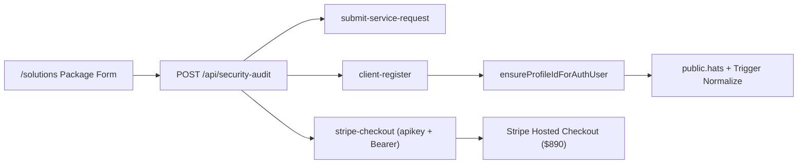

# T738 & T739 — Fix `/solutions` Direct Package Checkout (`hats_profile_id_fkey`) + Ground Google A2UI 1.0 Adoption

- **Tickets:** [[T738]] (Resolved) · [[T739]] (Queued in Active Backlog)
- **Date:** 2026-11-13
- **Agent Worktree:** `agy:t738-solutions-checkout-and-a2ui`

## 1. Root Cause Summary (`/solutions` Direct Package Checkout)

1. **`hats_profile_id_fkey` foreign key violation in `client-register`:**
   - Since `T210` (`claim_profile_for_account`), `public.profiles.id` is generated via `gen_random_uuid()`, while `public.profiles.auth_user_id` stores `auth.users.id`.
   - `w0m-api/supabase/functions/client-register/index.ts` resolved `public.profiles.id` only inside `if (domainChallenge)`, then attempted to insert raw `auth.users.id` into `public.hats.profile_id` (`REFERENCES public.profiles(id)`).
   - Seven additional edge functions (`client-api`, `stripe-checkout`, `stripe-portal`, `mercadopago-checkout`, `lead-api`, `seed-demo`, and `verify-credential`) also assumed `profile_id === auth.users.id`.
2. **Three Downstream Checkout Blockers on `/solutions` & `/services`:**
   - `stripe-checkout` requires JWT verification (`verify_jwt = true` in `w0m-api/supabase/config.toml`), yet `ServiceActionOrderConfigurator.svelte` and `AuditPricing.svelte` omitted `apikey` and `Authorization: Bearer <supabaseAnonKey>` headers.
   - Blank optional `Domain or Repo` sent `repo_url: ""` to `stripe-checkout`, rejected by `validateAuditCheckoutPayload`.
   - `validateAuditCheckoutPayload` ignored `package_price_usd`, `service_slug`, and `service_title`, defaulting to fixed `AUDIT_PRICES[level]`.

## 2. Verification Summary

- `just deno-check`: 64 edge function entrypoints type-checked, 0 errors.
- `just deno-test`: 395 passed, 0 failed across 34 edge-function test files (including new custom package & bare-domain tests in `stripe-billing.test.ts` and `lead-api.test.ts`).
- `pnpm --filter web exec vitest run src/tests/api/__tests__/security-audit-order.test.ts src/tests/service-action-order-configurator.test.ts`: 16/16 tests passed.
- `python3 w0m-web/project/scripts/supabase_surface_drift_check.py`: 767 `.from(...)` calls across 1006 files vs 200 SQL relations, 0 findings.
- `just ui-ticket-leak-check`: 503 UI/catalog files scanned, 0 leaked internal identifiers.

## 3. Google A2UI 1.0 Adoption Ticket (`T739`)

- Filed and grounded [[T739]] (`status: queued`, `queue: next`, `priority: P1`) for adopting Google A2UI 1.0 across `w0m-ext` (upgrading existing `@a2ui/lit@^0.8.1` and `<a2ui-surface id="agent-ui">` to 1.0) and `w0m-web` (`@webomage/ui` catalog bridge, AI Agent Helper, `@webomage/webmcp`, and CP agent surfaces).
