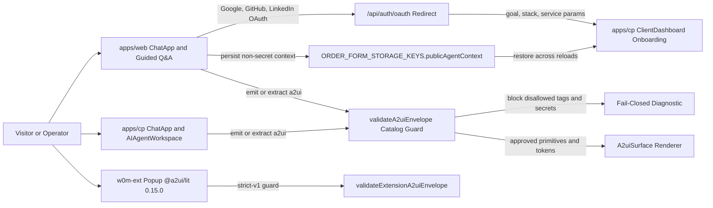

# T739 — Google A2UI 1.0 Generative UI, Guided Q&A Persistence & Fast OAuth Lead-In

- **Ticket:** `T739`
- **Date:** 2026-11-15
- **OpenSpec Change:** `2026-11-15-a2ui-v1-agentic-ui-and-guided-qa-oauth`
- **Scope:** `@webomage/webmcp`, `@webomage/ui`, `@webomage/lib/security/order-form-state`, `apps/web` (`ChatApp.svelte`), `apps/cp` (`ChatApp.svelte`, `AIAgentWorkspace.svelte`, `ClientDashboard.svelte`), and `w0m-ext/extension` (`@a2ui/lit@^0.15.0`).

## 1. Architecture Overview



## 2. Implemented Changes

1. **Unified A2UI 1.0 + v0.8 Validator & Catalog (`@webomage/webmcp`, `@webomage/ui`):**
   - `w0m-web/packages/webmcp/src/a2ui.ts`: Implements `WEBOMAGE_A2UI_CATALOG` (`Column`, `Row`, `Text`, `Button`, `Input`, `Select`, `Card`, `Badge`, `AuditSummaryCard`, `CheckoutTrigger`, `OAuthLeadBar`), `validateA2uiEnvelope()`, `normalizeA2uiMessage()`, `redactSensitiveA2uiData()`, `isSafeActionUrl()`, `extractA2uiBlocksFromMarkdown()`, `buildGuidedQaA2uiMessages()`, and `A2UI_RENDER_SURFACE_TOOL`.
   - `w0m-web/packages/ui/src/lib/a2ui/A2uiSurface.svelte` & `catalog.ts`: Renders validated component trees recursively through `@webomage/ui` primitives and CSS custom properties (`var(--...)`) with zero `{@html}`, zero `#hex` colors, and zero native `<button>`/`<input>`/`<select>` elements.
2. **Browser Extension Upgrade & Strict Guard (`w0m-ext`):**
   - Upgraded `@a2ui/lit` from `^0.8.1` to `^0.15.0` (`@a2ui/lit 0.15.0` resolved).
   - Added `w0m-ext/extension/src/ui/a2uiCatalogGuard.ts` (`initAgentUiSurface`, `validateExtensionA2uiEnvelope`) wired to `<a2ui-surface id="agent-ui">` in `w0m-ext/extension/src/ui/popup.ts`, plus unit coverage in `extension/src/__tests__/a2uiSurfaceGuard.test.ts`.
3. **Guided Q&A Context Persistence & 1-Click OAuth Lead-In (`w0m-web`):**
   - `w0m-web/packages/lib/src/security/order-form-state.ts`: Added `ORDER_FORM_STORAGE_KEYS.publicAgentContext`, `savePublicAgentContext()`, `loadPublicAgentContext()`, `clearPublicAgentContext()`, and `guidedGoal` / `guidedStack` fields on `FastOAuthOrderContext` & `parseOnboardingWizardQuery()`.
   - `w0m-web/apps/web/src/components/ChatApp.svelte`: Restores and persists Guided Q&A + conversation state across page reloads; renders `<A2uiSurface>` for ` ```a2ui ` blocks and Guided Q&A summaries; exposes Google, GitHub, and LinkedIn OAuth lead-in bars built with `buildFastOAuthRegisterUrl()`.
   - `w0m-web/apps/cp/src/components/ChatApp.svelte`, `w0m-web/apps/cp/src/components/admin/AIAgentWorkspace.svelte`, and `w0m-web/apps/cp/src/components/client/ClientDashboard.svelte`: Wired A2UI surface rendering and post-OAuth Guided Q&A `goal` / `stack` onboarding pre-fill.

## 3. Verification Evidence (Observed in Session)

| Check | Outcome | Observed Detail |
|---|---|---|
| `w0m-web` Vitest (`packages/webmcp`, `a2ui-guided-qa-oauth.test.ts`, `service-action-order-configurator.test.ts`, `sdd-dialect-onboarding.test.ts`) | **PASS** | `11` test files passed, `63` tests passed |
| `astro check` (`apps/web`) | **PASS** | `168` files checked: `0` errors, `0` warnings, `0` hints |
| `astro check` (`apps/cp`) | **PASS** | `288` files checked: `0` errors, `0` warnings, `1` pre-existing hint (`src/pages/index.astro:33`) |
| `w0m-ext` unit tests (`runAllTests.ts` incl. `a2uiSurfaceGuard.test.ts`) | **PASS** | `25` passed, `0` failed |
| `w0m-ext` `just typecheck` & `just build-chrome` | **PASS** | Exit `0` |
| `oxlint` on edited TS files (`w0m-web` + `w0m-ext`) | **PASS** | `0` warnings, `0` errors |
| `just ds-conformance` | **PASS** | `apps/cp` (`252` files) at/below baseline |
| `just ui-ticket-leak-check` | **PASS** | `504` UI/catalog files scanned, `0` leaked tokens |
| `just package-legitimacy-check` & `just dep-licenses-check` | **PASS** | `VERIFIED=357, SUS=0, SLOP=0`; `fail=0` (`1156` packages) |
| `just openspec-validate 2026-11-15-a2ui-v1-agentic-ui-and-guided-qa-oauth` | **PASS** | Valid OpenSpec change |
