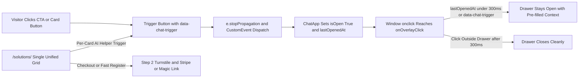

# T740 — AI Agent Helper Click Race Fix, `/solutions/` Selector Unification & Claw/Audit Runtime Benchmark

**Ticket:** `T740` (`.tasks/T740.md`)
**Status:** Verified in isolated agent tree `agent/t740-ai-helper-and-solutions-funnel` (pending owner Touch ID `just deploy-all` to update `https://webomage.com/solutions/`)
**Related:** `T153`, `T636`, `T738`, `T739`

---

## 1. Root Cause & Fixes Implemented (`webomage.com` & Client Portal)

### 1.1 External AI Agent Helper Buttons Did Nothing on Click

Clicking external CTA buttons (`Ask AI Agent Helper →`, `Complete via AI Agent Helper →`, `Open in AI Agent Helper →`, `Guided Q&A Scoping →`, `AI Guided Q&A Survey →`, `#contact-open-agent-btn`, `.solution-card a.text-link`, `.stage-card`, or `/contact` links) appeared to do nothing:

1. The button's `onclick` handler synchronously dispatched a window `CustomEvent` (`wom:chat-open`, `wom:chat-order-service`, or `wom:chat-guided-survey`).
2. `ChatApp.svelte` handled that event synchronously and set `isOpen = true`.
3. Immediately afterward on the same native DOM click bubble, `<svelte:window onclick={onOverlayClick} />` fired, checked `!target.closest(".chat-widget-container")`, and reset `isOpen = false` before the browser painted a single frame.
4. Additionally, `apps/web` `ChatApp.svelte`'s `startGuidedSurvey` / `finishGuidedSurvey` ignored pre-filled `email`, `name`, and `notes` passed from configurators, causing redundant prompts.

**Implemented Fix:**

- **`w0m-web/apps/web/src/components/ChatApp.svelte` & `w0m-web/apps/cp/src/components/ChatApp.svelte`**:
  - Added `let lastOpenedAt = 0;` and `markChatOpened()` called across `handleOpen`, `openFullScreen`, `handleOrderService`, `startGuidedSurvey`, and `toggleChat`.
  - Guarded `onOverlayClick` with both a `< 300ms` grace check (`lastOpenedAt < 300`) and external trigger selector exclusions (`[data-chat-trigger]`, `[data-chat-order]`, `[data-service-order-trigger]`, `[data-testid*="agent-btn"]`, `[data-testid*="ai-helper"]`, `[data-testid*="guided-survey"]`, `#contact-open-agent-btn`, `a[href*="/contact"]`).
  - Wired `quoteEmail`, `quoteName`, and `quoteNeed` hydration inside `startGuidedSurvey` and preserved `contact` metadata in `finishGuidedSurvey`.
- **Funnel Triggers (`ServiceActionOrderConfigurator.svelte`, `BlueprintOrderFlow.svelte`, `SecurityAuditWidget.svelte`, `AuditPricing.svelte`)**:
  - Updated helper trigger handlers (`handoffToAiAgentHelper` / `launchGuidedSurvey`) to call `e?.stopPropagation?.()`, carry `data-chat-trigger="true"`, and pass active form context (`email`, `name`, `targetUri`, `company`).
  - Added `"Ask AI Agent Helper →"` (`data-testid="audit-pricing-open-agent-btn"`) to `AuditPricing.svelte`'s checkout drawer actions.

### 1.2 Duplicate Solution Cards on `/solutions/`

Previously, `w0m-web/apps/web/src/components/pages/SolutionsPage.astro` stacked two separate 6-card solution selectors on `/solutions/`:

1. `{ id: "solutions", type: "solutions" }` (`SolutionsGrid.astro`), with tall cards and sparse vertical whitespace above links.
2. `{ id: "service-order-configurator", type: "service-order" }` (`ServiceActionOrderConfigurator.svelte`), right below it for the exact same 6 architecture solutions and packages.

**Implemented Fix:**

- Removed `{ id: "solutions", type: "solutions" }` from `SolutionsPage.astro` (keeping `SolutionsGrid.astro` untouched on disk for component tests), promoting `{ id: "service-order-configurator" }` under the unified heading `"Architecture Solutions & Direct Package Checkout"`.
- Added per-card `"Scope {item.shortTitle} with AI Agent Helper →"` triggers (`data-testid="service-card-ai-helper-${item.slug}"`, `data-chat-trigger="true"`) inside `ServiceActionOrderConfigurator.svelte`'s catalog grid so every card offers `Checkout` / `Fast Register` plus one-click pre-filled scoping in the AI Agent Helper.

### 1.3 Event & Funnel Architecture Diagram

---

## 2. Benchmark: `ZeroClaw v0.8.3` vs "Claw" Packages, `-claw` Runtimes & `cloudflare/security-audit-skill`

| Candidate | Origin / Runtime | Primary Purpose | Comparison Against Estate Standard (`ZeroClaw v0.8.3`, `T153`) |
|---|---|---|---|
| **ZeroClaw (`v0.8.3`)** | Rust single binary (`~3.4MB`, `<5MB` RAM, `<10ms` startup) | Local sandboxed agent runtime (`127.0.0.1:8888` `oMLX`, `zeroclaw acp` JSON-RPC 2.0 stdio, `:42617` gateway) | **Current estate baseline (`T153`).** Enforces `[risk_profiles.client_audit]` with `workspace_only = true`, `sandbox_enabled = true`, and denies `http_request`, `git_operations`, `spawn_subagent`, `browser`, `shell`, and `file_write`. |
| **`libclaw-*` / `claws-mail`** | Ubuntu / Debian `apt` C++ / GTK packages | C++ general utility library (sockets, logger, tween, graphic, dynamic library) and desktop mail client | **Name collision only.** Not an AI agent runtime or security scanner (`apt-cache search claw`). |
| **`cloudflare/security-audit-skill`** | Model-agnostic 6-phase audit skill / harness (open Orca tab + blog *"Build your own vulnerability harness"*) | Structured security auditing: Reconnaissance -> Coverage-Led Hunting -> Candidate Validation -> `findings.json`/`report-schema.json` -> Independent Verification -> `REPORT.md` | **Complementary skill methodology, not a runtime replacement.** Pairs cleanly on top of ZeroClaw's sandboxed execution model via file-backed ledgers and structured validation rather than competing with Rust runtime isolation. |
| **`TabClaw`** (`ustc-table-mining/TabClaw`) | Table/spreadsheet agent | Automated spreadsheet & tabular data mining workflows | Domain-specific to table processing; lacks general coding/audit sandboxing and low-footprint ACP gateway support. |
| **`OpenClaw`** (`openclaw-cli`) | Node.js / TypeScript (`1 GB+` RAM, `423.8 MB` bundle) | General JS agent daemon | **Already evaluated and retired (`T153`, `T196`)** in favor of ZeroClaw due to heavy RAM/disk footprint and broader attack surface. |
| **`PicoClaw` / `NanoClaw` / `IronClaw`** | Go embedded / minimal container SDK / Go + K8s RBAC + OIDC + WASM | Alternative lightweight or cluster-oriented `-claw` agent runners | Viable only if targeting pure K8s OIDC/WASM cluster orchestration (`IronClaw`) or Go/container embedding (`PicoClaw`/`NanoClaw`), whereas local MLX + ACP (`T153`) already fits `ZeroClaw v0.8.3` with zero JVM/Node/K8s overhead. |

**Recommendation:** Keep `ZeroClaw v0.8.3` as the local sandbox runtime (`~/.cargo/bin/zeroclaw`) and selectively adopt `cloudflare/security-audit-skill`'s 6-phase file-backed verification ledger (`findings.json` / independent candidate validation) inside w0m's client security audit methodology rather than swapping runtimes.
