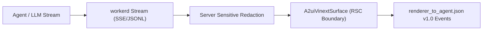

# T741 — `@webomage/a2ui-vinext` Implementation & Owner Release Handoff

**Ticket:** [[T741]] · **OpenSpec Change:** `w0m-web/openspec/changes/2026-11-15-a2ui-vinext-renderer/` · **License:** Apache-2.0

## Summary of Implemented Deliverables

- **OpenSpec Proposal & Spec (AC1):**
  - `w0m-web/openspec/changes/2026-11-15-a2ui-vinext-renderer/proposal.md`
  - `w0m-web/openspec/changes/2026-11-15-a2ui-vinext-renderer/tasks.md`
  - `w0m-web/openspec/changes/2026-11-15-a2ui-vinext-renderer/specs/a2ui-vinext-renderer/spec.md`
- **Core Package `w0m-web/packages/a2ui-vinext/` (AC2):**
  - `src/catalog.ts`: `BASIC_CATALOG_V1_COMPONENTS` covering all 18 `@a2ui/web_core/v1_0` Basic Catalog components, fail-closed Zod v4 + URL + prototype-pollution validation, `redactSensitiveDataModelWithCount`, `buildA2uiRendererCapabilities`, `createVinextMessageProcessor`, and `v1.0` / `v0.9.1` / `v0.8` envelope normalization.
  - `src/server/index.ts`: `bindServerDataModel`, `prepareA2uiRscSurface`, `createRendererActionEvent`, `createRendererErrorEvent`.
  - `src/workers/index.ts`: `parseA2uiExpressChunk`, `createA2uiJsonlTransformStream`, `createA2uiSseTransformStream`, `createA2uiSseResponse`, `createA2uiJsonlResponse`.
  - `src/vite/index.ts`: `vinextA2uiPlugin` for Vite / Vinext SSR + HMR integration.
  - `src/client/A2uiVinextSurface.tsx` (`"use client"`): All 18 v1.0 components + compat aliases (`Badge`, `Select`, `Input`, `Audio`), `Tabs`/`Modal`/`List` template expansion, cyclic guard, `@accessibility` attributes.
- **Cloudflare Workers Starter `w0m-web/packages/a2ui-vinext/examples/vinext-cloudflare-worker/`:**
  - `package.json`, `wrangler.jsonc`, `vite.config.ts`, `worker/index.ts`, `app/page.tsx`, `app/components/AgentShowcaseClient.tsx`, `README.md`.
- **Upstream Governance (`AgDR-0058`):**
  - Registered `"a2ui-project/a2ui"` in `scripts/w0m_prs.py` (`PRESET_REPOS["w0m-pr"]`, `PRESET_REPOS["wom7open"]`, `FORK_UPSTREAM_MAP["a2ui"]`, and `UPSTREAM_CONTRIBUTION_RULES["a2ui-project/a2ui"]` with `automation_mode: "cla_required"` and `requires_gpg_signature: True`) plus coverage in `scripts/tests/test_w0m_prs.py`.

## Architecture Flow



## Verification Results

- `openspec validate 2026-11-15-a2ui-vinext-renderer --type change --strict --no-interactive`: PASS
- `just spec-policy-check`: PASS (`367/745 specced total, 0 closed unspecced`)
- `./node_modules/.bin/tsc -p packages/a2ui-vinext/tsconfig.json` & `tsconfig.build.json`: PASS
- `./node_modules/.bin/oxlint packages/a2ui-vinext/src packages/a2ui-vinext/tests packages/a2ui-vinext/examples`: PASS (`0 warnings and 0 errors`)
- `./node_modules/.bin/vitest run packages/a2ui-vinext`: PASS (`3` test files, `12` tests)
- `examples/vinext-cloudflare-worker`: `pnpm install`, `pnpm run build`, and `wrangler deploy --dry-run`: PASS (`Total Upload: 1531.01 KiB / gzip: 443.87 KiB`)
- `just ds-conformance`, `just ui-ticket-leak-check`, `just license-check`, `just package-legitimacy-check`, `just dep-licenses-check`, `just check-guardrails`: PASS
- `python3 scripts/tests/test_w0m_prs.py`: PASS (`96/96`) · `just prs-proposals a2ui`: PASS (`1/1`)

## Owner-Gated Actions Remaining (AC3 / AC4)

Because public repository creation/push, live Cloudflare Workers deployments (`docs/DEPLOY-CONFIRM.md`), and Google CLA-gated PR submissions (`AgDR-0058`) require owner credentials/confirmation:

1. Verify Google CLA status at `https://cla.developers.google.com/` for `casualuser@gmail.com`.
2. Review the prepared PR body via `just prs-proposals a2ui`, fork `a2ui-project/a2ui` into `github.com/webomage/a2ui` (`w0m-pr/a2ui`), add the `renderers.mdx` entry, run `./scripts/fix_format.sh`, commit with `-S`, and open the PR once Google CLA is confirmed.
3. Deploy `examples/vinext-cloudflare-worker` via Wrangler (and restore `"license": "Apache-2.0"` without `"private": true` when exporting standalone `webomage/a2ui-vinext`):

```bash
cd ~/Projects/'!self'/w0m/w0m-web/packages/a2ui-vinext
cd examples/vinext-cloudflare-worker
pnpm install
pnpm exec wrangler deploy
```

```bash
cd ~/Projects/'!self'/w0m
just prs-proposals a2ui
just pr-dry a2ui
```
