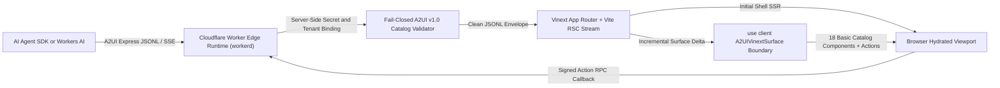

# T741 — `@webomage/a2ui-vinext` Renderer Architecture & Upstream `a2ui.org/ecosystem/renderers/` Contribution Plan

**Ticket:** `T741` (`.tasks/T741.md`)
**Status:** Queued for `w0m-sdlc-spec` (filed & grounded inside isolated tree `agent/t741-a2ui-vinext-ecosystem`)
**Related:** `T136`, `AgDR-0042`, `AgDR-0058`, `T739`

---

## 1. Upstream Ecosystem Gap Analysis (`a2ui-project/a2ui`)

Inspected `docs/site/src/content/docs/ecosystem/renderers.mdx`, `CONTRIBUTING.md`, and `.github/PULL_REQUEST_TEMPLATE.md` on `a2ui-project/a2ui@main`:

1. **Current Coverage (`21` Community Renderers, `3` Agent Libraries, `2` Related Tools):**
   - Client-side React entries (`easyops-cn/a2ui-sdk`, `zhama/a2ui`, `jem-computer/A2UI-react`, `BoteAI/a2ui`, `yessGlory17/generative-mui`, `Language-Lit/material3-expressive-a2ui`, `xpert-ai/a2ui-react`, `AINative-Studio/ai-kit-a2ui`) target **`v0.8` / `v0.9.x`** or unversioned client-only SPAs.
   - Svelte 5 (`ChaliceForAuri/a2ui-svelte`), Compose Multiplatform (`uny/a2ui-compose`), and WeChat Mini Program (`lbb00/a2ui-miniprogram`) reach **`v1.0`**.
   - **Verified Gap:** There is **no `vinext` / Cloudflare Workers SSR+RSC renderer** (`cloudflare/vinext` on Vite + React Server Components + `workerd`) and **no `v1.0` community React/Next.js ecosystem renderer** listed.
2. **Upstream Contribution Rules & Open PRs:**
   - Must follow `CONTRIBUTING.md`: sign the **Google CLA** (`https://cla.developers.google.com/`), add row(s) to `docs/site/src/content/docs/ecosystem/renderers.mdx`, run `./scripts/fix_format.sh`, and fill `.github/PULL_REQUEST_TEMPLATE.md`.
   - Listing criteria require an open-source repo (Apache-2.0 / MIT), declared version (`v1.0` + `v0.9.1`), core layout/text/input/action components, install instructions + runnable example, and active maintenance.
   - Open community PRs (#3992 `a2ui-kmp`, #4208 Kaltura catalog, #3313 `a2ui-bindjs`) target `docs/site/src/content/docs/ecosystem/renderers.mdx` directly.

---

## 2. Proposed Architecture: `@webomage/a2ui-vinext`



### Core Capabilities

1. **Edge-First Next.js API Surface on `cloudflare/vinext`:** Compatible with App Router, React Server Components, Vite HMR, and native Cloudflare Workers `workerd` bindings (`env.AI`, R2, KV, Durable Objects) without Node.js polyfill bloat or Next.js OpenNext cold starts.
2. **Fail-Closed Catalog Validation & Server-Side Data Binding:** Validates every inbound component node against registered A2UI v1.0 Basic + custom schemas before serialization and strips/resolves sensitive tokens server-side inside the Worker.
3. **Full 18 Basic Catalog Coverage:** `Row`, `Column`, `Card`, `Text`, `Button`, `TextField`, `Select`, `CheckBox`, `Divider`, `Badge`, `Modal`, `Tabs`, `List`, `Icon`, `Image`, `Slider`, `DateTimeInput`, `Audio`/`Video`.

---

## 3. Draft `renderers.mdx` Entry & `AgDR-0058` Submission Sequence

Draft row for `docs/site/src/content/docs/ecosystem/renderers.mdx` once `github.com/webomage/a2ui-vinext` is live and conformance-tested:

```markdown
| **[webomage/a2ui-vinext](https://github.com/webomage/a2ui-vinext)**<br />(`@webomage/a2ui-vinext`) | React / Vinext (Vite + Cloudflare Workers RSC) | `v1.0`, `v0.9.1` | Active | Edge-native React/Next.js renderer and streaming JSONL/SSE adapter for `cloudflare/vinext` on Vite and Cloudflare Workers (`workerd`), covering all 18 Basic Catalog components with fail-closed schema validation. |
```

Execution sequence per estate fork policy (`AgDR-0058`):

1. Build & publish `github.com/webomage/a2ui-vinext` (Apache-2.0, GPG-signed `-S` commits, runnable `examples/vinext-cloudflare-worker` + live Workers demo).
2. Fork `a2ui-project/a2ui` into `github.com/webomage/a2ui` (cloned locally under `w0m-pr/a2ui`, never under `casualuser/`).
3. Confirm Google CLA is signed for the commit identity (`Aleksei Tcelishchev <casualuser@gmail.com>`), edit `docs/site/src/content/docs/ecosystem/renderers.mdx`, and run `./scripts/fix_format.sh`.
4. Open the PR via `just pr-open` with explicit Why / What For / How rationale and verified conformance + live demo proof.
