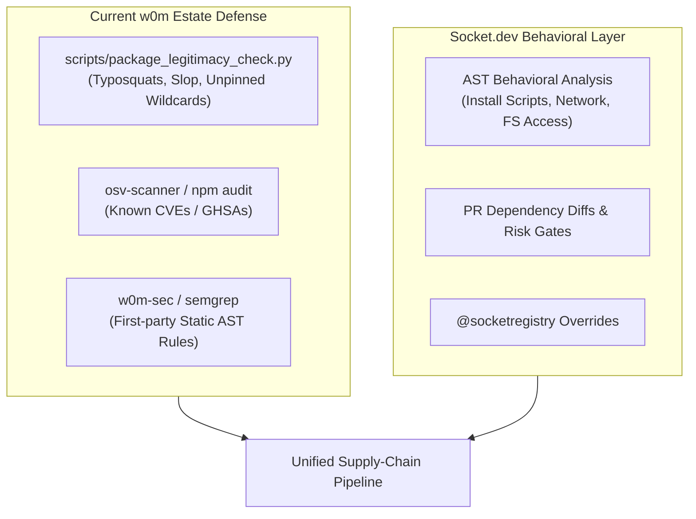

# T741 — Socket.dev Supply Chain Security Evaluation & Estate Incorporation Plan

**Ticket:** [[T741]] · **Package:** `@webomage/a2ui-vinext@0.1.1` · **Target:** [Socket.dev Overview](https://socket.dev/npm/package/@webomage/a2ui-vinext/overview/0.1.1)

## Executive Summary

This report evaluates the **Socket.dev** supply chain security analysis for `@webomage/a2ui-vinext@0.1.1` and outlines how the w0m ecosystem can incorporate Socket's AST-based behavioral threat analysis into its automated quality and security gates (`justfile`, `package_legitimacy_check.py`, and CI/CD).



---

## 1. Analysis of Socket.dev Report for `@webomage/a2ui-vinext@0.1.1`

### A. Health & Safety Signals
- **Supply Chain Risk (Clean / Low Risk):**
  - **Zero Install Scripts:** The package declares no `preinstall`, `install`, or `postinstall` lifecycle scripts. Attacks leveraging lifecycle execution hooks are blocked by design.
  - **Zero Minified / Obfuscated Code Blobs:** All published files in `./dist` map 1:1 to clear TypeScript compilation targets with `.d.ts` declarations and source maps.
  - **Minimal Dependency Tree:** Direct dependencies are restricted strictly to `zod: ^4.6.7` and `@a2ui/web_core: ^0.15.0`.
  - **Clean Tarball Geometry:** 59.0 kB packed (276.9 kB unpacked) containing 47 files, stripped of example node_modules and dev caches via `.npmignore`.

### B. Behavioral Capabilities Detected
Socket inspects AST nodes for standard runtime and build capabilities:
- **Environment & Node Access:** Detected in `./vite` (Vite build plugin) and `./workers` (Cloudflare Workers streaming transforms, `TextEncoder`/`ReadableStream`). These are legitimate, scoped capabilities required for edge SSR and build tooling.
- **Network Egress:** The package itself makes zero unprompted outbound network calls; streaming endpoints simply adapt incoming worker requests into A2UI SSE/JSONL streams.

### C. Standard New-Package Indicators
- **"New Package / New Author" Alert:** Socket flags newly published packages (< 30 days old or low cumulative download history). This is an expected informational baseline for version `0.1.x` and clears naturally as version history and release cadences mature.

---

## 2. Gap Analysis: w0m Current Stack vs. Socket.dev

| Capability | w0m Current State | Socket.dev | Recommendation |
|---|---|---|---|
| **Known Vulnerabilities (CVEs)** | `osv-scanner`, `pnpm audit` | Deep CVE scanning | Continue using `osv-scanner` as primary local gate |
| **Typosquat / Slopsquatting** | `scripts/package_legitimacy_check.py` | Global registry crawler | Complement `package_legitimacy_check.py` with Socket |
| **Install Script Execution** | Not audited during `pnpm add` | Blocks packages with arbitrary `postinstall` | **Incorporate Socket CLI wrapper / PR bot** |
| **Runtime Behavioral Analysis** | Semgrep (first-party code only) | Analyzes AST of third-party dependencies | **High Value: Adopt Socket for 3rd-party deps** |
| **PR Dependency Diffing** | Git diff review | Automated PR comments on behavioral risk | **Adopt Socket GitHub App on public repos** |

---

## 3. Incorporation Plan for the w0m Stack

### Stage 1: Public OSS Repositories (Immediate & Zero-Cost)
Install the **Socket GitHub App** on:
- `github.com/webomage/a2ui-vinext` (standalone library)
- `github.com/webomage/a2ui` (fork)

*Benefits:*
- Free for public open-source repositories.
- Automatically posts a structured PR review whenever dependencies change, highlighting behavioral alerts (e.g., unexpected network access, new install scripts, permission escalations).

### Stage 2: Justfile Recipe (`just socket-audit`)
Add a dedicated supply-chain audit recipe to the `@wom` root `justfile`:
```just
# Run Socket.dev supply chain scan on workspace manifests
socket-audit *args:
    @npx --yes socket scan create {{ args }}
```
For CI enforcement (`just socket-ci`), Socket exits with code 1 if critical/high-severity supply chain alerts are introduced. This requires storing a free `SOCKET_SECURITY_API_KEY` in Infisical.

### Stage 3: Enhancement to `scripts/package_legitimacy_check.py`
Cross-reference packages flagged as `[SUS]` (e.g. unpinned or freshly introduced external packages) against Socket package health metrics during pre-commit or `w0m-sdlc-security` gates.

---

## 4. Maintainer & Registry Ownership Alignment

- **Author Field in Manifest:** Configured as `Aleksei Tcelishchev <casualuser@gmail.com>` across standalone and monorepo manifests.
- **Maintainers Block:** Configured as `[{"name": "casualuser", "email": "casualuser@gmail.com"}]`.
- **Registry Co-Ownership:** To add `casualuser` as co-maintainer on npm:
  ```bash
  npm owner add casualuser @webomage/a2ui-vinext
  ```
