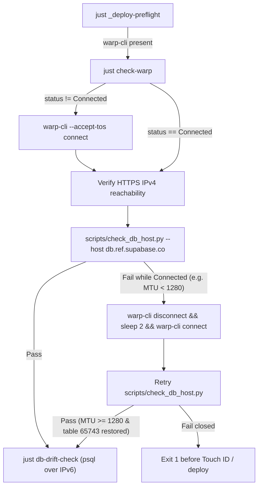

# T742 — Cloudflare WARP IPv6 Tunnel Self-Heal & `_deploy-preflight` Ordering

**Ticket:** `T742` (`.tasks/T742.md`)  
**Status:** Implemented & verified inside isolated agent tree `agent/t742-warp-ipv6-self-heal`  
**Related:** `T542`, `T503`, `T650`, `deploy-logs/run-2026.11.14-1794666347.log`

---

## 1. Observed Failure (`release 2026.11.14-1794666347`)

During `just deploy-all` (`deploy-logs/run-2026.11.14-1794666347.log`), two issues surfaced before deployment stopped at `check-warp`:

1. **`_deploy-preflight` (`justfile`)** ran `just db-drift-check` **before** `check-warp`:
   - `db-drift-check` printed `db-drift-check: psql failed — ['\tIs the server running on that host and accepting TCP/IP connections?']` and skipped verification.
   - `deploy-audit-latest.json` incremented `other_trouble` (`0 -> 2 (+2)`).
2. **`check-warp` (`justfile`)** reported:
   - `✅ WARP Status update: Connected`
   - `✅ app.infisical.com reachable (HTTP 200)` (IPv4)
   - `✅ pqbbjgeapylcengbuvee.supabase.co reachable (HTTP 404)` (IPv4)
   - `❌ FAIL [connect] db.pqbbjgeapylcengbuvee.supabase.co resolves (IPv6) but no address accepted a TCP connection on port 5432 within 5s.`

---

## 2. Root Cause (`journalctl -u warp-svc -b`)

1. **QUIC PMTU discovery lowered `CloudflareWARP` MTU below `IPV6_MIN_MTU` (`1280`):**
   - At `2026-11-14 06:36:21`, `quiche::pmtud` converged on `pmtu=1222` (`New PMTU found, adjusting tunnel mtu pmtu=1222`).
   - Because Linux removes global IPv6 addresses and flushes IPv6 routes when an interface's MTU drops below `1280` bytes (RFC 8200 / kernel `net/ipv6/addrconf.c`), `warp-svc` logged `DelRoute` across policy routing table `65743` (`DelRoute(Dest: ::/3; Output interface: 5)` through `ff80::/9`), leaving only IPv4 `172.16.0.2/32` and link-local IPv6.
   - Because `warp-cli status` remained `Connected` and IPv4 endpoints (`app.infisical.com`, `pqbbjgeapylcengbuvee.supabase.co`) kept responding, `check-warp` skipped calling `warp-cli connect`.
   - Meanwhile `eno1` had no native ISP IPv6 (`"v6_iface": null`), so `db.pqbbjgeapylcengbuvee.supabase.co` (`AAAA`-only) timed out on port `5432`.

2. **Preflight ordering mismatch:**
   - `_deploy-preflight` executed `@just db-drift-check` prior to `check-warp`, causing `psql` to run before WARP had connected or recovered its IPv6 routes.

---

## 3. Recovery & Preflight Self-Healing Architecture

---

## 4. Verification Summary

- **Live WARP Recovery:** `warp-cli --accept-tos disconnect && sleep 2 && warp-cli --accept-tos connect` restored `CloudflareWARP` at `mtu 1300` with global IPv6 and `table 65743` IPv6 routes; `scripts/check_db_host.py`, `just check-warp`, and `just db-drift-check` (`394 local file(s), 394 ledger entrie(s)`) all exited `0`.
- **Automated Regression Suite:** `scripts/tests/test_deploy_chain_order.py` asserts `_deploy-preflight` runs `just check-warp` strictly before `just db-drift-check`, and `check-warp` cycles WARP once on initial `check_db_host.py` failure before failing closed.
