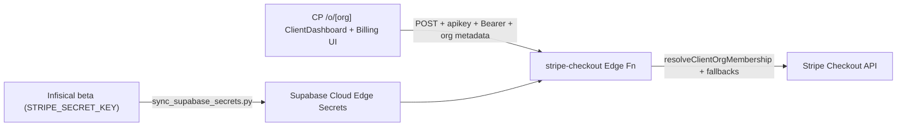

# T743 — Fix Stripe Secret Sync Allowlist & Client Portal Stripe Checkout Flows

- **Ticket:** [[T743]] (Done) · **Related:** [[T290]] · [[T373]] · [[T738]]
- **Date:** 2026-11-14
- **Agent Worktree:** `agy:t743-fix-stripe-checkout-and-secret-sync`

## 1. Root Cause Summary

1. **Missing Stripe keys in Supabase Edge Function secret sync (`w0m-api/scripts/sync_supabase_secrets.py`):**
   - Infisical `beta` holds `STRIPE_SECRET_KEY` (`sk_test_…`, 107 chars), while `STRIPE_WEBHOOK_SECRET` remains unset pending Stripe Dashboard webhook endpoint registration.
   - `keys_to_sync` in `w0m-api/scripts/sync_supabase_secrets.py` omitted both `STRIPE_SECRET_KEY` and `STRIPE_WEBHOOK_SECRET`, leaving Supabase Cloud (`pqbbjgeapylcengbuvee`) without `STRIPE_SECRET_KEY` (`500 Server missing environment configuration` on `stripe-checkout` and `503 Billing is not available` on `stripe-portal`).
   - Adding both tuples reuses the script's non-empty source guard: `STRIPE_SECRET_KEY` is prepared for upload (`just sync-secrets`), while empty `STRIPE_WEBHOOK_SECRET` is skipped cleanly without empty-clobbering.
2. **Client Portal `/o/[org]` onboarding wizard caller defects (`w0m-web/apps/cp/src/components/client/ClientDashboard.svelte`):**
   - `triggerPortalPackageCheckout()` omitted `apikey` and `Authorization: Bearer ...` headers required by Kong (`verify_jwt = true` in `w0m-api/supabase/config.toml`).
   - It omitted `contact_email` and `service_title` from the request body and silently swallowed non-OK HTTP responses without surfacing `wizardError`.
3. **Missing org/user fallback hydration in `stripe-checkout` (`w0m-api/supabase/functions/stripe-checkout/index.ts`, `_shared/stripe-billing.ts`):**
   - Authenticated `checkoutType === "audit"` calls queried only `hats.org_id` instead of hydrating `contact_email`, `company_name`, and `repo_url` from the client's `orgs` record (`email`, `company_name`, `name`, `website`) or `authUser.email`.
4. **Missing `apikey` header in `SubscriptionManager.svelte` and `InvoiceList.svelte`:**
   - Added conditional `apikey: supabaseKey` alongside `Authorization: Bearer ...` on Supabase Edge Function requests (`stripe-checkout` and `mercadopago-checkout`).

## 2. Verification Summary

- `infisical run --env=beta --silent -- python3 w0m-api/scripts/sync_supabase_secrets.py --dry-run`: Prepared 27 secret(s) including `STRIPE_SECRET_KEY (107 chars)`; safely skipped empty `STRIPE_WEBHOOK_SECRET` (exit 0).
- `deno test w0m-api/supabase/functions/_shared/stripe-billing.test.ts`: 15 passed, 0 failed (`90ms`), including 2 new tests covering `AuditCheckoutFallbacks` hydration and explicit payload precedence.
- `just deno-check`: 64 edge function entrypoints type-checked, 0 errors.
- `just deno-test`: 397 passed, 0 failed across 34 edge-function test files.
- `python3 -m unittest discover -s w0m-api/scripts/tests/ -p "test_*stripe*.py" -v`: 6/6 tests passed (`test_stripe_reconcile.py`).
- `pnpm --dir w0m-web exec vitest run packages/lib/src/system-registry/services-policy.spec.ts apps/web/src/tests/service-action-order-configurator.test.ts apps/cp/src/components/client/__tests__/client-links.test.ts`: 21/21 tests passed across 3 files (`10` + `6` + `5`).
- `just svelte-typecheck-ratchet`: 4/4 apps passed (`155` `.svelte` files, `0` errors <= baseline `0`).
- `just ui-ticket-leak-check`: `503` UI/catalog files scanned, `0` leaked internal identifiers.
- `python3 w0m-web/project/scripts/client_services_check.py`: `[OK]` (updated with Stripe sync & CP checkout contract assertions).
- `python3 w0m-web/project/scripts/check_connectors.py`: `PASS` (`9` registry entries, `9` docs declared).
- `python3 w0m-web/project/scripts/supabase_surface_drift_check.py`: `767` `.from(...)` calls across `1006` files vs `200` SQL relations (`0` findings).
- `test_client_ds_migration.py` (`18/18`) & `test_client_portal_firstrun.py` (`15/15`): passed.

## 3. Owner Production Cutover Steps

Live production activation still requires the Touch ID-gated owner commands (`docs/DEPLOY-CONFIRM.md`):
1. `just sync-secrets` — pushes `STRIPE_SECRET_KEY` (`sk_test_…`) from Infisical `beta` into Supabase Cloud.
2. `just deploy-all` — deploys updated `stripe-checkout` Edge Function and `w0m-web` (`cp`).
3. Register Stripe Dashboard webhook pointing to the `stripe-webhook` endpoint, save `STRIPE_WEBHOOK_SECRET` in Infisical `beta`, and run `just sync-secrets` again (then flip `expected_absent` only once both `dev` and `beta` intentionally carry all Stripe secrets).
