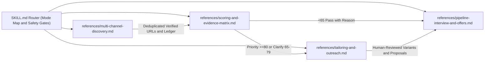

# Architecture & Verification Report — Modular `job-hunter` Skill Upgrade (`T744`)

**Ticket:** `T744` · **Date:** `2026-11-14` · **Spec:** `w0m-web/openspec/specs/sdlc_toolchain/spec.md` · **Version Stamp:** `2026.11.14-1794698448`

---

## 1. Executive Summary

Upgraded the `w0m-native` (`MIT`) `job-hunter` skill in `w0m-skills/skills/job-hunter/` from a monolithic `88`-line `SKILL.md` into a **5-file progressive-disclosure skill architecture** (`SKILL.md` router + 4 modular `references/*.md` playbooks), while keeping the unit **100% original `w0m-native` prose**, **`portable`** (zero internal workspace dependencies), and **`0/100 LOW · SAFE`** on `NVIDIA/SkillSpector`:

1. **Progressive-Disclosure Router (`w0m-skills/skills/job-hunter/SKILL.md`):** Preserves existing section anchors (`# Job Hunter`, `## Goal`, `## Operating Rules`, `## Opportunity Evaluation Rubric`, `## Workflow`) and adds a Mode & Companion Reference Map routing directly to each on-demand playbook, explicit Search-Only Discovery Mode rules for unauthenticated portals, CAPTCHA/HTTP `429` circuit breakers, clickable link verification, and passive-data framing.
2. **Modular Companion Playbooks (`w0m-skills/skills/job-hunter/references/*.md`):**
   - `multi-channel-discovery.md` — 4-tier channel sweep order (HN/GitHub/YC feeds -> Greenhouse/Ashby/Lever/Workday/Rippling ATS -> Upwork MCP/Contra/Toptal/Braintrust marketplaces -> public Telegram `t.me/s/<channel>/<post_id>` permalinks, Threads, and LinkedIn), deduplication key, Search-Only gate on unauthenticated portals, fail-closed link reachability verification, and Discovery Run Ledger schema.
   - `scoring-and-evidence-matrix.md` — Normalized 5-part brief schema, deterministic `0-100` weighted rubric breakdown (`35 + 20 + 20 + 15 + 10`), Triage Buckets (`>=80` Priority Apply, `65-79` Selective / Clarify, `<65` Pass / Archive), CV Fact & Story Provenance Matrix (`Direct Production Match` vs `Adjacent / Transferable Match` vs `True Gap`), and 5-class Red-Flag Taxonomy.
   - `tailoring-and-outreach.md` — Non-destructive role-variant emission, ATS keyword hygiene, `Problem -> Architecture/Action -> Measured Result` bullet pattern, 5-part `120-200` word cover note & marketplace proposal framework (no unsolicited salary ultimatums in cold cover notes), and channel-specific outreach templates.
   - `pipeline-interview-and-offers.md` — Full pipeline state machine (`Discovered -> Closed`) and Markdown/JSON tracker schema, `STAR + Tradeoffs` architecture story bank, reverse-interview engineering health questions, weighted multi-offer comparison matrix, and final terms negotiation checklist.
3. **Catalog, Packaging & Cross-Estate Sync:** Stamped `job-hunter` (`2026.11.14-1794698448`), updated `w0m-skills/skills-registry.json` & `w0m-skills/skill-portability.jsonc`, rebuilt `.claude-plugin/plugin.json` and `plugin.json` (`69` skills enumerated), and ran `just skills-sync` (`5` files synced into `.agents/skills/job-hunter/` and `w0m-web/.agents/skills/job-hunter/`, updating lockfiles, Backstage catalogs, and `w0m-web/docs/SKILLS-CATALOG.md`).

---

## 2. Modular Progressive-Disclosure Architecture

---

## 3. Verification Matrix

| Verification Gate | Command Executed | Measured Outcome |
|---|---|---|
| **Version Stamp & Hash Integrity** | `pnpm --dir w0m-skills run version:stamp job-hunter && pnpm --dir w0m-skills run version:check` | `job-hunter -> 2026.11.14-1794698448`; **`79` canonical units (`49` native, `30` imported, `0` unresolved)** |
| **Plugin Packaging & Manifest Lint** | `pnpm --dir w0m-skills run plugin:package && pnpm --dir w0m-skills run plugin:check && pnpm --dir w0m-skills run plugin:lint` | **`69` skills enumerated cleanly across `.claude-plugin/plugin.json` and `plugin.json`** |
| **Estate Sync & Parity** | `just skills-sync && just skills-sync --check` | **`job-hunter (5 file(s))` synced to root (`41`) and `w0m-web` (`63`), `0` drift** |
| **Skill Prose Static Audit** | `pnpm --dir w0m-skills run skill-audit` | **`240` `.md` files across `69` skills scanned -> `0` findings (`PASS`)** |
| **Vendoring / Companion Check** | `tsx scripts/audit_vendoring.ts --project ..` & `--project ../w0m-web` | **`0` undecided skills, `0` broken companion links across `42` root / `129` `w0m-web` skills** |
| **NVIDIA SkillSpector Deep Scan** | `just skillspector-scan w0m-skills/skills/job-hunter` | **`[APPROVE] score=0/100 (LOW · SAFE)`, `crit/high=0`, `sc9_excluded=0`, `active=0`, `suppressed=0`** |
| **Skills Unit, Sync, Portability & Version Suite** | `pnpm --dir w0m-skills run skill-test` | **`174 passed, 0 failed`** (`skill-portability.jsonc` & `install_generic` verified `portable`) |
| **TypeScript Typecheck** | `pnpm --dir w0m-skills run typecheck` | **`0` errors (`tsc --noEmit`)** |
| **Emoji Heading & Script Policy** | `just emoji-check` | **Passed (`0` prohibited headings; `204 <= 219` ratchet)** |
| **Skills Catalog Generation & Tests** | `just skills-catalog-check && just skills-catalog-test` | **`119` declared, `10` excluded verified `[OK]`; `4 passed`** |
| **Consumer Compatibility Probe** | `vitest run apps/web/src/tests/k7-git-browser.test.ts` | **`3 passed (3)` (`SKILL.md` header parser compatible)** |
