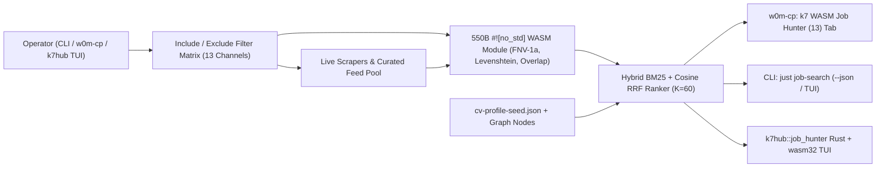

# T745 — `@wom` + `@k7` WASM Multi-Channel Job Hunter with Include/Exclude Filters & Hybrid Vector/Graph Grounding

- **Ticket**: `T745` (`#742`)
- **Status**: Implemented & verified in isolated agent tree (`/home/aleksei/.w0m/work/t745-k7-job-hunter/w0m`) and sibling `k7hub` repo (`/home/aleksei/Projects/!self/k7/k7hub`)

## Architecture Overview

## Implemented Surfaces

1. **`w0m-cf` Edge Worker (`w0m-cf/src/utils/wasm-utils.ts`, `src/lib/job-boards.ts`, `src/workflows/job-scanner.ts`, `src/wasm.d.ts`)**:
   - Added `ALL_JOB_BOARD_SOURCES` (`13` channels: `upwork`, `hn`, `ats`, `weworkremotely`, `remoteok`, `remotive`, `jobicy`, `workingnomads`, `nofluffjobs`, `adzuna`, `cryptojobslist`, `telegram`, `threads`).
   - Added `resolveActiveJobSources`, `scoreJobListingRubricWasm`, and `filterAndScoreJobListingsWasm`.
   - Added `scrapeHackerNews`, `scrapeJobicy`, `scrapeWorkingNomads`, `scrapePublicAtsBoards`, and filter-aware `scrapeAll(env, filterOptions)`.
   - Wired static `.wasm` ES module import (`w0m_wasm_utils.wasm`) so `vitest-pool-workers` (`workerd`) instantiates precompiled WASM without runtime codegen errors, and corrected the `"w0m-cf-wasm-health"` FNV-1a selftest digest (`0x4b25735ca3f2cfb1`).

2. **`k7hub` Rust + `wasm32` (`k7hub/src/job_hunter.rs`, `src/lib.rs`)**:
   - Added `ratatui` + `wasm32`-compatible `job_hunter` module (`ALL_JOB_SOURCE_IDS`, `resolve_active_sources`, `score_job_entry`, `filter_and_score_jobs`, `render_job_hunter_frame_snapshot`, `render_job_hunter_wasm_json`).

3. **`w0m-web` & `w0m-cp` (`packages/lib/src/security/k7-job-hunter.ts`, `apps/cp/src/components/admin/CrewToolkitAndTabLinuxConsole.svelte`)**:
   - Implemented in-browser 550-byte `#![no_std]` WASM execution (`k7Fnv1a64Hex`, `k7ScoreTokenOverlap`), 5-axis rubric, Hybrid BM25 + Cosine RRF, CV Graph provenance, and WASM TUI frame generator.
   - Mounted **k7 WASM Job Hunter (13)** tab (`k7-jobs`) in `CrewToolkitAndTabLinuxConsole.svelte` using `@webomage/ui` primitives and one-click TabLinux CLI dispatch.
   - Added `apps/web/src/tests/k7-job-hunter.test.ts` and updated `w0m-web/docs/K7-FAMILY.md`.

4. **`@wom` Hybrid CLI (`scripts/w0m_job_hunter.py`, `justfile`, `scripts/tests/test_w0m_job_hunter.py`)**:
   - Added `just job-search` and `just job-search-test` supporting `--include`, `--exclude`, `--only`, `--query`, `--remote-only`, `--usd-only`, `--contract-only`, `--min-score`, `--limit`, `--live`, and `--json`, grounded in `w0m-web/project/data/cv/cv-profile-seed.json`.
