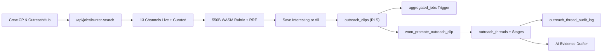

# T746 — k7 WASM Job Hunter Persistence, Live Multi-Channel API & Outreach/Employment Pipeline in Crew CP

## Summary

Connected the 13-channel `k7` WASM Job Hunter inside member/crew CP (`/me/work`, `/o/[org]/projects/services`, `/o/[org]/p/[project]/services`, `/admin/ai-agents`) and `OutreachHub` (`/me/outreach`, `/o/[org]/outreach`) to live multi-channel discovery, persistent Supabase database storage (`public.outreach_clips`, `public.outreach_threads`, `public.aggregated_jobs`, `public.outreach_thread_audit_log`), AI-grounded outreach drafting, and full employment stage tracking (`clipped` -> `drafting` -> `sent` -> `replied` -> `follow_up_due` -> `interviewing` -> `offer` -> `converted_to_proposal` -> `converted_to_contract` -> `hired` / `rejected` / `archived`).

## Architecture & Flow

## Changes Shipped

- **`w0m-api` Migration (`20261115200000_t746_job_hunter_outreach_pipeline.sql`)**:
  - Widened `outreach_clips_platform_check`, `outreach_threads_platform_check`, `source_links_provider_check`, and `aggregated_jobs_source_check` to admit all 13 `k7` channels (`upwork`, `hn`, `ats`, `weworkremotely`, `remoteok`, `remotive`, `jobicy`, `workingnomads`, `nofluffjobs`, `adzuna`, `cryptojobslist`, `telegram`, `threads`).
  - Widened `outreach_threads_status_check` to include `interviewing`, `offer`, `hired`, and `rejected`.
  - Updated `wom_promote_outreach_clip` to reuse existing threads matched by `linked_clip_id` or `source_url` idempotently.
  - Updated `wom_upsert_aggregated_job_from_clip` and its trigger for public job-board channels.
  - Added append-only `public.outreach_thread_audit_log` + `SECURITY DEFINER` trigger `wom_trg_outreach_thread_audit()` with forced RLS and X24 privilege lockdown (zero `anon` access).
- **Shared Library & API (`w0m-web`)**:
  - Extended `packages/lib/src/security/k7-job-hunter.ts` with `K7_OUTREACH_PLATFORMS`, `K7_EMPLOYMENT_STAGES`, `mapK7SourceToOutreachPlatform`, `fetchLiveK7JobCatalog`, and `buildK7OutreachClipDraft`.
  - Added authenticated `apps/cp/src/pages/api/jobs/hunter-search.ts` + thin re-export `apps/me/src/pages/api/jobs/hunter-search.ts`, registered in `apps/cp/src/lib/cp-routes.ts` (`ME_APIS`) and `apps/me/src/lib/route-policy.ts` (`ME_PORTAL_APIS`).
  - Widened `PLATFORMS` and `THREAD_STATUSES` in `apps/cp/src/pages/api/outreach/clips.ts` and `threads.ts`.
- **Crew CP & OutreachHub UI (`w0m-web`)**:
  - Upgraded `CrewToolkitAndTabLinuxConsole.svelte` (`k7-jobs` tab) with live multi-channel scanning, batch "Save Selected / Top Fit", "Save All Founded", "Save & Start Outreach", per-card clip saving, and inline employment stage updates.
  - Upgraded `OutreachHub.svelte` with all 13 job-hunter platforms, employment progress stage filters/pills, and the interactive Multi-Channel Job Hunter tab.

## Verification Status

- `supabase_surface_drift_check.py`: passed (0 findings across 771 `.from(...)` calls vs 201 SQL relations).
- `just ui-ticket-leak-check`: passed (0 leaks across 504 scanned UI/catalog files).
- `vitest`: `route-inventory.spec.ts` (18/18), `api-default-deny.spec.ts` (10/10), `k7-job-hunter.test.ts` (5/5), `cp-routes.test.ts` (112/112), and `me-portal.test.ts` (5/5) all passed.
- Pending owner Touch ID action: `just db-migrate` to apply `20261115200000_t746_job_hunter_outreach_pipeline.sql` and `just deploy-all` to ship to production.
